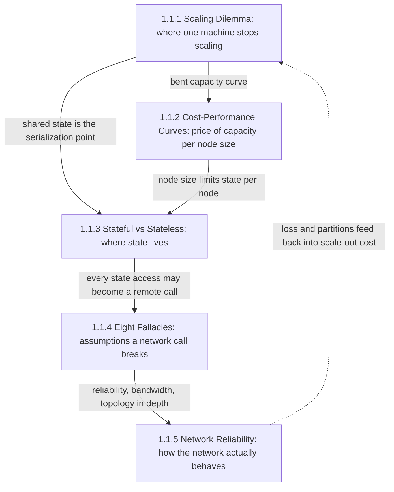
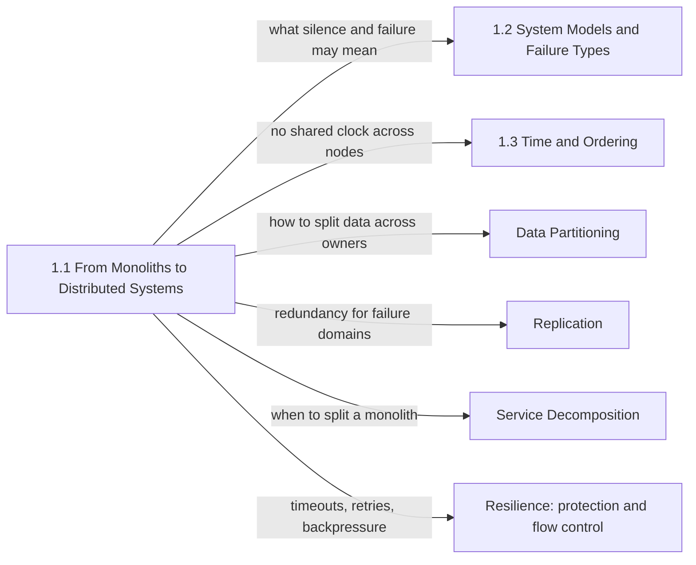

Tek bir makine, bir programa kimsenin tasarlamasına gerek kalmayan bir dizi garanti verir: her thread'in gördüğü tek bir bellek, ya çalışan ya da process'i kendisiyle birlikte çökerten bir çağrı, nanosaniyeler süren koordinasyon ve tam olduğu için apaçık görünen bir hata. Bu bölüm, bir sistemin o makineye sığmadığı ya da onun kaybına dayanması gerektiği anı ve iş ile veri bir ağla birbirine bağlı birden çok makineye yayıldığında değişen her şeyi konu alır. Tek bir soruyu beş farklı açıdan yanıtlar: tek makineden ayrılmak ne zaman doğru adımdır ve sistem bunu yaptığında neyi miras alır?

Bölümdeki her konudan geçen gerilim, kapasite ile koordinasyon arasındadır. Daha fazla makine; throughput'un, depolamanın ve servisin atlatabileceği hata sayısının tavanını yükseltir. Ama aynı zamanda koordinasyonu cache-coherence donanımından alıp paketleri kaybeden, geciktiren ve yeniden sıralayan bir ağ üzerinde çalışan yazılım protokollerine taşır; tam hatanın yerine de kısmi hatayı (partial failure) koyar: bir bileşen yavaş ya da erişilemezken geri kalanlar çalışmaya ve karar vermeye devam eder. Varsayılan bir kazanan yoktur. Büyük bir makinedeki monolit, pek çok iş yükü için yıllarca doğru cevaptır; ihtiyaç doğmadan benimsenen dağıtık bir tasarım ise koordinasyon vergisini trafiğin en düşük, iterasyon hızının en kritik olduğu dönemde öder.

Bu nedenle bölüm dağıtıklığı savunmaz. Karar için gereken ölçümleri ve zihinsel modeli verir, kararla birlikte gelen maliyetleri adlandırır; böylece replikasyon, consensus, mesajlaşma ve dayanıklılık üzerine sonraki bölümler, okuyucunun bu mekanizmaların neden var olduğunu bildiğini varsayabilir.

## Beş Konu Birbirinin Üzerine Nasıl İnşa Edilir

Konular iki yarıya ayrılır. İlk üçü kararın kendisiyle ilgilidir: tek bir makinenin ölçeklenmeyi nerede bıraktığı, kapasitenin her düğüm boyutunda neye mal olduğu ve birden fazla düğüm olduğunda state'in nerede yaşayabileceği. Son ikisi ise kararın sistemi bağladığı ortamla ilgilidir: mühendislerin yerel çağrılardan taşıdığı varsayımlar ve bu varsayımları bozan ağın fiziksel davranışı.

*Bölümdeki konular arasındaki bağımlılıklar. Düz oklar, hangi sayfanın bir sonrakinin üzerine kurduğu sonucu sağladığını gösterir; kesikli ok döngüyü ölçekleme kararına geri bağlar.*

Ölçekleme ikilemi ilk sıradadır, çünkü diğer tüm sayfaların kullandığı kavramları tanımlar: seri iş, coherence maliyeti, partition'lar arası iş ve ortak kader (shared fate). Maliyet-performans eğrileri, bu sayfanın temel sonucunu, yani kapasitenin makine boyutuyla doğrusal olmayan biçimde büyüdüğünü alır ve doğrusal bir fiyatı buna bölerek bir iş biriminin en ucuz olduğu noktayı bulur. İki sayfa da state'te buluşur: ölçekleme sayfası, yatayda büyütülmüş bir katmanın çoğu zaman serileşme noktasını yalnızca tek bir paylaşılan veritabanına taşıdığını; maliyet sayfası ise düğüm boyutunun tek bir sahibin tutabileceği state miktarını sınırladığını gösterir. Stateful ve stateless sayfasının üçüncü sırada olmasının nedeni budur.

State başka bir makinede yaşamaya başladığı anda ona yapılan her erişim bir ağ çağrısı olur; dördüncü sayfa, yerel bir çağrının garanti ettiği ve ağ çağrısının sessizce geri aldığı sekiz şeyi sıralar. Beşinci sayfa, fiziksel kökleri en derin olan üç yanılgıyı, yani güvenilirlik, bant genişliği ve topolojiyi paketlere, TCP zamanlayıcılarına ve yönlendirmeye kadar indirir. Kesikli ok pratikte önemlidir: kayıp, retransmission timeout'ları ve kısmi partition'lar yatay ölçeklemenin gerçek maliyetinin bir parçasıdır; bölümü bitiren okuyucu ölçekleme kararını bu maliyetleri hesaba katarak yeniden değerlendirmelidir.

## Her Konunun Yanıtladığı Soru

[Ölçekleme İkilemi: Dikey ve Yatay Ölçekleme](/distributed-systems/tr/foundations/monoliths-to-distributed/scaling-dilemma/), daha büyük bir makinenin neden bir noktadan sonra karşılığını vermediğini, daha fazla makinenin de neden aynı şekilde tıkandığını ve belirli bir iş yükünün önce hangi sınıra ulaşacağının nasıl ölçüleceğini yanıtlar. Sürekli birbirine karıştırılan iki satın almayı, kapasiteyi ve hata toleransını birbirinden ayırır. Shard'lama, replika ekleme ya da daha büyük bir instance alma kararından önce açılması gereken sayfadır.

[Maliyet-Performans Eğrileri ve Donanım Sınırları](/distributed-systems/tr/foundations/monoliths-to-distributed/cost-performance-curves/), hangi düğüm boyutunun bir birim faydalı işi en düşük maliyetle sağladığını yanıtlar; bu maliyet en yüksek benchmark throughput'unda değil, gecikme hedefinde ölçülür. Birim maliyetin boyut aralığının iki ucunda neden yükseldiğini, bir sunucunun içindeki hangi fiziksel kaynakların çekirdek sayısıyla birlikte büyümeyi bıraktığını ve redundancy ile tam düğüme yuvarlamanın gerçek bir filo için cevabı nasıl değiştirdiğini açıklar.

[Stateful ve Stateless Servisler: Hangisini Ne Zaman Kullanmalı](/distributed-systems/tr/foundations/monoliths-to-distributed/stateful-vs-stateless/), bir servisin verisinin her parçasının nerede yaşaması gerektiğini yanıtlar: iş mantığını çalıştıran process'in içinde mi, yoksa o process'in çağırdığı ayrı bir sistemde mi. Bu seçim, instance'ların birbirinin yerine geçebilmesi ile veri yerelliği arasında bir takastır ve her deploy'un, her autoscaling olayının ve her çöküşün ne kadar zor olacağını belirler. Yeni bir servis tasarlarken açın; "stateless" bir katman stateless değilmiş gibi davranmaya başladığında yeniden açın.

[Dağıtık Hesaplamanın 8 Yanılgısı](/distributed-systems/tr/foundations/monoliths-to-distributed/eight-fallacies/), mühendislerin yerel çağrılardan uzak çağrılara hangi varsayımları taşıdığını, bu varsayımların koda inanç yoluyla değil varsayılan değerler ve soyutlamalar yoluyla nasıl girdiğini ve her düzeltmenin neye mal olduğunu yanıtlar. Temel fikri, yani uzak bir çağrının başarı ve hatanın yanında üçüncü bir sonucu olduğu, kitabın ilerleyen bölümlerindeki timeout'ların, retry'ların ve idempotency'nin köküdür.

[Ağ Güvenilirliği, Bant Genişliği Sınırları ve Topoloji Değişiklikleri](/distributed-systems/tr/foundations/monoliths-to-distributed/network-reliability/), güvenilmez bir paket ağının uygulamanın gördüğü güvenilir görünümlü bağlantıya nasıl dönüştüğünü ve bu dönüşümün bedelini yanıtlar: tail latency'ye dönüşen kayıp, tek bir akışı nominal link hızının altında bağlayan kapasite sınırları ve takılma ile reset olarak yüzeye çıkan yol değişiklikleri. Belirtileri gecikme sıçramaları, duran transferler ya da yalnızca bazı host çiftleriyle sınırlı hatalar olan bir incident sırasında açılacak sayfadır.

| Konu | Yanıtladığı soru | Ne zaman açılmalı |
|---|---|---|
| [Ölçekleme İkilemi](/distributed-systems/tr/foundations/monoliths-to-distributed/scaling-dilemma/) | Bu iş yükü önce hangi sınıra takılır, tek makinede mi, çok makinede mi? | Daha büyük instance, daha fazla replika ya da sharding arasında karar verirken |
| [Maliyet-Performans Eğrileri](/distributed-systems/tr/foundations/monoliths-to-distributed/cost-performance-curves/) | Gecikme hedefinde iş birimi başına en düşük maliyeti hangi düğüm boyutu verir? | Bir filoyu boyutlandırırken, instance ailesi değiştirirken ya da bir maliyet sıçramasını açıklarken |
| [Stateful ve Stateless](/distributed-systems/tr/foundations/monoliths-to-distributed/stateful-vs-stateless/) | Bu veri process'in içinde mi, çağırdığı bir store'da mı yaşamalı? | Bir servis tasarlarken, sticky session eklerken ya da deploy sırasında çıkan hataları ayıklarken |
| [8 Yanılgı](/distributed-systems/tr/foundations/monoliths-to-distributed/eight-fallacies/) | Bu uzak çağrı, yerel çağrının hangi garantisini sessizce kaybediyor? | Bir tasarımı gözden geçirirken, bir modülü servise ayırırken ya da client varsayılanlarını denetlerken |
| [Ağ Güvenilirliği](/distributed-systems/tr/foundations/monoliths-to-distributed/network-reliability/) | Kayıp, bir bant genişliği sınırı ya da yol değişikliği uygulamaya nasıl ulaşır? | Tail latency'yi, yavaş toplu transferleri, reset'leri ya da kısmi partition'ları teşhis ederken |

## Okuma Sırası ve Gerekçesi

İlk okumada bölümü sidebar sırasıyla okuyun. Her sayfa kendinden öncekilerin sonuçlarını varsayar ve onları yeniden türetmek yerine geriye link verir: maliyet sayfası, ölçekleme sayfasındaki çekişme ve coherence yasalarını tekrarlamadan kullanır; state sayfası, stateless bir katmanın yine de paylaşılan state'te buluştuğu gözlemine dayanır; ağ sayfası ise okuyucunun yanılgıları zaten kabul ettiğini ve altındaki mekanizmaları öğrenmek istediğini varsayar. Sırasız okumak da işe yarar, ancak maliyet eğrileriyle başlayan bir okuyucu doğrusal olmayan ölçeklemeyi nereden geldiğini anlamadan hazır bir veri olarak karşılar.

İki kısa yol makuldür. Bir monoliti servislere bölmek üzere olan bir mühendis önce ölçekleme sayfasını, sonra yanılgıları, ardından state sayfasını okuyabilir; çünkü ayrıştırmanın en yaygın hatası, process içi çağrıları kaybettikleri garantileri yeniden düşünmeden uzak çağrılara dönüştürmektir. Maliyet ve ağ sayfaları, ortaya çıkan sistemi boyutlandırma ve işletme aşamasında takip edebilir. Ağ kaynaklı görünen bir incident'ın ortasındaki bir mühendis ise doğrudan ağ sayfasına ve oradaki hata modlarına gitmeli, ardından incident'ın yayılmasına koddaki hangi varsayımın izin verdiğini bulmak için yanılgılara dönmelidir.

## Bölümün El Kitabındaki Yeri

Bölümün bilgisayar bilimi temelleri dışında bir önkoşulu yoktur: process'lerin, thread'lerin ve belleğin nasıl çalıştığı, TCP'nin ne sağladığı ve temel olasılık. [Temeller & Fiziğin Yasaları](/distributed-systems/tr/foundations/) bölümünün giriş noktasıdır; sonrasındaki her şey, dağıtık bir sistemi makine sayısının değil kısmi hatanın ve koordinasyon maliyetinin tanımladığı sonucunu miras alır.

*Bölümün sonuçlarının daha sonra nerede ele alındığı. Her ok, bu bölümün hedef bölüme bıraktığı açık soruyu adlandırır.*

Diyagram, bilinçli olarak bırakılmış boşlukların bir listesi gibi okunur. Ağ sayfası, sessiz bir eşin yavaş bir eşten ayırt edilemeyeceğini gösterir; bir düğümün bu sessizlikten ne sonuç çıkarabileceği [Sistem Modelleri ve Hata Türleri](/distributed-systems/tr/foundations/system-models/) bölümünde, [Ağ Modelleri](/distributed-systems/tr/foundations/system-models/network-models/) ve [Hata Modelleri](/distributed-systems/tr/foundations/system-models/failure-models/) sayfalarıyla başlayarak formelleştirilir. Birden fazla makine olduğu anda birden fazla saat de vardır; bu da [Zaman ve Sıralama](/distributed-systems/tr/foundations/time-and-ordering/) bölümünün konusudur. Ölçekleme sayfası partition key'leri ve replikaları nasıl çalıştıklarını açıklamadan savunur; bu açıklama [Veri Bölümleme / Sharding](/distributed-systems/tr/data-management/data-partitioning/) ve [Replikasyon Stratejileri](/distributed-systems/tr/data-management/replication/) bölümlerine aittir.

Dağıtık bir mimariye geçip geçmemeye karar veren ekipler için iki devam konusu öne çıkar. [Servis Ayrıştırma Stratejileri](/distributed-systems/tr/microservice-patterns/service-decomposition/), servis sınırlarının nereye çekilmesi gerektiğini ele alır; buna, partition'lama seçeneğini erkenden bedel ödemeden açık tutan [modüler monolit](/distributed-systems/tr/microservice-patterns/service-decomposition/modular-monolith/) ve bu bölümdeki her maliyeti ödeyip faydaların hiçbirini elde etmeyen [dağıtık monolit](/distributed-systems/tr/microservice-patterns/service-decomposition/distributed-monolith/) dahildir. Yanılgılar sayfasının adlandırdığı düzeltmeler, yani deadline'lar, sınırlandırılmış retry'lar ve admission control, [Koruma Desenleri](/distributed-systems/tr/resilience/protection-patterns/) ve [Akış Kontrolü ve Aşırı Yük Yönetimi](/distributed-systems/tr/resilience/flow-control/) bölümlerinde inşa edilir; [Retry Fırtınaları ve Metastabil Hatalar](/distributed-systems/tr/resilience/flow-control/retry-storms-metastable-failures/) da burada tanıtılan kısmi hataların nasıl kesintilere dönüştüğünü gösterir.
