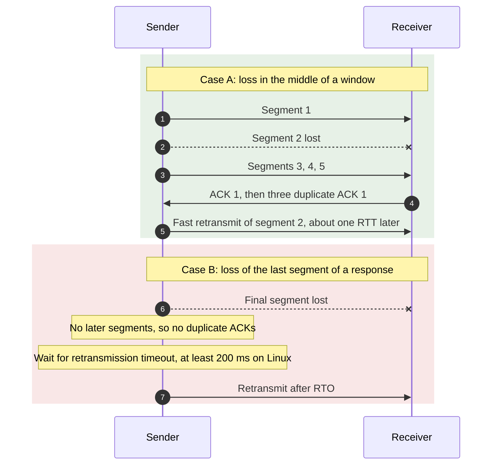
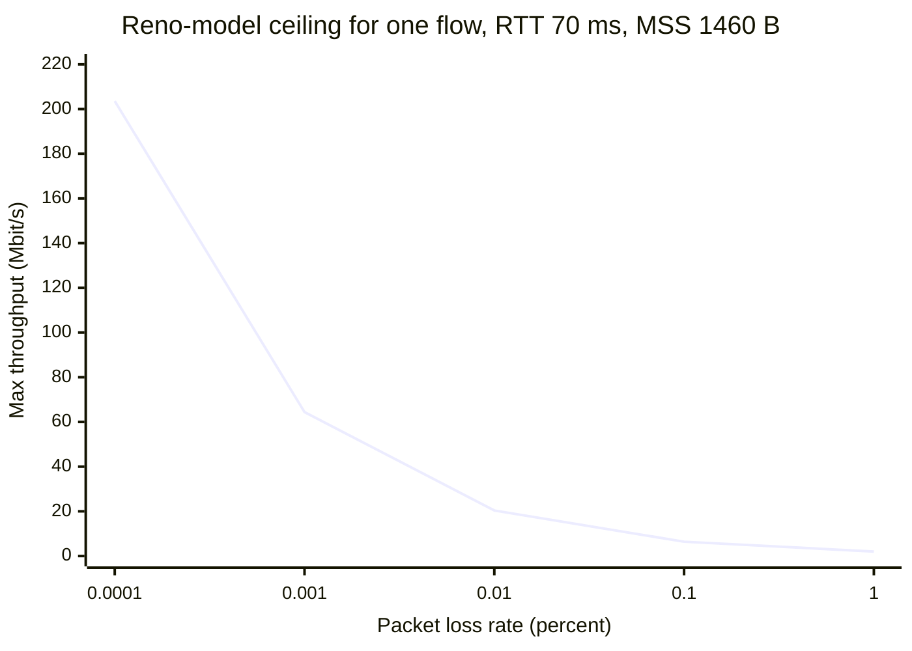
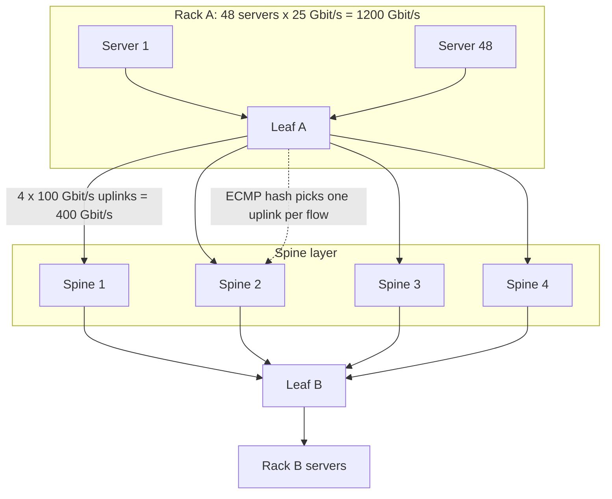
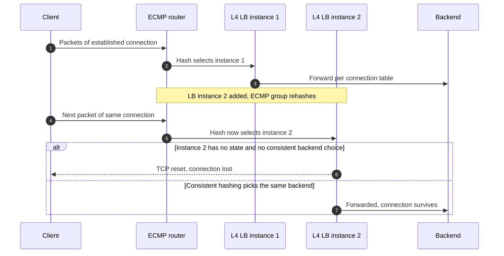
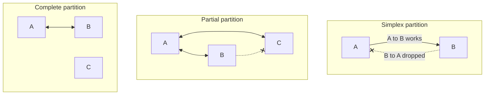
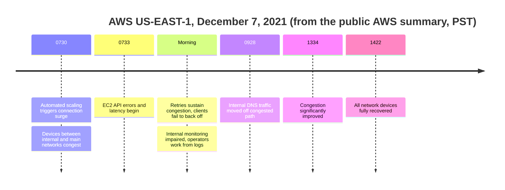

Bir veri merkezi ya da geniş alan ağı, link'lerle birbirine bağlanmış paylaşımlı kuyruklardan oluşur ve iki host arasındaki yolu her an değiştirebilen routing yazılımı tarafından yönetilir. Hiçbir teslimat garantisi vermez: bir IP paketi düşürülebilir, gecikebilir, sırası bozulabilir, çoğalabilir ya da bozulabilir ve ağ, göndericiye bunlardan hangisinin olduğunu söylemez. Uygulamanın "güvenilir bağlantı" olarak deneyimlediği her şey, bunun üzerine TCP (Transmission Control Protocol) ya da QUIC tarafından inşa edilir ve bu protokoller güvenilmezliği ortadan kaldırmaz. Onu başka bir şeye dönüştürürler: kaybolan paketler gecikmeye, yetersiz kapasite düşük throughput'a, ortadan kaybolan bir yol ise asılı kalan ya da reset edilen bir bağlantıya dönüşür.

Bu dönüşüm, sayfanın asıl dengesidir. Veri karşı tarafa ulaşana kadar yeniden gönderen bir transport protokolü doğruluğu, yani byte'ların sırayla gelmesini ya da bağlantının kopmasını satın alır; bedelini zamanlılıkla öder. Üstelik kurtarma zamanlayıcıları, bir round trip'in milisaniyenin kesri kadar sürdüğü veri merkezine göre değil internete göre ayarlanmıştır. Ağın kendisi de ikinci bir takas yapar: yedekli yollar (çok sayıda eşit maliyetli link, arızaların etrafından dolaşan routing) kapasite ve hata toleransı satın alır; karşılığında yollar haber vermeden değişir. Bu da yol üzerindeki herhangi bir bileşen bağlantı başına state tuttuğu anda önem kazanır.

Mühendislerin bu mekanizmaları görmezden gelmesine yol açan varsayımlar [Dağıtık Hesaplamanın 8 Yanılgısı](/distributed-systems/tr/foundations/monoliths-to-distributed/eight-fallacies/) sayfasının, instance başına sağlayıcı kotaları [Maliyet-Performans Eğrileri ve Donanım Sınırları](/distributed-systems/tr/foundations/monoliths-to-distributed/cost-performance-curves/) sayfasının, güvenilmez bir ağın biçimsel modelleri ise [Ağ Modelleri](/distributed-systems/tr/foundations/system-models/network-models/) sayfasının konusudur.

## Paket Kaybı: Nereden Gelir ve TCP Onu Nasıl Gecikmeye Dönüştürür

Paketler, farklı izler bırakan dört nedenle kaybolur. Congestion (tıkanıklık) kaybı, paketler link'in boşaltabileceğinden hızlı geldiği için bir switch port'unun buffer'ı dolduğunda olur; TCP'nin kullanılabilir hızı bulmak için kullandığı sinyal budur ve yükle ilişkilidir. Bozulma kaybı, arızalı bir optik modül, kablo ya da line card bitleri çevirdiğinde ve alıcı frame'i attığında olur; yükten bağımsızdır ve tek bir arayüzün CRC (cyclic redundancy check) hata sayaçlarında görünür. Politika kaybı, bir cihazın paketi iletmemeye karar vermesidir: bir firewall kuralı, dolmuş bir connection-tracking tablosu, bir sağlayıcı kotası. Arıza kaybı ise bir link ya da cihazın ölmesiyle routing'in trafiği ondan uzaklaştırması arasındaki pencerede yaşanır.

TCP, uygulamanın göndericinin yazdığı byte'ları sırayla okumasını ya da bağlantının sonunda bir hata bildirmesini garanti eder. Byte'ların ne zaman geleceğini, uzak kernel'ın onayladığı bir byte'ın uzak uygulama tarafından işlendiğini ya da kopmuş bir bağlantının hızla fark edileceğini garanti etmez. Alıcı, kesintisiz olarak aldığı en yüksek byte'ı onaylar; dolayısıyla bir boşluk göndericide ilerlemeyi bırakan acknowledgment'lar olarak görünür ve gönderici, maliyetleri arasında büyüklük mertebeleri fark olan iki yoldan biriyle kurtarma yapar.


*TCP'nin kaybolan bir segment'i kurtarmasının iki yolu. Fast retransmit yaklaşık bir round trip'e mal olur; retransmission timeout ise veri merkezi içinde yüzlerce round trip'e.*

A durumunda, kaybolan segment'ten sonrakiler gelmeye devam eder ve her biri son kesintisiz byte için tekrarlanan (duplicate) bir acknowledgment üretir (adım 4). Üç tekrar, göndericiye bir segment'in eksik olduğunu ama sonrakilerin ulaştığını söyler; gönderici hemen yeniden gönderir (adım 5) ve seçici onaylar (SACK) birkaç boşluğun tek round trip'te onarılmasını sağlar. Maliyet kabaca bir RTT'dir (round-trip time). B durumunda sonraki segment yoktur, dolayısıyla tekrarlanan onay da gelmez ve gönderici retransmission timeout'unu (RTO) beklemek zorundadır. RFC 6298, RTO'yu yumuşatılmış RTT'ye ortalama sapmanın dört katını ekleyerek hesaplar ama değeri sınırlar: Linux 200 ms'lik bir taban ve henüz RTT ölçülmemişken 1 saniyelik bir başlangıç değeri kullanır. RTT'nin 100 ila 500 mikrosaniye olduğu bir veri merkezinde tek bir RTO, birkaç yüz ila birkaç bin round trip'e bedeldir. Linux'un tail loss probe'u, yani yaklaşık iki RTT sonra gönderilen spekülatif bir yeniden gönderim, B durumundaki kayıpların bir kısmını kurtarır; ancak probe da kaybolursa yine taban değer belirleyici olur.

Bağlantı kurulumu daha da kötüdür. Kaybolan bir SYN'in (handshake'in ilk paketi) RTT tahmini yoktur; bu yüzden 1 saniye sonra, ardından üstel geri çekilmeyle yeniden gönderilir. Linux'un varsayılan `tcp_syn_retries` değeri olan 6 ile deneme yaklaşık 127 saniye sonra başarısız olur. Her istek için bağlantı açan ve %1 SYN kaybıyla karşılaşan bir client, isteklerinin %1'ine en az bir saniye ekler.

### Hesaplamalı Örnek: Fan-Out Yapan Bir Serviste %0,1 Kayıp

Tek bir veri merkezi içinde, medyan RTT'si 0,2 ms olan ve yanıtları yaklaşık on pakete sığan bir servis varsayalım; bozulmuş bir yol üzerinde de, ortalama gösteren dashboard'larda genellikle görünmeyen %0,1'lik bir paket kaybı olsun. Tüm sayılar örnek amaçlıdır.

On paketlik bir alışverişin en az bir paket kaybetme olasılığı `1 - 0.999^10`, yaklaşık %1,0'dır. Bu kayıpların yarısının bir burst'ün son segment'ine denk geldiğini ve en az 200 ms'lik bir RTO'ya mal olduğunu varsayalım. Bu durumda çağrıların yaklaşık %0,5'i yaklaşık 1 ms yerine 200 ms ya da daha uzun sürer: medyan kıpırdamaz, ortalama yaklaşık 1 ms artar, p99,5 ise iki büyüklük mertebesi sıçrar.

Şimdi bu servisi, 50 böyle çağrıyı paralel yapan ve hepsini bekleyen bir isteğin arkasına koyalım. 50 çağrıdan en az birinin RTO'ya düşme olasılığı `1 - 0.995^50`, yaklaşık %22'dir. Kullanıcı isteklerinin beşte birinden fazlası artık en az 200 ms sürer ve bunun tek nedeni binde birlik bir paket kaybıdır. [Ölçekleme İkilemi](/distributed-systems/tr/foundations/monoliths-to-distributed/scaling-dilemma/) sayfasında anlatılan tail amplifikasyonunun ağ seviyesindeki mekanizması budur; %0,1 kaybın veri merkezinde arka plan gürültüsü değil bir incident sayılmasının nedeni de budur.

### Kayıp Yalnızca Gecikmeyi Değil, Throughput'u da Sınırlar

Kayıp, tek bir bağlantının ne kadar hızlı gidebileceğini de sınırlar. Reno'yu ve değiştirilmiş biçimde CUBIC'i (Linux varsayılanı) içeren kayıp tabanlı congestion control ailesi, her kayıpta gönderim penceresini yarıya indirir ya da küçültür, sonrasında yavaşça büyütür. Mathis, Semke, Mahdavi ve Ott, Reno tarzı kontrol için ortaya çıkan tavanı türetmiştir: throughput en fazla yaklaşık `(MSS / RTT) * (1.22 / sqrt(p))` olur; burada MSS maksimum segment boyutu, `p` ise kayıp olasılığıdır. MSS'i 1.460 byte ve RTT'si 70 ms olan bölgeler arası bir flow için `MSS / RTT` yaklaşık 167 kbit/s'dir; dolayısıyla %0,01'lik bir kayıp oranı (`sqrt(p) = 0.01`), link 10 ya da 100 Gbit/s olsun, flow'u yaklaşık 20 Mbit/s ile sınırlar.


*Mathis formülünden elde edilen throughput tavanı. Kayıptaki her on katlık artış tavanı yaklaşık 3,2'ye böler.*

Eğri, temiz bir yolda yüzlerce Mbit/s ile akan uzun mesafeli bir replikasyon akışının, hiçbir erişilebilirlik alarmının yakalamadığı düşük seviyeli bir kayıp sırasında neden tek haneli değerlere düştüğünü açıklar. Model bir yaklaşıklıktır: CUBIC yüksek bant genişlikli, yüksek RTT'li yollarda Reno'dan hızlı toparlanır; Google'ın geliştirdiği model tabanlı algoritma BBR (Bottleneck Bandwidth and Round-trip propagation time) ise tekil kaybı congestion sinyali saymaz ve çok daha az bozulur. Nitel ders yine geçerlidir: kayıp tabanlı kontrolde mesafe üzerindeki throughput'u link hızı değil, kayıp oranı ve RTT belirler.

## Bant Genişliği: Bir Flow'u Gerçekte Hangi Sınır Bağlar

Tek bir aktarım en az beş bağımsız sınırdan geçer ve bağlayıcı olan, nadiren ağ arayüz kartının (NIC) nominal hızıdır.

Birincisi penceredir. TCP aynı anda en fazla bir pencere kadar onaylanmamış veriyi yolda tutabilir; dolayısıyla bir flow'un throughput'u `window / RTT` değerini aşamaz. Bir yolu doldurmak için pencerenin en az bant genişliği-gecikme çarpımı (bandwidth-delay product, BDP), yani `rate * RTT` kadar olması gerekir. 70 ms RTT'li 10 Gbit/s'lik bir yolun BDP'si 87,5 MB'tır. Linux, receive buffer'ı `net.ipv4.tcp_rmem` içindeki maksimuma kadar otomatik ayarlar ve bu maksimum yıllarca varsayılan olarak 6 MB'tı; 70 ms üzerinden 6 MB'lık bir pencere, hiç kayıp olmadan bile en fazla yaklaşık 720 Mbit/s, yani link'in onda birinden azını verir. 2025'teki bir kernel değişikliği varsayılan maksimumu 32 MB'a çıkardı; bu da aynı yolda yaklaşık 3,8 Gbit/s'ye izin verir. Yani tavan, filonun gerçekte çalıştırdığı kernel sürümüne bağlıdır. Veri merkezi içinde BDP yaklaşık 250 KB'tır (10 Gbit/s çarpı 0,2 ms) ve pencere nadiren bağlayıcıdır; bölgeler arasında ise ilk bağlayan odur.

İkincisi flow başına yoldur. Veri merkezi fabric'leri, trafiği ECMP (equal-cost multi-path) routing ile çok sayıda eşit maliyetli link'e dağıtır: her switch, birkaç next hop'tan birini seçmek için paketin 5-tuple'ını (kaynak ve hedef adres ve port'u ile protokol) hash'ler. Hash'leme, sıra bozulmasını önlemek için her flow'u tek bir yolda tutar; bu yüzden tek bir flow asla tek bir üye link'i aşamaz ve çakışan iki büyük flow, yanındaki link boşta dururken aynı link'i paylaşır. Bulut sağlayıcıları bunun üzerine kendi flow başına sınırlarını ekler; bunlar [Maliyet-Performans Eğrileri ve Donanım Sınırları](/distributed-systems/tr/foundations/monoliths-to-distributed/cost-performance-curves/) sayfasında anlatılır.

Üçüncüsü oversubscription'dır (aşırı abonelik). Leaf-spine fabric'te sunucular bir top-of-rack (leaf) switch'e, leaf'ler de spine'lara bağlanır. Sunucuya bakan kapasitesi spine'a bakan kapasitesinden fazla olan bir leaf oversubscribed'dır: rack içindeki trafik tam hızda akar, rack'ten çıkan trafik ise uplink'leri paylaşır.


*3:1 oversubscription'lı örnek bir leaf. Rack'ten çıkan her flow, ECMP hash'i tarafından tek bir uplink'e sabitlenir.*

400 Gbit/s'lik uplink'lerin arkasında 1.200 Gbit/s'lik sunucu kapasitesi olduğunda, rack aynı anda kapasitesinin yalnızca üçte birini rack dışına gönderebilir. Trafik yerel ya da kesik kesik olduğu sürece bu zararsızdır; her sunucuyu rack dışına göndermeye zorlayan bir shuffle, backfill ya da replica yeniden inşası ise uplink'leri dolu bulur. Dolayısıyla yerleşim, etkin bant genişliğini değiştirir: aynı rack'teki replica'lar tam hızda senkronize olur ama aynı kaderi paylaşır; farklı rack'lerdeki replica'lar daha güvenli ama daha yavaştır.

Dördüncüsü alıcının port'udur. Bir client'ın onlarca sunucuya istek gönderdiği ve hepsinin aynı anda yanıt verdiği çoktan bire trafik, yanıtları tek bir switch port'unda toplar. Bu, Vasudevan ve arkadaşlarının 2009'da analiz ettiği TCP incast'tir: senkronize burst sığ bir switch buffer'ını taşırır, birkaç flow son segment'lerini birlikte kaybeder ve her biri link boşta dururken 200 ms'lik bir RTO bekler; böylece ortalama kullanım düşük olmasına rağmen goodput çöker. Derin buffer'lar ise tersi yönde başarısız olur: aşırı yüklenen bir link hiçbir şey düşürmez ve kalıcı bir kuyruk biriktirir (bufferbloat); doygunluğun önce gecikme olarak görünmesinin nedeni budur. Beşinci sınır, yol üzerindeki herhangi bir middlebox'tır: load balancer'lar, NAT (network address translation) gateway'leri ve firewall'lar saniyedeki paket sayısını ve izlenen bağlantı sayısını sınırlar.

| Sınır | Belirleyen | Bağladığında belirti | Tespit | Çözüm |
|---|---|---|---|---|
| Pencere / BDP | Socket buffer maksimumu, RTT | Uzak mesafeli tek flow link hızının çok altında, kayıp yok | `ss -ti` pencereyi buffer maksimumuna yakın, cwnd'yi sabit gösterir | Buffer maksimumlarını artırmak, paralel akışlar |
| ECMP üye link'i | 5-tuple hash'i | Aynı host'lar arasında bazı flow'lar yavaş, bazıları hızlı | Dengesiz uplink kullanımı, flow başına throughput farkı | Daha fazla flow, destekleniyorsa flowlet ya da packet spraying |
| Sağlayıcı flow başı sınırı | Bulut kotası | Flow sabit bir hızda düzleşir | Sağlayıcı sayaçları, düz throughput çizgisi | Birden fazla flow, placement group'lar |
| Oversubscription | Leaf uplink oranı | Çok sayıda host rack dışına gönderdiğinde throughput düşer | Leaf switch'lerde uplink kullanımı ve discard'lar | Rack'e duyarlı yerleşim, toplu işlerin zamanlanması |
| Incast | Fan-in, sığ buffer'lar | Düşük ortalama kullanımla goodput çöküşü | Tek alıcıda kümelenen retransmission timeout'ları | Fan-in'i sınırlamak, DCTCP ile ECN, jitter'lı yanıtlar |
| Middlebox kapasitesi | Cihazın PPS ve state sınırları | Yeni bağlantılar başarısız, eskiler çalışıyor | Conntrack sayıları, cihaz drop sayaçları | Daha az bağlantı, stateless yollar |

:::tip[Yeni bağlantıdaki retry yeni bir yol izler]
ECMP 5-tuple'ı hash'lediği için yeni bir bağlantı yeni bir kaynak port'u ve genellikle fabric üzerinden yeni bir yol alır. Bozulmuş bir link'e hash'lenmiş bir bağlantıda timeout'a düşen istek, yeni bir bağlantıda yeniden denendiğinde çoğu zaman hemen başarılı olur, aynı bağlantıda denendiğinde ise yine başarısız olur. Retry için havuzdaki bağlantıyı yeniden kullanan client'lar aynı bozuk link'e çarpmaya devam edebilir; retry için yeni bağlantı açan client'lar ise farkında olmadan onun etrafından dolaşır.
:::

## Topoloji Değişiklikleri: Yol Değişikliği Uygulamaya Nasıl Ulaşır

Topoloji; yükseltmeler, drain'ler, scale-out, arızalar ve route geri çekmeleriyle sürekli değişir. Bunu routing protokolleri yönetir: bir router arızayı carrier kaybı, Bidirectional Forwarding Detection (BFD) probe'ları ya da süresi dolan protokol hold timer'ları yoluyla tespit eder, etkilenen route'ları geri çeker ve her router next hop'larını yeniden hesaplar. Yeniden yakınsama tamamlanana kadar arızalı elemana giden paketler düşürülür; router'lar kısa bir süre anlaşmazlık içindeyken paketler döngüye de girebilir. Carrier kaybı milisaniyeler içinde tespit edilir; yalnızca protokol zamanlayıcılarının yakalayabildiği sessiz bir arıza ise saniyeler, varsayılan BGP (Border Gateway Protocol) hold timer'larıyla onlarca saniye sürebilir. Veri merkezi fabric'lerinde saniye altı aralıklarla BFD kullanılmasının yaygın olmasının nedeni budur.

Stateless router'lar üzerinden geçen bir bağlantı için yeniden yönlendirme büyük ölçüde zararsızdır: yoldaki paketler kaybolabilir ya da sırası bozulabilir, TCP onları yeniden gönderir ve bağlantı en kötü ihtimalle bir RTO bedeliyle yeni yolda devam eder. Üye kazanan ya da kaybeden bir ECMP grubu flow'ları yeniden hash'ler ve resilient hashing kullanılmıyorsa modulo hash, değişen link'te hiç bulunmamış birçok flow'u da taşır. Bu routing için zararsızdır, ama state tutan her şey için değildir.

Topoloji değişiklikleri uygulamaya, yol üzerindeki bağlantı başına state aracılığıyla görünür hâle gelir. Bir NAT gateway'i, stateful bir firewall ve layer-4 bir load balancer, her bağlantıyı bir çeviriye, bir karara ya da seçilmiş bir backend'e eşleyen bir tablo tutar. Bir yeniden yönlendirme ya da yeniden hash'leme, kurulu bir bağlantının paketlerini o kaydı tutmayan farklı bir instance'a gönderirse, yeni instance'ın bağlantıdan haberi yoktur ve paketleri ya düşürür ya da bir reset ile yanıtlar.


*Stateful bir layer-4 load balancer'ın scale-out'u. Mevcut bağlantıların hayatta kalıp kalmaması, yeni instance'ın eski instance'ın seçimini yeniden üretip üretemeyeceğine bağlıdır.*

Adım 3 ile 4 arasında topoloji bu bağlantıyla ilgisi olmayan bir nedenle değişir ve adım 5'te bağlantının paketleri handshake'i hiç görmemiş bir instance'a ulaşır. `alt` dalı tasarım kararıdır: Google'ın Maglev'i gibi bunun için tasarlanmış load balancer'lar backend'i 5-tuple'ın consistent hash'iyle seçer; böylece bağlantıların çoğu için her instance aynı seçimi yapar, geri kalanlar için bağlantı state'i paylaşılır ya da replike edilir. Genel teknik [Consistent Hashing](/distributed-systems/tr/data-management/data-partitioning/consistent-hashing/) sayfasında, katman ayrımı ise [L4 ve L7 Yük Dengeleme](/distributed-systems/tr/communication/load-balancing/l4-vs-l7/) sayfasında ele alınır. Uygulamalar bu olayları, kendi deploy'larıyla değil altyapı değişiklikleriyle çakışan `connection reset by peer` patlamaları olarak görür.

İkinci kanal, bir uç noktanın adres değiştirmesidir. TCP bir bağlantıyı 4-tuple'ıyla tanımlar; dolayısıyla her adres değişikliği bağlantıyı sonlandırır. QUIC ise connection ID'leri kullanır ve bir bağlantıyı yeni bir client adresine taşıyabilir; bu [HTTP/2 ve HTTP/3](/distributed-systems/tr/communication/synchronous-protocols/http2-http3-quic/) sayfasında anlatılır. Mantıksal topoloji, yani bir ismin arkasında hangi instance'ların durduğu, discovery ve DNS üzerinden değişir; bu da [DNS Tabanlı Keşif](/distributed-systems/tr/microservice-patterns/service-discovery/dns-based-discovery/) sayfasının konusudur.

### Partition'lar Kısmi, Asimetrik ve Gridir

Ders kitabındaki partition'lar düğümleri birbirine ulaşamayan iki gruba ayırır. Gerçek partition'lar genellikle daha dağınıktır.


*Üç partition biçimi. Kısmi durumda A herkese ulaşabilir, B ile C ise birbirine ulaşamaz; simplex durumda trafik yalnızca tek yönde akar.*

Kısmi bir partition'da bazı düğüm çiftleri iletişim kurabilir, bazıları kuramaz; dolayısıyla "benim grubumda kim var" sorusunun tutarlı bir yanıtı yoktur. Herkese ulaşabilen bir düğüm (diyagramdaki A) sağlıklı bir cluster görür, B ve C ise birbirinin öldüğüne inanır. B leader ise C bir seçim başlatıp A'nın oyuyla kazanabilir, A'ya hâlâ ulaşabilen B de buna itiraz edebilir; leader'lık sonsuza kadar el değiştirebilir ya da iki düğüm farklı client'lara karşı aynı anda leader gibi davranabilir. Simplex bir partition'da mesajlar yalnızca tek yönde akar: heartbeat almaya devam eden ama yanıtları düşürülen bir düğüm, kendisini sağlıklı sanırken eşleri tarafından ölü kabul edilir. Tek yönlü bir ACL (access control list) ya da arızalanan bir transceiver böyle bir partition üretebilir.

Bu biçimler egzotik değildir. Alquraan ve arkadaşları, yaygın kullanılan 25 dağıtık sistemde ağ partition'larına atfedilen 136 hatayı incelemiş ve çoğunluğunun veri kaybı, silinmiş verinin yeniden ortaya çıkması, bozulmuş kilitler ve çökmeler gibi felaket boyutunda etkiler doğurduğunu bulmuştur. Alfatafta ve arkadaşlarının devam çalışması, 12 popüler sistemde özellikle kısmi partition'ları incelemiş, bunların da felaket boyutunda hatalara yol açtığını ve tek bir düğümü kısmen partition'lamanın bunları tetiklemeye yetebileceğini göstermiştir.

En geniş kategori, Huang ve arkadaşlarının adlandırdığı gray failure'dır (gri arıza): belirtileri ince olan ve farklı gözlemciler tarafından farklı algılanan bir hata. Paketlerin %2'sini düşüren bir switch port'u ya da yalnızca büyük frame'leri bozan bir NIC, ikili sağlık kontrollerini tetiklemez; çünkü birkaç küçük probe geçerken uygulama trafiği zarar görür. Tanımlayıcı özellik, farklı gözlemlenebilirliktir (differential observability): izleyici ile kullanıcı farklı sistemler görür. Bu yüzden tespit, uygulamanın hedef başına kendi hatalarından, retransmission'larından ve gecikmesinden gelmeli ve ortak elemanı bulmak için eşler arasında karşılaştırılmalıdır.

:::danger[Kısmi partition'lar naif leader seçimini bozar]
Doğruluk argümanı "benden ulaşılamıyor" ile "herkesten ulaşılamıyor"u eş tutan bir protokol, ağ kısmen partition'landığında iki leader seçebilir ya da onaylanmış yazmaları kaybedebilir. Güvenliği hata tespitine dayanmayan protokoller, örneğin term numaralı quorum tabanlı consensus kullanın ve eski leader'ın yazmalarını, [Split-Brain Problemi ve Fencing Tokens](/distributed-systems/tr/coordination/consensus-algorithms/split-brain-fencing/) sayfasında anlatıldığı gibi, monoton artan token'larla fence edin. Bir partition sırasında tutarlılık garantileri düzeyinde neyin ayakta kaldığı ise [CAP Teoremi](/distributed-systems/tr/data-management/consistency-models/cap-theorem/) sayfasının konusudur.
:::

## Başa Çıkma Stratejileri ve Bedelleri

Kayıp, kapasite sınırları ya da yol değişiklikleri için her çözüm bir maliyeti başka bir maliyetle takas eder ve seçim, sistemin gecikme bütçesini nerede harcadığına bağlıdır.

| Strateji | Neyi çözer | Bedeli | Ne zaman tercih edilir |
|---|---|---|---|
| Uzun ömürlü, havuzlanmış bağlantılar | SYN kaybı, handshake maliyeti | Tek yola ve backend'e sabitlenir, topoloji değişikliğinden sonra bayatlar | Kararlı eşler arasında yüksek istek hızları |
| Kısa bağlantılar ya da periyodik yeniden bağlanma | Bayat yollar, dengesiz backend yükü | Handshake gecikmesi, SYN kaybına açıklık, daha fazla middlebox state'i | Sık ölçeklenen filolar; maksimum bağlantı ömrüyle birlikte |
| Düşük RTO tabanı (route başına) | Timeout kaynaklı tail latency | RTT sıçrarsa sahte yeniden gönderimler | Kararlı, milisaniye altı RTT'li kontrollü veri merkezi ağları |
| DCTCP ile ECN | Incast, kuyruk gecikmesi | Uçtan uca switch ve host desteği gerekir | İşlettiğiniz homojen veri merkezi fabric'leri |
| BBR congestion control | Rastgele kayıp altında throughput | Kayıp tabanlı flow'lara karşı adillik, sürüme bağlı davranış | Uzun mesafeli toplu aktarım, kayıplı WAN yolları |
| Hedged request'ler | Tek bir yavaş yoldan gelen tail | Çağrılan tarafa ek yük | Sıkı gecikme hedefli idempotent okumalar |
| Rack'e ve zone'a duyarlı yerleşim | Oversubscription, ortak kader | Zamanlama kısıtları, zone'lar arası maliyet | Replikasyon ve toplu veri yolları |
| Connection migration'lı QUIC | Client adres değişiklikleri, head-of-line blocking | User-space CPU maliyeti, UDP'ye düşman middlebox'lar | Mobil ve internete açık client'lar |

Seçimlerin çoğunu iki gözlem belirler. Birincisi, kayıp kaynaklı tail'den kaçınmanın en ucuz yolu RTO üreten koşullardan, en başta senkronize fan-in'den kaçınmak ve uygulama deadline'larını, transport toparlanmadan başka bir yerde yeniden denemeye yetecek kadar kısa tutmaktır. İkincisi, yol üzerinde daha fazla state tutan her çözüm (bağlantı sabitleme, sticky load balancing, stateful firewall'lar) sistemi topoloji değişikliğine karşı daha hassas kılar; state'i kaldıran her çözüm ise bağlantı kurmayı pahalılaştırır. Uygulama seviyesindeki deadline'lar ve retry politikası [Zaman Aşımları](/distributed-systems/tr/resilience/protection-patterns/timeouts/) ve [Üstel Geri Çekilme ve Jitter ile Yeniden Deneme](/distributed-systems/tr/resilience/protection-patterns/retry-exponential-backoff/) sayfalarında ele alınır.

### Kernel'ın Gördüklerini İncelemek

Kernel'ın TCP sayaçları, ağ güvenilmezliğinin en doğrudan kanıtıdır; çünkü transport'un uygulamadan gizlediğini kaydederler.

```shell
# Per-connection view: rto, rtt, cwnd, retrans counters for each socket
ss -tin dst 10.0.2.15
# Host-wide counters; a rising TCPTimeouts rate means tail latency from RTOs
nstat -az TcpRetransSegs TcpExtTCPTimeouts TcpExtTCPLossProbes TcpExtTCPSynRetrans
# Receive buffer limits that cap the window (min default max, bytes)
sysctl net.ipv4.tcp_rmem
# Lower the RTO floor for one data center route only (iproute2), not globally
ip route change 10.0.0.0/16 via 10.0.0.1 rto_min 10ms
# Connection-tracking table usage versus its maximum on hosts that NAT or filter
sysctl net.netfilter.nf_conntrack_count net.netfilter.nf_conntrack_max
```

`TcpExtTCPTimeouts` değerini mümkünse hedef başına bir oran olarak okuyun: filo genelinde bir artış fabric'i, tek bir rack'e doğru bir artış o rack'in leaf'ini, tek bir host'a doğru bir artış ise onun NIC'ini ya da kablosunu işaret eder.

:::caution[Transport zamanlayıcılarını global olarak ayarlamayın]
`rto_min`, `tcp_retries2` ya da `tcp_syn_retries` değerlerini tüm host için düşürmek internete, diğer bölgelere ve ara sıra uzun duraklamalar yaşayan servislere giden bağlantıları da etkiler; buralarda kısa bir zamanlayıcı sahte yeniden gönderimlere ya da bağlantının erken kopmasına yol açar. Agresif değerleri yalnızca RTT'sini kontrol ettiğiniz hedeflere route başına uygulayın ve uygulama gecikmesini kernel zamanlayıcılarıyla değil, istek deadline'larıyla sınırlayın.
:::

## Production'daki Hata Modları

### ECMP Grubunda Gri Bir Link

Tetikleyici: bir ECMP grubundaki bir üye link ya da line card, paketlerin küçük bir kısmını düşürür ya da bozar. Belirtiler: bağlantıların sabit bir alt kümesi, yani bozuk link'e hash'lenenler, yavaşlar ya da timeout'a düşer; aynı host'lar arasındaki diğer bağlantılar ise sağlıklıdır. Yeni bağlantılardaki retry'lar başarılı olur, sağlık kontrolleri geçer. Tespit: switch'lerdeki arayüz başına CRC ve discard sayaçları, kaynak-hedef çiftine göre gruplanmış retransmission timeout'ları ve tek bir servis için iki tepeli (bimodal) gecikme dağılımları. Azaltma: link'i ECMP grubundan drain etmek ve client'larda timeout'a düşen istekleri yeni bir bağlantıda yeniden denemek. Kurtarma: optik modülü ya da kabloyu değiştirmek ve link'i geri almadan önce hata sayaçlarını doğrulamak.

### Incast Çöküşü

Tetikleyici: bir scatter-gather isteği, bir cache ısıtma işi ya da bir shuffle, çok sayıda sunucunun aynı mikrosaniyeler içinde tek bir alıcıya yanıt vermesine yol açar. Belirtiler: toplama yapan servisin throughput'u keskin biçimde düşerken link kullanımı düşük kalır ve gecikme 200 ms'nin katlarında kümelenir. Tespit: göndericilerde tek bir alıcıya doğru artan `TcpExtTCPTimeouts`, alıcının leaf port'undaki discard sayaçları. Azaltma: istek başına fan-in'i sınırlamak, yanıtlara küçük rastgele gecikmeler eklemek, fabric destekliyorsa DCTCP ile ECN'i etkinleştirmek ya da alıcının sonuçları toplu olarak çekmesini sağlamak.

### Connection-Tracking Tükenmesi

Tetikleyici: bağlantıları izleyen bir host ya da gateway (NAT, stateful firewall, Kubernetes düğümlerinde iptables tabanlı servis yönlendirmesi), çoğu zaman bir client her istek için yeni bağlantı açmaya başladıktan ya da bir retry fırtınasından sonra tablosunu doldurur. Belirtiler: kurulu bağlantılar çalışmaya devam ederken yeni bağlantılar başarısız olur ya da asılı kalır ve kernel `nf_conntrack: table full, dropping packet` loglar. Tespit: `nf_conntrack_count` değerinin `nf_conntrack_max` değerine yaklaşması, izlenen bağlantı sınırları için sağlayıcı sayaçları. Azaltma: bağlantıların yeniden kullanılması, tracking tablosunda kapanmış bağlantılar için daha kısa timeout'lar, belleğe göre boyutlandırılmış daha büyük tablolar; düğüm seviyesindeki davranış [Kubernetes Ağı](/distributed-systems/tr/kubernetes/runtime-and-operations/kubernetes-networking/) sayfasında ele alınır.

### Retry'larla Büyüyen Kapasite Kaybı

En yıkıcı ağ hataları, bir kapasite düşüşünü buna daha fazla göndererek tepki veren client'larla birleştirir. 7 Aralık 2021'de, AWS'nin US-EAST-1'deki ana ağında bir servisin kapasitesini ölçeklendiren otomatik bir etkinlik, AWS'nin iç ağındaki birçok client'ta beklenmedik bir davranışı tetikledi ve iki ağı birbirine bağlayan cihazları boğan bir bağlantı dalgası üretti. Gecikme ve hatalar daha fazla bağlantı denemesine ve retry'a yol açtı; AWS, gizli kalmış bir sorunun bu client'ların yeterince geri çekilmesini engellediğini bildirdi. Tıkanıklık, operasyon ekibinin nedeni bulmak için ihtiyaç duyduğu gerçek zamanlı izlemeyi de aksattı.


*Olay sırası AWS'nin kamuya açık özetinden alınmıştır. Bağımlı servisler daha sonra, bazıları 16:00 PST'den sonra toparlandı.*

Zaman çizelgesi önemli olan biçimi gösterir: tetikleyici, çok az mühendisin mimari diyagrama çizeceği bir bileşendeki bir kapasite olayıydı ve olayı saatlerce sürdüren şey client davranışıydı, yani koşullar kötüleştikçe artan bağlantı denemeleri ve retry'lar. Google Cloud'un 2 Haziran 2019 incident'ında ise bakım otomasyonu, birden fazla konumdaki ağ control plane işlerini aynı anda devreden çıkardı; birkaç dakikalık fail-static durumundan sonra route'lar geri çekildi, kapasite düştü ve bazı bölgeler saatlerce yoğun paket kaybı yaşadı. İki durumda da ağ tamamen çökmedi; kapasite kaybetti ve sonucu, azalan kapasiteye verilen tepki belirledi. Geri besleme dinamikleri [Retry Fırtınaları ve Metastabil Hatalar](/distributed-systems/tr/resilience/flow-control/retry-storms-metastable-failures/) ve [Hata Yayılımı: Kaskad Hata Analizi](/distributed-systems/tr/foundations/system-models/cascading-failure/) sayfalarında ele alınır.

| Hata | Dışarıdan belirti | Tespit sinyali | Azaltma |
|---|---|---|---|
| Gri link | Bağlantıların bir alt kümesi yavaş, retry'lar başarılı | Arayüz CRC hataları, host çifti başına RTO'lar | Link'i drain etmek, yeni bağlantıda retry |
| Incast | Düşük kullanım, 200 ms'lik basamaklarla gecikme | Tek alıcıya doğru RTO'lar, leaf port discard'ları | Fan-in'i sınırlamak, jitter, DCTCP |
| Conntrack dolu | Yeni bağlantılar başarısız, eskiler sorunsuz | `nf_conntrack: table full` logu, sayının maksimuma yakın olması | Bağlantıları yeniden kullanmak, tabloları boyutlandırmak |
| Stateful yol değişikliği | Altyapı değişikliklerinden sonra reset patlamaları | LB ya da route olaylarıyla ilişkili reset'ler | Consistent hash'li LB'ler, client'ta yeniden bağlanma mantığı |
| Kısmi partition | Leader'ın el değiştirmesi, çelişen görüşler | Çift bazında erişilebilirlik matrisi | Fencing ile quorum consensus |
| Retry'larla kapasite kaybı | Yük arttıkça hatalar artar | İstek başına deneme, bağlantı hızı | Retry bütçeleri, backoff, load shedding |

## Elinizdeki Ağa Karşı Tasarlamak

Bir istek birkaç uzak çağrıdan fazlasını yapıyorsa ya da gecikme hedefi 200 ms ile aynı büyüklük mertebesindeyse kayba karşı tasarlayın; çünkü orada RTO'lar kullanıcıya dönük yüzdeliklerde görünür: retransmission timeout'larını bir servis metriği olarak ölçün, senkronize fan-in'den kaçının ve retry'ı yeni bir bağlantıda yapın. Tek bir flow'un rack'ler, zone'lar ya da bölgeler arasında birkaç yüz Mbit/s'nin üzerinde veri taşıması gerekiyorsa bant genişliği sınırlarına karşı tasarlayın: BDP'yi hesaplayın, çalıştırdığınız kernel'lardaki buffer maksimumlarını kontrol edin ve paralel flow'lar planlayın. Bir bağlantı bir deploy'dan ya da altyapı değişikliğinden daha uzun yaşıyorsa, ki pratikte bu havuzdaki her bağlantı demektir, topoloji değişikliğine karşı tasarlayın: reset'leri varsayın, bağlantı ömrünü sınırlayın ve stateful middlebox'ları ya instance'lar arasında tutarlı kılın ya da yoldan çıkarın.

Tail latency'yi düzeltmek için kernel zamanlayıcılarını global olarak düşürmeyin; bu, hataları kontrol etmediğiniz yollara taşır. Geçen bir sağlık kontrolünü ağın uygulama trafiği için sorunsuz olduğunun kanıtı saymayın; gri arızalar tam da ikisi arasındaki farkla tanımlanır ve [Sağlık Durumuna Duyarlı Yönlendirme](/distributed-systems/tr/communication/load-balancing/health-aware-routing/) ancak kullandığı sinyaller kadar iyidir. Bir replikasyon ya da yedekleme yolunu NIC'in nominal hızına göre boyutlandırmayın. Ve failover mantığını partition'ların temiz ve simetrik olduğu varsayımı üzerine kurmayın: kısmi ve tek yönlü partition'ları yalnızca tam düğüm izolasyonuyla değil, [hata enjeksiyonu](/distributed-systems/tr/resilience/chaos-engineering/fault-injection/) ile açıkça test edin.

Bir düğümün sessizlikten ne çıkarabileceği [Hata Modelleri](/distributed-systems/tr/foundations/system-models/failure-models/) ve [Heartbeats ve Zaman Aşımı Yapılandırmasının Bilimi](/distributed-systems/tr/resilience/failure-detection/heartbeats-timeouts/) sayfalarının konusudur. Bu sayfa, göndericiyi transport'un değil isteklerin alıcısının sınırladığı uygulama seviyesindeki akış kontrolünden de farklıdır; o konu [Geri Baskı](/distributed-systems/tr/resilience/flow-control/backpressure/) sayfasında ele alınır.

## İleri Okuma

- Matthew Mathis, Jeffrey Semke, Jamshid Mahdavi, and Teunis Ott, *The Macroscopic Behavior of the TCP Congestion Avoidance Algorithm*, ACM SIGCOMM Computer Communication Review, 1997.
- Vijay Vasudevan et al., *Safe and Effective Fine-grained TCP Retransmissions for Datacenter Communication*, ACM SIGCOMM, 2009.
- Peng Huang et al., *Gray Failure: The Achilles' Heel of Cloud-Scale Systems*, HotOS, 2017.
- Ahmed Alquraan, Hatem Takruri, Mohammed Alfatafta, and Samer Al-Kiswany, *An Analysis of Network-Partitioning Failures in Cloud Systems*, USENIX OSDI, 2018.
- Mohammed Alfatafta, Basil Alkhatib, Ahmed Alquraan, and Samer Al-Kiswany, *Toward a Generic Fault Tolerance Technique for Partial Network Partitioning*, USENIX OSDI, 2020.
- Amazon Web Services, *Summary of the AWS Service Event in the Northern Virginia (US-EAST-1) Region*, 2021. https://aws.amazon.com/message/12721/
