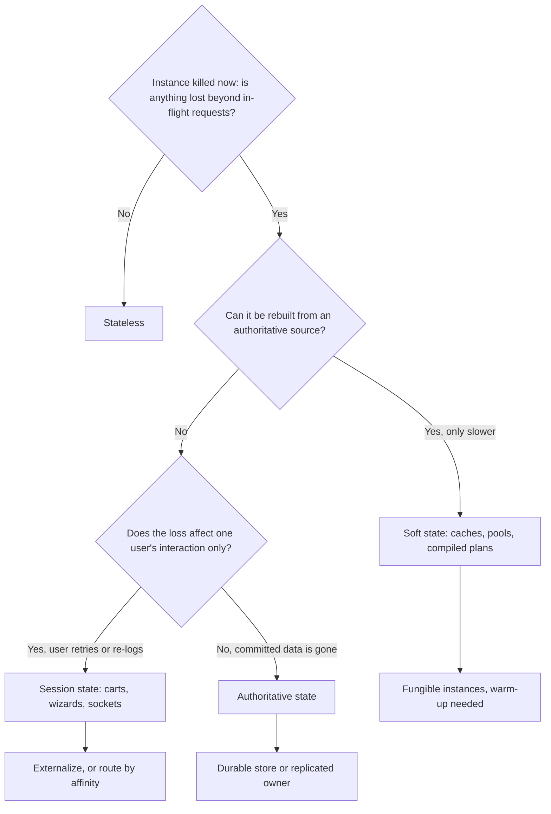
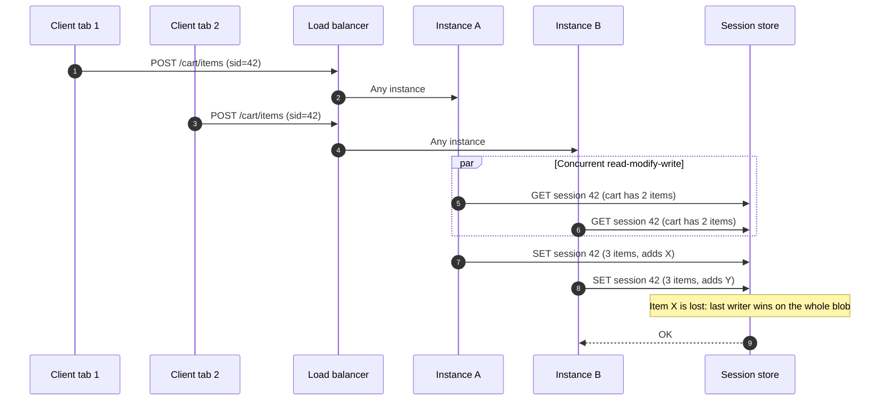
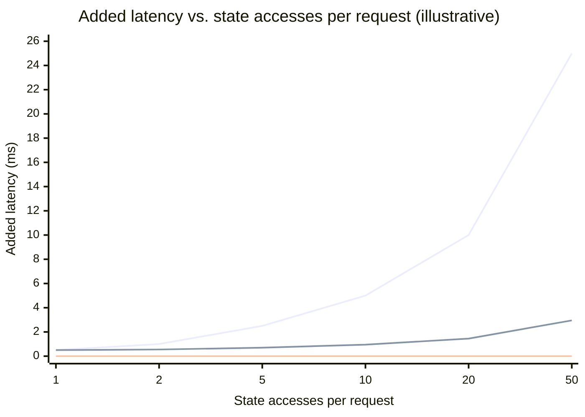
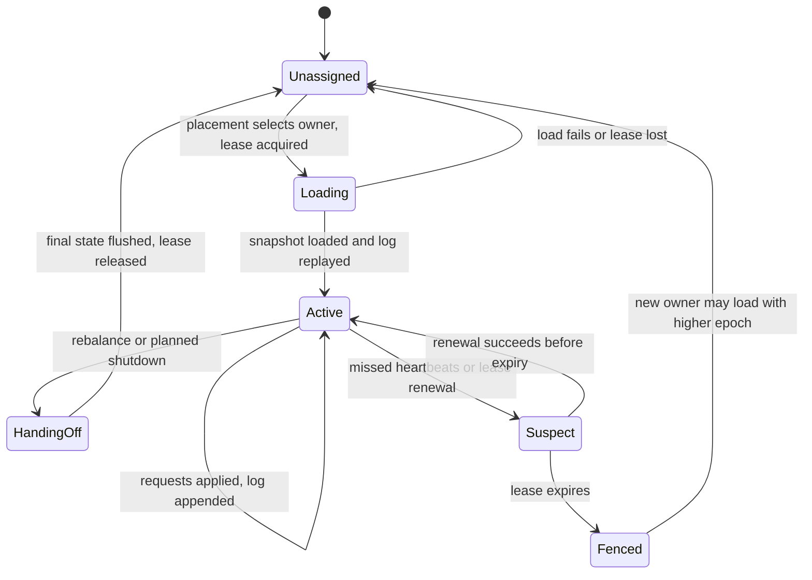
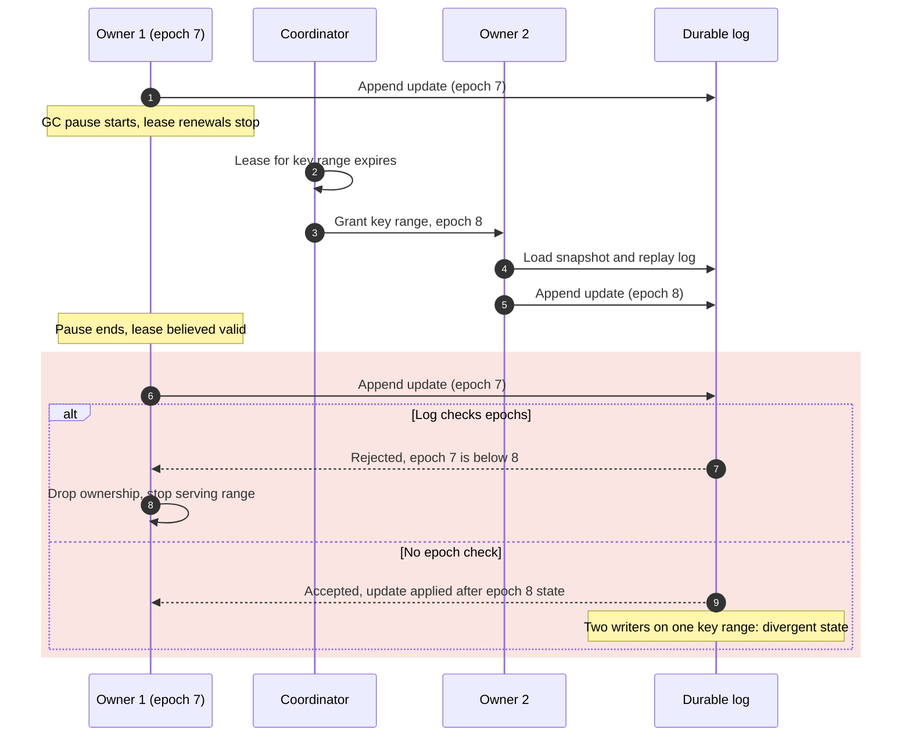

Bir servis, bir isteğe verdiği yanıt yalnızca isteğin kendisine ve isteği işleyen instance'ın dışındaki sistemlere bağlıysa stateless'tır: herhangi bir instance herhangi bir isteğe hizmet verebilir ve bir instance'ın kaybı, üzerinde o anda işlenen istekler dışında hiçbir şey kaybettirmez. Bir servis ise bir instance, doğru yanıt verebilmek için istekler arasında veri tutuyorsa stateful'dur: istekler belirli bir instance'a ulaşmak zorundadır ve o instance'ın çökmesi, yeniden başlaması ya da kaldırılması, işlenmekte olan isteklerden fazlasına mal olur. Asıl soru hiçbir zaman durumun var olup olmadığı değildir; durumun iş mantığını çalıştıran sürecin içinde mi, yoksa bu sürecin çağırdığı ayrı bir sistemde mi yaşadığıdır.

Temel denge, instance'ların birbirinin yerine geçebilirliği (fungibility) ile verinin yerelliği (locality) arasındadır. Durumu dışarıya taşımak instance'ları birbirinin yerine geçebilir kılar; böylece hesaplama katmanı için load balancing, otomatik ölçekleme, rolling deploy ve çökme sonrası kurtarma sıradan işlere dönüşür. Buna karşılık her istek durumuna ulaşmak için bir ya da daha fazla ağ round trip'i öder ve durum deposu, kapasitesi ve erişilebilirliği tüm servisi sınırlayan ortak bağımlılık hâline gelir. Durumu süreç içinde tutmak ise erişimi bir bellek okumasına indirir, uzak bağımlılığı istek yolundan çıkarır ve tek bir sahibin güncellemeleri kilit kullanmadan sıraya koymasını sağlar. Bedeli, her durum parçasının tek bir instance'ın kimliğine bağlanmasıdır: yönlendirme anahtarı bilmek zorundadır, ölçekleme veri taşır ve her yeniden başlatma bir kurtarma işlemidir.

Dolayısıyla "stateless" bir sistem hakkında değil, yalnızca bir katman hakkında söylenmiş bir sözdür. Tek bir veritabanının önündeki stateless uygulama sunucusu filosu, durumunu ve en zor hata modlarını veritabanına taşımıştır; bu birleşmenin throughput üzerindeki sonuçları [Ölçekleme İkilemi](/distributed-systems/tr/foundations/monoliths-to-distributed/scaling-dilemma/) sayfasında incelenir.

## Durumu Kaybının Bedeline Göre Sınıflandırmak

Bir sürecin tuttuğu herhangi bir veri için işe yarayan test şudur: süreç rastgele bir anda ortadan kalkarsa ne olur? Yanıt, durumu farklı muamele gerektiren dört sınıfa ayırır ve "stateless" servislerle ilgili üretim ortamındaki karışıklığın çoğu bu dört sınıfı tek bir sınıf gibi ele almaktan doğar.


*Süreç içindeki veriyi, sürecin kaybının doğurduğu sonuca göre sınıflandırmak. Her sınıfın yerleşim ve kurtarma için farklı bir gereksinimi vardır.*

İstek kapsamındaki (request-scoped) veri istekle birlikte ölür ve hesaba katılmaz. Yumuşak durum (soft state), sürecin atıp yeniden hesaplayabileceği veridir: yerel bir cache, bir connection pool, JIT ile derlenmiş bir kod yolu, belleğe yüklenmiş bir makine öğrenmesi modeli. Kaybı, instance ısınırken gecikmeye ve kaynağa binen yüke mal olur, doğruluğa asla; yalnızca yumuşak durum tutan instance'ların yine de birbirinin yerine geçebilir sayılmasının nedeni budur. Yine de ısınma maliyeti gerçektir: aynı anda yeniden başlatılan bir filo, tüm cache miss'lerini aynı anda arkadaki depoya gönderir; bu hata modu [Cache Stampede ve Thundering Herd](/distributed-systems/tr/data-management/distributed-caching/cache-stampede/) sayfasında ele alınır.

Oturum durumu (session state), sözde stateless servislerin içinde en sık saklanan sınıftır. Tek bir istemcinin süregelen etkileşimine aittir: bir giriş oturumu, bir alışveriş sepeti, çok adımlı bir form, açık bir WebSocket ve ona bağlı abonelikler. Kaybı tek bir kullanıcıya görünür ve o kullanıcı tarafından telafi edilebilir. Yetkili durum (authoritative state) ise commit edilmiş verinin tek kopyasıdır: bir hesap bakiyesi, kabul edilmiş bir sipariş, bir stream işlemcisinin onayladığı olaylardan hesapladığı bir toplam. Kaybı veri kaybıdır; süreç herhangi bir şeyi onaylamadan önce bir write-ahead log'a, replikasyona ya da ikisine birden ihtiyaç duyar.

| Sınıf | Tipik örnekler | Instance kaybı ne demek | Yeniden oluşturma kaynağı | Yerleşim gereksinimi |
|---|---|---|---|---|
| İstek kapsamlı | Ayrıştırılmış istek, ara sonuçlar | Yalnızca işlenmekte olan istekler başarısız olur | İstemcinin yeniden denemesi | Yok |
| Yumuşak durum | Yerel cache, connection pool, yüklü model | Isınma sırasında yüksek gecikme ve backend yükü | Veritabanı, model deposu | Isınma yükünü sınırlamak; filo genelinde soğuk başlangıçtan kaçınmak |
| Oturum durumu | Giriş oturumu, sepet, açık socket | Etkilenen kullanıcılar ilerlemelerini kaybeder ya da yeniden bağlanır | Dışarı taşınmadıysa genellikle yok | Dışarı taşımak ya da affinity ile yönlendirme ve kabul edilebilir kayıp |
| Yetkili durum | Bakiyeler, siparişler, stream toplamları | Veri kaybı | Loglanmadıysa ya da replike edilmediyse yok | Onaydan önce dayanıklı log ya da replikasyon |

Dört sınıfı kesen ikinci bir eksen daha vardır: durumun eşzamanlı istekler tarafından değiştirilip değiştirilmediği. Çoğunlukla okunan durum (bir feature flag anlık görüntüsü, bir yönlendirme tablosu) her instance'a kopyalanabilir. Üzerinde çekişme olan değişken durum (bir sayaç, bir rate limit bütçesi, iki sekmeden düzenlenen bir sepet) ise güncellemelerin sıraya konduğu tek bir yere ihtiyaç duyar: eşzamanlılık denetimi olan bir depo ya da tek bir sahip süreç.

## Dışarıya Taşınmış Durum: Stateless Servisler Nasıl Çalışır

Stateless bir servis, oturum ve yetkili durumu süreçten iki yoldan biriyle çıkarır. Durumu istemci taşıyabilir; bu genellikle servisin her istekte herhangi bir sorgu yapmadan doğruladığı, [JWT](/distributed-systems/tr/security/authentication-authorization/jwt/) gibi imzalı bir token biçimindedir. Ya da istemci yalnızca bir kimlik taşır ve servis her istekte durumu bu kimlikle Redis ya da birincil veritabanı gibi ortak bir depodan çeker, değiştiğinde geri yazar. Her iki durumda da instance'ları birbirinin yerine geçebilir kılan değişmez (invariant) aynıdır: bir istek işleyicisinin çıktısı, isteğin ve erişim anında dış deponun içeriğinin bir fonksiyonudur; işleyiciyi hangi instance'ın çalıştırdığına ya da o instance'ın daha önce ne işlediğine asla bağlı değildir.

Operasyonel özellikleri satın alan bu değişmezdir. Load balancer herhangi bir algoritmayı kullanabilir (bkz. [Load Balancing Algoritmaları](/distributed-systems/tr/communication/load-balancing/algorithms/)). Zaman aşımına uğrayan bir istek, işlem idempotent olduğu sürece başka bir instance'a yeniden gönderilebilir (bkz. [Idempotency](/distributed-systems/tr/communication/api-gateway/idempotency/)). Otomatik ölçekleyici saniyeler içinde bir instance ekleyip trafiği ona yönlendirebilir ve işlenmekte olan istekleri boşalttıktan sonra bir instance'ı kaldırabilir; bu pencere en uzun oturumun değil, en uzun isteğin süresiyle ölçülür.


*Aynı oturuma ait iki eşzamanlı isteğin farklı instance'larda işlenmesi. Birbirinin yerine geçebilirlik affinity'yi ortadan kaldırır; onunla birlikte tek bir sahibin örtük olarak sağlayacağı sıralamayı da.*

1-4. adımlar tasarımın amaçladığı özelliği gösterir: aynı oturuma ait iki istek farklı instance'larda ilerler. 5-8. adımlar ise bunun bedelini gösterir. Her instance oturumun tamamını okur, kendi özel kopyasını değiştirir ve nesnenin tamamını geri yazar; böylece ikinci yazma birincinin üzerine sessizce yazar. Oturumu bellekte tutan tek bir süreç bu iki isteği sıraya koyardı; durumu dışarıya taşımak bu sıralama noktasını ortadan kaldırmıştır ve depo, açıkça istenmedikçe onu geri getirmez.

### Dışarıya Taşımanın Garanti Etmedikleri

Dışarıya taşımak yalnızca hesaplamanın birbirinin yerine geçebilirliğini garanti eder, fazlasını değil. Eşzamanlılık denetimi sağlamaz: `GET` ve `SET` ile blob cache'i gibi kullanılan bir depo last-writer-wins semantiği verir; doğruluk için ya alan düzeyinde atomik işlemler (bir Redis hash alanını artırmak, bir SQL `UPDATE ... SET qty = qty + 1`) ya da yazma anında sürüm numarası kontrol edilen optimistic concurrency gerekir. Depo replike ediliyorsa ve okumalar geride kalmış bir replikaya gidebiliyorsa read-your-writes sağlamaz: sepete ürün ekleyip sayfayı hemen yenileyen kullanıcı eski sepeti görebilir; bu anomali [Nedensel Tutarlılık ve Oturum Garantileri](/distributed-systems/tr/data-management/consistency-models/causal-consistency-session-guarantees/) sayfasındaki oturum garantileriyle ele alınır. Erişilebilirlik bağımlılığını da ortadan kaldırmaz: depo çöktüğünde durum gerektiren her istek için tüm instance'lar çökmüş sayılır; deponun hata alanı (failure domain) servisin hata alanı olur.

İstemcinin taşıdığı durumun da kendine özgü dışarıda bıraktıkları vardır. İmzalı bir token, sunucu tarafında bir sorguyu (bir deny-list) yeniden devreye sokmadan süresi dolmadan iptal edilemez; dolayısıyla ömrü, çalınmış ya da bayatlamış bir token'ın ne kadar süre geçerli kalacağının üst sınırıdır. Taşıma katmanına sığmak zorundadır: RFC 6265 tarayıcılardan yalnızca en az 4.096 baytlık cookie'leri desteklemelerini ister ve her bayt her istekte yeniden gönderilir. Ayrıca hangi token'ın sunulacağını istemci seçer; bu yüzden bakiye gibi yalnızca ileriye gitmesi gereken bir durum, imzalı olsa bile orada yaşayamaz: daha önceki geçerli bir token'ın tekrar oynatılması meşru bir istekten ayırt edilemez.

### Sayısal Örnek: 1,2 Milyon Oturum Nerede Tutulmalı

Zirvede saniyede 30.000 isteği 24 instance üzerinde karşılayan, 1,2 milyon aktif oturumu ve 4 KB'lık serileştirilmiş bir oturumu (sepet içeriği ve kullanıcı tercihleri) olan bir mağaza servisi varsayalım. Her istek oturumu okur; %10'u onu değiştirir. Oturum, 30 dakikalık hareketsizlikten sonra sona erer. Bu örnekteki tüm sayılar açıklama amaçlıdır.

**Sticky yönlendirme ile süreç içi oturumlar.** Toplam oturum belleği `1.2M * 4 KB = 4.8 GB`, yani instance başına yaklaşık 200 MB'tır ve oturuma erişim bir bellek araması kadar ucuzdur. Maliyetler yaşam döngüsü olaylarında ortaya çıkar. Bir instance'ın çökmesi oturumların `1/24`'ünü, yani 50.000 kullanıcıyı kaybettirir. Instance'ları dörderli gruplar hâlinde yeniden başlatan bir rolling deploy ya her oturumu bir kez kaybeder ya da boşaltılan her instance'taki oturumların süresinin dolmasını bekler: 30 dakikalık hareketsizlik süresi ve altı grupla bir deploy en az üç saat sürer ve 30 dakika boyunca hiç boşta kalmayan aktif kullanıcılar her boşaltmanın sonunda yine de kesilir. Yatay ölçekleme başlangıçta pek işe yaramaz, çünkü mevcut oturumlar eski instance'lara bağlı kalır.

**Sunucu tarafı oturum deposu.** Her istek bir okuma, isteklerin %10'u da bir yazma yapar; depo saniyede 33.000 işlem karşılar. 4 KB'lık değerlerle bu `33,000 * 4 KB`, yaklaşık 132 MB/s ya da 1,06 Gbit/s yük demektir; bu rakam, deponun CPU'su dolmadan çok önce ağ bütçesine hâkim olur. Zone içi round trip'in 0,5 ms olduğu varsayılırsa her istek en az 0,5 ms gecikme kazanır. Oturumu bir hash olarak yeniden yapılandırıp yalnızca isteğin ihtiyaç duyduğu alanları okumak (ortalama 300 bayt diyelim) bant genişliğini %90'dan fazla düşürür; aynı nedenle yazma yolu blob'u yeniden yazmak yerine alanları güncellemelidir; bu, yukarıda gösterilen kayıp güncelleme yarışını da çözer. Deponun 4,8 GB'a ek olarak anahtar başına ek yüke ve bir replikaya ihtiyacı vardır; bu mütevazı bir makinedir ve uygulama katmanı serbestçe deploy edilebilir hâle gelir.

**İmzalı istemci tarafı token.** 4 KB'lık oturum imzalanıp base64 ile kodlandığında (base64 ikili veriyi 4/3 oranında şişirir) 5,4 KB'ı aşar ve RFC 6265 asgarisine göre tek bir cookie'ye sığmaz; token'lar sepetler için değil, birkaç yüz baytlık kimlik bilgileri (claim) için uygundur. Pratik tasarım bu yüzden hibrittir: kimlik için her instance'ta yerel olarak doğrulanan kısa ömürlü imzalı bir token, sepet için ise kullanıcıya göre anahtarlanmış ve alan alan erişilen sunucu tarafı bir depo.

Süreç içi durum istek başına en ucuz, yaşam döngüsü olayı başına en pahalı seçenektir; dışarıya taşınmış durum bunun tersidir. Durumuna bir kez dokunan bir istek için 0,5 ms, saatler yerine dakikalar süren deploy'lar karşılığında küçük bir bedeldir. Durumuna çok kez dokunan bir istek için ise karşılaştırma değişir.


*Üstte: uzak depo, birbirine bağımlı erişimler, her biri 0,5 ms. Ortada: uzak depo, toplu ya da pipeline'lanmış erişimler, 0,5 ms artı öğe başına 0,05 ms. Altta: süreç içi bellek, mikrosaniyenin altında.*

Üstteki çizgi, sistemleri stateful tasarımlara iten durumdur: her tick'te birbirine bağımlı 50 güncelleme uygulayan bir oyun sunucusu, her işlemi yakın geçmişe göre dönüştüren bir ortak düzenleme editörü, birkaç bütçeye bakan bir rate limiter. Her erişim bir öncekinin sonucuna bağlı olduğunda pipeline kullanmak imkânsızdır ve uzak gecikme doğrusal olarak birikir. Ortadaki çizgi, erişimler bağımsız olduğunda toplu işlemenin stateless tasarımı ne kadar uzatabildiğini gösterir.

## Stateful Servisler: Sahiplik, Yönlendirme ve Kurtarma

Tek bir instance'ın ötesine ölçeklenen stateful bir servis durumunu partition'lara bölmek zorundadır: her anahtar, varlık ya da oturum herhangi bir anda tam olarak bir instance'a aittir ve o anahtara ait istekler sahibine yönlendirilir. Sahip, anahtarın durumunu bellekte tutar, güncellemeleri birer birer uygular ve onaylamadan önce kalıcı hâle getirir ya da replike eder. Belirli bir anahtarı yalnızca bir süreç değiştirdiği için sahibin onu tek thread'le işlemesi (actor sistemlerinde bir mailbox, stream işlemcilerinde bir partition'ın thread'i), oturum deposu yarışında eksik olan sıralamayı hiçbir dağıtık kilit olmadan sağlar.

Bu yapıyı üç mekanizma işletir. Bir yerleşim fonksiyonu anahtarları sahiplere eşler; bunu ya canlı üyelik üzerinde hash'leyerek (bkz. [Consistent Hashing](/distributed-systems/tr/data-management/data-partitioning/consistent-hashing/)) ya da her anahtarın sahibini kaydeden ve tek tek anahtarları taşıyabilen açık bir dizinle yapar. Bir yönlendirme katmanı her isteği güncel sahibine ulaştırır: anahtarı bilen bir load balancer, yerleşimi bilen bir istemci kütüphanesi ya da isteği sahibine ileten herhangi bir instance. Bir sahiplik protokolü de herhangi bir anda en fazla bir instance'ın bir anahtarın sahibi olduğuna inanmasını sağlar; bu normalde bir koordinasyon servisinden alınan süre sınırlı bir lease'tir (bkz. [Kiralama Tabanlı Kilitleme](/distributed-systems/tr/coordination/distributed-locking/lease-based-locking/)) ve eski bir sahibin geç kalan yazmalarının reddedilmesi için depolama katmanında yapılan bir kontrolle birleştirilir.

Microsoft Orleans, sanal bir actor'ü (bir "grain") ihtiyaç anında etkinleştirir ve konumunu bir grain dizinine kaydeder; bu dizin Orleans 9.0'a kadar nihai tutarlı (eventually consistent) bir dağıtık hash tablosuydu, Orleans 9.0 ise onu güçlü tutarlı bir dizinle değiştirdi. Depoya yazılan grain durumu bir ETag taşır; böylece çakışan bir yazma uygulanmak yerine tespit edilir. Akka Cluster Sharding, varlıkları shard'lara, shard'ları da bir koordinatör aracılığıyla düğümlere atar. Kafka Streams, girdi partition'larını instance'lara atar, her partition'ın durumunu yerel bir RocksDB deposunda tutar ve her güncellemeyi compacted bir changelog topic'ine yazarak onu dayanıklı kılar. OSDI 2016'da anlatılan Google Slicer ise anahtar aralıklarını uygulama görevlerine atayan ve yük kaydıkça onları yeniden dengeleyen genel bir otomatik sharding servisidir; isteklere ayrı bir depolama katmanından değil, kendi süreçlerinde tuttukları veriden daha hızlı yanıt veren servisler için geliştirilmiştir.

### Sahiplik Yaşam Döngüsü

Sahiplenilen her anahtar aynı durumlardan geçer ve her geçişin, stateless tasarımın ödemediği bir maliyeti vardır.


*Bir anahtarın tek bir instance üzerindeki sahiplik yaşam döngüsü. Yalnızca Active durumu isteklere hizmet verir; diğer her durum o anahtar için erişilemezlik demektir.*

Loading durumu, stateful tasarımların yerelliğin bedelini ödediği yerdir: yeni sahip, anahtarın durumunu bir snapshot ve ardından gelen log'dan yeniden kurmak ya da devir (handoff) sırasında önceki sahipten almak zorundadır. Doğruluk argümanı iki olguya dayanır: yeni sahip yalnızca önceki sahibin lease'i sona erdikten ya da bırakıldıktan sonra yükleme yapar ve yeni sahibin her yazması, önceki sahibin hâlâ gönderebileceği herhangi bir yazmadan daha yüksek bir epoch, yani fencing token taşır. İkinci olgu olmadan birincisi yetmez, çünkü duraklatılmış bir süreç lease'inin sona erdiğini bilmez; mekanizma [Fencing Tokens](/distributed-systems/tr/coordination/distributed-locking/fencing-tokens/) sayfasında ele alınır.

Suspect durumu, lease süresinin bir dengeye dönüştüğü yerdir. Kısa bir lease hataları hızlı tespit eder ve erişilemezliği kısaltır; ancak lease'ten uzun süren bir garbage collection duraklaması ya da ağ gecikmesi sağlıklı bir sahibin fence'lenmesine yol açar ve anahtarları başka bir yerde tam bir yükleme döngüsünden geçer. Uzun bir lease bunun tersini yapar.

### Kurtarma Süresi Yerelliğin Asıl Bedelidir

Loading durumunda geçen süre yaklaşık olarak durum boyutunun geri yükleme bant genişliğine bölümüdür. Bir instance'ın 40 GB duruma sahip olduğunu ve changelog'undan, broker'ları ve diğer kiracıları korumak için kısılmış, efektif 100 MB/s hızla geri yüklediğini varsayalım (açıklama amaçlı). Geri yükleme 400 saniye, yani yaklaşık yedi dakika sürer; bu süre boyunca sahip olduğu anahtarlar erişilemezdir ya da kimse tarafından sunulmaz. Bu tür 24 instance'ın tek tek yeniden başlatıldığı bir rolling restart, her yeniden başlatma tam bir geri yüklemeyi tetikliyorsa yalnızca geri yüklemeye yaklaşık üç saat harcar.

Çözüm, sahipliğin geri yükleme yapmadan taşınabilmesi için başka bir yerde sıcak bir kopya tutmaktır. Kafka Streams bunlara standby replika der: ek instance'lar changelog'u sürekli tüketir ve gölge bir depoyu güncel tutar; böylece failover yalnızca kalan küçük gecikmeyi (lag) yeniden oynatır. Kafka 2.6'dan (KIP-441) beri, yeni bir instance'a geçici ısınma (warm-up) replikaları atayıp aktif görevi oraya ancak replika yetiştikten sonra taşıyabilir; görevi deposu sıfırdan yeniden kurulurken durdurmaz.

```text
# Kafka Streams: keep one warm copy of every state store on another instance
num.standby.replicas=1
# Changelog lag (in offsets) below which an instance counts as caught up
acceptable.recovery.lag=10000
# Extra warm-up replicas allowed at once while moving tasks
max.warmup.replicas=2
# How often to check whether warm-up replicas can take over (ms)
probing.rebalance.interval.ms=600000
# Local RocksDB location; must survive restarts to avoid a full restore
state.dir=/var/lib/kafka-streams
```

İki varsayılan değer ekipleri şaşırtır: `num.standby.replicas` 0'dır, yani varsayılan bir kurulum her hatadan sonra changelog'dan geri yükleme yapar; `state.dir` ise JVM'in geçici dizini altındadır ve container'lar bu dizini yeniden başlatmada genellikle siler. Kubernetes'te kararlı kimliği ve instance başına volume'u bir [StatefulSet](/distributed-systems/tr/kubernetes/fundamentals/pod-deployment-statefulset/) sağlar; instance'a kalıcı bir ad ve disk verir, sahiplik semantiği vermez; onu yine uygulamanın gerçekleştirmesi gerekir.

:::caution[StatefulSet bir servisi güvenli biçimde stateful yapmaz]
Kubernetes kararlı bir pod adını garanti eder ve aynı volume'u yeniden bağlar; ancak bir ağ bölünmesi ya da yavaş bir düğüm kapanması sırasında iki sürecin aynı anahtarların sahibi olduğuna inanmasını engellemez. Sahiplik yine de uygulamada ya da onun koordinasyon katmanında lease ve fencing ile zorlanmalıdır.
:::

## Tasarımları Karşılaştırmak

Tasarımlar "durum sahibi olup olmamalarından" çok, her maliyetin nerede ödendiğiyle ayrışır: istek başına, yaşam döngüsü olayı başına ya da hata başına.

| Tasarım | Durumun yaşadığı yer | İstek başına maliyet | Instance kaybı ne demek | Deploy ve ölçekleme maliyeti | Eşzamanlılık denetimi | Ne zaman tercih edilmeli |
|---|---|---|---|---|---|---|
| Stateless + veritabanı | Birincil veritabanı | Bir ya da daha fazla sorgu | İşlenmekte olan istekler dışında hiçbir şey | Asgari | Veritabanı transaction'ları | İstek-yanıt iş mantığı için varsayılan |
| Stateless + oturum deposu | Key-value deposu | Erişim başına bir round trip | İşlenmekte olan istekler dışında hiçbir şey | Asgari | Tasarlanmalı: alan güncellemeleri ya da sürümler | Instance'lar arasında paylaşılan, orta boyutlu oturum verisi |
| İmzalı istemci token'ı | İstemci | İmza doğrulama, daha büyük istekler | Hiçbir şey | Asgari; anahtar rotasyonu | Yok; tekrar oynatılabilir | Küçük, çoğunlukla okunan kimlik ve yetkilendirme bilgileri |
| Sticky bellek içi oturumlar | Instance belleği, affinity yönlendirme | Bellek erişimi | O instance'taki oturumlar kaybolur | Her deploy'da uzun boşaltmalar ya da oturum kaybı | Instance başına kilitleme | Oturum kaybı kabul edilebilir ve deploy'lar seyrek, ya da eski sistemden geçiş |
| Sahipli stateful servis | Instance belleği artı log ya da replika | Bellek erişimi | Yeniden yükleme ya da failover'a kadar anahtarlar erişilemez | Yeniden dengeleme durum taşır; geri yükleme süresi baskındır | Anahtar başına tek sahip | İstek başına çok sayıda bağımlı durum erişimi, doğal olarak bölünmüş varlıklar |
| Replike stateful depo | Her replika | Quorum ya da leader round trip'i | Failover, veri kaybı yok | Replika yeniden kurulum süresi | Replikasyon protokolü | Kayıt sisteminin (system of record) kendisi |

Sticky oturumlar orta yol gibi görünür. Affinity yönlendirme (AWS ALB'nin `AWSALB` gibi bir load balancer cookie'si ya da bir istemci kimliğinin hash'i) istemciyi aynı instance'a geri gönderir, ama o instance'ı sahip yapmaz: hedef sağlıksız olduğunda ya da kaldırıldığında load balancer istemciyi başka bir instance'a taşır ve yeni instance'ta oturumun kopyası yoktur. Affinity, bir kullanıcının verisini tek bir cache'te sıcak tutmak gibi yumuşak durum için bir performans optimizasyonudur; hiçbir şey için doğruluk mekanizması değildir.

## Hata Modları ve Dışarıdan Görünüşleri

Stateless tasarımlar ortak depolarında ve fark edilmeden sürecin içine sızmış durumda hata verir. Stateful tasarımlar ise sahiplik geçişlerinde hata verir.

### Stateless Katmanda Gizli Durum

Tetikleyici: tasarımın dışarıda olduğunu varsaydığı durum aslında süreçte yaşar: bir prototipten kalma bellek içi oturum haritası, yerel diske yazılan yüklemeler, süreç içi bir rate limiter, her instance'ın içinde çalışan zamanlanmış bir iş. Belirtiler yalnızca instance sayısı değiştiğinde ortaya çıkar: deploy sonrası oturumu kapanan kullanıcılar, bir sonraki istekte 404 dönen yüklemeler, `N` instance ile hedeflenen trafiğin `N` katına izin veren bir rate limit, her e-postayı `N` kez gönderen gece işi. Tespit: yükle değil, deploy'larla ve replika sayısı değişiklikleriyle ilişkili hatalar ve anomaliler. Hafifletme: durumu ortak bir depoya taşımak ya da zamanlanmış işler için bir lease ile tek bir çalıştırıcı seçmek. Tekrarlanmış yan etkiler kodu düzeltmekle geri alınamaz.

:::tip[Birbirinin yerine geçebilirliği üretimden önce siz test edin]
Her servisi üretim öncesi ortamda en az iki replika ile çalıştırın, round robin ile yönlendirin ve test paketi sırasında rastgele bir instance'ı öldürün. Gizli oturum durumu, yerel dosyalar ve tekrarlanan zamanlanmış işler, tek bir ek instance maliyetiyle tek bir koşuda ortaya çıkar.
:::

### Sticky Oturum Dengesizliği

Tetikleyici: dengesiz oturumlarla birlikte affinity yönlendirme; örneğin tek bir proxy arkasında aynı IP hash'ini paylaşan çok sayıda istemci ya da birkaç ağır, uzun ömürlü oturum. Belirtiler: filo ortalaması sağlıklı görünürken tek bir instance'ın doygunluğa ulaşması ve yatay ölçeklemenin bunu hafifletmemesi. Tespit: instance başına yük dağılımı. Hafifletme: IP yerine cookie affinity'si, sınırlandırılmış affinity süresi ya da oturumu dışarıya taşımak.

### Ortak Kader Olarak Oturum Deposu

Tetikleyici: oturum deposunun doygunluğa ulaşması (sayısal örnekte görüldüğü gibi genellikle büyük blob'ların yarattığı bant genişliği), failover'a girmesi ya da yeniden başlatmada verisini kaybetmesi. Belirtiler: tüm instance'ların aynı anda hata vermesi ya da tüm kullanıcıların aynı anda oturumunun kapanması. Tespit: uygulamanın hata oranıyla birlikte depo gecikmesi, ağ throughput'u ve eviction sayaçları. Hafifletme: alan düzeyinde erişim, replikasyon ve depo erişilemez olduğunda salt okunur sayfalar sunmak gibi bilinçli bir bozulma (degradation) politikası.

### Bir Duraklamadan Sonra Çift Sahiplik

Tetikleyici: bir sahibin, uzun bir garbage collection duraklaması, takılan bir disk ya da bir ağ bölünmesi nedeniyle, hâlâ işlemekte olduğu istekler varken lease'ini yenilemeyi bırakması. Küme anahtarlarını yeni bir sahibe atar. Eski sahip kaldığı yerden devam eder ve yerinin başkasına verildiğinden habersiz, yarım kalan yazmalarını tamamlar.


*Lease'i sona erdikten sonra geri dönen duraklatılmış bir sahip. Sonuç tamamen dayanıklı katmanın epoch'u zorlayıp zorlamadığına bağlıdır.*

2-5. adımlar sıradan bir failover'dır: koordinatör duraklatılmış bir süreci ölü bir süreçten ayırt edemez, bu yüzden aralığı daha yüksek bir epoch ile yeniden atar. 6. adım tehlikenin kendisidir: eski sahibin yazması duraklamadan önce hazırlanmıştır ve yeni bir kontrol yapılmadan gönderilir. Log'da epoch kontrolü varsa (7. ve 8. adımlar) yazma reddedilir ve eski sahip yerinin başkasına verildiğini öğrenir. Kontrol yoksa (9. adım) yazma yeni sahibin durumundan sonra uygulanır ve artık iki süreç aynı anahtarların birbirinden ayrışan görünümlerini tutar. Tespit: aynı aralığın sahipliğini bildiren iki instance, depolama katmanındaki reddedilen epoch sayaçları ve GC duraklama loglarıyla ilişkili lease sona erme olayları. Bu problemin genel biçimi [Split-Brain Problemi](/distributed-systems/tr/coordination/consensus-algorithms/split-brain-fencing/) sayfasında incelenir.

:::danger[Fencing olmadan lease'ler iki sahibi engellemez]
Bir lease, koordinatörün sahipliği yeniden atamadan önce ne kadar bekleyeceğini sınırlar; duraklatılmış bir sürecin sonrasında harekete geçmesini durdurmaz. Bir sahibin yazmalarını alan depo ya da log daha eski bir epoch'tan gelen yazmaları reddetmedikçe, stateful bir servis iki sahibin güncellemelerini aynı anahtara sessizce uygulayabilir.
:::

### Geri Yükleme Fırtınaları

Tetikleyici: bir küme yükseltmesi, bir düğüm havuzunun değiştirilmesi ya da bir çökme döngüsü nedeniyle çok sayıda stateful instance'ın birlikte yeniden başlaması ve her birinin tüm durumunu changelog'dan ya da eşlerinden geri yüklemesi. Belirtiler: geri yükleme trafiği broker'ları ya da ağı doyurur, geri yükleme süreleri tek instance tahmininin çok ötesine uzar ve başlangıç sağlık kontrolü süresini aşan instance'lar öldürülüp geri yüklemeye sıfırdan başlar. Tespit: instance başına geri yükleme ilerlemesi ve lag, broker ya da eş çıkış trafiği ve yeniden başlatma sayıları. Hafifletme: yeniden başlatmaların yalnızca son değişiklikleri oynatması için kalıcı yerel durum, standby replikalar, stateful set'ler için birer birer yeniden başlatma, geri yükleme süresine tahammül eden startup probe'lar ve çıkıştan önce sahipliği devreden [graceful termination](/distributed-systems/tr/kubernetes/runtime-and-operations/graceful-termination-pdb/).

### Hata İmzalarının Özeti

| Hata | Tasarım | Dışarıdan belirti | Tespit sinyali | Hafifletme |
|---|---|---|---|---|
| Gizli durum | Stateless | Deploy ya da ölçekleme sonrası hatalar veya tekrarlar | Replika sayısı değişiklikleriyle ilişkili anomaliler | Dışarı taşımak; işler için lease ile seçilen tek çalıştırıcı |
| Kayıp güncelleme | Stateless + depo | Eşzamanlılık altında kaybolan sepet öğeleri ya da ayarlar | Sürümlüyse sürüm çakışmaları; değilse kullanıcı şikâyetleri | Alan düzeyinde atomik güncellemeler, optimistic sürümler |
| Depo doygunluğu ya da kesintisi | Stateless + depo | Filo genelinde hata ya da toplu oturum kapanması | Depo gecikmesi, throughput, eviction'lar | Daha küçük okumalar, replikasyon, bozulma politikası |
| Affinity dengesizliği | Sticky oturumlar | Tek sıcak instance, sağlıklı ortalama | Instance başına yük dağılımı | Sınırlı cookie affinity'si, dışarı taşımak |
| Çift sahiplik | Sahipli stateful | Ayrışmış ya da bozulmuş varlık durumu | Çift sahiplik, reddedilen epoch sayaçları | Depolamada fencing ile lease'ler |
| Geri yükleme fırtınası | Sahipli stateful | Toplu yeniden başlatma sonrası uzun erişilemezlik | Geri yükleme lag'i, broker çıkışı, yeniden başlatma döngüleri | Kalıcı volume'lar, standby'lar, kademeli yeniden başlatma |

## Durumun Nerede Yaşayacağını Seçmek

İş mantığı katmanını varsayılan olarak stateless yapın. İstekleri durumlarına birkaç kez dokunan ve bunu zaten transaction sağlayan bir veritabanı üzerinden yapan istek-yanıt servisleri yerellikten çok az kazanır ve bunun bedelini her deploy'da ağır biçimde öder. Oturum durumunu alan alan erişilen sunucu tarafı bir depoda, kimliği kısa ömürlü imzalı bir token'da tutun ve her süreç içi cache'i, sistemin hepsini aynı anda kaybetmeye dayanması gereken yumuşak durum olarak ele alın.

Ölçümler işaret ettiğinde sahipli bir stateful tasarım seçin: uzak gecikmenin katlandığı, istek başına çok sayıda bağımlı durum erişimi; işlemlerin çoğunun tek bir varlıkla sınırlı kaldığı, doğal olarak bir varlığa (bir oyun maçı, bir sohbet odası, bir doküman, bir cihaz) göre bölünmüş durum; uzak bir deponun zaten sıraya koyacağı kadar yüksek varlık başına güncelleme hızları; ya da durumun, tüketilen offset'lerle adım adım ilerlemesi gereken bir toplam olduğu stream işleme. Adya ve arkadaşları *Fast key-value stores: An idea whose time has come and gone* (HotOS 2019) çalışmasında bu tür iş yükleri için, her istekte veriyi uzak bir cache'e gönderip oradan almanın (marshalling) maliyetinin, otomatik shard'lanan stateful uygulama sunucuları kurmanın maliyetini aştığını savunmuştur.

Bir veritabanı şeması yazmaktan kaçınmak için stateful tasarım seçmeyin; varlıkların keyfî kombinasyonlarda etkileştiği durumlarda seçmeyin, çünkü sahipler arası işlemler dağıtık koordinasyonu geri getirir; bellek içi durumun arkasında dayanıklı bir log ya da replika yoksa seçmeyin, çünkü her çökme veri kaybına dönüşür; ekip lease, fencing, yeniden dengeleme ve geri yükleme ayarlarını işletemiyorsa da seçmeyin, çünkü bunlar kalıcı bir operasyonel yüke dönüşür. Sticky oturumları da bu iki tasarımın yerine kullanmayın: süreç içi durumun yaşam döngüsü maliyetlerini korur, doğruluk garantilerini ise vermezler.

Bu ayrımla sıkça karıştırılan iki komşu kavram vardır. [REST](/distributed-systems/tr/communication/synchronous-protocols/rest/)'in statelessness kısıtı protokolle ilgilidir: her istek kendisini yorumlamak için gereken her şeyi taşır ve bir servis, istekleri adını verdikleri kaynağın sahibine yönlendirirken de bu kısıtı karşılayabilir. Ayrıca [WebSocket ve Server-Sent Events](/distributed-systems/tr/communication/synchronous-protocols/websocket-sse/) sayfasındaki gibi uzun ömürlü bir bağlantı, arkasındaki servis ne yaparsa yapsın, onu sonlandıran instance üzerinde kendi başına bir oturum durumudur.

## İleri Okuma

- Adam Wiggins, *The Twelve-Factor App*, Heroku, 2011.
- Pat Helland, *Life beyond Distributed Transactions: an Apostate's Opinion*, CIDR, 2007.
- Philip A. Bernstein, Sergey Bykov, Alan Geller, Gabriel Kliot, and Jorgen Thelin, *Orleans: Distributed Virtual Actors for Programmability and Scalability*, Microsoft Research Technical Report MSR-TR-2014-41, 2014.
- Atul Adya et al., *Slicer: Auto-Sharding for Datacenter Applications*, USENIX OSDI, 2016.
- Atul Adya, Robert Grandl, Daniel Myers, and Henry Qin, *Fast key-value stores: An idea whose time has come and gone*, ACM HotOS, 2019.
- Martin Kleppmann, *Designing Data-Intensive Applications*, O'Reilly, 2017.
