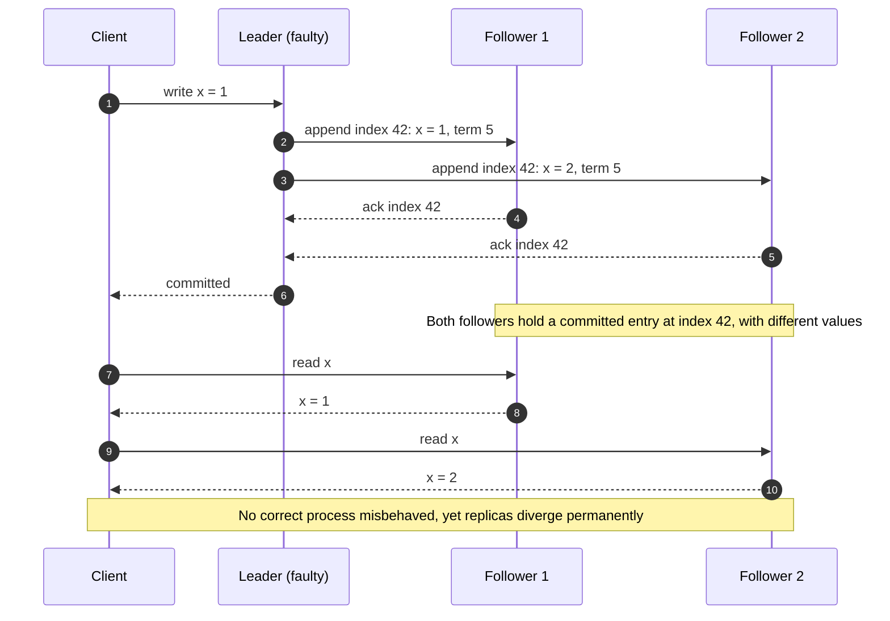
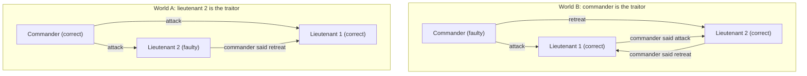
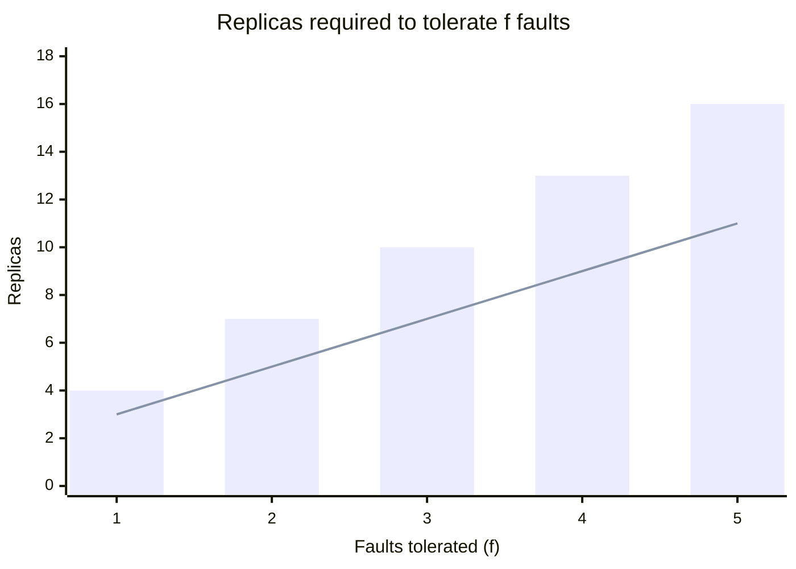
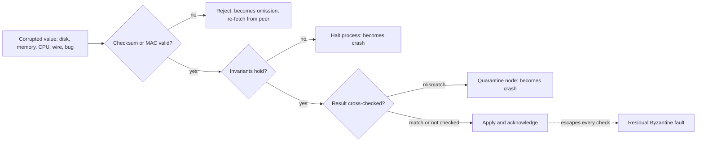
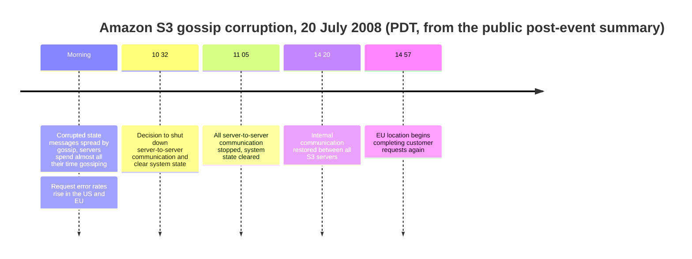

Bizans hatası, bir process'in izlemesi gereken protokolden herhangi bir sapmadır. Bizans bir process çökebilir, sessiz kalabilir ya da geç yanıt verebilir; ama doğru bir process'in asla göndermeyeceği bir mesajı da gönderebilir: aynı term içinde iki aday için oy, hiç saklamadığı veri için onay (acknowledgment), kendi uydurduğu bir log kaydı ya da aynı istek için farklı eşlere farklı değerler. Equivocation (çift konuşma) adı verilen bu son davranış, modeli tanımlayan davranıştır. [Hata Modelleri](/distributed-systems/tr/foundations/system-models/failure-models/) sayfasında anlatılan zararsız (benign) modeller, hatalı bir process'in söylediği her şeyin doğru bir process'in de söyleyebileceği bir şey olduğunu varsayar; Bizans modeli bu varsayımı tamamen kaldırır.

Ad, Lamport, Shostak ve Pease'in 1982'de uzlaşma problemini, bir kısmı hain olan generallerin haberciler aracılığıyla saldırıp saldırmamaya karar vermesi olarak çerçevelemesinden gelir. Bu çerçeve "Bizans" kelimesinin "kötü niyetli" anlamına geldiği izlenimini verir; oysa tek sahipli bir veri merkezinde daha yaygın kaynaklar şunlardır: hata bildirmeden yanlış değer hesaplayan ya da saklayan donanım, bellekte ya da iletim hattında zayıf checksum'lardan kaçan bit kaymaları (bit flip) ve bir replikanın kendi içinde tutarlı ama yanlış durum üretmesine yol açan yazılım hataları. Bir process'in yalan söylemesi için niyete ihtiyacı yoktur; sağlıklı görünürken yanlış olması yeterlidir.

Asıl denge, Bizans hatalarını tolere etmek ile onları zararsız hatalara dönüştürmek arasındadır. Tolere etmenin bedeli, `f` hataya dayanmak için `2f + 1` yerine en az `3f + 1` replika, herkesin herkese mesaj gönderdiği (all-to-all) turlar, her mesajda kimlik doğrulama ve en sık göz ardı edilen maliyet olarak hataları birbirinden bağımsız replikalardır; aynı donanımda çalışan aynı yazılım bu bağımsızlığı sağlamaz. Dönüştürmek ise, yani her kaydı ve mesajı checksum'lamak, her göndericinin kimliğini doğrulamak ve invariant'ları denetleyerek bozulmuş bir process'in konuşmak yerine çökmesini sağlamak, çok daha ucuzdur ve kazara bozulmaların çoğunu yakalar; ama denetimlerin kapsamadığı her şeyi kaçırır ve geçerli anahtarlara sahip olup bilerek yalan söyleyen bir katılımcıya karşı hiçbir koruma sunmaz. Üretim sistemlerinin çoğu kendi filoları içinde dönüştürür ve yalnızca katılımcıların birbirine güvenmediği yerlerde tolere eder. Tolere eden protokoller, yani PBFT, ardılları ve proof-of-work ile proof-of-stake zincirleri, [Bizans Hata Toleransı](/distributed-systems/tr/coordination/consensus-algorithms/byzantine-fault-tolerance/) sayfasında ele alınır; bu sayfa hata modelinin kendisini işler.

## Bizans Bir Process'in Çökmüş Bir Process'in Yapamadığı Şeyler

Her zararsız protokol, doğruluk argümanının bir yerinde, hatalı bir process'in en kötü ihtimalle sessiz kalacağına dayanır. Crash toleranslı bir protokolde quorum kesişimi işe yarar, çünkü iki çoğunluğun kesişimindeki process ne söylediğini hatırlar ve bu konuda doğruyu söyler. Bu process bir adaya ona oy verdiğini, diğerine vermediğini söyleyebiliyorsa, kesişim hiçbir bilgi taşımaz ve protokolün safety argümanı dayanaksız kalır.

Aşağıdaki sequence diyagramı bu çöküşün en küçük hâlini gösterir: crash toleranslı, Raft'a benzer yapıdaki bir replikasyon protokolünde, aynı log pozisyonu için farklı follower'lara farklı kayıtlar göndererek çift konuşan bir leader.


*Tek bir process'in çift konuşması, crash hataları için tasarlanmış bir protokolü çökertir. Her follower kaydı kendi log'una göre denetler ve doğru biçimde kabul eder; protokolde leader'ın farklı follower'lara ne söylediğini karşılaştıran hiçbir adım yoktur.*

İki follower da protokole harfiyen uydu: her biri term 5'in meşru leader'ından düzgün biçimlenmiş bir append aldı ve onu onayladı. Protokolün log matching özelliği, aynı index ve term'e sahip bir kaydı tutan iki log'un o index'e kadar özdeş olduğunu söyler; ancak bu özellik, bir leader'ın her term'de her index için en fazla bir kayıt oluşturduğu varsayımından türetilir. Bizans bir leader ile bu varsayım yanlıştır, dolayısıyla özellik de yanlıştır. 7-10. adımlar belirtiyi gösterir: farklı commit edilmiş değerler döndüren iki replika ve hiçbir yerde loglanmamış bir hata.

Bizans bir process'in, çökmüş ya da mesaj atlayan bir process'in ötesinde sergileyebileceği davranışlar kısa bir listeye sığar:

- **Equivocation (çift konuşma):** aynı protokol adımı için farklı alıcılara çelişen mesajlar göndermek.
- **Sahte durum:** yapmadığı bir şeyi tuttuğunu, sakladığını ya da ona oy verdiğini iddia etmek.
- **Sahtecilik (forgery):** mesajlar kimlik doğrulamalı değilse, başka bir process'ten geliyormuş gibi görünen bir mesaj göndermek.
- **Seçici katılım:** bazı eşlere doğru, bazılarına yanlış davranmak ya da yalnızca bazı anahtarlar veya mesaj türleri için yanlış davranmak.
- **İş birliği (collusion):** diğer hatalı process'lerle koordineli hareket etmek; model, tüm hatalı davranışların en kötü kombinasyonunu varsayarak buna izin verir.
- **Zamanlama manipülasyonu:** mesajları stratejik olarak geciktirmek; bu, safety'yi ihlal etmeden liveness'a saldırır.

Kimlik doğrulama listeden yalnızca sahteciliği çıkarır, başka hiçbir şeyi değil. İmzalı bir mesaj onu kimin gönderdiğini kanıtlar; bu da imzalarla çift konuşan bir process'in arkasında kanıt bıraktığı anlamına gelir. Ama imzalamak, bir process'in birbiriyle çelişen iki ifadeyi imzalamasını engellemez. Çelişkiyi fark etmek için alıcıların birbirleriyle bilgi karşılaştırması gerekir; Bizans protokollerinin harcadığı ek mesaj turu tam olarak budur.

### Ayırt Edilemezlik: Üç Process Neden Tek Bir Haine Dayanamaz

Lamport, Shostak ve Pease, kimlik doğrulamasız, yani sözlü (oral) mesajlarla, process'lerin üçte ikisinden fazlası doğru olmadıkça uzlaşmanın imkânsız olduğunu ispatladı; hem de her mesajın bilinen bir süre içinde ulaştığı senkron bir sistemde bile. En küçük durum nedenini gösterir. Bir komutan iki teğmene bir emir gönderir; üçünden herhangi biri hain olabilir; sadık teğmenler aynı kararı vermeli ve komutan sadıksa onun emrine uymalıdır.


*Teğmen 1'in birbirinden ayırt edemediği iki dünya. İkisinde de komutandan "saldır", teğmen 2'den "komutan geri çekil dedi" mesajını alır.*

World A'da komutan sadıktır ve saldırı emri vermiştir; bu yüzden teğmen 1 saldırmak zorundadır. World B'de teğmen 1 tamamen aynı mesajları alır; hangi dünyada olduğunu ayırt edemez ve orada da saldırmak zorundadır. Şimdi World B'ye teğmen 2'nin tarafından bakalım: komutandan "geri çekil", teğmen 1'den "komutan saldır dedi" mesajını almıştır. Bu görünüm, komutanın sadık olup geri çekilme emri verdiği ve teğmen 1'in hain olduğu üçüncü bir dünyayla özdeştir; o dünyada teğmen 2 geri çekilmek zorundadır. Sonuçta World B'de teğmen 2 geri çekilirken teğmen 1 saldırır: iki sadık process farklı karar verir ve uzlaşma ihlal edilir. Bu yapı genelleştirildiğinde, `n` process'in sözlü mesajlarla `f` Bizans hatasını yalnızca `n > 3f` ise tolere edebildiği görülür; aynı makale bu sınırı `f + 1` mesajlaşma turuyla sağlayan bir algoritma da verir.

İmzalar senkron sonucu değiştirir: teğmen 2 komutanın imzalı emrini iletmek zorundaysa, komutanın geri çekil dediğini iddia edemez ve imkânsızlık ortadan kalkar. İmzalı mesajlar ve senkron bir ağ varsa, uzlaşma herhangi sayıda hatalı process için mümkündür. Ancak bu kaçış yolu, üretim sistemlerinin çalıştığı ortamlara taşınmaz. Sistemin sessiz bir hatalı process'i yavaş bir doğru process'ten ayırt edemediği kısmi senkron modelde, Dwork, Lynch ve Stockmeyer'in gösterdiği ve [Ağ Modelleri](/distributed-systems/tr/foundations/system-models/network-models/) sayfasında özetlenen sonuç uyarınca, sınır imzalarla bile `n >= 3f + 1`'e geri döner. Bir sonraki bölüm bu sınırın nereden geldiğini gösterir.

## Quorum Aritmetiği: 3f + 1 Nereden Gelir

Kısmi senkron modelde çalışan bir protokol, `n - f` process'ten yanıt aldıktan sonra ilerleyebilmek zorundadır; çünkü en fazla `f` hatalı process hiç yanıt vermeyebilir ve onları beklemek sonsuza kadar bloke olmak demektir. Dolayısıyla her karar `q = n - f` büyüklüğünde bir quorum tarafından verilir. Buradan iki gereksinim çıkar.

Safety, çelişen kararlar verebilecek herhangi iki quorum'un, ikisini birden desteklemeyi reddedecek en az bir doğru process'i paylaşmasını gerektirir. `n` process'ten seçilen `q` büyüklüğündeki iki quorum en az `2q - n` process'te kesişir. Bunların `f` kadarı Bizans olabilir ve her iki kararı da desteklemeye hazırdır; bu yüzden kesişim en az `f + 1` olmalıdır. `q = n - f` yerine konduğunda `2(n - f) - n >= f + 1` elde edilir ve bu `n >= 3f + 1`'e sadeleşir. Crash toleranslı bir protokolde kesişimdeki her process dürüsttür; bu yüzden tek bir ortak process yeterlidir: `2(n - f) - n >= 1`, bu da `n >= 2f + 1` verir. Bizans durumundaki fazladan `f` replika yalnızca, iki quorum'un kesişiminin tamamen yalancılardan oluşamaması için vardır.

`f = 1` ve `n = 4` ile quorum üç replikadır; herhangi iki quorum en az iki replikayı paylaşır ve bunların en fazla biri hatalıdır. Üç replika ve ikişerli quorum'larla, iki quorum yalnızca tek bir replikayı paylaşabilir; o replika hatalıysa her iki kararı da destekleyebilir.

İstemciler sonuçları okurken aynı aritmetiğin bir türüyle karşılaşır. Tek bir replikadan yanıt alan bir istemci, o replikanın hatalı olup olmadığını bilemez. `f + 1` eşleşen yanıt bekler; çünkü en fazla `f` replika yalan söyler, dolayısıyla `f + 1` özdeş yanıtın en az biri doğru bir replikadan gelir.

### Sayısal Örnek: Bir Bizans Grubunu Boyutlandırmak

Bir operatörün, bir state machine'i replike eden bir grupta aynı anda bir, iki ya da üç hatalı replikayı tolere etmesi gerektiğini ve crash toleranslı bir protokolü, leader'ın önerisinden sonra her istek için iki all-to-all aşama kullanan PBFT ailesinden Bizans toleranslı bir protokolle karşılaştırdığını varsayalım. Tüm sayılar örnek amaçlıdır ve her gerçek implementasyonun kullandığı batching'i göz ardı eder.


*Çubuklar: Bizans toleranslı gruplar, `3f + 1`. Çizgi: crash toleranslı gruplar, `2f + 1`. Tolere edilen her ek hata için aradaki fark bir replika büyür.*

`f = 1` için crash toleranslı bir grup üç, Bizans grubu dört replikaya ihtiyaç duyar; bu %33 daha fazla donanım ve depolama demektir. `f = 3` için sayılar yedi ve ondur. Depolama replika sayısıyla büyür: on replikaya kopyalanan 5 TB'lık bir durum 50 TB yer kaplar, yedi replikada ise 35 TB.

Mesaj maliyeti daha hızlı büyür. Leader tabanlı crash toleranslı bir protokol, leader'dan follower'lara tek bir round trip ile bir kaydı commit eder; bu yaklaşık `2(n - 1)` mesajdır: `n = 7` için 12. Bir all-to-all aşama `n(n - 1)` mesaj gönderir; dolayısıyla `n = 10` için bu türden iki aşama, öneri ve yanıtlara ek olarak karar başına 180 mesaj gönderir. Her mesaj bir imza taşıyorsa ve birini doğrulamak onlarca mikrosaniye CPU sürüyorsa (şemaya ve donanıma bağlı, örnek amaçlı bir değer olarak 50 µs varsayalım), her replika karar başına yaklaşık `2(n - 1) = 18` imza doğrular; bu yaklaşık 0,9 ms CPU eder ve batching yapmayan bir replikayı core başına saniyede kabaca 1.100 kararla sınırlar. Batching, imzalar yerine message authentication code'lar ve HotStuff gibi doğrusal iletişimli protokoller bu maliyetleri düşürmek için vardır.

Aritmetik, formülde görünmeyen bir varsayım da içerir: `f` hata bağımsız olmalıdır. Aynı CPU modelinde aynı binary'yi çalıştıran on replika üç hatalı replikayı tolere eder; ama belirli bir isteğin tetiklediği deterministik bir bug onunu birden hatalı yapar ve sınır yedi farkla aşılır.

:::danger[Özdeş replikalar Bizans hatalarını da paylaşır]
Bizans toleranslı bir protokol safety'yi yalnızca en fazla `f` replika hatalıyken garanti eder. Bir yazılım bug'ı, her replikaya gönderilmiş bozuk bir konfigürasyon ya da ele geçirilmiş bir build pipeline'ı, her replikayı aynı anda hatalı yapar ve protokol bu durumda yanlış durumu tam bir uzlaşmayla commit eder. Yazılım hatalarına tolerans çeşitlilik gerektirir: Castro, Rodrigues ve Liskov'un BASE çalışmasında incelendiği gibi bağımsız implementasyonlar ya da en azından farklı sürümler ve kademeli rollout'lar. Çeşitlilik olmadan fazladan replikalar donanım bozulmasına ve münferit ele geçirilmelere karşı koruma sağlar, bug'lara karşı değil.
:::

## Güvenilir Bir Veri Merkezinde Bizans Davranışı Nereden Gelir

Özel bir filo işleten ekipler, ağlarında kimse kötü niyetli olmadığı için Bizans hatalarının kendilerini ilgilendirmediği sonucuna sık sık varır. Sınıflandırma niyete değil davranışa bağlıdır ve sıradan kusurlar, yalnızca Bizans modelinin tanımlayabildiği davranışlar üretir.

İşlemcilerdeki sessiz veri bozulması (silent data corruption) son dönemin en çok incelenen örneğidir. Google'dan Hochschild ve arkadaşları 2021'de "mercurial" (değişken) core'ları tanımladı: üretim kusurları nedeniyle sıradan testlerden geçerken ara sıra yanlış sonuç hesaplayan core'lar. Makale, hem Google'da hem Facebook'ta görülen, birkaç bin makine başına birkaç tane mertebesinde bir oran bildirir. Facebook'tan Dixit ve arkadaşları da 2021'de yüz binlerce makinelik bir filoda yüzlerce etkilenmiş CPU raporladı ve bir core'un belirli girdiler için bir üs alma fonksiyonunu sıfır olarak hesapladığı bir vakayı ayrıntılandırdı: bir sıkıştırma açma adımı, boş olmayan bir dosyanın boyutunu sıfır sanıp onu atladı ve eksik dosyalar aşağı akışta veri kaybı olarak ortaya çıktı. Hiçbir makine çökmedi, hata bildirmedi ya da bir health check'te başarısız olmadı. Her biri makul görünen ama yanlış olan çıktılar üretti.

Bellek ve depolama bit kaymalarıyla katkıda bulunur. Hata düzeltme kodlu (ECC, error-correcting code) bellek, her word'de tek bitlik hataları düzeltir ve iki bitlik hataları tespit eder; bu da bellek bozulmasının çoğunu ya hiçbir şeye ya da bir machine-check crash'ine dönüştürür. Ancak çok bitli hatalar ondan kaçabilir ve ECC'siz makinelerde böyle bir dönüşüm hiç yoktur. Diskler ve SSD'ler firmware bug'ları, yanlış yere yapılan yazmalar ve başarılı raporlanıp kaybolan yazmalar nedeniyle yanlış veri döndürür; bu hataları ancak veriden ayrı saklanan checksum'lar tespit edebilir.

Ağlar paketleri denetimlerin kaçırdığı biçimlerde bozar. Stone ve Partridge gerçek ağlardan alınan trace'leri inceledi ve 2000 tarihli makalelerinde, iletim hatalarının neredeyse tamamını yakalaması gereken link seviyesindeki CRC'lere (cyclic redundancy check) rağmen yaklaşık 30.000 paketten birinin TCP checksum'ından geçemediğini bildirdi; bu, bozulmanın kablolarda değil host'ların ve router'ların içinde olduğuna işaret ediyordu. Aynı çalışma, kabaca 200 milyon paketten birinin 16 bitlik TCP checksum'ının tespit edemediği bir hata taşıyacağını tahmin etti. Veri merkezi paket hızlarında ikinci sayı küçük değildir: saniyede bir milyon paket işleyen bir servis, bu örnek oranla, yaklaşık her üç dakikada bir bozuk bir paketi geçerli kabul eder.

Aviyonik fiziksel bir varyant ekler: Driscoll ve arkadaşları, farklı alıcıların farklı değerler olarak okuduğu, spesifikasyonun hafifçe dışındaki (slightly-off-specification) sinyalleri tanımladı; böylece tek bir yayın iki mesaja dönüşür ve hiçbir yazılım devrede olmadan çift konuşma ortaya çıkar.

Kalan kaynak yazılımdır: rolling upgrade sırasında farklı sürümdeki bir replika durumu farklı serileştirir, bir state machine bug'ı bir işlemi diğerlerinden farklı uygular, yanlış yapılandırılmış bir node yanlış shard'dan yanıt verir. Her process kendi durumu hakkında dürüsttür, ama o durum protokolün varsaydığı durum değildir.

### Bizans Hatalarını Crash'e Dönüştürmek

Olağan savunma, bozulmayı protokole gireceği noktada tespit edilebilir hâle getirmektir; böylece yanlış bir şey söyleyecek olan process bunun yerine durur ve Bizans hatası, zararsız protokollerin zaten tolere ettiği bir crash'e ya da omission'a dönüşür.


*Her denetim, bir bozulma sınıfını zararsız bir hataya dönüştürür. Tüm denetimlerden geçen her şey protokole doğru görünen bir mesaj olarak ulaşır; zararsız bir protokolün başa çıkamadığı kalıntı budur.*

Checksum'lar ucuzdur ve değer hesaplandıktan sonra gerçekleşen bozulmayı yakalar: diskte, bellek buffer'larında, iletim hattında. Kafka'nın record batch formatı her batch üzerinde bir CRC32C taşır; HDFS ise bir block'un her parçası için checksum saklar ve bunları okumada ve aktarımda doğrular. Message authentication code'lar (MAC) ağ mesajları için aynı alanı kapsar ve buna gönderici kimlik doğrulamasını ekler; transport katmanında bunu [mTLS](/distributed-systems/tr/service-mesh/network-policies-mtls/mtls/) sayfasında anlatılan mutual TLS yapar. Invariant denetimleri düzgün biçimlenmiş ama imkânsız değerleri yakalar: azalmış bir term numarası, log'un sonunun ötesindeki bir index, bir korunum kuralını ihlal eden bir bakiye. Çapraz denetim (cross-checking), yani aynı hesaplamayı farklı core'larda veya makinelerde çalıştırıp karşılaştırmak, yanlış sonuç hesaplayan bir CPU'yu yakalayan tek yöntemdir ve maliyeti onu kritik hesaplamalarla ve filo taramasıyla sınırlar.

Çapraz denetimden önceki her denetimin zayıflığı, hesaplanmış olanı doğrulaması, hesaplamanın doğru olup olmadığını doğrulamamasıdır. Kusurlu bir core'un ürettiği bir değer üzerinde hesaplanan checksum, o andan itibaren yanlış değeri sadakatle korur. Bu nedenle checksum'lar verinin kaynağına olabildiğince yakın hesaplanmalı ve kullanıldığı yere olabildiğince yakın doğrulanmalıdır; bu, uçtan uca argümanın (end-to-end argument) bozulmaya uygulanmasıdır.

```text
on receive(msg) from peer:
    if not verify_mac(msg, key_of(peer)): drop(msg); count("auth_fail"); return
    if crc32c(msg.payload) != msg.crc:   drop(msg); count("crc_fail"); return    # omission, sender retries
    entry = decode(msg.payload)
    if entry.term < log.last_term or entry.index != log.last_index + 1:
        halt("invariant violated")       # crash, not a wrong vote; operator rebuilds the node
    log.append_with_checksum(entry)      # stored checksum lets reads detect later disk corruption
```

Pseudocode'daki iki sonuç bilinçli olarak seçilmiştir. Kimlik doğrulamasından ya da checksum'ından geçemeyen bir mesaj düşürülür; böylece hata bir omission'a dönüşür ve göndericinin yeniden iletimi onu onarır. Kimliği doğrulanmış ve bozulmamış olduğu hâlde bir protokol invariant'ını ihlal eden bir mesaj ise yukarı akışta bir şeyin, göndericinin ya da bu process'in, zaten yanlış olduğu anlamına gelir; devam etmek tek bir bozulmuş process'i birbirinden ayrışmış replikalara dönüştürme riski taşır, bu yüzden process durur ve eşlerinden yeniden kurulur.

## Stratejileri Karşılaştırmak: Tolere Et, Tespit Et ya da Yalıt

Seçim, bir Bizans protokolü çalıştırmak ile Bizans hatalarını görmezden gelmek arasında ikili bir seçim değildir. Aşağıdaki stratejiler birleştirilebilir ve çoğu sistem bunların birkaçını kullanır.

| Strateji | Yakaladıkları | Kaçırdıkları | Maliyet | Ne zaman tercih edilmeli |
|---|---|---|---|---|
| Kayıtlarda ve mesajlarda checksum | Hesaplamadan sonraki bozulma: disk, bellek buffer'ları, ağ | Yanlış hesaplanmış değerler, bug'lar, kasıtlı yalanlar | Ucuz: CRC32C yaygın CPU'larda donanım hızlandırmalıdır | Her zaman, uçtan uca, dahili kontrol mesajları dahil |
| Kimlik doğrulama (MAC, imza, mTLS) | Sahtecilik, taklit edilen göndericiler | Anahtar sahibinin çift konuşması, dürüstçe gönderilen yanlış değerler | MAC için düşük, imza için daha yüksek | Her ağ sınırı; üçüncü tarafların doğrulaması gereken yerlerde imza |
| Fail-fast ile invariant denetimi | İmkânsız durumlar, birçok bug, bazı bozulmalar | Makul görünen ama yanlış değerler | Düşük, artı mühendislik eforu | Her state machine; durmak ayrışmaktan iyidir |
| Yedekli yürütme ve filo taraması | Mercurial core'lar, hesaplama bozulması | Tüm yürütmelerde bulunan korelasyonlu bug'lar | Uygulandığı yerde 2x hesaplama; tarama için filo zamanı | Kritik hesaplamalar: şifreleme, sıkıştırma, finansal toplamlar |
| Bizans toleranslı replikasyon | Yalancılar dahil, keyfi davranan en fazla `f` replika | `f`'ten fazla korelasyonlu hata | `3f + 1` replika, all-to-all turlar, kriptografi | Birbirine güvenmeyen operatörler, yüksek güvence sistemleri, blockchain'ler |
| Güvenilir donanım bileşeni | Bileşen sağlamsa çift konuşma | Güvenilir bileşenin kendi hataları | Donanım bağımlılığı; üreticisine güven | Replika sayısını `2f + 1`'e indirmek, MinBFT tarzı protokollerdeki gibi |

Son satır bir cümlelik açıklama gerektirir. Replika sayısını `2f + 1`'in üstüne çıkaran şey çift konuşmadır; her replikada, her mesajı benzersiz ve artan bir değerle imzalayan monoton bir sayaç gibi küçük, güvenilir bir bileşen varsa, hatalı bir replika aynı sayaç değeriyle iki farklı mesaj gönderemez. Veronese ve arkadaşları MinBFT'de böyle bir bileşen kullanarak `f` Bizans hatasını `2f + 1` replikayla tolere etti. Garanti protokolden donanıma taşınır ve ancak donanımın kendi hata modeli kadar sağlamdır.

:::caution[MAC göndericiyi doğrular, tutarlılığı değil]
Bir message authentication code, alıcısına mesajı paylaşılan anahtarın sahiplerinden birinin gönderdiğini kanıtlar. Ancak alıcının bunu başkasına kanıtlamasına izin vermez; dolayısıyla MAC ile doğrulanmış bir mesaj alan replika, onu göndericinin ne söylediğine dair kanıt olarak iletemez. CPU tasarrufu için MAC kullanan protokoller, çift konuşmayı tespit etmek için ek turlara ya da dikkatli bir tasarıma ihtiyaç duyar; "tüm trafik mTLS üzerinden geçiyor" demeyi Bizans koruması saymak, kimlik doğrulamayı uzlaşmayla karıştırmaktır.
:::

## Hata Modları: Bozulma Modeli Aştığında

Aşağıdaki hatalar, Bizans davranışının zararsız varsayımlar üzerine kurulmuş sistemlere ulaştığı ya da onu tolere etmek için kurulmuş sistemlerin varsayımlarını aştığı yollardır.

### Replikasyon Bozuk Bir Değeri Yayar

Tetikleyici: bozuk bir değer, kaynaklandığı node'daki tüm denetimlerden geçer ve bir replikasyon ya da yayılım protokolüne girer. Replikasyon durumu sadakatle ve hızla kopyalamak için tasarlanmıştır; bu yüzden bozulmayı da sadakatle ve hızla kopyalar. 20 Temmuz 2008'de Amazon S3, kök nedeni gossip protokolü üzerinden paylaşılan dahili durum mesajlarındaki tek bitlik bozulma olan, yaklaşık sekiz saatlik bir kesinti yaşadı. Amazon'un anlatımına göre birkaç mesajda tek bir bit bozulmuştu; mesajlar hâlâ anlaşılabilir durumdaydı ama taşıdıkları sistem durumu bilgisi yanlıştı. Müşteri verisi MD5 checksum'larıyla korunuyor, dahili durum mesajları ise korunmuyordu; bu yüzden bozulma tespit edilmedi ve tüm sisteme yayıldı.


*Kontrol mesajlarındaki birkaç bozuk bit, sadakatle yayılarak veri yolu checksum'lı olan bir depolama servisini durdurdu.*

Zaman çizelgesi, neden önce onarımın değil sınırlamanın (containment) geldiğini gösterir. Her sunucu gossip yoluyla bozuk durumu benimsedikten sonra hiçbirinde diğerlerini onarmaya yetecek güvenilir bir görünüm kalmamıştı; bu yüzden kurtarma, tüm iletişimi durdurmak, durumu temizlemek ve yeniden kurmak demekti ve kesintinin büyük kısmını bu aldı. Gossip mekanizması [Gossip Protokolleri](/distributed-systems/tr/resilience/failure-detection/gossip-protocols/) sayfasında ele alınır. Amazon'un iyileştirmesi, durum mesajlarına checksum ve gossip davranışına alarm eklemek oldu. Bu sınıfın belirtileri: hiçbir node'un hata bildirmediği hâlde node'lar arasında tutarsız durum ve yükte karşılık gelen bir değişiklik olmadan artan kontrol düzlemi trafiği ya da CPU kullanımı. Tespit: her dahili mesaj türü için checksum hata sayaçları ve replikalar arasında durum özetlerinin (digest) karşılaştırılması; bunun standart yapısı [Anti-Entropy](/distributed-systems/tr/data-management/replication/anti-entropy-merkle/) sayfasında anlatılan Merkle ağaçlarıdır. Hafifletme: kontrol mesajlarını veriyle aynı titizlikte checksum'lamak ve yayılan durumu benimsemeden önce invariant'lara karşı doğrulamak. Kurtarma: yayılımı durdurmak, güvenilir bir kaynak belirlemek ya da kalıcı veriden yeniden kurmak ve node'ları o kaynaktan yeniden devreye almak.

:::tip[Yalnızca veriyi değil, kontrol düzlemini de checksum'layın]
Olgun sistemlerde veri yolları genellikle uçtan uca checksum'lıdır; üyelik, yönlendirme, konfigürasyon ve koordinasyon mesajları ise çoğu zaman değildir, çünkü küçüktürler, sıktırlar ve sistemin kendi ekibi tarafından yazılırlar. Oysa bunlar her node'un güvendiği ve hemen üzerine işlem yaptığı mesajlardır. Bir veri kaydındaki bozuk bit tek bir kayda zarar verir; paylaşılan durumdaki bozuk bir bit ise tüm cluster'ı yanlış yöne çevirebilir.
:::

### Sağlıklı Görünen Bir Node'da Sessiz Hesaplama Bozulması

Tetikleyici: kusurlu bir core, belirli komutlar ya da girdiler için yanlış sonuçlar üretir. Belirtiler: hiçbir bileşenin bildirmediği yanlış veri; örneğin eksik satırlar, başarısız sıkıştırma açma işlemleri ve daha sonra başka makinelerde fark edilen checksum uyuşmazlıkları. Tespit: uygulama seviyesindeki checksum hatalarını ve veri doğrulama hatalarını yalnızca sorunu bulan host'a göre değil, veriyi üreten host'a göre ilişkilendirmek; hem Google'ın hem Facebook'un anlattığı gibi boştaki kapasite üzerinde periyodik tarama testleri çalıştırmak. Hafifletme: kritik dönüşümleri yedekli hesaplayıp karşılaştırmak; doğrulamanın hesaplamadan ucuz olduğu yerlerde çıktıyı doğrulamak, örneğin yeni sıkıştırılmış bir block'u açarak denetlemek. Kurtarma: host'u devreden çıkarmak, ardından şüpheli pencere boyunca ürettiği her şeyi izleyip yeniden hesaplamak; bu da hangi verinin hangi makinede üretildiğini kaydeden bir köken bilgisi (lineage) gerektirir.

### Zararsız Bir Quorum'da Çift Konuşma veya Ayrışma

Tetikleyici: crash toleranslı bir consensus grubundaki bir replika, bir bug, bozuk bir log kaydı ya da [Hata Modelleri](/distributed-systems/tr/foundations/system-models/failure-models/) sayfasında anlatılan amnesia'lı bir yeniden başlatma yüzünden tutarsız mesajlar gönderir. Belirtiler: aynı uygulanmış index'te durum özetleri farklı olan replikalar; hangi replikanın sunduğuna göre farklı değer döndüren okumalar; uygulayamadıkları log kayıtlarında çöken follower'lar. Tespit: uygulanmış durumun replikalar arasında periyodik hash karşılaştırması; etcd bunu üyeler arasında isteğe bağlı bir bozulma denetimi (corruption check) olarak sunar; herhangi bir uyuşmazlıkta alarm üretilmelidir. Hafifletme: ayrışan replikanın hizmet vermesine izin vermek yerine onu durdurmak ve doğrulanmamış log'a sahip bir replikanın asla leader olmasına izin vermemek. Kurtarma: ayrışan üyeyi, çoğunluğun üzerinde uzlaştığı bir durumun snapshot'ından yeni bir kimlikle yeniden kurmak. Protokol mekanizması [Raft](/distributed-systems/tr/coordination/consensus-algorithms/raft/) sayfasındadır.

### Bizans Toleranslı Bir Grupta f'in Aşılması

Tetikleyici: ortak bir bug, ele geçirilmiş bir anahtar dağıtımı ya da aynı hatalı değişikliği her yere gönderen bir rollout yüzünden `f`'ten fazla replikanın birlikte hata vermesi. Belirtiler: protokolden hiçbir belirti gelmez; protokol her zamanki gibi uzlaşır, ama artık hatalı replikaların desteklediği şey üzerinde. İlk işaret dışarıdan gelir, örneğin başka bir doğruluk kaynağıyla yapılan bir mutabakattan (reconciliation). Tespit: hangi replikaların sürüm, anahtar ve donanım paylaştığını izleyen çeşitlilik takibi; commit edilmiş durumun bağımsız denetimleri. Hafifletme: hiçbir değişiklik güvenle çalıştığı kanıtlanmadan `f`'ten fazla replikaya ulaşmayacak şekilde upgrade'leri kademelendirmek; her replika için ayrı anahtar materyali kullanmak; birçok replikayı aynı anda değiştirebilecek operasyonel erişimi kısıtlamak. Kurtarma: doğru olduğu bilinen son durumu belirleyip oradan yeniden oynatmak (replay).

## Hangi Bizans Hatalarına Karşı Tasarım Yapılacağına Karar Vermek

Veri ve mesajların her yerde Bizans bozulmasına uğrayabileceğini varsayın ve bunu crash'lere ve omission'lara dönüştürün. Diskteki her kayıt ve ağdaki her mesaj, dahili kontrol mesajları dahil, kaynağında hesaplanıp kullanıldığı yerde doğrulanan bir checksum taşır; her process kendi state machine'inin invariant'larını denetler ve biri ihlal edildiğinde devam etmek yerine durur; her bağlantının kimliği doğrulanır. Bunun maliyeti düşüktür ve güvenilir bir filodaki kazara Bizans davranışının çoğunu kapsar. TCP ve ECC var diye bunu atlamayın; ikisi de ölçek büyüdükçe bir kalıntı bırakır.

Yanlış hesaplamanın tespit edilemez ve pahalı olacağı yerlere yedekli yürütme ekleyin: kriptografik işlemler, sıkıştırma, finansal toplamların hesaplanması ve çıktısı tek kopya olarak saklanan her şey. Bunu her yere eşit uygulamayın; filonun küçük bir kısmını etkileyen bir hata için tarama daha ucuzdur.

Replikalar birbirine güvenmeyen taraflara ait olduğunda Bizans toleranslı bir replikasyon protokolü kullanın: konsorsiyum ledger'ları, kurumlar arası takas (settlement), public blockchain'ler ve tek bir ele geçirilmiş operatörün geçmişi değiştirememesi gereken sistemler. Fiziksel katmanın kendisinin çift konuşabildiği aviyonik gibi yüksek güvence sistemlerinde de kullanın. Tek implementasyonlu bir sistemde bug'lara karşı savunma olarak kullanmayın, çünkü özdeş replikalar birlikte hata verir ve `3f + 1` garantisi buharlaşır. Tek bir kurumun güvenilir cluster'ında checksum ve doğrulamanın yerine de kullanmayın; çünkü daha ucuz denetimlerin büyük ölçüde çözdüğü bir sorun için üçte bir daha fazla replika ve bir büyüklük mertebesi daha fazla mesaj harcar.

Kısmi bağlantıyı, yavaş node'ları ve kaybolan mesajları, farklı node'lar farklı şeyler gözlemlese bile zararsız hatalar olarak ele alın: bu node'lar hâlâ yalnızca doğruyu söyler. [Hata Modelleri](/distributed-systems/tr/foundations/system-models/failure-models/) sayfasında incelenen Cloudflare'in 2020 olayı bir Bizans hatası olarak başlıklandırılmış, sonradan omission olarak yeniden sınıflandırılmıştı; omission'ın çaresi daha fazla replika değil, daha iyi hata tespitidir. Korelasyonlu hataların bir protokolün eşiğini ne sıklıkla aştığı, yani `f`'in hiç doğru sayı olup olmadığı, [Deterministik ve Olasılıksal Hata Modelleri](/distributed-systems/tr/foundations/system-models/deterministic-vs-probabilistic/) sayfasının konusudur.

## İleri Okuma

- Leslie Lamport, Robert Shostak ve Marshall Pease, *The Byzantine Generals Problem*, ACM Transactions on Programming Languages and Systems, 1982.
- Miguel Castro ve Barbara Liskov, *Practical Byzantine Fault Tolerance*, USENIX OSDI, 1999.
- Peter H. Hochschild, Paul Turner, Jeffrey C. Mogul, Rama Govindaraju, Parthasarathy Ranganathan, David E. Culler ve Amin Vahdat, *Cores That Don't Count*, HotOS, 2021.
- Harish Dattatraya Dixit, Sneha Pendharkar, Matt Beadon, Chris Mason, Tejasvi Chakravarthy, Bharath Muthiah ve Sriram Sankar, *Silent Data Corruptions at Scale*, arXiv, 2021.
- Jonathan Stone ve Craig Partridge, *When the CRC and TCP Checksum Disagree*, ACM SIGCOMM, 2000.
- Kevin Driscoll, Brendan Hall, Håkan Sivencrona ve Phil Zumsteg, *Byzantine Fault Tolerance, from Theory to Reality*, SAFECOMP, 2003.
