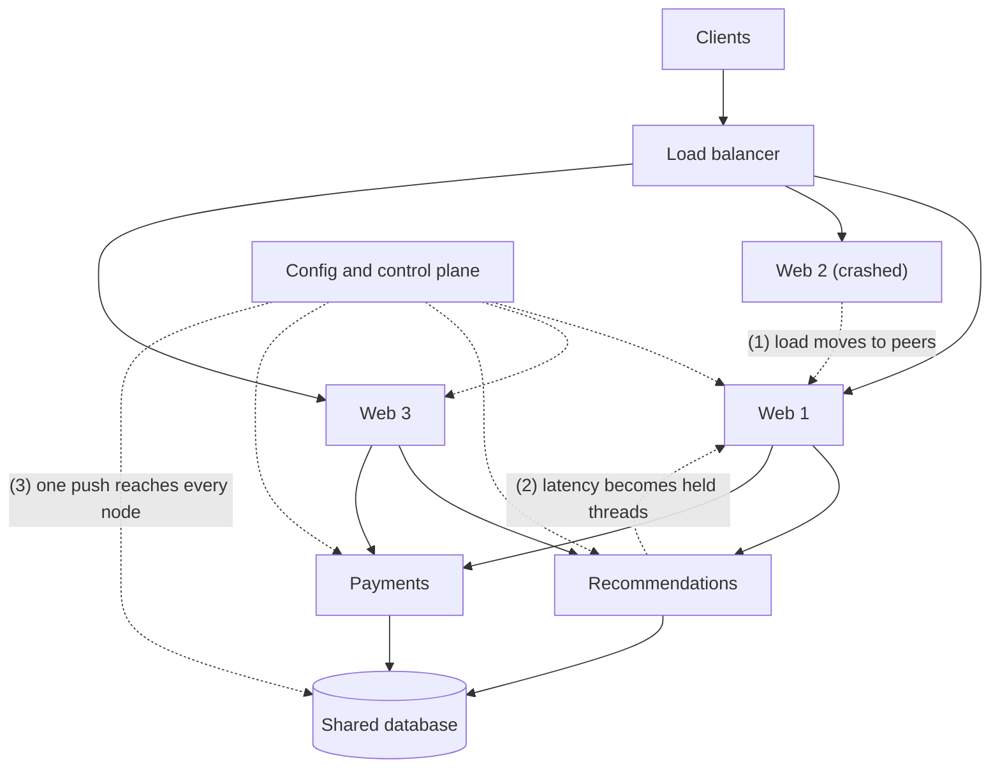
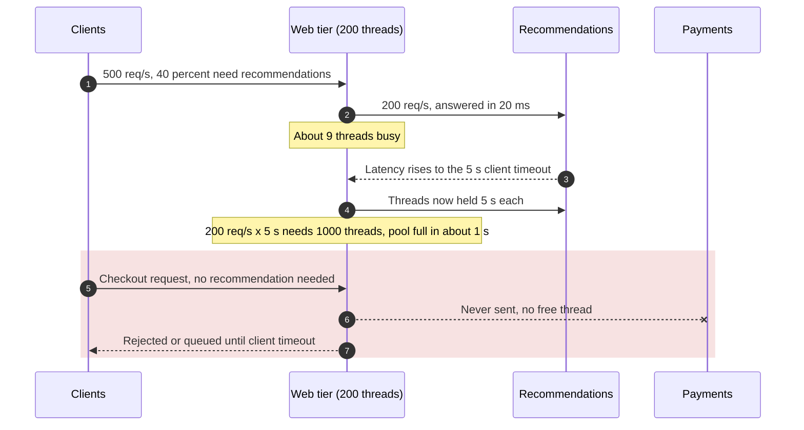
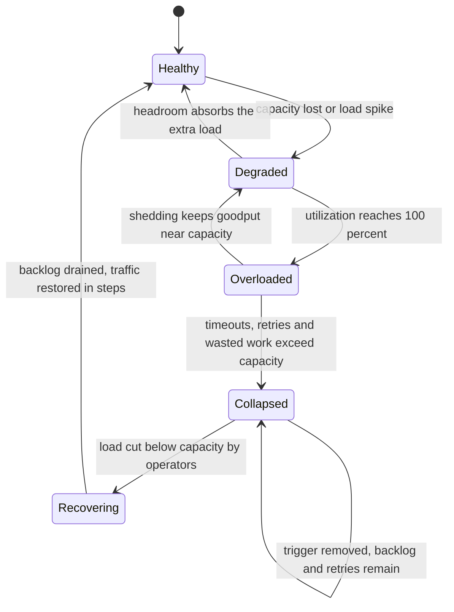
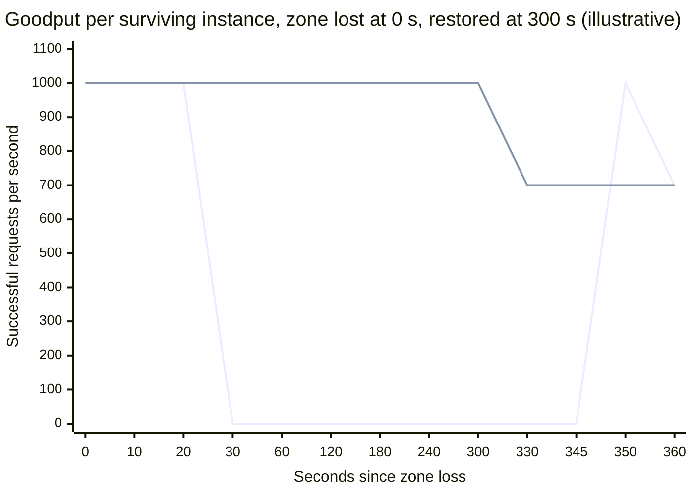
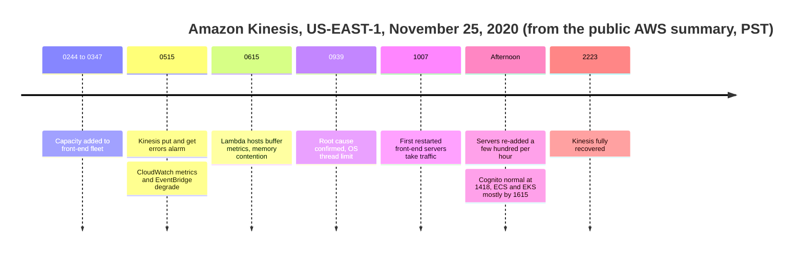

Kaskad hata (cascading failure), bir bileşendeki hatanın diğer bileşenlerin hata verme olasılığını artırdığı ve böylece hasarın tetikleyiciden sonra kendi kendine büyüdüğü hatadır. Ortak kökenli (common-mode) hatadan farklıdır: orada tek bir neden (hatalı bir firmware sürümü, bir elektrik olayı) birçok bileşeni aynı anda vurur; kaskadda ise her hata bir sonrakine yol açar. Ayırt edici işaret nedensel bir zincir, çoğu zaman da bir döngüdür: hata yükü artırır ya da kaynakları tutar, artan yük veya tutulan kaynaklar yeni hatalara neden olur, bunlar da yükü yeniden artırır.

Kaskadlar, dağıtık sistemlerin hataya tepki verecek şekilde kurulmasından doğar. Load balancer trafiği ölen bir instance'tan uzaklaştırır, istemciler başarısız bir çağrıyı yeniden dener (retry), orkestratörler çöken bir process'i yeniden başlatır, depolama sistemleri kaybolan bir kopyayı yeniden replike eder, bölgeler (region) birbirine failover yapar. Her tepki tek başına bir hata için doğrudur ve her biri aynı zamanda yükü, gecikmeyi ya da işi hatalı bir bileşenden sağlıklı bir bileşene taşıyan bir kanaldır. Kaskad savunmasının asıl dengesi doğrudan buradan çıkar: tekil hataları maskeleyen mekanizmalar, korelasyonlu hataları yayan mekanizmaların ta kendisidir ve yayılımı sınırlamak, bazı işlerin bilerek erken başarısız olmasına izin vermek demektir: istekleri reddetmek, retry'ları sınırlamak, çok fazla host'u devreden çıkarmayı reddetmek ya da zamanın çoğunda boşta duran yedek kapasite tutmak.

Bu sayfa yayılım mekanizmalarının ve bir sistemi bu mekanizmalar açısından analiz etme yönteminin kanonik sayfasıdır. Sistemi yalnızca retry'lar üzerinden çökmüş hâlde tutan geri besleme döngüsü [Retry Fırtınaları ve Metastabil Hatalar](/distributed-systems/tr/resilience/flow-control/retry-storms-metastable-failures/) sayfasında, bir replikasyon eşiğini aşan korelasyonlu hatalar [Deterministik ve Olasılıksal Hata Modelleri](/distributed-systems/tr/foundations/system-models/deterministic-vs-probabilistic/) sayfasında incelenir; tek tek savunmaların her birinin kendi sayfası vardır ve ilgili oldukları yerde bağlantı verilir.

## Hatanın Yayıldığı Üç Kanal

Bir hata, bileşeninden üç kanaldan biriyle çıkar ve her kanal farklı bir savunma gerektirir. Yük, aynı iş yükünü paylaşan eşler (peer) arasında yatay olarak hareket eder. Gecikme, çağrılan servisten çağıranlara doğru yukarı çıkar ve orada tutulan kaynaklara dönüşür. Bazı hatalar ise, kurtarma mekanizmasının kendisi de dahil olmak üzere, tüm bileşenlerin paylaştığı yollar üzerinden ilerler.


*Tek bir çağrı grafiği üzerinde üç yayılım kanalı: yatay yük aktarımı, dikey kaynak bağlılığı ve tüm bileşenlerin paylaştığı ortak bir yol.*

Diyagram sıradandır: içinde yanlış yapılandırılmış hiçbir şey yoktur. Web 2'nin çökmesi tam tasarlandığı gibi ele alınır; load balancer onun payını Web 1 ve Web 3'e gönderir. Recommendations'ın yavaşlaması kendi açısından bir hata değildir; hâlâ yanıt verir. Kontrol düzlemi (control plane) ise geri kalan her şeyi işletilebilir kılan bileşendir. Her ok, yalnızca alıcı taraf gelen yükü karşılayacak kapasiteye ya da izolasyona sahip olmadığında tehlikeli hâle gelir; kaskad analizinin tek tek bileşenlerin güvenilirliğiyle değil, pay (headroom) ve bağlılıkla (coupling) ilgilenmesinin nedeni budur.

### Yatay Kanal: Kaybedilen Kapasite Hayatta Kalanlara Biner

`N` özdeş instance'tan `k` tanesi hata verdiğinde, gelen yük `N - k` instance'a dağılır ve hayatta kalan her birinin yükü `N / (N - k)` katına çıkar. Bu artışın gecikmeye etkisi orantılı değildir. Bir sunucudaki kuyruk gecikmesi `u` kullanım oranı için kabaca `1 / (1 - u)` ile büyür; dolayısıyla %70'ten %90 kullanıma çıkmak gecikmenin kuyruk bileşenini üç katına çıkarır, %100 ve üzerinde ise hiçbir kararlı durum yoktur. Eğrinin türetilmesi [Kuyruk Teorisi Temelleri](/distributed-systems/tr/resilience/flow-control/queueing-theory-littles-law/) sayfasındadır.

Yatay kanal, aşırı yükün kendisi hataya yol açtığında kaskada dönüşür. Fazla istekleri bellekte biriktiren bir sunucunun heap'i tükenir, garbage collection kullanan bir runtime zamanını istek işlemek yerine çöp toplamakla geçirir, process meşgul olduğu için health check zaman aşımına uğrar. Bunların her biri aşırı yükü kapasite kaybına çevirir; kapasite kaybı ise aşırı yükün girdisidir. Döngü kazancı aritmetikte görünür: kalan `n` instance'tan bir tanesinin daha kaybı, hayatta kalan her birinin yükünü yeniden `n / (n - 1)` katına çıkarır ve `n` küçüldükçe bu çarpan büyür; yani her domino taşı bir öncekinden daha hızlı düşer.

### Dikey Kanal: Yavaş Bağımlılıklar Üst Katmanın Kaynaklarını Tüketir

Çağıran taraf beklerken kaynak tutar: bir thread ya da coroutine, bir pool'dan alınmış bağlantı, istek ve yanıt buffer'ları, eşzamanlı istek sınırında bir slot. Little Yasası'na göre tutulan kaynak sayısı, varış hızı ile her kaynağın tutulma süresinin çarpımına eşittir. Yavaşlayan ama yanıt vermeye devam eden bir bağımlılık, çağıranların tuttuğu kaynakları bu yüzden katlar ve bunu yaparken bir circuit breaker'ın ya da hata oranı alarmının sayacağı tek bir hata bile döndürmez.


*Yavaş bir bağımlılığın paylaşılan bir worker pool'u tüketmesi. Hızlar ve thread sayıları temsilidir.*

1. ve 2. adımlar sağlıklı durumdur. 3. adımda Recommendations hata vermez, yalnızca yavaşlar; bu daha tehlikeli davranıştır, çünkü 4. adımdan itibaren her çağrı bir thread'i istemci zaman aşımının tamamı boyunca tutar. 4. adımdan sonraki notta pool tükenmiştir ve 5.-7. adımlarda Recommendations'a hiç dokunmayan bir checkout isteği de başarısız olur, çünkü aynı thread'ler için yarışır. Payments baştan sona sağlıklıdır ve hiç trafik almaz; onun dashboard'larından bakıldığında olay, talepte bir düşüş gibi görünür. Kritik olmayan bir bağımlılıktaki hata kritik yolun hatasına dönüşmüş ve çağrı grafiğinde bir seviye yukarı çıkmıştır; artık web katmanını çağıranlar da onu beklerken kendi kaynaklarını tutacaktır.

Bu kanalın ne kadar uzağa ulaşacağını iki parametre belirler. Zaman aşımı, her kaynağın ne kadar süre tutulacağını, dolayısıyla çarpanı sınırlar; bu konu [Zaman Aşımları](/distributed-systems/tr/resilience/protection-patterns/timeouts/) sayfasında ele alınır. İzolasyon ise tükenen pool'u hangi isteklerin paylaştığını belirler: her bağımlılığa kendi sınırlı pool'unu ya da eşzamanlılık sınırını vermek [bulkhead deseni](/distributed-systems/tr/resilience/protection-patterns/bulkhead-pattern/), sağlıksız olduğu bilinen bir bağımlılığa karşı hızlıca başarısız olmak ise [circuit breaker](/distributed-systems/tr/resilience/protection-patterns/circuit-breaker/) desenidir.

### Ortak Yollar: Paylaşılan Bağımlılıklar, Kontrol Düzlemleri ve Kurtarma Eylemleri

Üçüncü kanal, hataları her şeyin bağımlı olduğu ve servis diyagramlarında nadiren görünen bileşenler üzerinden taşır: DNS, kimlik ve token servisleri, service discovery, yapılandırma dağıtımı, metadata servisleri, log ve metrik hatları, deployment sistemi. Buradaki bir hata tek bir bileşenin bozulması değildir; tüm bileşenlerin bir bağımlılığının aynı anda bozulmasıdır. Tüketicilerini çökerten bir yapılandırma gönderimi bunun en açık örneğidir; yapılandırma değişikliklerinin de binary'ler gibi aşamalı yayılmaya ihtiyaç duymasının nedeni budur ve bu yöntem [Canary Sürümü](/distributed-systems/tr/deployment/deployment-patterns/canary-release/) sayfasında anlatılır.

Kurtarma eylemleri de aynı kanalın parçasıdır ve en sık gözden kaçan unsurdur. Yeniden başlatılan bir filo soğuk cache'lerle gelir ve tüm okuma yükünü arkasındaki veritabanına gönderir; bu, filo ölçeğinde bir [cache stampede](/distributed-systems/tr/data-management/distributed-caching/cache-stampede/) olayıdır. Bir node'un değiştirilmesi, hayatta kalan replikalarda istemci trafiğiyle yarışan bir yeniden replikasyon başlatır. Bölgesel bir failover, bir bölgenin tüm yükünü kendi zirvesine göre boyutlandırılmış başka bir bölgeye taşır. Bunların her biri, zaten zayıflamış oldukları anda, yükü en az kaldırabilecek bileşenlere yönelmiş bir yük sıçramasıdır.

## Pozitif Geri Besleme Döngüsü ve Tetikleyiciden Neden Uzun Yaşadığı

Bir kaskad, sistemin bozulmaya verdiği tepki yükü, bozulmanın yükü azaltmasından daha hızlı artırdığında kendi kendini sürdürür. Üç yükseltici tekrar tekrar karşımıza çıkar. Retry'lar istek başına deneme sayısını çarpar ve her katman retry yaptığında bu çarpım katmanlar boyunca bileşik olarak büyür. Boşa giden iş (wasted work), aşırı yüklenmiş bir sunucunun kapasitesini, çağıranların çoktan vazgeçtiği isteklere harcamasına yol açar. Kapasite kaldırma ise, yani çökmeler, başarısız health check'ler ya da load balancer'dan çıkarılma, kullanım oranı kesrinin paydasını küçültür.


*Aşırı yük altındaki bir servisin durumları. Collapsed üzerindeki öz döngü, kararlı hâle gelmiş bir kaskadın tanımlayıcı özelliğidir.*

Önemli geçişler Overloaded durumundan çıkan iki geçiştir. Fazla işi kabul noktasında atan (shedding) bir servis kapasitesinde verimli kalır ve yük düştüğünde Degraded durumuna geri döner. Tüm işi kabul eden bir servis ise Collapsed durumuna geçer; orada goodput'u, yani çağıranın deadline'ı içinde başarıyla tamamlanan isteklerin hızı, throughput'unun çok altına düşer. Collapsed üzerindeki öz döngü kaskadları pahalı kılan şeydir: tetikleyiciyi ortadan kaldırmak bu durumdan çıkarmaz, çünkü çöküş sırasında birikmiş backlog ve üretilmiş retry'lar onu orada tutmaya kendi başlarına yeterli yüktür. Tek çıkış yolu, yükün açıkça kapasitenin altına indirilmesi ve ardından kontrollü bir artıştan geçer. Bronson ve arkadaşları bu kalıcılığa metastabil hata (metastable failure) adını verir; arkasındaki retry dinamikleri [Retry Fırtınaları ve Metastabil Hatalar](/distributed-systems/tr/resilience/flow-control/retry-storms-metastable-failures/) sayfasında incelenir.

### Aşırı Yüklenmiş Bir Kuyrukta Goodput Çöküşü

Boşa giden iş, goodput'u sıfıra indirmek için hiç retry'a ihtiyaç duymaz. Kapasitesi saniyede `C` istek olan, sınırsız bir ilk giren ilk çıkar (FIFO) kuyruğa sahip ve istemcilerinin bir `T` zaman aşımından sonra sunucuya haber vermeden isteği bıraktığı bir sunucu düşünün. Gelen yük `L > C` ise kuyruk saniyede `L - C` kadar büyür. Aşırı yük başladıktan `s` süre sonra işlenen bir istek `s * C / L` anında gelmiştir, dolayısıyla `s * (1 - C / L)` kadar beklemiştir. Bu bekleme `T`'yi aştığı andan itibaren sunucunun tamamladığı her istek çoktan terk edilmiş bir istektir. Goodput `s = T / (1 - C / L)` anında sıfıra düşer ve sunucu %100 kullanım ve tam throughput raporlarken orada kalır.

Bu eşik kısadır. `T = 1 s` ve %20 aşırı yükte `1 - C / L = 1/6` olur ve goodput 6 saniye sonra sıfıra ulaşır; %5 aşırı yükte bu 21 saniye sürer. Aşırı yük küçüktür; çöküş ise tamdır. Daha kötüsü, yük kapasitenin altına geri düştüğünde sunucu önce terk edilmiş isteklerden oluşan backlog'u eritmek zorundadır ve kuyruk `T * C`'den kısa olana kadar hâlâ hiçbir faydalı çıktı üretmez.

### Örnek Hesap: Üç Zone'dan Birini Kaybetmek

Üç availability zone'a eşit dağılmış 12 instance'tan oluşan, her instance'ı saniyede 1.000 istekte doyan ve zirvede saniyede 8.400 istek alan, yani instance başına 700 istekle %70 kullanımda çalışan stateless bir servis varsayın. Tüm rakamlar temsilidir. Filo tek bir instance'ın kaybını rahatça karşılar (11 instance'ta instance başına 764 istek) ve yalnızca N+1'i kontrol eden kapasite incelemeleri onu sağlıklı ilan eder.

Bir zone kesintisi dört instance'ı ortadan kaldırır. Kalan sekiz instance'ın her biri saniyede 1.050 istek alır; bu, kapasitenin %5 üzerindedir. Önceki bölümdeki FIFO sunucu ve 1 saniyelik istemci zaman aşımıyla, filonun toplam 8.000 istek/s kapasitesi talebin %95'i olmasına rağmen, hayatta kalan her instance'ta goodput 21 saniye sonra sıfıra ulaşır. Zone'un 300 saniye sonra geri geldiğini varsayın. Hayatta kalan her instance `50 * 300 = 15.000` isteklik, yani yaklaşık 15 saniyelik bir backlog biriktirmiştir. Instance başına yük 700'e geri düşer, kuyruk saniyede 300 istek hızla erir ve goodput ancak kuyruk 1.000 kaydın altına indiğinde, yani 47 saniye daha sonra geri gelir. Kesinti 300 saniye sürmüştür; servis yaklaşık 326 saniye boyunca hiçbir şey üretmemiştir.


*20. saniyeden sonraki alt çizgi: deadline'dan habersiz FIFO kuyruk. Üst çizgi: deadline'ı geçmiş istekleri işlemeye başlamadan atan aynı sunucu. Retry modellenmemiştir.*

İki çizgi yalnızca sunucunun süresi dolmuş bir istekle ne yaptığında ayrılır. Onu kuyruktan çıkarırken atmanın neredeyse hiçbir maliyeti yoktur; bu yüzden deadline'a duyarlı sunucu boyunca saniyede yaklaşık 1.000 taze isteği tamamlamayı sürdürür ve zone geri döner dönmez 700'e iner; hizmet verilemeyen %5 her şeyi peşinden sürüklemek yerine hızla başarısız olur. Grafik, FIFO durumunu pratikte daha da kötüleştirecek iki yükselticiyi de dışarıda bırakır: zaman aşımına uğrayan isteklerini yeniden deneyen ve gelen yükü kabaca iki katına çıkaracak istemciler ile kuyruk belleği doldurdukça çöken ve instance başına yükü 1.200'e ve ötesine taşıyacak instance'lar.

Bu olayı önleyen kapasite kuralı aritmetikten çıkar. `N` instance'tan `k` tanesinin kaybına `u_max` en yüksek güvenli kullanım oranında dayanmak için, kayıptan önceki instance başına kullanım `u_max * (N - k) / N` değerini aşmamalıdır. Zone büyüklüğündeki kayıplarla (`k = 4`, `N = 12`) ve `u_max = 0.8` ile bu değer %70 değil, %53'tür. Daha fazla zone'a yaymak bu payın maliyetini düşürür: üçer instance'lık dört zone'la aynı kural %60'a izin verir.

:::note[N+1, tek bir hata alanı hakkında bir ifadedir]
Kapasite planları çoğu zaman birimi belirtmeden N+1 der. Instance bazında N+1 olan bir filo; zone, rack ya da deployment dalgası bazında N'nin altında kalabilir. Servisin aşırı yüke girmeden kaybedebilmesi gereken en büyük korelasyonlu birimi açıkça belirtin ve payı bu birime göre boyutlandırın; korelasyon yapısının kendisi [Deterministik ve Olasılıksal Hata Modelleri](/distributed-systems/tr/foundations/system-models/deterministic-vs-probabilistic/) sayfasında ele alınır.
:::

## Bir Topolojiyi Kaskad Riski Açısından Analiz Etmek

Kaskad analizi, bağımlılık grafiğinin her node'una ve her kenarına dört sorunun uygulandığı bir incelemedir. Savunmaların hepsinden ucuzdur ve hangi savunmaların maliyetine değdiğine o karar verir.

İlk soru, bu node hata verdiğinde yükün nereye gittiğidir. Replike edilmiş her katman için, en büyük korelasyonlu hata alanının kaybından sonra zirve yükte hayatta kalanların kullanım oranını yukarıdaki kuralla hesaplayın. Herkese hizmet veren gizli katmanları da dahil edin: veritabanı primary'si, token servisi, metadata deposu, DNS resolver'ları. Hayatta kalanları güvenli kullanım oranını aşan bir katman bir domino taşıdır.

İkinci soru, çağıranların bu node'u beklerken neyi ve ne kadar süreyle tuttuğudur. Çağrı hızını normal gecikmeyle değil, çağıranın zaman aşımıyla çarpın ve sonucu çağrının paylaştığı pool ya da eşzamanlılık sınırıyla karşılaştırın. Çarpımın paylaşılan pool'u aştığı kenarlar dikey yayılım yollarıdır. Çağrılan servisin gecikme dağılımından türetilen ve deadline olarak aşağıya taşınan (propagated) zaman aşımlarını tercih edin; böylece aşağı akıştaki bir çağrı, asıl çağıranın beklemeye razı olduğundan daha uzun beklemez.

Üçüncü soru, tek bir kullanıcı isteğinin kaç deneme üretebileceğidir. `d` katmanın her biri en fazla `r` deneme yapıyorsa, başarısız bir yaprak servis kullanıcı isteği başına en fazla `r^d` deneme alır: üç katmanın her birinde üç deneme 27 eder. Retry'ı yalnızca tek bir katmanda, genellikle kullanıcıya en yakın olanda ya da retry bütçesi olanda yapın; diğerlerini hızlıca başarısız olacak şekilde bırakın.

Dördüncü soru, kurtarmanın neye ihtiyaç duyduğudur. Bu katmanın soğuk başlangıcının bağımlılıklarından ne istediğini listeleyin (cache ısınması, bağlantı kurulumu, yapılandırma çekme, leader seçimi) ve bağımlılığın, kendisi de toparlanırken bu ani yükü karşılayabildiğini doğrulayın. Özellikle döngüleri arayın: başlamak için kendi bağımlılığına ihtiyaç duyan bir servis, raporladığı sisteme bağımlı bir durum sayfası, çökmüş olan kimlik servisine ihtiyaç duyan bir operatör aracı. Kurtarma grafiğindeki döngüler bir kaskadı kilitlenmeye (deadlock) dönüştürür.

Savunmalar bu kanallara eşlenir ve hiçbiri hepsini kapsamaz.

| Savunma | Kırdığı kanal | Maliyeti | Ne zaman tercih edilmeli |
|---|---|---|---|
| Hata alanı başına kapasite payı | Yatay | En büyük korelasyonlu kayba göre ayrılmış boşta kapasite | Kritik katmanlarda her zaman; en büyük korelasyonlu kayba göre boyutlandırın |
| [Yük atma](/distributed-systems/tr/resilience/flow-control/load-shedding/) ve deadline'a duyarlı kuyruklar | Boşa giden iş üzerinden geri besleme | Aşırı yük altında açık reddetmeler | Kapasitesinden fazla yük alabilecek her sunucu |
| Zaman aşımları ve aşağı taşınan deadline'lar | Dikey | Geç de olsa başarılı olabilecek çağrıların başarısız olması | Her uzak çağrı; varsayılanlardan değil, ölçülen gecikmeden belirleyin |
| Bulkhead'ler ve bağımlılık başına eşzamanlılık sınırları | Dikey | Pool'daki kaynakların daha düşük zirve kullanımı | Farklı kritiklikte bağımlılıkları olan çağıranlar |
| Circuit breaker'lar | Dikey ve hata veren servise binen yük | Açık kalınan süre boyunca reddedilen istekler | Hatası hata oranı ya da gecikmeyle tespit edilebilen bağımlılıklar |
| Retry bütçeleri, tek katmanda retry | Denemeler üzerinden geri besleme | Geçici hatalarda daha düşük başarı oranı | Retry yapan tüm istemciler; derin çağrı grafiklerinde zorunlu |
| Statik kararlılık ve aşamalı yayılım | Ortak yollar | Önceden ayrılmış kapasite, daha yavaş yapılandırma dağıtımı | Kontrol düzlemleri, yapılandırma ve failover yolları |

### Yükün Nasıl Hareket Edeceğini Belirleyen Proxy Ayarları

Bir service mesh'te bu savunmaların bir kısmı sidecar'da ya da edge proxy'de yaşar ve varsayılan değerleri bir kaskad politikasını kodlar. Envoy'da cluster başına circuit breaker eşikleri, tek bir upstream cluster'a yönelik eşzamanlı bağlantıları, bekleyen istekleri, aktif istekleri ve eşzamanlı retry'ları sınırlar; belgelenmiş varsayılanlar ilk üçü için 1.024, retry'lar için 3'tür. Retry bütçesi tanımlandığında sabit retry sınırının yerini aktif isteklerin bir yüzdesi alır (varsayılan %20, en az 3 eşzamanlı retry tabanıyla). Outlier detection art arda hata döndüren host'ları devreden çıkarır (ejection), ancak varsayılan olarak hiçbir zaman cluster'ın %10'undan fazlasını çıkarmaz; panic threshold (varsayılan %50) ise sağlıklı host'lar yarının altına düştüğünde Envoy'un sağlık durumuna göre filtrelemeyi bırakıp trafiği tüm host'lara dağıtmasını sağlar.

```yaml
clusters:
- name: recommendations
  circuit_breakers:
    thresholds:
    - priority: DEFAULT
      max_pending_requests: 64      # bound the queue instead of letting it absorb overload
      max_requests: 256             # caller-side concurrency limit for this dependency
      retry_budget:                 # overrides max_retries when present
        budget_percent: { value: 10.0 }
        min_retry_concurrency: 3
  outlier_detection:
    consecutive_5xx: 5
    max_ejection_percent: 10        # never eject enough hosts to overload the rest
  common_lb_config:
    healthy_panic_threshold: { value: 50.0 }   # below this, route to all hosts
```

Son iki ayar, tam tersi gibi görünen kaskad savunmalarıdır. Sağlıksız bir host'u çıkarmak tek bir kötü host için doğrudur, ama tüm host'lar aşırı yük yüzünden yavaşladığında felakettir: her çıkarma geri kalanların yükünü artırır, onlar da kontrollerden geçemez ve sırayla çıkarılır. Çıkarma sınırı ve panic threshold, load balancer'ın tüm trafiği giderek küçülen bir hayatta kalanlar kümesine yığmasını engeller; iyi host'ları yok etmemek karşılığında kötü host'lardan gelen bazı hataları kabul eder.

:::caution[Derin health check'ler kapasiteyi tam ihtiyaç duyulduğu anda kaldırır]
Veritabanını çağıran ya da process meşgulken zaman aşımına uğrayan bir liveness veya load balancer health check'i, aşırı yük ya da bir bağımlılık kesintisi sırasında tüm instance'larda aynı anda başarısız olur. Orkestratör bu durumda sağlıklı process'leri yeniden başlatır ve bunlar soğuk cache'ler ve daha yüksek başlangıç maliyetiyle geri gelir; ya da load balancer hepsini devreden çıkarır. Liveness kontrollerini process'e yerel tutun, bağımlılık kontrollerini readiness'ta ve tüm instance'lar birlikte başarısız olduğunda fail-open davranışıyla tutun; ayrıntılar için [Liveness ve Readiness](/distributed-systems/tr/kubernetes/runtime-and-operations/kubernetes-probes/) ve [Sağlık Durumuna Duyarlı Yönlendirme](/distributed-systems/tr/communication/load-balancing/health-aware-routing/) sayfalarına bakın.
:::

## Production'daki Hata Modları

Kamuya açık postmortem'lerdeki kaskadlar nadiren bir çökmeyle başlar. Bir yavaşlamayla, bir kapasite değişikliğiyle ya da rutin bir işlemle başlar ve sistemin verdiği tepkiyle kesintiye dönüşür.

### Kapasite Kaybından Sonra Domino Etkisiyle Aşırı Yük

Tetikleyici: bir zone, rack ya da deployment dalgası, kalan payın karşılayabileceğinden fazla kapasiteyi ortadan kaldırır. Belirtiler: hayatta kalanların gecikmesi saniyeler içinde artar, ardından instance'lar art arda çökmeye ya da health check'lerde başarısız olmaya başlar ve her kayıp bir öncekinden daha erken gelir. Tespit: instance başına kullanımın kayıp sonrası eşikle karşılaştırılması, zaman içindeki instance sayısı, çökme nedenleri (out-of-memory sonlandırmaları, GC süresi) ve throughput'tan ayrı ölçülen goodput. Hafifletme: kapasite eklemeden önce, gelen yükü hayatta kalan kapasitenin altına indirmek için edge'de yük atın; çünkü çöken bir filoya eklenen yeni instance'lar ısınmadan uçurumdan itilir. Kurtarma: önce kapasiteyi geri getirin, ardından goodput'u izleyerek trafiği adım adım yeniden kabul edin.

### Yük Altında Kapasite Kaldıran Health Check'ler

Tetikleyici: aşırı yük ya da paylaşılan bir bağımlılığın kesintisi, birçok instance'ta health check'lerin aynı anda başarısız olmasına neden olur. Belirtiler: instance yeniden başlatmaları ya da çıkarmaları zamanda kümelenir; hata oranları artarken sağlıklı host sayısı düşer; başlangıcın kendisi pahalı olduğu için yeniden başlatılan pod'lar crash loop'a girer. Tespit: yükle korelasyonlu yeniden başlatma sayıları ve outlier ejection sayaçları, filonun sağlıksız işaretlenen oranı ve nedeni process hatası değil zaman aşımı olan liveness başarısızlıkları. Hafifletme: çıkarmaları sınırlayın, panic yönlendirmeyi etkinleştirin, liveness kontrollerini ucuz ve yerel yapın. Kurtarma: kapasitenin küçülmesini durdurmak için başarısız olan kontrolü geçici olarak devre dışı bırakın ya da eşiğini yükseltin.

### Paylaşılan Bir Kontrol Servisine Karşı Retry Döngüsü

20 Eylül 2015'te US-East'teki DynamoDB, geri besleme döngüsünü tüm depolama sunucularının bağımlı olduğu bir metadata servisinde gösterdi. Depolama sunucuları sahip oldukları partition'ların listesi olan üyelik (membership) bilgilerini bu servisten periyodik olarak ve ayrıca bir ağ kesintisinden sonra çeker. Global Secondary Index'lerin hızla benimsenmesi, büyük tablolar için üyelik listelerini çok büyütmüş ve yanıt sürelerini depolama sunucularının sınırına yaklaştırmıştı. PDT ile 02:19'daki kısa bir ağ kesintisi birçok sunucunun aynı anda üyelik istemesine yol açtı; yanıtlar sınırı aştı, sunucular yeniden denedi ve kendilerini hizmetten çıkardı; rutin yenilemeleri artık zaman aşımına uğrayan sağlıklı sunucular da devreden çıktı. Müşteri hata oranları yaklaşık %55'e ulaştı. Metadata servisine kapasite ekleme girişimleri, servis yönetim isteklerini işleyemeyecek kadar aşırı yüklü olduğu için başarısız oldu. Kurtarma, operatörlerin 05:06'da metadata servisine yönelik istekleri duraklatıp retry yükünü sona erdirmesi, kapasite eklemesi ve depolama sunucularını kademeli olarak yeniden kabul etmesiyle geldi; müşterilerin çoğu 07:10'a kadar normal hata oranlarına döndü.

Bu sıra, bu sayfadaki her unsuru içerir: payı fark edilmeden tüketen yavaş bir büyüme (üyelik boyutu izlenmiyordu), talebi senkronize eden bir tetikleyici, yavaşlığı hataya dönüştüren bir zaman aşımı, kapasiteyi kaldıran bir kurtarma eylemi, tetikleyiciden sonra da süren bir retry döngüsü ve kapasite eklemekle değil yükü kesmekle başlayan bir çözüm.

### Bir Bağımlılık Grafiği Boyunca Yayılım

25 Kasım 2020'de US-EAST-1'deki Amazon Kinesis Data Streams'in front-end filosuna yapılan bir kapasite eklemesi, Kinesis üzerine kurulu servislere yayılan bir kesintiyi tetikledi. Her front-end sunucusu diğer her front-end sunucusu için bir işletim sistemi thread'i tutuyordu; dolayısıyla thread sayısı filo büyüklüğüyle birlikte artıyordu. Eklenen sunucular front-end sunucularını bir işletim sistemi thread sınırının ötesine itti; bundan sonra sunucular shard haritalarını oluşturamadı ve istekleri yönlendiremedi.


*Olay sırası AWS'nin kamuya açık özetinden alınmıştır. Tüm bağımlı servislerin toparlanma zamanları gösterilmemiştir.*

Zaman çizelgesinin üç özelliği analiz açısından önemlidir. Tetikleyici bir kapasite eklemesiydi, yani normalde bir servisi daha güvenli kılmak için yapılan eylem; bağlılık ise (filo büyüklüğüyle orantılı thread'ler) daha küçük ölçeklerde görünmeyen bir ölçekleme özelliğiydi. Yayılım, kâğıt üzerinde best-effort olan bağımlılık kenarlarını izledi: Cognito ve Lambda, analitik ve metrikler için Kinesis ve CloudWatch kullanıyordu ve her iki durumda da teslim edilemeyen verinin yerel olarak buffer'lanması, asıl iş yüküne hizmet eden host'lardaki kaynakları tüketti; bu, dikey kanalın daha az belirgin bir biçimidir. Kurtarma ise bilerek yavaş tutuldu: hızlı bir yeniden başlatmanın yaratacağı çekişmeden kaçınmak için front-end filosu saatte birkaç yüz sunucu hızıyla geri getirildi; bu da Collapsed durumundan kontrollü artışla çıkıştır. AWS ayrıca Service Health Dashboard'a gönderi yapan aracın Cognito'ya bağımlı olduğunu bildirdi; bu, dördüncü analiz sorusunun aradığı türden bir kurtarma grafiği döngüsüdür.

:::tip[Best-effort bağımlılıkları kaynak açısından da best-effort yapın]
Bir bağımlılık ancak hatası çağıranın belleğini, thread'lerini ya da bağlantılarını tüketemiyorsa gerçekten isteğe bağlıdır. Telemetri, analitik ve denetim (audit) yan kanallarına ait buffer'ların sabit bir boyutu ve bir veri atma politikası olmalı, bunlara yazanlar istek yolunu asla bloklamamalıdır. Bunu bağımlılığı durdurarak değil, trafiğini sessizce yutarak (blackhole) test edin: reddedilen bir bağlantı hızlıca başarısız olur, sessiz kalan bir bağlantı ise her sınırsız beklemeyi ortaya çıkarır.
:::

| Hata | Kanal | Dışarıdan belirti | Tespit sinyali | Hafifletme |
|---|---|---|---|---|
| Domino etkisiyle aşırı yük | Yatay | Instance'lar art arda ve her seferinde daha hızlı düşer | Hayatta kalanların kullanımı ve kayıp sonrası eşik; çökme nedenleri | Edge'de yük atın, sonra kapasiteyi geri getirin |
| Pool tükenmesi | Dikey | Yavaş bir bağımlılıkla birlikte ilgisiz endpoint'ler de başarısız olur | Pool doygunluğu, bağımlılık başına eşzamanlı istekler | Zaman aşımları, bulkhead'ler, circuit breaker'lar |
| Health check ile kapasite kaybı | Yatay | Yük altında sağlıklı host sayısı düşer | Yükle korelasyonlu ejection'lar ve yeniden başlatmalar | Ejection sınırları, panic yönlendirme, yerel liveness |
| Retry döngüsü | Geri besleme | Tetikleyici giderildikten sonra kesinti sürer | İstek başına deneme sayısı, goodput ve throughput farkı | Retry bütçeleri, duraklatma ve kademeli artış |
| Kurtarma dalgası | Ortak yol | Filo geri geldiğinde ikinci bir kesinti | Cache isabet oranı, yeniden başlatma sonrası bağlantı hızı | Aşamalı yeniden başlatma, cache ısıtma, kabul kontrolü |
| Paylaşılan bağımlılık hatası | Ortak yol | Birçok servis birlikte başarısız olur | Paylaşılan bağımlılığa göre gruplanmış hatalar | Statik kararlılık, aşamalı yapılandırma yayılımı |

## Kaskad Analizi Tasarımı Ne Zaman Değiştirir

Analizi, kullanıcıya dönük bir hedefin kritik yolundaki her katman ve bir avuçtan fazla çağıranı olan her paylaşılan bağımlılık için yapın. Bir kapasite azaltımından önce, bir istek yoluna senkron bir bağımlılık eklemeden önce, yeni bir katmanda retry'ı etkinleştirmeden önce ve bir failover tasarımı kabul edilmeden önce bu analiz zorunludur: bir failover planı, alıcı tarafın aldığı yük için yeterli paya sahip olduğunu ve başlangıç ihtiyaçlarının kendileri de toparlanmakta olan bağımlılıklarca karşılandığını göstermedikçe eksiktir.

Çağrı grafiği derin ya da geniş olduğunda, katmanlar pool'ları veya veritabanlarını paylaştığında ve servisin kabul noktasında sınırlı bir kuyruk bulunmadığında savunmaların tamamına yatırım yapın. Kaynaklar tüketilmeden önce devreye giren savunmaları (kabul kontrolü, deadline'lar, eşzamanlılık sınırları), sonra devreye girenlere (yeniden başlatmalar, ejection'lar, otomatik ölçekleme) tercih edin; çünkü ikinci gruptakiler, kapasite değişikliğinin kendisinin kötüleştirdiği belirtilere tepki olarak kapasite kaldırır ya da ekler. Otomatik ölçekleme dakikalarca gecikmeli bir kapasite aracıdır, bir kaskad savunması değildir; darboğazı paylaşılan bir aşağı akış bileşeni olan bir katmanı ölçeklemek aşırı yükü oraya taşır, bu durum [HPA ve KEDA](/distributed-systems/tr/kubernetes/fundamentals/hpa-keda/) sayfasında anlatılır.

Kaskad riskine retry, daha uzun zaman aşımı ya da daha derin health check ekleyerek yanıt vermeyin; bunların her biri bir yayılım kanalını genişletir. Instance'lar zone ya da deployment dalgası bazında birlikte hata veriyorsa, payı tek instance hatasına göre boyutlandırmayın. Düşürülmüş bir modu yük altında denenmeden güvenli saymayın: [Fallback Stratejileri](/distributed-systems/tr/resilience/protection-patterns/fallback-strategies/) sayfasında tartışıldığı gibi, başka bir servisi çağıran fallback'ler yükü en kötü anda o servise taşır. Ve kâğıt üzerindeki analizle yetinmeyin; zirveye yakın yük altında bir zone'u kaldıran bir [GameDay](/distributed-systems/tr/resilience/chaos-engineering/gameday/), aritmetiğin tutup tutmadığını gösteren tek testtir.

Birçok servise dokunan her olay bir kaskad değildir. Tek bir yapılandırma gönderimi tüm tüketicileri aynı anda bozuyorsa hata ortak kökenlidir ve çözüm pay değil aşamalı dağıtımdır. Bir servis hata verdiğinde çağıranları hata döndürüyor ama o servis toparlandığı anda onlar da toparlanıyorsa, hata geri besleme olmadan yayılmıştır ve çözüm zarif bozulmadır (graceful degradation). Kaskada özgü imza, tetikleyiciden sonra büyüme ve tetikleyici kaldırıldıktan sonra kalıcılıktır; yukarıdaki geri beslemeyi kıran savunmaları gerektiren yalnızca bu imzadır.

## İleri Okuma

- Mike Ulrich, *Addressing Cascading Failures*, in Betsy Beyer, Chris Jones, Jennifer Petoff, and Niall Richard Murphy (eds.), *Site Reliability Engineering*, O'Reilly, 2016.
- Nathan Bronson, Abutalib Aghayev, Aleksey Charapko, and Timothy Zhu, *Metastable Failures in Distributed Systems*, USENIX HotOS, 2021.
- Lexiang Huang, Matthew Magnusson, Abishek Bangalore Muralikrishna, Salman Estyak, Rebecca Isaacs, Abutalib Aghayev, Timothy Zhu, and Aleksey Charapko, *Metastable Failures in the Wild*, USENIX OSDI, 2022.
- Amazon Web Services, *Summary of the Amazon DynamoDB Service Disruption and Related Impacts in the US-East Region*, 2015. https://aws.amazon.com/message/5467D2/
- Amazon Web Services, *Summary of the Amazon Kinesis Event in the Northern Virginia (US-EAST-1) Region*, 2020. https://aws.amazon.com/message/11201/
- Envoy Project, *Circuit breaking*, *Outlier detection*, and *Panic threshold*, Envoy proxy documentation.
