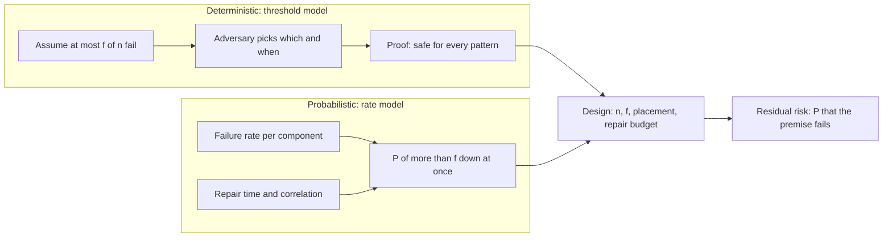
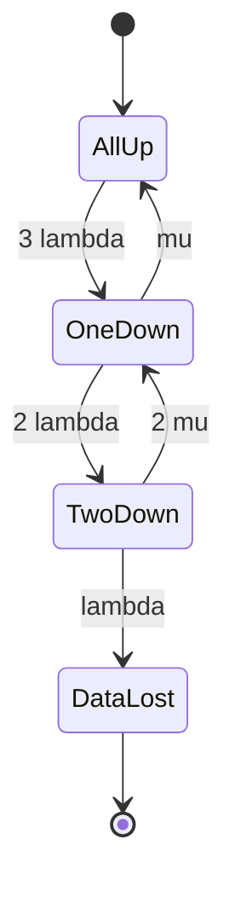
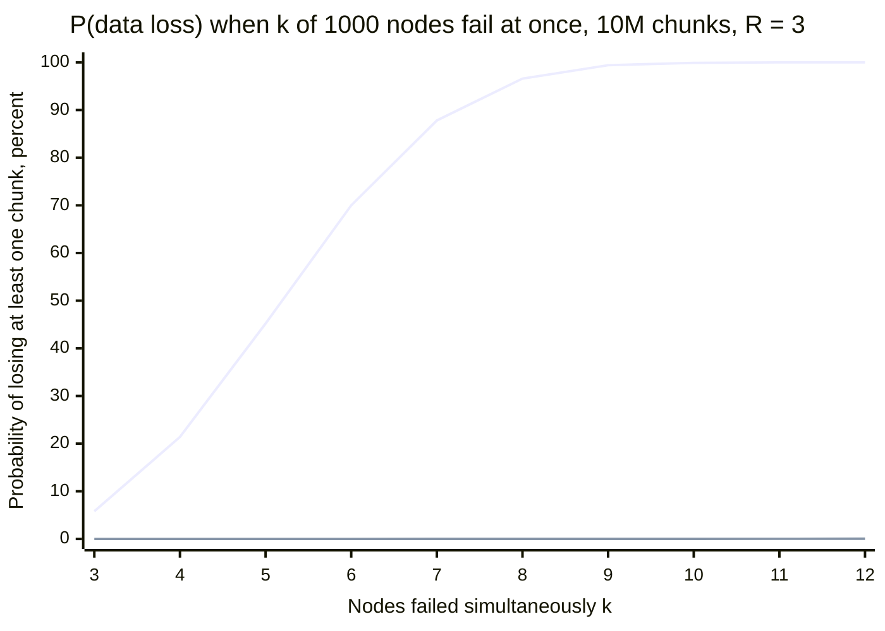
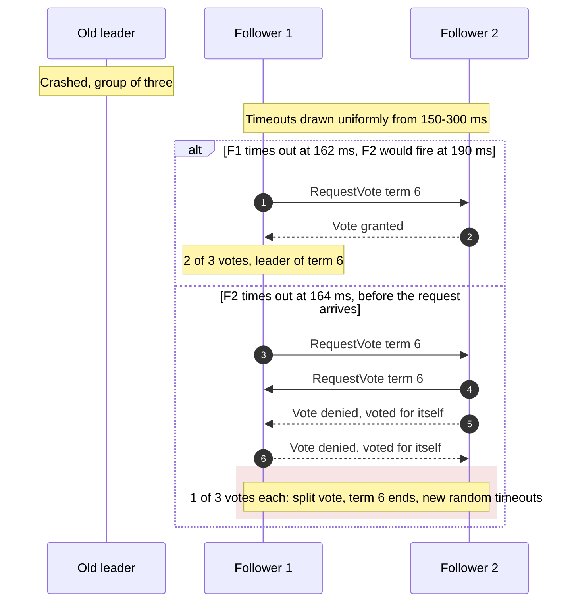
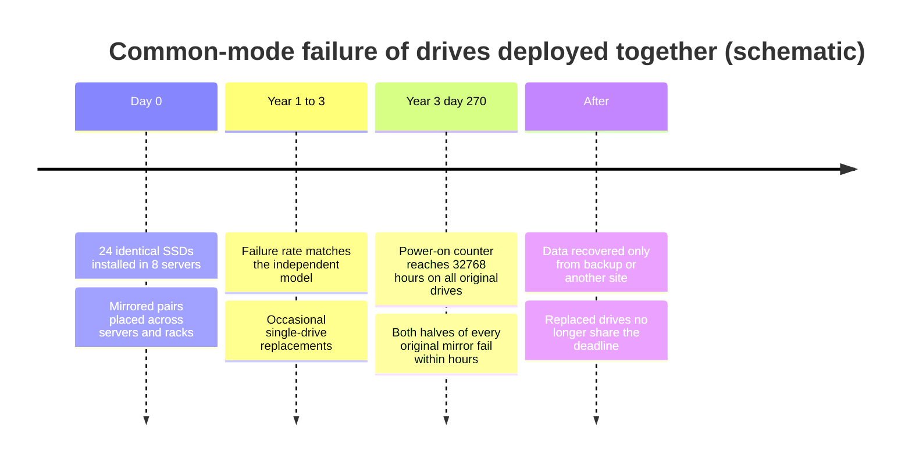

Deterministik bir hata modeli bir sınır koyar ve bu sınırın içindeki her davranış için konuşur: `n` process'ten en fazla `f` tanesi hata verir, hangilerinin ve ne zaman hata vereceğini bir düşman (adversary) seçer ve protokol bu seçimlerin her biri için doğru olmak zorundadır. Olasılıksal bir hata modeli ise hataları rastgele olaylar olarak tanımlar: her bileşen belirli bir oranla hata verir, belirli bir onarım süresi boyunca devre dışı kalır ve komşularından bağımsız ya da onlarla korelasyonlu biçimde bozulur. Birincisi "en fazla `f` bileşen bozulursa sistem güvenlidir" biçiminde garantiler üretir; ikincisi "bir yılda veri kaybetme olasılığı `p`'dir" biçiminde ifadeler. Gerçek her sistem ikisine de ihtiyaç duyar: birincisi öncülünün ne sıklıkla çiğnendiği hakkında hiçbir şey söylemez, ikincisi ise olası görmediği durumlarda ne olacağı hakkında hiçbir şey söylemez.

Asıl denge, ispat ile kalibrasyon arasındadır. Eşik modeli, sınırının altındaki her hata örüntüsüne, düşmanca zamanlama dahil, dayanıklıdır ve doğruluğu bir kez ve kalıcı olarak ispatlanabilir; ama bir operatöre üç replikanın yeterli olup olmadığını söyleyemez, çünkü "yeterli" bir olasılıktır. Olasılıksal model boyutlandırma sorusunu bir sayıyla yanıtlar, ancak bu sayı oranlar, onarım süreleri ve hepsinden önemlisi bağımsızlık hakkındaki varsayımları kadar iyidir; gerçek hataların ilk çiğnediği varsayım da bağımsızlıktır. Bir rack'in elektriğini kaybetmesi, bir firmware hatasının aynı üretim partisindeki her diskte tetiklenmesi ya da hatalı bir konfigürasyonun her yere dağıtılması gibi korelasyonlu hatalar, bağımsız hata tahminlerini düzenli olarak büyüklük mertebeleriyle yanıltır.

Ayrımın ikinci bir anlamı hatalara değil algoritmalara uygulanır. Deterministik bir protokol aynı girdiler ve aynı mesaj sıralamaları karşısında hep aynı davranır; rastgeleleştirilmiş (randomized) bir protokol ise yazı tura atar, böylece zamanlamayı kontrol eden bir düşman onu sonsuz bir döngüye zorlayamaz. Consensus, tamamen asenkron bir sistemde FLP imkansızlık sonucundan rastgeleleştirme sayesinde kaçar: safety deterministik kalır, sonlanma ise 1'e yakınsayan bir olasılığa dönüşür. Bu sonucun dayandığı zamanlama varsayımları [Ağ Modelleri](/distributed-systems/tr/foundations/system-models/network-models/) sayfasında, burada sayılan zararsız (benign) hata sınıfları ise [Hata Modelleri](/distributed-systems/tr/foundations/system-models/failure-models/) sayfasında tanımlanır.


*İki model farklı soruları yanıtlar. Eşik modeli sınırın içindeki davranışı ispatlar; oran modeli sınırın ne sıklıkla aşıldığını tahmin eder.*

Soldaki yol, protokol makalelerinin ispatladığı şeydir: [Raft](/distributed-systems/tr/coordination/consensus-algorithms/raft/) herhangi sayıda crash karşısında güvenlidir ve çoğunluk ayakta olduğu sürece ilerler; bir Bizans protokolü de `3f + 1` replikadan en fazla `f` tanesi hatalı davrandığı sürece güvenlidir. Sağdaki yol ise kapasite ve dayanıklılık (durability) planlamasının hesapladığı şeydir. İkisi tasarım kararında buluşur ve bu karardan çıkan şey hiçbir zaman bir kesinlik değildir: tek bir onarım penceresi içinde `f`'den fazla bileşenin bozulma olasılığıdır ve bir operatöre eşiğin doğru seçilip seçilmediğini söyleyen tek sayı da budur.

## Aynı Hatanın İki Tarifi

Eşik modeli hataları bir düşmanın seçimi olarak ele alır. Belirli bir hata kombinasyonunun olası olup olmadığını sormaz; sınırın içindeki herhangi bir kombinasyonun invariant'ı bozup bozamayacağını sorar. Garantilerinin güçlü olmasının ve ispatlarının patolojik zamanlamalara dayanmasının nedeni budur: `f` hatalı process'in her seçimi için doğru olduğu gösterilmiş bir protokol, ne kadar sıra dışı olursa olsun gerçekte yaşanan seçim için de doğrudur. Bedeli, modelin sınırın dışında sessiz kalmasıdır. Üç üyesi düşmüş beş üyeli bir Raft grubu, modelde "daha az güvenli" değildir; modelin dışındadır ve model, ilerlemenin duracağı dışında hiçbir öngörüde bulunmaz.

Model, olasılıkları birbirinden çok farklı hata örüntülerini de ayırt etmez: aynı güç hattını paylaşan üç üyeyi kaybetmek ile ayrı binalardaki üç üyeyi kaybetmek ispat için aynı olaydır, ama operatör için değildir.

### Oranlar, Onarım Süreleri ve Üstel Dağılım Varsayımı

Olasılıksal tarif her bileşene bir hata oranı `lambda` ve bir onarım oranı `mu` atar. Ortalama hataya kadar geçen süre (mean time to failure, MTTF) `1 / lambda`, ortalama onarım süresi (mean time to repair, MTTR) ise `1 / mu`'dür. Donanım üreticileri MTTF yayımlar; filo operatörleri ise yıllık hata oranını (annualized failure rate, AFR), yani bir popülasyonun yılda bozulan kesrini gözlemler. Küçük oranlar için ve MTTF saat cinsinden verildiğinde ikisi `AFR = 8760 / MTTF` ile ilişkilidir. Tek bir bileşenin kararlı durumdaki erişilebilirliği `MTTF / (MTTF + MTTR)`'dir.

Standart sadeleştirme, hataların bir Poisson sürecini izlediğidir: bir sonraki hataya kadar geçen süre üstel dağılımlıdır, belleksizdir ve bileşenler arasında bağımsızdır. Bu varsayım altında bir bileşenin kısa bir `t` penceresinde bozulma olasılığı yaklaşık `lambda * t`'dir ve birbiriyle örtüşen pencereler içinde birkaç bağımsız bileşenin birlikte bozulma olasılığı bu terimlerin çarpımıdır. Patterson, Gibson ve Katz'ın RAID için verdiği veri kaybına kadar ortalama süre formülleri bu varsayıma dayanır.

Saha verileri bu varsayımla üç biçimde çelişir. Birincisi, oranlar datasheet'lerin ima ettiğinden yüksektir: Schroeder ve Gibson yaklaşık 100.000 diski incelemiş ve yıllık değiştirme oranlarının tipik olarak %1'in üzerinde, yaygın olarak %2-4 arasında ve bazı sistemlerde %13'e kadar çıktığını bulmuştur; oysa datasheet'lerdeki 1 ile 1,5 milyon saatlik MTTF değerleri en fazla yaklaşık %0,88'lik bir oran ima eder. İkincisi, oranlar sabit değildir: aynı çalışmada değiştirme oranları, düz bir orta dönem izlemek yerine yaşla birlikte istikrarlı biçimde artmıştır. Üçüncüsü ve en önemlisi, hatalar bağımsız değildir: aynı çalışma değiştirmeler arasındaki sürelerde belirgin bir otokorelasyon ve uzun menzilli bağımlılık bulmuştur; yani bir hata bir sonrakinin olasılığını artırır.

### Bir Replika Grubunun Markov Modeli

Oranları bir dayanıklılık tahminine çevirmenin olağan yolu, durumları tek bir veri öğesinin kaç replikasının devre dışı olduğunu sayan sürekli zamanlı bir Markov zinciridir. Hatalar zinciri bir durum sağa, onarımlar bir durum sola taşır; en sağdaki emici (absorbing) durum veri kaybıdır.


*Bağımsız hatalar ve her bozuk replikanın paralel onarımı varsayımıyla, üç replikada saklanan tek bir öğenin Markov zinciri.*

`AllUp` durumundan üç replikanın herhangi biri bozulabilir, bu yüzden geçiş oranı `3 lambda`'dır. `OneDown` durumunda zincir, `mu` oranındaki bir onarım ile `2 lambda` oranındaki ikinci bir hata arasında yarışır; MTTR, MTTF'ye göre çok küçük olduğundan neredeyse her zaman geri döner. `TwoDown` durumunda son replika `lambda` oranıyla bozulurken iki onarım paralel olarak toplam `2 mu` oranıyla ilerler. `mu`, `lambda`'dan çok büyük olduğunda veri kaybına kadar ortalama süre (mean time to data loss, MTTDL) yaklaşık `mu^2 / (3 * lambda^3)`, yani `MTTF^3 / (3 * MTTR^2)`'dir. Özgün RAID analizinde olduğu gibi hataları birer birer onaran tek bir onarım ekibi varsayıldığında `TwoDown` durumundan çıkış oranı `mu` olur ve sabit 6'ya çıkar.

Bu formülün iki özelliği dayanıklılık mühendisliğinin büyük kısmını belirler. MTTDL, MTTF'nin küpüyle artar ama MTTR'nin karesiyle azalır; dolayısıyla rebuild süresini yarıya indirmek MTTDL'i dört katına çıkarır, bu da MTTF'de 1,6 katlık bir iyileşmeyle aynı kazançtır. Ayrıca formül tek bir öğeyi anlatır: bir filo milyonlarca öğe saklar ve filo düzeyindeki soru kaç farklı replika kümesinin bulunduğudur; bu bir donanım kararı değil, bir yerleşim (placement) kararıdır.

:::caution[MTTDL filo hakkında değil, model hakkında bir ifadedir]
Tek bir replika grubu için yayımlanmış milyarlarca yıllık bir MTTDL, verinin bağımsız donanım hataları yüzünden kaybolmayacağını söyler. Korelasyonlu elektrik olaylarından, operatör hatalarından, veriyi her replikada silen yazılım hatalarından ya da firmware kusurlarından kaynaklanan kayıplara bir sınır koymaz. Dayanıklılık tahminlerini onları üreten varsayımlarla birlikte raporlayın ve bağımsız hata varsayımıyla hesaplanmış bir MTTDL'i, aynı şeyi ölçüyormuş gibi bir erişilebilirlik hedefiyle asla karşılaştırmayın.
:::

## Oranlardan Riske: Yerleşim ve Korelasyon

Korelasyon iki yoldan girer. Ortak nedenli (common-cause) olaylar birçok bileşeni aynı anda devre dışı bırakır: bir güç dağıtım birimi, bir top-of-rack switch, bütün bir hücreye dağıtılan bir kernel güncellemesi, bir soğutma arızası. Ortak kipli (common-mode) kusurlar ise bileşenlerin birbirinin aynısı olduğu için birlikte bozulmasına yol açar: aynı üretim partisinden diskler, aynı firmware, aynı binary. Ortak nedenli hatalar uzayda kümelenir ve hata alanları (failure domain) arasında yerleşimle ele alınabilir; ortak kipli hatalar ise tasarımda kümelenir ve yerleşimden etkilenmez, çünkü her alan aynı kusuru taşır.

Ford ve arkadaşları bunu Google'ın depolama filosunda ölçmüştür. Her biri bir öncekinden en fazla iki dakika sonra gelen node hatalarından oluşan diziye hata patlaması (failure burst) adını vermiş, büyük patlamaların güçlü biçimde rack'e bağlı olduğunu bulmuş ve node hataları arasındaki korelasyonun erişilemezliğe katkıda bulunan diğer tüm etkenleri gölgede bıraktığı sonucuna varmışlardır. Temel nicel bulguları, korelasyonlu node hatalarını hesaba katmamanın erişilebilirliği tipik olarak en az iki büyüklük mertebesi fazla tahmin ettirdiğidir. Ayrıca rack farkındalıklı (rack-aware) yerleşimin bir stripe'ın hataya kadar ortalama süresini tipik olarak 3 kat artırdığını ve veri merkezleri arasında replikasyonun korelasyona karşı tek bir merkez içinde replika eklemekten çok daha iyi koruduğunu göstermişlerdir: iki hücrenin her birinde ikişer kopya, tek bir hücredeki dört kopyadan iki büyüklük mertebesi daha uzun bir MTTF sağlamıştır.

### Hesaplanmış Örnek: Bağımsız Tahmin ve Korelasyonlu Olay

Her biri %4'lük bir AFR ile bozulan (`lambda = 0.04 / 8760` saat başına, MTTF yaklaşık 219.000 saat) 1.000 node'dan oluşan, her biri üç kez replike edilmiş 10 milyon chunk tutan bir depolama kümesi varsayın. Bozulan bir node'un chunk'ları hayatta kalanlardan 2 saatte yeniden replike edilir. Tüm sayılar örnek amaçlıdır.

Bağımsız model altında tek bir replika grubu için `MTTDL = 219000^3 / (3 * 2^2)` saattir, yaklaşık 100 milyar yıl. Filo ise tek bir grup değildir. Rastgele yerleşimde her chunk rastgele bir node üçlüsüne düşer. Olası `C(1000, 3)`, yani yaklaşık 166 milyon üçlü vardır ve 10 milyon chunk bunların yaklaşık %5,8'ini doldurur. Aynı zincir filo genelinde toplandığında, herhangi üç node'un aynı anda devre dışı olma oranı yaklaşık `N * (N - 1) * (N - 2) * lambda^3 / (2 * mu^2)`'dir; bu da yılda yaklaşık 0,0017, yani 600 yılda bir eder. Bu üçlülerin yalnızca %5,8'i bir chunk tuttuğu için bağımsız hatalardan kaynaklanan veri kaybı yaklaşık 10.000 yılda bir yaşanır. 2 saat yerine 24 saatlik bir rebuild ile aynı aritmetik 72 yılda bir sonucunu verir: MTTR'deki on iki katlık artış 144 katlık bir bedel doğurur.

Şimdi yılda bir korelasyonlu olay ekleyin: tesis genelinde bir elektrik kesintisi ve sonrasında node'ların %1'inin, yani 10 makinenin geri gelmemesi; bu, Cidon ve arkadaşlarının copyset replikasyonunu gerekçelendirmek için kullandığı türden bir senaryodur. On bozuk node `C(10, 3) = 120` üçlü içerir ve her biri 0,058 olasılıkla bir chunk tutar; dolayısıyla en az bir chunk'ın üç replikasının da bozuk node'larda olma olasılığı `1 - 0.942^120`, yaklaşık %99,9'dur. Bağımsız model 10.000 yılda bir kayıp öngörmüştü; korelasyonlu olay ise her gerçekleştiğinde kaybı neredeyse kesin hâle getirir, kabaca dört büyüklük mertebesi daha kötü.


*Üst eğri: rastgele yerleşim. Alt eğri: 333 ayrık copyset, her chunk bunlardan birinde. Hesaplanmış örnekteki aynı örnek küme.*

Üst eğri, rastgele yerleşimin korelasyonlu hatalar karşısında neden kırılgan olduğunu gösterir: farklı replika kümelerinin sayısı o kadar büyüktür ki bozulan hemen her node grubu bunlardan birini içerir. Alt eğri copyset yerleşimini kullanır: küme üçer node'luk 333 sabit gruba bölünür ve her chunk tam olarak bir grupta saklanır. On bozuk node artık yalnızca bir grubun tamamını içerirse kayba yol açar; bunun olasılığı yaklaşık %0,024'tür. Takas bedelsiz değildir: bir kayıp bir grubun payının tamamını, birkaç chunk yerine yaklaşık 30.000 chunk'ı yok eder ve bozulan bir node tüm kümeden değil yalnızca iki grup ortağından yeniden inşa edilebilir, bu da MTTR'yi uzatır. Cidon ve arkadaşları, elektrik kesintisi altındaki 5.000 node'luk bir RAMCloud kümesi için copyset'lerin veri kaybı olasılığını %99,99'dan %0,15'e, Facebook'un HDFS kümesi için ise %22,8'den %0,78'e düşürdüğünü bildirir. Önerdikleri copyset replikasyon şeması, ayrık grupları bir scatter width parametresiyle genelleştirir; bu parametre her node'un daha fazla eşle copyset paylaşmasına izin verir ve kayıp sıklığı ile onarım paralelliği arasında takas yapar.

:::danger[Aynı diskler aynı saatte bozulabilir]
HPE, Kasım 2019'da HPD8'den eski firmware'e sahip bazı SAS SSD'lerin tam olarak 32.768 çalışma saatinden (power-on hours) sonra bozulacağı, ardından ne diskin ne de verisinin kurtarılabileceği uyarısında bulundu; 2020'de bunu 40.000 saatte tetiklenen ikinci bir kusur izledi. Birlikte kurulan diskler eşiğe birlikte ulaşır; bu yüzden aynı parti içindeki mirroring ya da RAID hiçbir koruma sağlamaz. Ortak kipli hatalar rastgele değil deterministiktir ve tek savunma çeşitliliktir: karışık partiler ya da modeller, kademeli kurulum ve firmware takibinin filo envanterinin bir parçası olması.
:::

## Rastgeleleştirilmiş Algoritmalar: Deterministik Safety, Olasılıksal Liveness

FLP sonucu, tek bir process'in crash olabildiği asenkron bir sistemde hiçbir deterministik consensus protokolünün sonlanmayı garanti edemeyeceğini gösterir; ispat, protokolü sonsuza dek kararsız tutan düşmanca bir zamanlama kurar ve bu, deterministik bir protokolün bir sonraki adımı öngörülebilir olduğu için işler. Ben-Or'un 1983 protokolü bu öngörülebilirliği ortadan kaldırır: her turda, tek bir değer için açık bir çoğunluk görmemiş bir process yerel bir yazı tura atar. Mesaj teslimini kontrol eden ama yazı tura sonuçlarını kontrol edemeyen bir düşman, tüm process'leri sonsuza dek bölünmüş tutamaz; çünkü bir turda yeterli sayıda yazı turanın aynı gelip çoğunluk oluşturması pozitif bir olasılığa sahiptir. Protokol, doğru process'ler çoğunlukta olduğu sürece crash hatalarına, bir varyantı ise hatalı process'ler beşte birden az olduğunda Bizans hatalarına dayanır.

Garantinin biçimi değişir. Agreement ve validity, deterministik bir protokolde olduğu gibi her yürütmede geçerlidir; çünkü bir process yalnızca bir quorum'un desteklediği bir değere karar verir ve quorum'lar kesişir. Sonlanma ise olasılık 1 ile gerçekleşir: `r` turdan sonra hâlâ kararsız kalma olasılığı `r` büyüdükçe sıfıra gider, ama her yürütme için geçerli sonlu bir sınır yoktur. Bağımsız yerel yazı turalarla beklenen tur sayısı process sayısına göre üstel olabilir; Rabin'in aynı yıldaki protokolü ise tüm process'lerin gözlemlediği rastgele bir değer olan ortak bir yazı tura (common coin) kullanır ve sabit bir beklenen tur sayısında sonlanır. İspatın kendisi [FLP İmkansızlık Sonucu](/distributed-systems/tr/coordination/consensus-algorithms/flp-impossibility/) sayfasında, Bizans protokolleri ise [Bizans Hata Toleransı](/distributed-systems/tr/coordination/consensus-algorithms/byzantine-fault-tolerance/) sayfasında ele alınır.

Üretimdeki consensus protokolleri rastgeleleştirmeyi daha ölçülü kullanır. Raft, safety kurallarında deterministiktir ama election timeout'larını rastgeleleştirir; böylece follower'lar nadiren aynı anda aday olur. Bölünmüş oy (split vote) bir safety hatası değil, bir liveness hatasıdır: hiçbir aday çoğunluğu elde edemez, term biter ve her follower yeni bir timeout çeker.


*Üç üyeli bir grubun leader'ı crash olduktan sonra iki follower yarışıyor. Süreler örnek amaçlıdır.*

İki dal yalnızca zamanlamada ayrışır. İlkinde F1'in timeout'u dolar ve isteği F2'nin kendi zamanlayıcısı dolmadan F2'ye ulaşır; böylece F2 2. adımda oyunu verir ve F1 çoğunluğu elde eder. İkincisinde F2'nin zamanlayıcısı F1'inkinden 2 ms sonra, F1'in isteği ulaşmadan dolar; 3-6. adımlarda her aday zaten kendine oy vermiştir ve diğerini reddeder, term de leader çıkmadan biter. Bedel, bir safety ihlali değil, bir timeout aralığı daha beklemektir. İki follower timeout'larını 150 ms'lik bir pencereden düzgün dağılımla çektiğinde ve bir isteğin henüz ulaşamayacağı 10 ms'lik bir aralık varsayıldığında çakışma olasılığı `1 - (1 - 10 / 150)^2`, yaklaşık %12,9'dur. Dört follower'ın yarıştığı beş üyeli bir grupta seçimlerin yaklaşık %24'ünde ilk adaydan sonraki 10 ms içinde ikinci bir aday çıkar; ancak bunların çoğu yine de bir leader seçer, çünkü erken aday diğerlerinin oylarını toplar; bu yüzden bu rakamlar bölünmüş oylar için üst sınırdır. Tur başına bölünme olasılığı `p` için beklenen tur sayısı `1 / (1 - p)`'dir ve Raft makalesinin timeout aralığının bir broadcast round trip'inden çok daha büyük olması şartı `p`'yi küçük tutar.

### Yığının Diğer Katmanlarında Olasılıksal Garantiler

Tek bir özellik üzerinde olasılıksal bir sınır taşıyan deterministik yapı yığının pek çok yerinde karşımıza çıkar ve her durumun kendi kanonik sayfası vardır. Bitcoin zinciri olasılıksal kesinlik (probabilistic finality) sağlar: özgün makale, hash gücünün %10'una sahip bir saldırganın 6 blok derinliğe gömülmüş bir bloğu yaklaşık 0,00024 olasılıkla geri alabileceğini hesaplar; bu olasılık derinlikle üstel olarak düşer ama hiçbir zaman sıfıra ulaşmaz. Gossip ile bilgi yayılımı, logaritmik sayıda turda tüm üyelere yüksek olasılıkla ulaşır; bkz. [Gossip Protokolleri](/distributed-systems/tr/resilience/failure-detection/gossip-protocols/). Phi accrual dedektörü ikili bir hüküm yerine bir şüphe düzeyi üretir; bkz. [Phi Accrual Hata Dedektörü](/distributed-systems/tr/resilience/failure-detection/phi-accrual-detector/). `R + W` değeri en fazla `N` olan Dynamo tarzı depolardaki kısmi quorum'lar, Bailis ve arkadaşlarının olasılıksal sınırlı bayatlık (probabilistically bounded staleness) olarak nicelendirdiği bir olasılıkla bayat veri döndürür; bkz. [Lidersiz Replikasyon](/distributed-systems/tr/data-management/replication/leaderless-replication/).

## Modellerin Karşılaştırılması

| Yaklaşım | Neyi garanti eder | Neyi söylemez | Ana maliyet | Ne zaman tercih edilmeli |
|---|---|---|---|---|
| Deterministik eşik, deterministik algoritma | Zamanlama modeli altında, en fazla `f` hatanın her örüntüsü için safety ve liveness | `f`'den fazlasının ne sıklıkla bozulduğu; `f`'nin ötesindeki davranış | `2f + 1` ya da `3f + 1` replika; sonlanma zamanlama varsayımı gerektirir | Agreement, sahiplik ve sıralamanın doğruluğu |
| Deterministik eşik, rastgeleleştirilmiş algoritma | Her örüntü için safety; asenkronluk altında bile olasılık 1 ile sonlanma | Her yürütme için tur sayısına bir sınır | Yazı tura mekanizması; ortak yazı tura kriptografik kurulum gerektirir | Asenkron ya da düşmanca ağlar, özellikle Bizans ortamları |
| Olasılıksal, bağımsız hatalar | Oranlardan ve MTTR'den MTTDL ve erişilebilirlik tahminleri | Korelasyonlu olaylar, ortak kipli kusurlar, operatör ve yazılım hataları | Oran ve onarım süresi verisi | Replikasyon faktörünün ve onarım bant genişliğinin birinci dereceden boyutlandırılması |
| Olasılıksal, korelasyonlu hatalar | Hata alanı ve patlama modelleri verildiğinde kayıp ve erişilemezlik | Her alanda ortak olan kusurlar | Filo telemetrisi ve patlama analizi; yerleşim kısıtları | Dayanıklılık hedefleri, yerleşim politikası, alanlar arası replikasyon kararları |
| Protokol içinde olasılıksal garanti | Bayatlık, geri alınma ya da kaçırılan yayılım için sınırlı olasılık | Belirli bir yürütme için en kötü durum davranışı | Ölçülmüş dağılımlara göre ayar | Gecikme ya da erişilebilirlik karşılığında nicelendirilmiş riski kabul eden iş yükleri |

Satırlar alternatif değil, katmandır: iyi tasarlanmış bir depolama sistemi deterministik bir algoritma çalıştırır, `f`'yi korelasyonlu bir olasılıksal modelden seçer ve dayanıklılık hedefini varsayımları yazılı bir olasılık olarak ifade eder.

### Sayıları Değiştiren Parametreler

Üçlü replikasyonda MTTR karesiyle girer; bu yüzden onarım bant genişliği, onarımın başlamasından önceki gecikme ve rebuild kısıtlaması (throttling) donanım kalitesi kadar önemlidir. Ford ve arkadaşlarının anlattığı GFS, erişilemeyen bir node'daki verinin kurtarılmasına başlamadan önce 15 dakika bekliyordu, çünkü erişilemezlik olaylarının %10'undan azı bundan uzun sürüyordu; bu, yaygın geçici hatalarda onarım bant genişliğini boşa harcamamak için nadir gerçek hatada MTTR'yi bilinçli olarak artırır. Yerleşim, farklı replika kümelerinin sayısını belirler; hata alanı kısıtları ise hangi korelasyonlu olaylara hiç dayanılabileceğine karar verir. HDFS'nin varsayılan blok yerleşimi bir replikayı yazanın node'una, iki replikayı ise farklı bir rack'e koyar; böylece tek bir rack kaybı hiçbir bloğu yok etmez. Ceph aynı kısıtı CRUSH haritasında ifade eder:

```shell
# Replicated rule: never place two replicas of a placement group under the same rack
ceph osd crush rule create-replicated rep-by-rack default rack
ceph osd pool set orders crush_rule rep-by-rack
# Three copies; reject writes when fewer than two are available
ceph osd pool set orders size 3
ceph osd pool set orders min_size 2
```

Bu kural, rack düzeyindeki elektrik ve ağ hatalarını "korelasyonlu, modellenmemiş" kategorisinden eşik modeline taşır: yalnızca bir rack bozulduğu sürece her placement group'un en fazla bir replikası kaybolur ki bu da üç üyeli bir grupta tam olarak `f = 1` demektir. `min_size` ayarı, eşik modelinin liveness tercihini açık hâle getirir: tek replika kaldığında pool, tek bir ek hatanın yok edeceği yazmaları kabul etmek yerine I/O sunmayı durdurur.

:::tip[MTTR'yi bir dağılım olarak ve kuyruğundan ölçün]
Dayanıklılık modelleri ortalama onarım süresini kullanır, ama veri kaybı en uzun onarımlar sırasında yaşanır: yoğun saatlerde kısıtlanan rebuild'ler, tükenmiş bir yedek parça havuzu yüzünden geciken onarımlar ya da ilk rebuild'i yavaşlatan ikinci bir hata. Her olay için hata tespitinden tam yeniden replikasyona kadar geçen süreyi kaydedin ve modele ortalamayı değil 99. yüzdelik dilimi verin.
:::

## Model Yanlış Olduğunda Hata Modları

Olasılıksal model sessizce başarısız olur; gerçek risk bir olay yaşanana dek tahminden uzaklaşır. Eşik modeli ise sınırında gürültüyle başarısız olur, ama kimsenin hata olarak saymadığı olaylarla aşılabilir.

### Korelasyonlu Olaylar f'yi Aşar

Tetikleyici: tek bir neden, eşiğin izin verdiğinden fazla üyeyi devre dışı bırakır; örneğin bir elektrik olayı, hücre genelinde bir güncelleme ya da replikaların paylaştığı bir top-of-rack switch. Belirtiler: bir consensus grubu quorum'u kaybeder ve yazma kabul etmeyi bırakır; bir depolama sistemi erişilebilir replikası sıfır olan chunk'lar ya da placement group'lar raporlar. Tespit: her replika grubu için hata alanı başına üye sayısını sayın, herhangi bir grubun aynı alanda iki üyesi olduğunda alarm üretin ve yalnızca tekil node hatalarını değil hata patlamalarının büyüklüğünü de izleyin. Azaltma: yerleşim kısıtlarını yazma anında uygulayın, kaybı kabul edilemeyen veriyi bağımsız tesisler arasında replike edin ve değişiklikleri hiçbir dağıtım aynı anda herhangi bir grubun birden fazla üyesine dokunmayacak biçimde kademelendirin. Kurtarma: elektriği geri getirin ya da değişikliği geri alın, ardından normal bakıma dönmeden önce eksik replikalı öğeleri yeniden replike edin.

### Ortak Kipli Kusurlar

Tetikleyici: birbirinin aynısı olan bileşenler, ortak bir koşulda tetiklenen bir kusuru paylaşır: bir çalışma saati sayacı, bir artık saniye, her üyeye replike edilen bozuk biçimli bir kayıt. Belirtiler: yerleşim modelinin bağımsız saydığı replikaların eşzamanlı bozulması.


*Çalışma saatine bağlı bir firmware kusurunun şematik zaman çizelgesi; disk ve sunucu sayıları örnek amaçlıdır.*

Filo üç yıl boyunca bağımsız modelin öngördüğü gibi davranır ve bozulmak üzere olan bir modele güven inşa eder. Rack'ler arası yerleşim işe yaramaz, çünkü her rack aynı partiyi barındırır; hayatta kalanlar yalnızca daha önceki değişimlerdir, yani bağımsız hataların kazara getirdiği çeşitlilik. Tespit: cihaz başına model, firmware ve çalışma saati envanteri tutun ve üretici uyarılarına abone olun. Azaltma: her replika grubu içinde modelleri ya da partileri karıştırın, kurulumları kademelendirin ve firmware'i bozulma üzerine değil bir takvime göre güncelleyin. Yazılım da aynı özelliğe sahiptir; Bizans replikaları için [Bizans Hataları](/distributed-systems/tr/foundations/system-models/byzantine-faults/) sayfasında tartışılır.

### Onarım Sırasında Ortaya Çıkan Gizli Hatalar

Tetikleyici: bir sektör ya da nesne haftalardır okunamaz durumdadır, ama bir rebuild onu son sağlam kopya olarak isteyene kadar kimse onu okumamıştır. Belirtiler: bir rebuild okuma hatalarıyla yarıda kalır; Markov zincirinin `OneDown` durumu aslında `TwoDown` durumudur. Tespit: her replikayı sabit bir döngüyle okuyup doğrulayan arka plan scrubbing'i ve scrub'ların bulduğu checksum uyuşmazlıkları için alarmlar. Azaltma: scrub aralığı ikinci bir hataya kadar beklenen süreye göre kısa kalacak sıklıkta scrub yapın ve tespit edilen hataları hemen diğer replikalardan onarın; mekanizma [Anti-Entropy](/distributed-systems/tr/data-management/replication/anti-entropy-merkle/) sayfasında anlatılır. Scrubbing olmadan gizli bir hatanın etkin MTTR'si, bir şeyin onu okumasına kadar geçen süredir.

### Bağımsız Hataları Korelasyonlu Hâle Getiren Kaskadlar

Tetikleyici: bir hata hayatta kalanların yükünü artırır ve onların hata oranını yükseltir. Bir node kaybından sonraki yeniden replikasyon trafiği, replikaları tutan node'larda diski ve ağı doyurur; servisi yavaşlatır ve bazen başka node'ları bozuk olarak işaretleyen timeout'ları tetikler. Belirtiler: tek bir node ile başlayıp büyüyen hata patlamaları. Tespit: onarım trafiğiyle korelasyonlu hata tespiti olayları; büyüyen onarım kuyruğu derinliği. Azaltma: onarıma hız sınırı koyun, en az replikası kalan öğelere öncelik verin ve geçici hatalar için kurtarmayı geciktirin. Bu geri besleme [Hata Yayılımı: Kaskad Hata Analizi](/distributed-systems/tr/foundations/system-models/cascading-failure/) sayfasının konusudur.

### Yakınsamayan Rastgeleleştirilmiş Liveness

Tetikleyici: rastgeleleştirme aralığı mesaj gecikmesine göre çok dardır; örneğin tek zone'lu bir kurulumdan bölgeler arası bir kuruluma taşınan election timeout'ları. Belirtiler: yükselen term numaralarıyla tekrar eden seçimler ve kararlı bir leader'ın olmaması; tüm üyeler sağlıklıyken yazmaların yapılamaması. Tespit: term değişim hızı, dakika başına seçim sayısı ve leader görev süresi. Azaltma: timeout aralığını round-trip süresinin belirgin biçimde üzerinde kalacak şekilde genişletin, destekleniyorsa pre-vote'u etkinleştirin ve yalnızca leader yokluğuna değil seçim hızına da alarm kurun.

| Hata | Çiğnenen model varsayımı | Tespit sinyali | Azaltma |
|---|---|---|---|
| Korelasyonlu olay `f`'yi aşar | Replikalar arası bağımsızlık | Hata patlamaları; hata alanı başına replika | Yerleşim kısıtları, tesisler arası replikasyon, kademeli dağıtımlar |
| Ortak kipli kusur | Bileşenler tasarımlarından bağımsız bozulur | Model, firmware ve yaşa göre envanter | Çeşitlilik, kademeli kurulum, firmware yönetimi |
| Onarım sırasında gizli hata | Bozuk replikalar hemen tespit edilir | Scrub checksum uyuşmazlıkları | Düzenli scrubbing, anında onarım |
| Kaskad | Hata oranı yükten bağımsızdır | Yeni hatalarla korelasyonlu onarım trafiği | Onarım hız sınırları, önceliklendirme, gecikmeli kurtarma |
| Yakınsamayan rastgeleleştirme | Yazı tura sonuçları adayları ayırır | Seçim hızı, term artışı | Daha geniş aralıklar, pre-vote, gecikme farkındalıklı ayar |

## Hangi Kararı Hangi Model Yönetmeli

İhlali bir doğruluk hatası olan her özellik için deterministik eşik modelini kullanın: agreement, karşılıklı dışlama (mutual exclusion), sahiplik, sıralama ve bir yazmanın kabul edilip edilmeyeceği kararı. Bu özellikler sınırın içindeki hata örüntülerinin çoğu için değil, her biri için geçerli olmalıdır; çünkü nadir örüntü, uzun süre çalışan bir sistemin eninde sonunda karşılaştığı örüntüdür. Bir quorum kuralını, çakışan bir örüntünün olası olmadığı argümanıyla değiştirmeyin; bu tür argümanlar bağımsızlık ve düşmanca zamanlamanın yokluğunu varsayar, partition'lar ve duraklamalar ise ikisini de sağlar.

Olasılıksal modeli, eşik modelinin verili kabul ettiği parametreleri seçmek için kullanın: replikasyon faktörü, hata alanlarının sayısı ve türü, onarım bant genişliği, scrub sıklığı ve kurtarmadan önceki gecikme. Korelasyonu, hata alanları ve patlama büyüklükleri filonun kendi telemetrisinden alınarak açıkça modelleyin ve bağımsız hata tahminini asla tahminin kendisi olarak değil, dayanıklılık için bir üst sınır olarak görün. Korelasyonlu ve ortak kipli terimler dahil edilip açıkça belirtilmedikçe, müşterilere yönelik bir dayanıklılık ya da erişilebilirlik iddiasını olasılıksal modelle gerekçelendirmeyin; [SLO](/distributed-systems/tr/observability/slo-sla-error-budgets/slo/) sayfasında tartışıldığı gibi bir erişilebilirlik hedefi gerçek kesintilere karşı ölçülür ve gerçek kesintilere basit modelin dışarıda bıraktığı terimler hâkimdir.

Ağın ya da düşmanın herhangi bir sabit zamanlamayı boşa çıkarabildiği durumlarda rastgeleleştirilmiş algoritmalar kullanın: asenkron Bizans uzlaşması, öngörülemeyen geniş alan bağlantıları üzerindeki lidersiz protokoller, birbirinin aynısı process'ler arasında simetri kırma. Kısmen senkron bir protokol içinde rastgeleleştirmeyi, Raft'ın yaptığı gibi yalnızca liveness için kullanın. Safety'ye rastgeleliğin karar vermesine izin vermeyin; yalnızca "yüksek olasılıkla" güvenli olan bir protokol, Bitcoin'in kesinlik analizinin yaptığı gibi o olasılığı ve geçerli olduğu varsayımları açıkça belirtmelidir.

Deterministik simülasyon testi, adına rağmen farklı bir fikirdir: bir sistemi tohumlanmış (seeded) sözde rastgele bir zamanlayıcı altında çalıştırarak eşik modelinin hata örüntüsü uzayını tarar ve başarısız olan her yürütmeyi birebir yeniden oynatır. Bu bir hata modeli değil, [Jepsen ve Deterministik Simülasyon](/distributed-systems/tr/deployment/distributed-testing/jepsen-deterministic-simulation/) sayfasında ele alınan bir test yöntemidir.

## İleri Okuma

- David A. Patterson, Garth Gibson, and Randy H. Katz, *A Case for Redundant Arrays of Inexpensive Disks (RAID)*, ACM SIGMOD, 1988.
- Bianca Schroeder and Garth A. Gibson, *Disk Failures in the Real World: What Does an MTTF of 1,000,000 Hours Mean to You?*, USENIX FAST, 2007.
- Daniel Ford, François Labelle, Florentina I. Popovici, Murray Stokely, Van-Anh Truong, Luiz Barroso, Carrie Grimes, and Sean Quinlan, *Availability in Globally Distributed Storage Systems*, USENIX OSDI, 2010.
- Asaf Cidon, Stephen M. Rumble, Ryan Stutsman, Sachin Katti, John Ousterhout, and Mendel Rosenblum, *Copysets: Reducing the Frequency of Data Loss in Cloud Storage*, USENIX ATC, 2013.
- Michael Ben-Or, *Another Advantage of Free Choice: Completely Asynchronous Agreement Protocols*, ACM PODC, 1983.
- Peter Bailis, Shivaram Venkataraman, Michael J. Franklin, Joseph M. Hellerstein, and Ion Stoica, *Probabilistically Bounded Staleness for Practical Partial Quorums*, VLDB, 2012.
