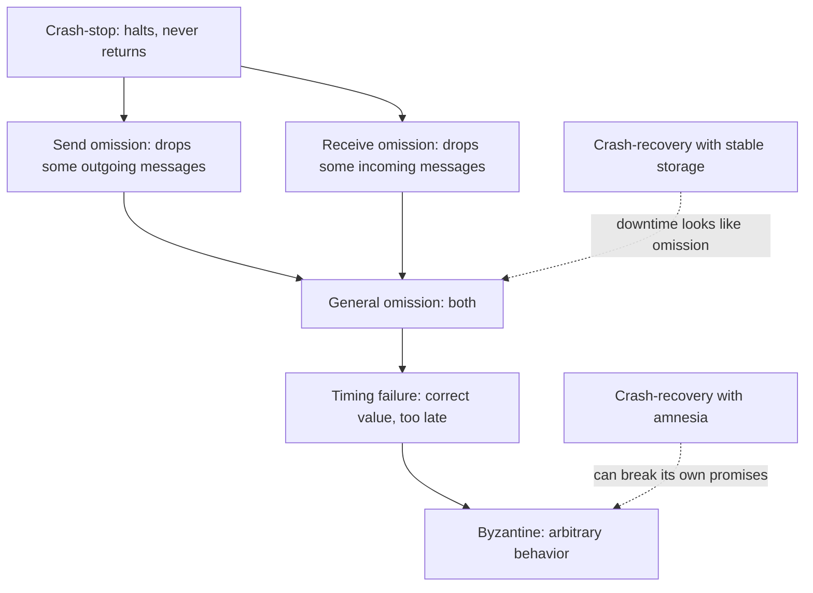
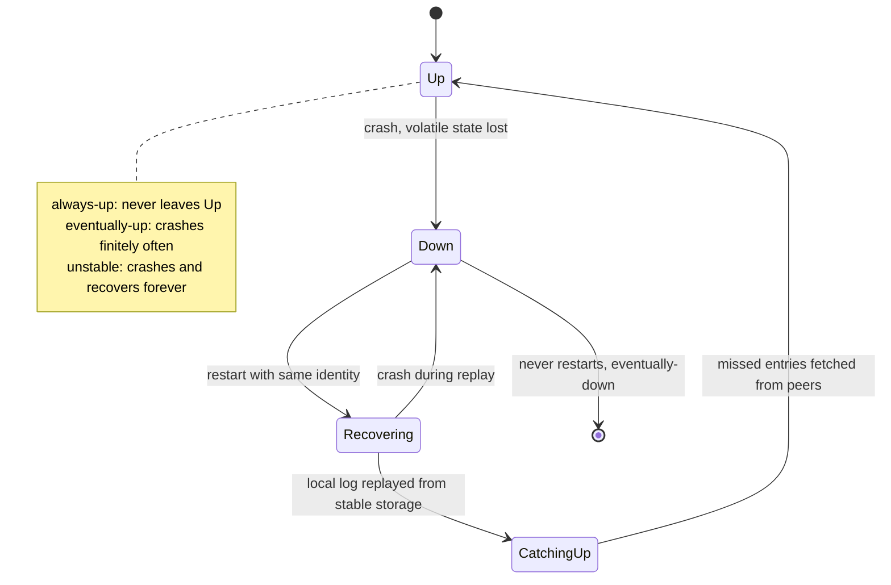
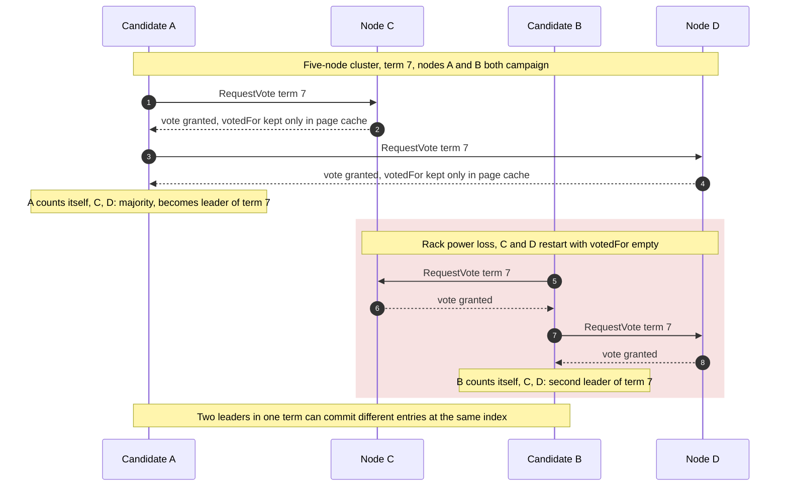
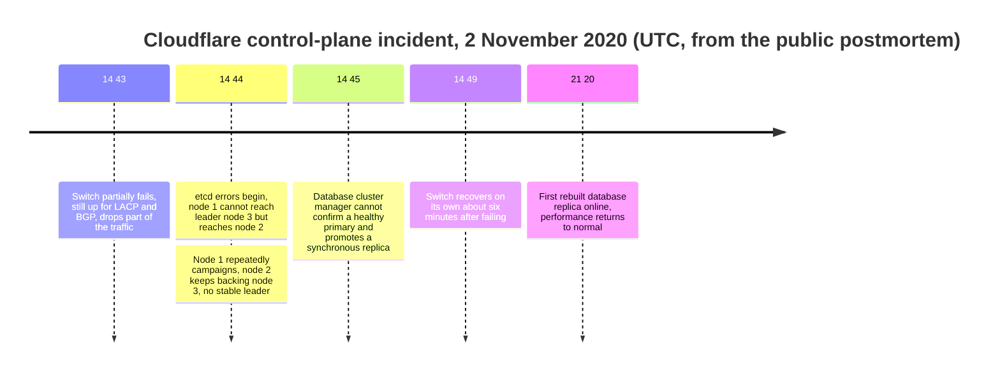

Hata modeli, bir algoritma ile ortamı arasında bileşenlerin nasıl hatalı davranmasına izin verildiğine dair yapılan sözleşmedir. Crash-stop, bir process'in duruncaya kadar doğru çalıştığını ve durduktan sonra bir daha hiçbir adım atmadığını söyler. Crash-recovery, bir process'in durup daha sonra yeniden başlayabileceğini ve bu sırada yalnızca kalıcı depolamaya (stable storage) yazdıklarını koruyacağını söyler. Omission ise process'in çalışmaya devam ettiğini, ama göndermesi ya da alması gereken bazı mesajların sessizce kaybolduğunu söyler. Üçü de zararsızdır (benign): hatalı bir process, doğru bir process'in göndermeyeceği bir mesajı asla göndermez. Keyfi, hatta kötü niyetli davranış Bizans modelidir ve [Bizans Hataları](/distributed-systems/tr/foundations/system-models/byzantine-faults/) sayfasında ele alınır.

Model tasarım aşamasında seçilir ve eğer uygulanıyorsa implementasyon tarafından uygulanır. Bir crash-stop ispatı yalnızca duran bir process'in eski kimliğiyle asla geri dönmediği yerde geçerlidir; bir crash-recovery ispatı ise yalnızca "kalıcı" dediği her yazma işleminin elektrik kesintisinden sağ çıktığı durumda geçerlidir. Consensus ve replikasyon sistemlerindeki veri kaybı hatalarının çoğu protokol hatası değil, varsayılan modelin dışına çıkan deployment'lardır; tipik örnek, söz verdiği durumdan daha azıyla yeniden başlayan bir process'tir.

Asıl denge, bir hatayı tolere etmenin maliyeti ile onu önlemenin maliyeti arasındadır. Crash-stop gibi zayıf bir model algoritmaları basitleştirir, ama deployment'ı her yeniden başlatmayı tam veri kopyalamalı bir değiştirmeye dönüştürmeye zorlar. Crash-recovery gibi daha zengin bir model bir node'un saniyeler içinde geri katılmasına izin verir, ama protokolün her adımını verdiği sözleri harekete geçmeden önce kalıcı hale getirmeye zorlar; bu da her yazma işleminin gecikme yoluna senkron bir disk flush'ı koyar. Omission toleransının bedeli yeniden iletim (retransmission), tekilleştirme (deduplication) ve idempotent işlemlerdir. Mesajların ulaşıp ulaşmadığından farklı olarak ne kadar sürede ulaşabileceği ayrı bir konudur ve [Ağ Modelleri](/distributed-systems/tr/foundations/system-models/network-models/) sayfasında işlenir.

## Zararsız Hataların Hiyerarşisi

Cristian ile Hadzilacos ve Toueg'in 1990'ların başında düzenlediği klasik hata modelleri, her modelin altındakinin tüm davranışlarına izin verip üzerine yenilerini eklediği bir hiyerarşi oluşturur. En dar olanı crash-stop'tur: process belirli bir ana kadar kusursuz davranır, sonra sonsuza dek hiçbir şey göndermez ve almaz. Send omission, bir process'in çalışmaya devam ederken bazı mesajları gönderememesine; receive omission bazılarını alamamasına; general omission ise her ikisine izin verir. Crash, belirli bir noktadan sonraki tüm mesajların omission'ıdır; dolayısıyla general omission'ı tolere eden bir algoritma crash'leri de tolere eder. Timing (performans) hataları, doğru bir yanıtın belirlenmiş zaman sınırının dışında gelmesine izin verir. Bizans hataları ise her şeye izin verir.


*Her ok, bir modelden ondan kesinlikle daha serbest olan modele işaret eder. Crash-recovery zincirin yanında durur: kalıcı depolaması sağlamsa omission artı kaybolan geçici (volatile) durum gibi davranır; değilse, yeniden başlayan bir process daha önce söylediğiyle çelişebilir.*

Crash-recovery zincire oturmaz ve diyagramın asıl vurgusu budur. Kalıcı depolaması sağlam şekilde yeniden başlayan bir process, dışarıdan bakıldığında kapalı kaldığı süre boyunca tüm mesajları omission'a uğratmış bir process gibi görünür: protokol yanlış mesajlar değil, eksik mesajlar görür. Üzerine işlem yapmış olduğu durumu kaybederek yeniden başlayan bir process ise türünden farklıdır. Crash'ten önce aday A'ya oy vermiş ve bu oyu unutmuşsa, yeniden başladıktan sonra aynı seçimde aday B'ye de oy verebilir. Hiçbir zararsız model bir process'in kendi önceki mesajlarıyla çelişmesine izin vermez; bu yüzden crash-recovery için tasarlanmış bir protokol, hafızasını kaybetmiş (amnesiac) bir process'le karşılaştığında ispatının Bizans olarak gördüğü bir davranışla karşı karşıyadır.

### Crash-Stop ve Fail-Stop Aynı Model Değildir

Crash-stop, diğer process'lerin crash'in gerçekleştiğini anlayıp anlayamayacağı hakkında hiçbir şey söylemez. Schlichting ve Schneider'in 1983'te tanımladığı fail-stop tam olarak bunu ekler: duran bir process'in hatası her doğru process tarafından tespit edilebilir ve kalıcı durumu okunabilir kalır. Fail-stop, crash-stop artı mükemmel bir failure detector'dür ve mükemmel bir detector yalnızca senkron modelde var olabilir. Asenkron ya da kısmen senkron bir sistemde crash-stop'a uğramış bir process, sınırsız bir süre boyunca yavaş bir process'ten ayırt edilemez; bu, [Ağ Modelleri](/distributed-systems/tr/foundations/system-models/network-models/) sayfasında geliştirilen ayırt edilemezlik argümanıdır. Hatalar duyuruluyormuş gibi yazılan algoritmalar fail-stop algoritmalarıdır ve duyuru bir timeout olduğunda güvensiz hale gelirler.

Hata modeli ile zamanlama modeli birbirinden bağımsız iki eksendir. Kısmi senkronlukta, crash veya omission hatalarıyla consensus `n >= 2f + 1` process, Bizans hatalarıyla `n >= 3f + 1` process gerektirir. Crash-stop ve general omission aynı sınırı paylaşır, çünkü omission hatalı bir process, doğru bir process'in gözünde henüz doğrulayamadığı bir crash'ten ibarettir.

## Crash-Recovery: Yeniden Başlatmadan Ne Sağ Çıkar

Crash-recovery, production'daki stateful sistemlerin neredeyse tamamının gerçekte içinde yaşadığı modeldir. Process'ler OOM killer tarafından öldürülür, bir supervisor tarafından yeniden başlatılır, bir kernel güncellemesiyle reboot edilir ya da arızalı bir rack yüzünden elektriği kesilip açılır; ve aynı kimlik, aynı diskle geri gelirler. Aguilera, Chen ve Toueg bu modeli formelleştirmiş ve process'leri uzun vadeli davranışlarına göre sınıflandırmıştır; bu sınıflandırma kalıcı depolama gereksinimini kesinleştirir.


*Crash-recovery modelinde tek bir process'in yaşam döngüsü. İyi (good) bir process always-up ya da eventually-up'tır; kötü (bad) bir process eventually-down ya da unstable'dır.*

İki kurtarma durumunun ayrı olmasının bir nedeni vardır. `Recovering` durumunda process bildiklerini kendi diskinden yeniden kurar ve replay tamamlanana kadar protokol mesajlarına yanıt vermemelidir, çünkü bellekteki görüşü zaten vermiş olduğu sözlerden daha eskidir. `CatchingUp` durumunda ise verdiği tüm sözleri bilir, ama kapalıyken alınan kararlardan habersizdir; bunları çekerken protokole katılabilir. `Recovering` sırasında yanıt veren bir process, elle yazılmış replikasyon kodunda amnesia'ya giden en yaygın yoldur.

Sınıflandırma, crash-stop'un ifade edemediği bir hatayı da adlandırır: sonsuza dek çöküp yeniden başlayan, hiç gitmeyen ama hiç işe de yaramayan unstable process. Crash loop'taki bir pod bunun örneğidir.

### Kalıcı Depolama Neden Gereklidir

Aguilera, Chen ve Toueg, kalıcı depolama olmadan crash-recovery modelinde consensus'un yalnızca hiç çökmeyen process sayısı kötü process'lerin azami sayısını aştığında çözülebilir olduğunu, aksi halde eventually perfect bir failure detector ve güvenilir bağlantılarla bile imkansız olduğunu ispatlamıştır. Kalıcı depolama olmadan toparlanan bir process, eski bir adı taşıyan yepyeni bir process'tir: önceki sözleri kaybolmuştur, dolayısıyla yalnızca hiç çökmemiş process'lere güvenilebilir. Her node'un bakım için eninde sonunda yeniden başlatıldığı bir cluster'da bu koşul sağlanamaz; bu yüzden pratikteki crash-recovery protokolleri verdikleri sözleri kalıcı hale getirir.

Kalıcı hale getirilmesi gereken şey, tam olarak diğer process'lerin üzerine işlem yapabileceği beyanlar kümesidir. Raft'ta bunlar mevcut term, o term'de oy verilen aday ve log'dur; Raft spesifikasyonu, process herhangi bir isteğe yanıt vermeden önce bunların kalıcı depolamada olmasını şart koşar. Invariant, yanıttan önce kalıcı hale getirmektir; sonra kalıcı hale getirmek bir sonraki crash ile yarıştır.

```text
on RequestVote(term, candidateId, lastLogIndex, lastLogTerm):
    if term > currentTerm: currentTerm = term; votedFor = null
    grant = term == currentTerm
            and votedFor in (null, candidateId)
            and candidate log is at least as up to date as ours
    if grant: votedFor = candidateId
    persist(currentTerm, votedFor)     # write + fsync; a promise is not made until this returns
    reply(currentTerm, grant)          # only now may the candidate count this vote
```

Sondan bir önceki satır, hata modelinin uygulandığı yerdir. Flush'ı kaldırırsanız ya da diskin onu geçici bir önbellekten onaylamasına izin verirseniz, protokolün crash-recovery ispatı artık deployment için geçerli olmaz. Aşağıdaki akış, iki üyenin onaylanmış bir oyu kaybetmesinin sonucunu gösterir.


*Amnesia, çoğunluk quorum'unu boşa çıkarır. Beşte iki çoğunluk her zaman kesişir, ama burada kesişim önceki sözünü unutmuş node'lardan oluşur.*

Raft'ı güvenli kılan quorum argümanı, herhangi iki çoğunluğun en az bir ortak üyesi olduğu ve bu üyenin ikinci adayı reddedeceğidir. 2. ve 4. adımlarda bu ortak üyeler C ve D'dir. Yeniden başladıktan sonra oy verdiklerini hatırlamazlar; böylece 6. ve 8. adımlarda kesişim fiziksel olarak vardır ama hiçbir hafıza taşımaz. Term 7'deki iki leader aynı index'e farklı birer entry replike edebilir ve term başına tek leader varsayan Raft'ın log matching özelliği artık ayrışmayı engellemez.

:::danger[Devre dışı bırakılmış ya da yalan söyleyen bir flush protokolün ispatını geçersiz kılar]
Senkron flush'ları atlayan bayraklar, barrier'ları kapatılarak mount edilmiş dosya sistemleri, host'u yazmaları geçici bir önbellekten onaylayan sanal diskler ve power-loss protection olmadan geçici yazma önbelleği kullanan sürücüler, crash-recovery'yi amnesia'lı crash-recovery'ye dönüştürür. Cluster ilk korelasyonlu elektrik olayına kadar doğru çalışır. etcd, adı onu doğru tarif eden bir `--unsafe-no-fsync` bayrağı sunar; buna benzer hiçbir şeyin production'daki bir quorum'da yeri yoktur.
:::

### Sayısal Örnek: Yeniden Başlatmak mı, Değiştirmek mi

Crash-recovery ile crash-stop arasındaki seçim, kurtarma aritmetiğinde görünür hale gelir. Her üyesi 2 TB veri tutan, 5 MB/s yazma alan ve bir node'u devre dışı bırakan olaylar için üye başına yıllık %4 arıza oranına sahip üç üyeli bir replika grubu varsayalım. Tüm sayılar örnek amaçlıdır.

Crash-recovery'de, yeniden başlayan bir üye 20 saniyelik process açılışından sonra son checkpoint'ten bu yana biriken yerel log'unu replay eder; örneğin 4 GB'ı 500 MB/s ile, yani 8 saniyede. Ardından kaçırdıklarını çeker: 30 saniyelik kesinti, 5 MB/s ile 150 MB eder ve 10 Gbit/s'lik bir bağlantıda bir saniyeden kısa sürer. Grup yaklaşık 30 saniye boyunca bir üye eksik çalışır.

Crash-stop'ta duran bir üyeye bir daha asla güvenilmez. Yerine gelen üye, canlı trafiği korumak için kısıtlanmış efektif 250 MB/s hızla 2 TB'lık tam bir kopya alır; bu 8.000 saniye, yani yaklaşık 2,2 saat sürer. Bu pencere boyunca üç üyeli grup başka hiçbir hatayı tolere edemez. Üye başına saatlik arıza oranı `0.04 / 8760`, yani yaklaşık `4.6e-6`'dır. Kalan iki üyeden birinin 2,2 saatlik yeniden kurulum sırasında arızalanma olasılığı yaklaşık `2 * 4.6e-6 * 2.2`, yani olay başına `2.0e-5`'tir; 30 saniyelik bir yeniden başlatma sırasında ise yaklaşık `7.7e-8`'dir, kabaca 260 kat daha düşük. Crash-recovery'nin kazandırdığı bu orandır, bedeli ise her sözde bir flush'tır: kullanılan donanımda her flush 1 ms sürüyorsa (örnek amaçlı ve büyük ölçüde cihaza bağlı), bir follower birçok entry'yi tek bir flush'ta toplamadıkça saniyede 1.000'den fazla ardışık sözü onaylayamaz. Her production log'unun group commit uygulamasının nedeni budur; ayrıntılar [Write-Ahead Log](/distributed-systems/tr/data-management/storage-engines/write-ahead-log/) sayfasındadır.

:::tip[Yeni bir kimlik crash-recovery'yi crash-stop'a dönüştürür]
Bir üyenin diski kaybolduğunda ya da şüpheli olduğunda, veya stateful bir pod yeni bir volume'a yeniden zamanlandığında, onun boş bir veri dizini ve eski adıyla geri katılmasına izin vermeyin; üye kimliğini host adına değil veriye bağlayın. Üyeyi membership'ten çıkarın ve oy vermeden önce arayı kapatması gereken yeni bir üye olarak geri ekleyin. Bu, protokolün tolere edemediği amnesia'lı bir yeniden başlatmayı, tolere edebildiği bir crash-stop ve ardından gelen temiz bir katılıma dönüştürür.
:::

## Omission: Process'ler Çalışırken Kaybolan Mesajlar

Omission hatası, her iki uç da çalışmaya devam ederken gönderilmesi ya da teslim edilmesi gerektiği halde gönderilmemiş ya da teslim edilmemiş bir mesajdır. Send omission, process ile ağ arasındaki sınırın gönderici tarafında; receive omission ise alıcı tarafında gerçekleşir. Pratikte ikisi de birçok katmanda olur ve çoğu uygulama tarafından görülmez.


*Çalışan iki process arasında mesajların kaybolduğu yerler. Switch'in solundaki kayıplar send omission, sağındakiler receive omission olarak görünür.*

Diyagram, omission'ın neden olağan durum olduğunu açıklar. Canlı ama bloklanmış bir thread socket'ini hiç okumaz; her paket ulaşmış olsa bile bu bir receive omission'dır. Dolu bir listen backlog'u, process mevcut bağlantılardaki health check'lere yanıt verirken yeni bağlantı girişimlerini düşürür. Bir interrupt fırtınası altında receive ring'i taşan bir NIC, switch'in teslim ettiği paketleri düşürür. Bunların her biri, yalnızca process'in çalışıp çalışmadığını kontrol eden her şeye process'i sağlıklı gösterir.

### Transport Katmanı Omission'ı Maskeleyip Gecikmeye Çevirir

TCP kaybolan segment'leri yeniden iletir; böylece geçici paket kaybı kaybolmuş bir mesaj yerine gecikmeye dönüşür. Bu maskeleme sınırlıdır: yeniden iletimler tükendiğinde ya da bir uygulama timeout'u tetiklendiğinde bağlantı kapatılır ve uçuştaki her mesajın akıbeti bilinmez hale gelir. Omission transport katmanının üstünde yeniden ortaya çıkar, üstelik artık gönderici işlemin gerçekleşip gerçekleşmediğini bilemez.

Omission'ı tolere etmenin maliyetini bu belirsizlik belirler. Yeniden deneyen bir gönderici omission'ı olası bir tekrarlamaya (duplication) dönüştürür; bu yüzden ya alıcı tekilleştirme yapmalı ya da işlem idempotent olmalıdır. Fair-loss bir bağlantı, yeniden iletim artı tekilleştirme ile güvenilir bir bağlantıya dönüştürülür; uygulama katmanında aynı yapı [idempotency key'leri](/distributed-systems/tr/communication/api-gateway/idempotency/) ve [En Az Bir Kez, En Fazla Bir Kez ve Tam Olarak Bir Kez Semantiği](/distributed-systems/tr/communication/async-messaging/delivery-semantics/) sayfasındaki teslim garantileri olarak karşımıza çıkar.

### Sayısal Örnek: Kayıplı Bir Yola Karşı Yeniden Denemeler

Her mesajı bağımsız olarak `p = 0.01` olasılıkla sessizce kaybeden, yani ciddi biçimde bozulmuş bir yol üzerinden yapılan bir istek-yanıt çağrısı ve günde bir milyon çağrı işleyen bir servis varsayalım. Tüm sayılar örnek amaçlıdır.

Bir deneme yalnızca hem istek hem yanıt ulaşırsa başarılı olur; olasılığı `(1 - p)^2 = 0.9801`'dir, dolayısıyla ilk denemelerin %1,99'u başarısız olur: günde 19.900 çağrı. En fazla üç deneme ve bağımsız kayıplarla, üçünün de başarısız olma olasılığı `0.0199^3`, yaklaşık `7.9e-6`, yani günde sekiz çağrıdır. Yeniden denemeler tam bir çözüm gibi görünür.

İki düzeltme tabloyu değiştirir. Birincisi, başarısız denemeler içinde isteğin ulaştığı ve yalnızca yanıtın kaybolduğu oran `p * (1 - p) / (1 - (1 - p)^2)`, yani yaklaşık %49,7'dir. Günde kabaca 9.900 çağrı işlenir ve sonra yeniden denenir; tekilleştirme olmadan sistem, görünür 19.900 hatayı önlemek için günde yaklaşık 9.900 tekrarlanmış yan etki üretir. İkincisi, gerçek omission'lar korelasyonludur: dalgalanan bir bağlantı ya da takılmış bir alıcı, saniyelerce her mesajı düşürür. Kayıplar 5 saniyelik patlamalar halinde geliyor ve denemeler 100 ms arayla yapılıyorsa, üç denemenin üçü de aynı patlamanın içine düşer ve yeniden deneme başarı oranı neredeyse sıfıra iner; bu sırada yeniden deneme trafiği bozulmuş yoldaki yükü üç katına çıkarır. Yeniden deneme aralıkları ve bütçeleri [Üstel Geri Çekilme ve Jitter ile Yeniden Deneme](/distributed-systems/tr/resilience/protection-patterns/retry-exponential-backoff/) sayfasında ele alınır.

### Kısmi ve Asimetrik Omission

Omission, ders kitabı diyagramlarındaki temiz partition'lara uymaz. Bir bağlantı trafiği yalnızca tek yönde düşürebilir, bir switch hash ile seçilmiş akışların bir kısmını düşürebilir ve X node'u Y ile Z'ye ulaşırken Y, X'e ulaşamayabilir. Huang ve arkadaşları bu genel örüntüye gray failure adını vermiştir: bir bileşen, bazı gözlemcilerin gördüğü ve diğerlerinin, çoğu zaman failure detector'ün kendisinin görmediği bir biçimde bozulmuştur. Production trafiğinden farklı bir ağ veya kod yolu kullanan bir health check, istemcilerin yaşadığından farklı bir hatayı ölçer.

Consensus protokolleri asimetrik omission'a belirli bir şekilde duyarlıdır. Leader'ın heartbeat'lerini artık alamayan ama hala gönderebilen bir follower timeout'a düşer, term'ini artırır ve aday olur; daha yüksek term'i alan her eş, sağlıklı ve herkes tarafından erişilebilir olmasına rağmen mevcut leader'ı bırakır. Raft tezi, bir adayın term'ini artırmadan önce kazanıp kazanamayacağını sorduğu Pre-Vote'u ve bir leader'ın çoğunluktan haber alamadığında görevi bıraktığı CheckQuorum'u tarif eder; ikisi de tek yönlü omission'ın aksi halde sağlıklı olan cluster'ları istikrarsızlaştıracak kadar yaygın olması nedeniyle vardır. Mekaniği [Raft](/distributed-systems/tr/coordination/consensus-algorithms/raft/) sayfasında anlatılır.

## Modellerin Karşılaştırılması ve Implementasyon Yükümlülükleri

Her model, implementasyonun doğru kılması gereken şeylerin bir listesidir. Tablo, her model için neyin olabileceğini, o modelde ispatlanmış bir algoritmanın doğru kalması için implementasyonun ne yapması gerektiğini ve modelin hangi durumda tasarımın dayanacağı doğru model olduğunu gösterir.

| Model | İzin verilen davranış | Implementasyon yükümlülüğü | Kısmi senkronlukta consensus | Ne zaman tercih edilmeli |
|---|---|---|---|---|
| Crash-stop | Bir kez durur, asla geri dönmez | Duran bir node kendi kimliğiyle asla geri katılmaz; yerine geçen yeni bir kimlik alır | `n >= 2f + 1` | Stateless worker'lar, bir doğruluk kaynağından yeniden kurulan immutable replikalar, tam yeniden replikasyonun ucuz olduğu sistemler |
| Crash-recovery, kalıcı depolamalı | Durur, kalıcı hale getirilmiş durumla yeniden başlar | Her sözü harekete geçmeden önce dayanıklı bir flush ile kalıcı hale getir; replay bitene kadar protokol mesajlarını reddet | `n >= 2f + 1`, iyi process'lerin çoğunluğu sayılarak | Yerel diskli stateful üyeler: consensus log'ları, veritabanları, broker'lar |
| Crash-recovery, kalıcı depolamasız | Durur, hiçbir şeyle yeniden başlar | Asla eski kimlikle geri katılma ya da hiç çökmeyen process sayısının kötü process'lerden fazla olmasını şart koş | Yalnızca always-up process'ler kötü olanlardan fazlaysa | Nadiren bilinçli seçilir; flush'lar kaybolduğunda bir deployment'ın düştüğü modeldir |
| General omission | Çalışır, bazı gönderme ve almaları düşürür | Yeniden ilet, tekilleştir, işlemleri idempotent yap, takılmış alıcıları tespit et | `n >= 2f + 1` | Gerçek bir ağ ya da sınırlı kuyruklar üzerinden iletişim kuran her process |
| Timing | Doğru ama geç | Beklemeleri timeout'larla sınırla; safety'nin onlara bağlı olmamasını sağla | Kısmi senkronlukta ayrı bir eşik yok | Gerçek zamanlı ve lease tabanlı tasarımlar, bkz. [Ağ Modelleri](/distributed-systems/tr/foundations/system-models/network-models/) |

Gerçek sistemler, esas olarak hangi sözleri senkron olarak kalıcı hale getirdikleri ve hangilerini replikasyona devrettikleri konusunda ayrışır. etcd gibi Raft implementasyonları ve varsayılan yapılandırmasıyla ZooKeeper'ın transaction log'u onaylamadan önce flush yapar; böylece her üye tek başına kalıcı depolamalı crash-recovery'yi sağlar. Kafka bir mesajı commit edilmiş saymadan önce flush yapmaz; varsayılan olarak flush'ı işletim sistemine bırakır ve in-sync replika kümesi boyunca replikasyona güvenir. Cassandra'nın varsayılan `periodic` commit log modu yazmaları hemen onaylar ve commit log'u varsayılan olarak 10 saniyede bir senkronlar; onaylamadan önce flush yapan bir `batch` modu ve yeni sürümlerde bir `group` modu da vardır. Bu sistemler node başına sınırlı bir amnesia'yı kabul eder ve replikaların flush edilmemiş kuyruklarını aynı anda kaybetmeyeceğini varsayar.

:::caution[Flush yerine replikasyon bağımsız hataları varsayar]
Bellekten onaylayıp replikalara güvenmek, ancak replika crash'leri bağımsız olduğu sürece geçerli bir tasarımdır. Bir rack'in elektriğinin kesilmesi, her node'da aynı bozuk paketin tetiklediği bir kernel panic ya da ters giden bir rolling upgrade sırasındaki eşzamanlı yeniden başlatma kayıpları korelasyonlu hale getirir; o zaman onaylanmış veri hiçbir diskte bulunmaz. Replikaları ayrı güç ve hata alanlarına yerleştirin ve aynı verinin birden fazla replikasını aynı anda yeniden başlatmayın.
:::

### Çalışan Bir Host'ta Omission'ı Gözlemlemek

Omission process'i canlı bıraktığı için, daha önce gösterilen yolun her katmanındaki sayaçlardan tespit edilmelidir. Linux'ta bunları kernel ve NIC tutar:

```shell
# Accept queue overflows: connection attempts dropped while the process looks healthy
nstat -az TcpExtListenOverflows TcpExtListenDrops
# Datagrams dropped because the socket buffer was full (receive and send omission)
nstat -az UdpRcvbufErrors UdpSndbufErrors
# Retransmissions: TCP masking omission as delay
nstat -az TcpRetransSegs TcpExtTCPTimeouts
# NIC-level drops: rx ring overflow and discards, names vary by driver
ethtool -S eth0 | grep -iE 'drop|miss|discard'
```

Health check'leri geçen bir node'da yükselen bir listen-overflow sayacı, sürmekte olan bir receive omission'dır. Diğerlerinde değil de yalnızca bir eş çiftinde yükselen yeniden iletim sayıları, process sorunundan çok kısmi bir yol arızasına işaret eder.

## Gerçeklik Modelin Dışına Çıktığında Hata Modları

Aşağıdaki hatalar, deployment'ların sessizce bir modelden daha serbest bir modele geçtiği ve protokolün hiç ispatlanmadığı davranışlar ürettiği yollardır.

### Kaybolan Flush'lar Yoluyla Amnesia

Tetikleyici: bir flush veriyi dayanıklı kılmadan başarı bildirir ya da uygulamanın görmezden geldiği bir hata bildirir. Linux'ta PostgreSQL topluluğu 2018'de, Rebello ve arkadaşları ise daha sonra sistematik olarak, başarısız bir `fsync` sonrasında kernel'in kirli sayfaları temiz olarak işaretleyebildiğini ve hatayı yalnızca bir kez bildirdiğini gösterdi; dolayısıyla veri kaybolmuşken bir yeniden deneme başarılı olabilir. PostgreSQL buna, flush hatasında sunucuyu panic'e sokup write-ahead log'dan toparlanarak yanıt verdi; bu değişiklik sürüm 12'de geldi ve 9.4'e kadar geriye taşındı. Belirtiler: bir elektrik olayı ya da depolama hatasından sonra bir üye onayladığından daha kısa bir log'la yeniden başlar; replikalar commit edilmiş entry'ler konusunda anlaşamaz; tek bir term için iki leader ortaya çıkar. Tespit: her üyenin olaydan önceki son onaylanmış index'ini toparlanmış index'iyle karşılaştırın; kernel log'undaki depolama I/O hatalarında alarm üretin; flush gecikmesini izleyin (etcd'de `etcd_disk_wal_fsync_duration_seconds`); cihazın fiziksel olarak sağlayabileceğinden çok daha hızlı flush'lar şüphelidir. Azaltma: her flush hatasını ölümcül sayıp log'dan yeniden başlayın; power-loss protection'lı depolama kullanın; yeni bir depolama platformuna güvenmeden önce dayanıklılığı bir elektrik kesme testiyle doğrulayın. Kurtarma: etkilenen üyeyi çıkarın ve yeni bir kimlikle sağlıklı eşlerden yeniden kurun. Alagappan ve arkadaşları, consensus tabanlı depolamanın bir üyenin kaybolmuş ya da bozulmuş entry'lerine çoğu zaman çökerek ya da hasarı yayarak tepki verdiğini, protokol farkındalıklı kurtarmanın (protocol-aware recovery), yani entry'leri onları kesin olarak tutan eşlerden çekmenin her ikisini de önlediğini göstermiştir.

### Flush Edilmemiş Kuyrukların Korelasyonlu Kaybı

Tetikleyici: bellekten onay veren replikaların hepsinin elektriği birlikte kesilir. Kafka'da unclean shutdown yaşamış bir replika daha kısa bir log'la geri gelebilir ve in-sync replika kümesinin son üyesiyse yeniden leader seçilerek daha sağlıklı replikaları kendisine göre truncate etmeye zorlayabilir; KIP-966 (Eligible Leader Replicas) bunu önler, Kafka 4.0'da deneyseldir ve 4.1'de KRaft cluster'larında varsayılan olarak açıktır. Belirtiler: producer'lara hiçbir hata bildirilmeden, kurtarmadan sonra onaylanmış mesajların eksik olması. Tespit: olaydan önce ve sonra consumer'ların gördüğü offset'leri ya da high watermark'ları karşılaştırın; broker yeniden başlarken log truncation mesajlarına bakın. Azaltma: ayrı güç alanları ve leader seçiminde veri kaybettiği bilinen replikaları reddeden bir sürüm. Kurtarma: her replikada yalnızca bellekten onaylanmış veri kaybolmuştur; kurtarma, upstream kaynaklardan geri yüklemek demektir.

### Bir Quorum'u Felç Eden Kısmi Omission

2 Kasım 2020'de, tek bir switch kısmen arızalandıktan sonra Cloudflare'in API'si ve dashboard'u 6 saat 33 dakika boyunca bozuk çalıştı: switch link aggregation ve yönlendirme için ayakta kaldı ama trafiğin bir kısmını iletmeyi bıraktı. Üç node'lu etcd cluster'ının bir node'u leader'a yalnızca bu switch üzerinden, üçüncü node'a ise sağlıklı bir yoldan ulaşıyordu.


*Tek bir switch'teki altı dakikalık kısmi omission, aşağı akıştaki otomatik failover ve replika yeniden kurulumlarıyla saatlerce süren bir kesintiye büyüdü.*

Cloudflare olayı bir Bizans hatası olarak adlandırdı ve daha sonra topluluğun bunu bir omission hatası olarak değerlendirdiğini ekledi; daha kesin sınıflandırma budur: hiçbir node doğru bir node'un göndermeyeceği bir mesaj göndermedi, ama bir node bir eşe giden trafiğinin bir kısmını kaybetti. Ayrım önemlidir, çünkü omission, asimetrik omission bölümünde anlatıldığı gibi kısmi görüşe sahip bir node'un diğerlerini bozmasını engelleyen zararsız `2f + 1` protokolleriyle tolere edilir. Altı dakikalık hata, ardından gelen müdahaleyle altı saatlik bir olaya dönüştü; bu örüntü [Hata Yayılımı: Kaskad Hata Analizi](/distributed-systems/tr/foundations/system-models/cascading-failure/) sayfasında incelenir. Bu sınıf için tespit sinyalleri: leader değişimi ve seçim sayaçları (`etcd_server_leader_changes_seen_total`), buna karşılık gelen bir leader crash'i olmadan yükselen term numaraları ve eş çiftleri arasında asimetrik olan eş başına round-trip hataları.

### Crash Loop'taki Unstable Üyeler

Tetikleyici: bir üye açılış sırasında ya da katıldıktan kısa süre sonra, örneğin bozuk bir kayıt ya da bir bellek limiti yüzünden çöker. Belirtiler: membership dalgalanır ve her yeniden başlatma eşlerine yük bindiren bir yetişme (catch-up) trafiği tetikler. Tespit: supervisor'ün yeniden başlatma sayaçları (Kubernetes'te `kube_pod_container_status_restarts_total` gibi), ardından "ready" gelmeyen tekrarlanan "recovering" log satırları. Azaltma: yeniden başlatmaları geri çekilmeyle (backoff) yapın ve bir üyeyi belirlenmiş bir süre boyunca ayakta kalana kadar quorum kararlarının dışında tutun; böylece unstable bir process iyi değil kötü olarak ele alınır. Kurtarma: crash'e neden olan kaydı düzeltin ya da karantinaya alın; daha hızlı yeniden başlatmak unstable bir process'e yardımcı olmaz.

## Tasarımın Dayanacağı Hata Modelini Seçmek

Bir node'un durumu başka bir yerden ucuza yeniden kurulabiliyorsa ve yerine gelenler yeni bir kimlik alıyorsa crash-stop'a göre tasarlayın: stateless servisler, dayanıklı bir kuyruktan iş çeken worker'lar, kaybı yanlış yanıt değil cache miss anlamına gelen cache node'ları. Veri saklayan bir quorum'un üyeleri için crash-stop'u seçmeyin, çünkü o zaman her rutin yeniden başlatma tam bir yeniden replikasyona ve azalmış hata toleranslı bir pencereye mal olur.

Başkalarının güvendiği sözler veren her şey için kalıcı depolamalı crash-recovery'ye göre tasarlayın: consensus üyeleri, birincil veritabanları, log broker'ları, kilit servisleri. Kritik yoldaki flush'ı kabul edin ve onu kaldırmak yerine group commit ve power-loss protection'lı cihazlarla maliyetini düşürün. Depolamanın gerçekten dayanıklılık sağladığını doğrulamadan bu modeli benimsemeyin; doğrulanmamış bir sanal diskte dürüst model amnesia'lı crash-recovery'dir ve tasarım, toparlanan bir node'un eşleriyle uzlaşana kadar oy vermesine ya da onay göndermesine asla izin vermemelidir.

Process hata modeli ne olursa olsun, bir ağı ya da sınırlı bir kuyruğu geçen her mesaj için general omission varsayın. Bu, her uzak işlemin ya idempotent olması ya da bir tekilleştirme anahtarı taşıması, her yeniden denemenin bir bütçesi olması ve liveness kontrollerinin production trafiğiyle aynı yolu kullanması demektir. Bir health check'e yanıt veren process, yalnızca bu yüzden omission hatalarından arınmış sayılmaz.

Bizans modeline yalnızca bileşenler yalan söyleyebildiğinde geçin: güvenilmeyen katılımcılar ya da checksum'ların yakalamadığı bozulmalar. Sessiz disk bozulması sınır durumdur. Her kayıt ve mesajdaki checksum'lar bozulmaların çoğunu tespit edilebilir bir crash ya da omission'a dönüştürür; bu, onları Bizans olarak tolere etmekten çok daha ucuzdur; bkz. [Bizans Hataları](/distributed-systems/tr/foundations/system-models/byzantine-faults/). Bir modelin mutlak bir garanti mi yoksa bir olasılık mı olduğu, örneğin korelasyonlu hataların replikasyonu ne sıklıkla boşa çıkardığı, [Deterministik ve Olasılıksal Hata Modelleri](/distributed-systems/tr/foundations/system-models/deterministic-vs-probabilistic/) sayfasının konusudur.

## İleri Okuma

- Flaviu Cristian, *Understanding Fault-Tolerant Distributed Systems*, Communications of the ACM, 1991.
- Richard D. Schlichting and Fred B. Schneider, *Fail-Stop Processors: An Approach to Designing Fault-Tolerant Computing Systems*, ACM Transactions on Computer Systems, 1983.
- Marcos K. Aguilera, Wei Chen, and Sam Toueg, *Failure Detection and Consensus in the Crash-Recovery Model*, Distributed Computing, 2000.
- Ramnatthan Alagappan, Aishwarya Ganesan, Eric Lee, Aws Albarghouthi, Vijay Chidambaram, Andrea C. Arpaci-Dusseau, and Remzi H. Arpaci-Dusseau, *Protocol-Aware Recovery for Consensus-Based Storage*, USENIX FAST, 2018.
- Peng Huang, Chuanxiong Guo, Lidong Zhou, Jacob R. Lorch, Yingnong Dang, Murali Chintalapati, and Randolph Yao, *Gray Failure: The Achilles' Heel of Cloud-Scale Systems*, HotOS, 2017.
- Cloudflare, *A Byzantine Failure in the Real World*, Cloudflare blog, 2020.
