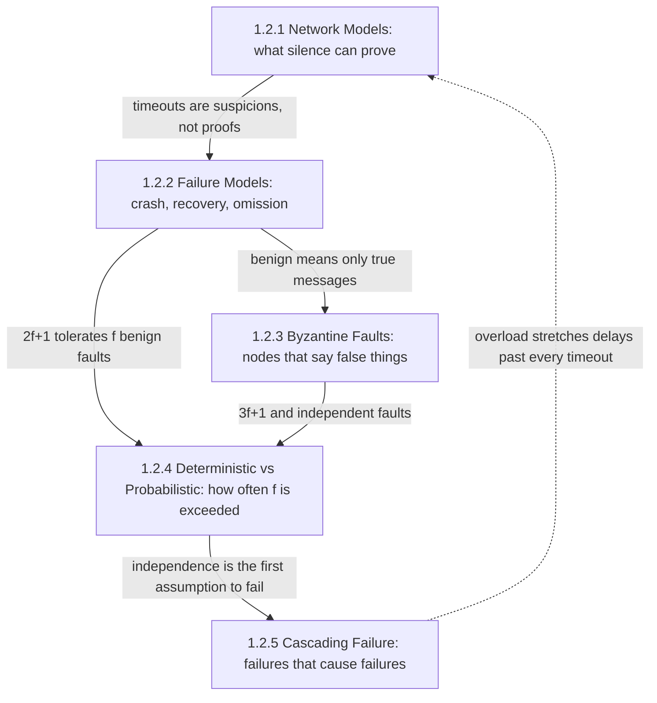
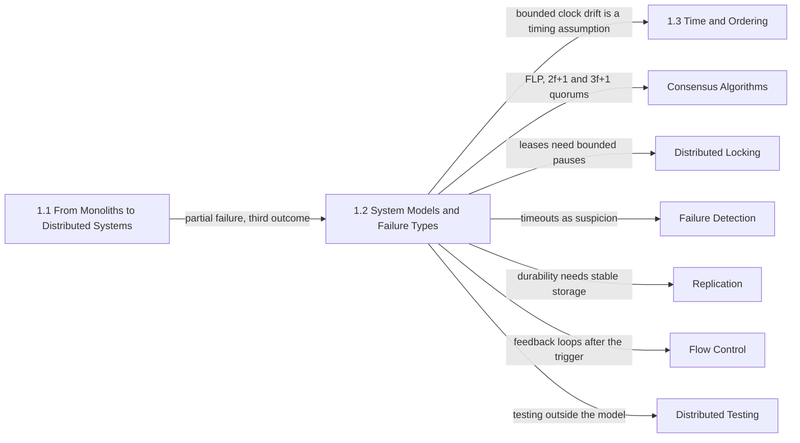

Dağıtık bir algoritmanın doğru olduğuna dair her iddia aslında koşullu bir önermedir: mesajlar şöyle davranırsa, process'ler yalnızca şu biçimde hata verirse ve aynı anda şu sayıdan fazlası bozulmazsa, algoritma sözünü tutar. Bu koşulların kümesine sistem modeli denir. Bu bölüm modeli açık hale getirir, çünkü production sistemleri tam da modelin olduğu yerde kırılır: replike sistemlerdeki pek çok veri kaybı ve split-brain olayı yanlış bir protokolden değil, ortamın protokol modelinin "olmaz" dediği bir şeyi yapmasından kaynaklanır. Lease süresinden uzun bir duraklama, onaylanmış bir yazmayı unutan bir disk ya da bağımsız bozulduğu varsayılan iki replikanın birlikte çökmesi bunun tipik örnekleridir.

Bölümün ele aldığı tek problem, bir node'un gözlemlediği şeyden, hepsinden önemlisi gözlemleyemediği şeyden ne sonuç çıkarabileceğidir. Yanıt vermeyi bırakan bir eş (peer) çökmüş, duraklatılmış, kayıplı bir bağlantının arkasında kalmış ya da yalan söylüyor olabilir. Beş konunun her biri cevabın bir parçasını sabitler: sessizliğin bir anlam taşıması için ne kadar sürmesi gerektiği, hangi tür hatalı davranışlara izin verildiği, hatalı bir node'un yanlış şeyler söyleyip söyleyemeyeceği, aynı anda kaç hata için plan yapılacağı ve daha fazlasının ne kadar olası olduğu, bir hatanın bir sonrakini daha olası kılıp kılmadığı.

Her konudan geçen gerilim, bir varsayımın gücü ile çiğnenmesinin bedeli arasındadır. Sınırlı gecikmeler, yalnızca crash biçiminde hatalar, az sayıda ve bağımsız arıza gibi güçlü bir model; daha fazla problemi daha az replikayla, daha az turla ve daha basit kodla çözülebilir kılar. Ama aynı zamanda ortama yapılmış bir bahistir ve bahis kaybedildiğinde, güvenliği bu bahse dayanan bir algoritma sessizce yanlış sonuç üretir. Zayıf bir model nadiren çiğnenir, ancak bazı problemleri çözülemez, bazılarını da pahalı hale getirir. Bölüm bir kazanan seçmez; gerçek sistemlerin tekrar tekrar başvurduğu çözümü gösterir: güvenliği karşılanabilecek en zayıf model altında ispatlamak, daha güçlü varsayımlara ise yalnızca performans ve ilerleme (liveness) için, yani yanılmanın sistemi yanlış değil yavaş yaptığı yerlerde dayanmak.

## Tek Bir Modelin Dört Boyutu ve Onu Kıran Beşincisi

Bölümün konuları birbirinden bağımsız beş başlık değildir. İlk ikisi her sistem modelinin ihtiyaç duyduğu iki ekseni tanımlar: bir zamanlama modeli ve bir hata modeli. Üçüncüsü hata modelini en serbest haline genişletir. Dördüncüsü, ilk üçünün veri olarak kabul ettiği niceliği, yani hata sayısını ekler ve bu sayının ne sıklıkla aşıldığını sorar. Beşincisi ise dördüncüde gizli duran varsayımı, hataların birbirinden bağımsız geldiği varsayımını, bir hatanın bir sonrakine nasıl yol açtığını göstererek ortadan kaldırır.

*Bölümdeki konular arasındaki bağımlılıklar. Düz oklar her sayfanın bir sonrakine hangi sonucu devrettiğini gösterir; kesikli ok, bir kaskadın bölümün başladığı zamanlama varsayımlarına nasıl geri beslendiğini gösterir.*

Ağ modelleri ilk sıradadır, çünkü bir hata dedektörünün neyi bilebileceğine zamanlama modeli karar verir ve sonraki her sayfa bu sonucu kullanır: kısmen senkron bir ortamda timeout yalnızca bir şüphedir; dolayısıyla "çöktü" diyen bir hata modeli, kimsenin gözlemleyebileceği şeyi değil, olanı tarif eder. Hata modelleri ardından zararsız (benign) sınıfları, yani crash-stop, crash-recovery ve omission'ı, her birinin implementasyondan neyi kalıcı olarak yazmasını ve neyi yeniden denemesini beklediğiyle birlikte tanımlar. Bizans sayfası, tüm zararsız modellerin ortak tek özelliğini, hatalı bir node'un doğru bir node'un gönderemeyeceği hiçbir mesajı göndermediği varsayımını alır ve kaldırır; bu da replika sayısını `2f + 1`'den `3f + 1`'e çıkarır.

İki eşik de `f` cinsinden ifade edilir ve `f`'nin nereden geldiğini soran sayfa dördüncüsüdür. Bir eşik ispatı, aynı anda `f`'den fazla bileşenin ne sıklıkla bozulduğu hakkında hiçbir şey söylemez; onarım süreleri ve korelasyon içeren bir oran modeli ise söyler. Beşinci sayfa bu hesabın pratikte neden iyimser kaldığını açıklar: trafiği taşımak, retry yapmak, yeniden replike etmek ve failover gibi hataya verilen tepkiler, yükü hatalı bileşenden sağlıklı olanlara taşır; böylece hatalar sistemin kendi tasarımı yüzünden korelasyonlu hale gelir. Kesikli ok operasyon açısından önemlidir: kaskad halindeki bir aşırı yük, gecikmeyi zamanlama modelinin dayandığı her timeout'un ötesine uzatır; böylece sistem tam da toparlanmaya çalışırken ilk sayfanın "kararlılık öncesi" rejimine geri döner.

## Her Konunun Yanıtladığı Soru

[Ağ Modelleri: Senkron, Asenkron ve Kısmen Senkron](/distributed-systems/tr/foundations/system-models/network-models/), bir algoritmanın mesaj gecikmesi, process hızı ve saat kayması hakkında neyi varsayabileceğini ve her varsayımın neyi çözülebilir kıldığını yanıtlar. Production'daki consensus'un hiçbir zamanlama varsayımı olmadan güvenli, ancak zamanlama düzgün davrandığında ilerleyecek şekilde tasarlandığı yönündeki ana sonucu, sonraki tüm koordinasyon bölümlerinin izlediği şablondur. Bir tasarım bir timeout'a, bir lease'e ya da bir saat sınırına dayandığında bu sayfayı açın.

[Hata Modelleri: Crash-Stop, Crash-Recovery, Omission](/distributed-systems/tr/foundations/system-models/failure-models/), bir process'in ya da bağlantının yalan söylemeden nasıl hatalı davranabileceğini ve her modelin implementasyondan ne istediğini yanıtlar: yeniden başlatmada yeni bir kimlik, her sözden önce kalıcı bir flush ya da idempotent retry'lar. Yazma kuyruğunu kaybetmiş ve yeniden başlamış bir node'un neden toparlanmış bir node değil bir hafıza kaybı (amnesia) kaynağı olduğunu, pek çok replikasyon hatasının neden aslında kendi modelinin dışında davranan deployment'lar olduğunu açıklayan sayfa budur.

[Bizans Hataları: Kötü Niyetli veya Bozuk Aktörler](/distributed-systems/tr/foundations/system-models/byzantine-faults/), bir node yanlış ya da tutarsız mesajlar gönderebildiğinde neyin değiştiğini, bu davranışın sıradan bir veri merkezinin içinde nereden kaynaklandığını ve çoğu sistemin onu tolere etmek yerine neden checksum'lar ve invariant kontrolleriyle crash'e dönüştürdüğünü yanıtlar. Uçtan uca bütünlük kontrolleri ile Bizans hatalarına dayanıklı bir protokol arasında seçim yaparken ya da sağlıklı görünen bir replika yanlış veri sunarken bu sayfayı açın.

[Deterministik ve Olasılıksal Hata Modelleri](/distributed-systems/tr/foundations/system-models/deterministic-vs-probabilistic/), "en fazla `f` bileşen bozulur" biçimindeki bir eşiğin "üç failure domain'e dağılmış üç replika, yılda şu olasılıkla veri kaybı verir" biçiminde bir boyutlandırma kararına nasıl dönüştürüleceğini ve korelasyonlu hataların naif tahmini neden büyüklük mertebeleriyle yanılttığını yanıtlar. Başlığın diğer okumasını da kapsar: güvenliği deterministik tutarken sonlanmayı olasılığı 1'e yakınsayan bir olaya dönüştüren rastgeleleştirilmiş algoritmalar.

[Hata Yayılımı: Kaskad Hata Analizi](/distributed-systems/tr/foundations/system-models/cascading-failure/), tek bir hatanın kaybedilen kapasite, yavaş bağımlılıkların tuttuğu kaynaklar ve ortak kontrol yollarıyla toparlanma eylemleri üzerinden nasıl yayıldığını ve pozitif bir geri besleme döngüsünün tetikleyici ortadan kalktıktan sonra bile sistemi neden ayağa kaldırmadığını yanıtlar. Bu yolları bir olay ortaya çıkarmadan önce bulmak için bir topolojinin nasıl taranacağına dair bir yöntem sunar.

| Konu | Yanıtladığı soru | Ne zaman açılmalı |
|---|---|---|
| [Ağ Modelleri](/distributed-systems/tr/foundations/system-models/network-models/) | Bir node sessizlikten ne sonuç çıkarabilir ve her zamanlama varsayımı hangi problemleri çözülebilir kılar? | Timeout'ları, lease'leri, seçim (election) ayarlarını ya da saate dayanan herhangi bir güvenlik argümanını gözden geçirirken |
| [Hata Modelleri](/distributed-systems/tr/foundations/system-models/failure-models/) | Tasarım hangi zararsız hataları tolere etmeli ve bunun için neyi kalıcı yazmalı ya da yeniden denemeli? | Replike bir depo tasarlarken, yeniden başlatma ile değiştirme arasında karar verirken, fsync ayarlarını denetlerken |
| [Bizans Hataları](/distributed-systems/tr/foundations/system-models/byzantine-faults/) | Bir node yanlış şeyler söylerse ne olur; bu tolere mi edilmeli yoksa crash'e mi dönüştürülmeli? | Checksum eklerken, sessiz veri bozulmasını araştırırken, bir BFT protokolünü değerlendirirken |
| [Deterministik ve Olasılıksal](/distributed-systems/tr/foundations/system-models/deterministic-vs-probabilistic/) | `f`'den fazla bileşenin birlikte bozulma olasılığı nedir ve rastgeleleştirme ne kazandırır? | Replikasyon faktörünü ve yerleşimi seçerken, bir dayanıklılık hedefi belirlerken |
| [Kaskad Hata](/distributed-systems/tr/foundations/system-models/cascading-failure/) | Bir hata hangi yollar üzerinden bir sonrakinin olasılığını artırır? | Bir zone kaybı için kapasite planlarken, bir bağımlılık ya da retry katmanı eklerken, bir failover planını incelerken |

## Okuma Sırası ve Gerekçesi

İlk okumada bölümü sidebar sırasıyla okuyun. Sıra, bir sistem modelinin inşasını izler: önce zamanlama ekseni, ardından hata ekseninin zararsız hali, sonra serbest hali, sonra hataların sayısı, en son da aralarındaki bağımlılık. Her sayfa öncekileri yeniden türetmek yerine onlara bağlantı verir: hata modelleri sayfası, okuyucunun bir timeout'un crash'i duraklamadan ayıramayacağını zaten kabul ettiğini varsayar; Bizans sayfası eşiklerini zararsız olanların üzerine kurar; olasılıksal sayfa da her ikisinin eşiklerinin ne sıklıkla aşıldığını hesaplar. Kaskad hatayla başlayan bir okuyucu olayları anlar, ama o sayfadaki savunmaların neden korelasyonu kırmak üzerine kurulduğunu anlamaz.

İki kısa yol makuldür. etcd, ZooKeeper ya da Raft ile replike edilen bir veritabanı gibi consensus tabanlı bir depoyu yapılandırmak veya işletmek üzere olan bir mühendis, ağ modelleri ile hata modellerini birlikte okuyup şimdilik orada durabilir; çünkü election timeout'larının, lease'lerin ve kalıcı flush'ların arkasındaki varsayımlar bu iki sayfadadır. Bir filo için kapasite ya da dayanıklılık planlayan bir mühendis ise olasılıksal sayfayı ve ardından kaskad hatayı okumalıdır: ilki bağımsız ve korelasyonlu kayıp için aritmetiği verir, ikincisi sistemin retry, failover ve yeniden replikasyon yoluyla kendi yarattığı korelasyonu gösterir. Bizans sayfası, hiçbir bileşen hata bildirmediği halde yanlış çıkan veriyi araştıran herkes tarafından bağımsız olarak okunabilir.

## Bölümün El Kitabındaki Yeri

Bölüm bir öncekini, [Monolitlerden Dağıtık Sistemlere](/distributed-systems/tr/foundations/monoliths-to-distributed/) bölümünü, özellikle de uzak bir çağrının başarı ve başarısızlık dışında üçüncü bir sonucu olduğu sonucunu varsayar. [Dağıtık Hesaplamanın 8 Yanılgısı](/distributed-systems/tr/foundations/monoliths-to-distributed/eight-fallacies/) bu sonucu gayri resmi olarak adlandırır; [Ağ Güvenilirliği, Bant Genişliği Sınırları ve Topoloji Değişiklikleri](/distributed-systems/tr/foundations/monoliths-to-distributed/network-reliability/) ise arkasındaki fiziksel gecikmeleri ve kayıpları gösterir. Bu bölüm o gözlemleri, bir algoritmanın karşısında ispatlanabileceği varsayımlara dönüştürür.

*Bölümün varsayımlarının daha sonra nerede kullanıldığı. Her ok, hedef bölümün bu bölümden devraldığı varsayımı adlandırır.*

Diyagram, çiğnenen bir varsayımın nerede yüzeye çıkacağının haritasıdır. Saat kayması sınırları bir zamanlama varsayımıdır; bu yüzden [Zaman ve Sıralama](/distributed-systems/tr/foundations/time-and-ordering/), ağ modellerinin bittiği yerden [Fiziksel Saatler](/distributed-systems/tr/foundations/time-and-ordering/physical-clocks/) ve [TrueTime](/distributed-systems/tr/foundations/time-and-ordering/truetime-spanner/)'ın belirsizlik aralığıyla başlar. Ağ modelleri sayfasının ifade edip bağlantı verdiği imkânsızlık sonucu [FLP İmkansızlık Sonucu](/distributed-systems/tr/coordination/consensus-algorithms/flp-impossibility/) sayfasında ispatlanır; bölümün quorum eşikleri üzerine kurulan protokoller ise [Raft](/distributed-systems/tr/coordination/consensus-algorithms/raft/)'tan [Bizans Hata Toleransı](/distributed-systems/tr/coordination/consensus-algorithms/byzantine-fault-tolerance/)'na kadar [Mutabakat Algoritmaları](/distributed-systems/tr/coordination/consensus-algorithms/) bölümündedir. Lease'ler sınırlı duraklamalara dayanır ve bu yüzden [Dağıtık Kilitleme](/distributed-systems/tr/coordination/distributed-locking/) bölümünde ele alınan [fencing token](/distributed-systems/tr/coordination/distributed-locking/fencing-tokens/)'lara ihtiyaç duyar.

Şüpheyi operasyonel bir sinyale dönüştürmek, [heartbeat'ler ve timeout'lar](/distributed-systems/tr/resilience/failure-detection/heartbeats-timeouts/) ile [phi accrual dedektörü](/distributed-systems/tr/resilience/failure-detection/phi-accrual-detector/) üzerinden [Hata Tespiti ve Üyelik Protokolleri](/distributed-systems/tr/resilience/failure-detection/) bölümünün konusudur. Crash-recovery'nin dayanıklılık yükümlülükleri [Replikasyon Stratejileri](/distributed-systems/tr/data-management/replication/) bölümünde ve [write-ahead log](/distributed-systems/tr/data-management/storage-engines/write-ahead-log/) sayfasında yeniden karşımıza çıkar. Kaskad hata sayfasının ortaya koyduğu geri besleme döngüsü [Akış Kontrolü ve Aşırı Yük Yönetimi](/distributed-systems/tr/resilience/flow-control/) bölümünde, özellikle [Retry Fırtınaları ve Metastabil Hatalar](/distributed-systems/tr/resilience/flow-control/retry-storms-metastable-failures/) sayfasında analiz edilir. Son olarak bir model, implementasyonun onun içinde kaldığına dair kanıt kadar iyidir; [Dağıtık Sistemlerde Test](/distributed-systems/tr/deployment/distributed-testing/) bölümündeki [Doğruluk Testi: Jepsen ve Deterministik Simülasyon](/distributed-systems/tr/deployment/distributed-testing/jepsen-deterministic-simulation/) sayfasının, bu bölümün tanımladığı duraklamaları, partition'ları ve kaybolan yazmaları tam olarak enjekte etmesinin nedeni budur.
