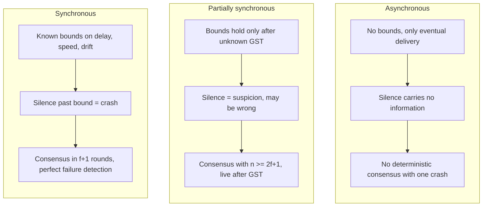
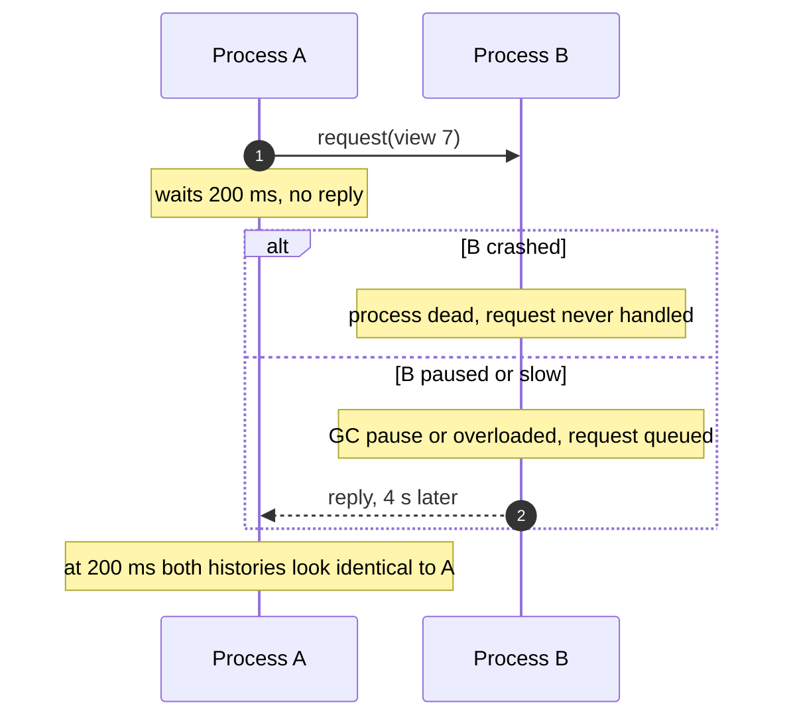
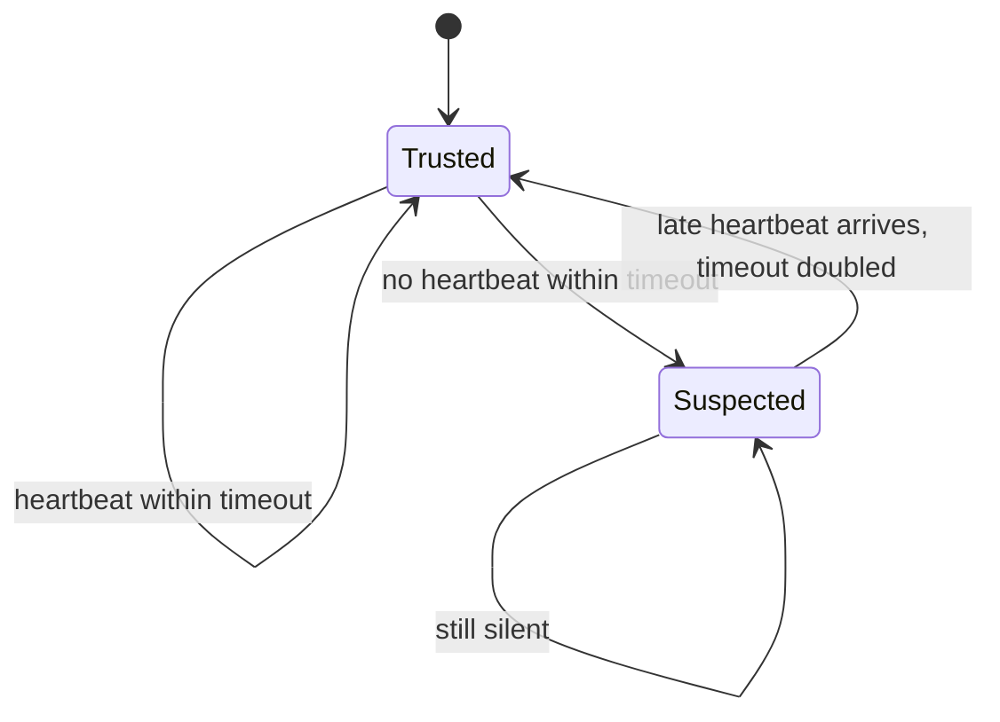
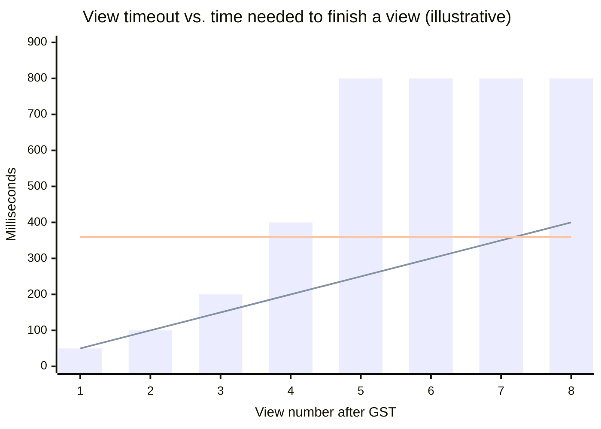
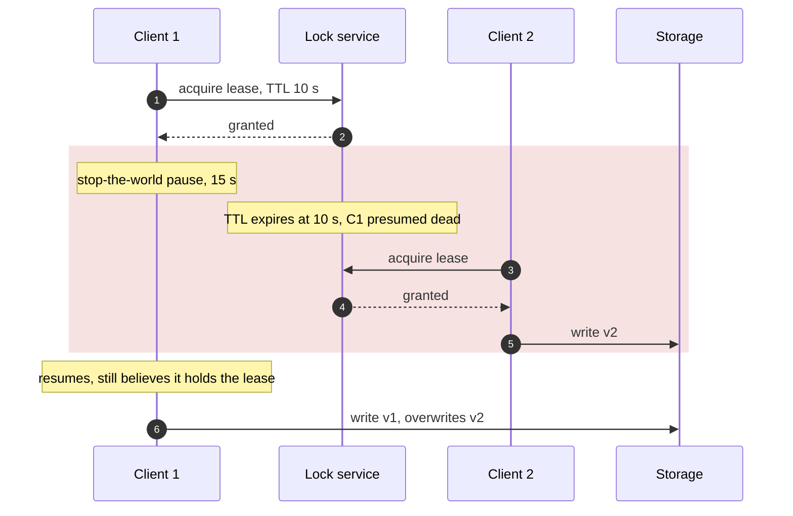

Ağ modeli, daha doğru bir adlandırmayla zamanlama modeli (timing model), bir algoritmanın bir mesajın ulaşmasının ne kadar sürebileceği, bir process'in diğerine göre ne kadar hızlı çalışabileceği ve yerel saatlerin ne kadar kayabileceği hakkında yaptığı varsayımlar kümesidir. Senkron model bu üçünün de algoritmanın bildiği sabitlerle sınırlı olduğunu varsayar. Asenkron model hiçbir sınır varsaymaz: mesaj eninde sonunda teslim edilir ve canlı bir process eninde sonunda bir sonraki adımını atar, ama ne zaman olacağına dair hiçbir şey söylenmez. Kısmen senkron model ikisinin arasında durur: sınırlar vardır ama bilinmez, ya da bilinirler ama yalnızca bilinmeyen bir andan sonra geçerli olurlar.

Model önemlidir, çünkü bir process'in sessizlikten ne sonuç çıkarabileceğini belirler. Senkron modelde, bilinen sınır içinde yanıt vermeyen bir eş (peer) çökmüştür; yani timeout bir kanıttır. Asenkron modelde aynı sessizlik hiçbir şey kanıtlamaz, çünkü eş duraklatılmış, aşırı yüklenmiş ya da yavaş bir bağlantının arkasında olabilir ve her algoritma hangisinin geçerli olduğunu hiç öğrenmeden doğru kalmak zorundadır. Dağıtık bir sistemdeki her doğruluk argümanı, yazıya dökülmüş olsun ya da olmasın, bu varsayımlardan birine dayanır. En yaygın tasarım kusuru ise ortamı yalnızca kısmi senkronluk sağlarken kodunda timeout'ları kanıt olarak kullanan bir algoritmadır.

Asıl denge güce karşı risktir. Daha güçlü bir zamanlama varsayımı daha fazla problemi daha az replika ve daha az round ile çözülebilir kılar, ama ortam üzerine yapılmış bir bahistir; bahis kaybedildiğinde güvenliği (safety) bu varsayıma dayanan bir algoritma sessizce yanlış sonuç üretir. Daha zayıf bir varsayım neredeyse hiç ihlal edilmez, ama bazı problemleri, en ünlüsüyle deterministik consensus'u çözümsüz bırakır. Paxos, Raft, Zab ve PBFT'nin kullandığı çözüm garantiyi ikiye bölmektir: safety (kötü bir şey olmaz) asenkron model altında, liveness (iyi bir şey eninde sonunda olur) ise kısmen senkron model altında kanıtlanır. Mesajların ne kadar yavaş ilerlediğinden farklı olarak process'lerin nasıl hata verdiği [Hata Modelleri](/distributed-systems/tr/foundations/system-models/failure-models/) sayfasının, gecikmenin fiziksel kaynakları ise [Ağ Güvenilirliği, Bant Genişliği Sınırları ve Topoloji Değişiklikleri](/distributed-systems/tr/foundations/monoliths-to-distributed/network-reliability/) sayfasının konusudur.


*Üç zamanlama modeli, bir eş sessizleştiğinde process'in ne sonuç çıkarabileceği ve bunun consensus için doğurduğu sonuç. GST, küresel stabilizasyon zamanıdır (global stabilization time).*

Her sütunu yukarıdan aşağıya okuyun: varsayım sessizliğin nasıl yorumlanabileceğini, yorum da neyin inşa edilebileceğini belirler. Production sistemlerinin gerçekte yaşadığı sütun ortadakidir ve önemli olan kutu onun ortasındaki kutudur. Kısmen senkron modelde timeout bir şüphe üretir; bu şüphenin yanlış olmasına, yanlış şüpheler eninde sonunda durduğu sürece izin verilir. Bu model üzerine kurulan algoritmalar yanlış şüphelere durumu bozmadan dayanmak zorundadır.

## Zamana Dair Üç Varsayım ve Her Birinin Kazandırdıkları

Modeller üç büyüklükle tanımlanır. `Delta`, bir mesajın gönderilmesinden teslimine kadar geçen azami süredir. `Phi`, en hızlı ve en yavaş process'in hızları arasındaki azami orandır; bir process tek adım atarken bir diğerinin kaç adım atabileceğini sınırlar. `rho`, yerel bir saatin gerçek zamana göre azami kayma hızıdır. Bir model, her büyüklüğün sınırlı olup olmadığını ve sınırın algoritma tarafından bilinip bilinmediğini sabitler.

### Senkron: Bilinen Sınırlar ve Kilit Adımlı Round'lar

`Delta`, `Phi` ve `rho` sınırlı ve biliniyorsa, bir algoritma round'lar dizisi olarak yazılabilir. Her round'da her process mesajlarını gönderir, round içinde gönderilen her mesajın ulaşması için yeterince bekler (bu süre `Delta` ve `Phi`'den hesaplanır ve saat kaymasına dayanması için `rho` ile uzatılır) ve ardından bir sonraki durumunu hesaplar. Round sonuna kadar gelmemiş bir mesaj hiç gönderilmemiştir, dolayısıyla gönderen çökmüştür. Tespit hem eksiksiz hem de isabetlidir: her çökme tespit edilir ve canlı hiçbir process'ten şüphelenilmez.

Bu isabet zor problemleri kolaylaştırır. En fazla `f` crash hatası altında `n` process arasında consensus, `n`'den küçük her `f` için çözülebilir ve Fischer ile Lynch 1982'de en kötü durumda `f + 1` round'un gerekli olduğunu gösterdi: her round'daki bir çökme bir değeri bazı process'lerden saklayabilir ve yalnızca yeni çökmenin olmadığı bir round herkesin aynı kümeyi gördüğünü garanti eder. Keyfi (Bizans) hatalar ve kimlik doğrulamasız mesajlar söz konusu olduğunda Lamport, Shostak ve Pease `n > 3f` koşulunun gerekli ve yeterli olduğunu gösterdi; dijital imzalarla ise Dolev-Strong protokolü `f + 1` round'da istenen sayıda hatalı process'e dayanır.

Bedeli şudur: en kötü durum gerçekleşsin ya da gerçekleşmesin her round en kötü durum kadar sürer ve sınır, bir mesajın gönderilmesiyle işlenmesi arasındaki her şeyi kapsamak zorundadır: ağ, kernel, runtime, garbage collector, hypervisor. Bu modeli gerçekten karşılayan sistemler bu katmanların her birini mühendislikle sınırlar: zaman tetiklemeli (time-triggered) aviyonik veri yolları, ayrılmış iletim slotlarına sahip otomotiv ve endüstriyel kontrol ağları ve tek bir kasa içindeki donanım protokolleri. Paylaşılan host'larda garbage collection'lı bir runtime çalıştıran genel amaçlı bir veri merkezi bu modeli karşılamaz; aşağıdaki sayısal örnek bunu ölçer.

### Asenkron: Sınır Yok, Sessizlikten Sonuç Yok

Asenkron model tüm sınırları kaldırır. Canlı process'ler arasındaki mesajlar eninde sonunda teslim edilir ve canlı process'ler eninde sonunda adım atar, ama her sonlu gecikme mümkündür. Model çekicidir, çünkü yavaşlık onu ihlal edemez: asenkron model altında doğru olan bir algoritma her gecikme, duraklama ya da aşırı yük deseninde doğru kalır.

Zayıflığı gözlemle ilgili tek bir olgudur. Bir eşi bekleyen process, çökmüş bir eşi yavaş bir eşten ayırt edemez, çünkü yavaş olan yanıt verene kadar ikisi dışarıdan aynı görünür.


*Ayırt edilemezlik: A'nın karar vermesi gereken anda, çökmüş bir B ile yavaş bir B tamamen aynı gözlemleri üretir.*

1. ve 2. adımlar iki dalda da aynıdır. A 200 ms'de ne karar verirse versin, hangi dalda olduğunu bilmeden karar verir. A, B'yi ölü kabul edip devam ederse, yavaş dal eninde sonunda A'nın gözden çıkardığı bir process'ten, hatta belki B'nin hâlâ yetkili olduğuna inandığı bir process'ten yanıt teslim eder. A beklerse, çökme dalı hiç bitmez. Fischer, Lynch ve Paterson bunu FLP imkansızlık sonucuna dönüştürdü: tek bir process bile çökebiliyorsa, asenkron bir sistemde hiçbir deterministik algoritma consensus'u garanti edemez. İspat ve sonuçları [FLP İmkansızlık Sonucu](/distributed-systems/tr/coordination/consensus-algorithms/flp-impossibility/) sayfasında ele alınır.

Asenkron modelde pek çok şey hâlâ mümkündür. Reliable broadcast, quorum okuma ve yazmaları, conflict-free replicated data type'lar ve eventual consistency asenkron modelde güvenlidir, çünkü hiçbiri her process'in bilinen bir anda tek bir karar üzerinde uzlaşmasını gerektirmez. Ben-Or'un 1983 protokolüyle başlayan randomize consensus da deterministik olarak değil, 1 olasılıkla sonlanarak FLP'den kaçar; bu ayrım [Deterministik ve Olasılıksal Hata Modelleri](/distributed-systems/tr/foundations/system-models/deterministic-vs-probabilistic/) sayfasının konusudur.

:::note[Bağlantı modelleri ayrı bir eksendir]
Zamanlama modelleri mesajların ne kadar sürdüğünü tanımlar. Mesajların kaybolup kaybolamayacağı, çoğaltılıp bozulup bozulamayacağı ise bağlantı (link) soyutlamalarıyla tanımlanır: fair-loss link'ler (sonsuz kez gönderilen bir mesaj sonsuz kez teslim edilir), yeniden iletimle kurulan stubborn link'ler ve buna tekilleştirme (deduplication) eklenerek kurulan perfect link'ler. Teorinin çoğu canlı process'ler arasında güvenilir bağlantı varsayar ve kaybı hata modeline iter; mesaj ihmalinin (omission) burada değil, [Hata Modelleri](/distributed-systems/tr/foundations/system-models/failure-models/) sayfasında yer almasının nedeni budur.
:::

### Kısmi Senkronluk: Eninde Sonunda Geçerli Olan Sınırlar

Dwork, Lynch ve Stockmeyer kısmi senkronluğu 1988'de, genellikle düzgün davranan ama her zaman geçerli bir sınırı olmayan sistemleri tanımlamak için ortaya koydu. İki varyant verdiler. Birincisinde `Delta` ve `Phi` vardır ama bilinmez; bu yüzden algoritma bunları koda gömemez. İkincisinde sınırlar bilinir, ama yalnızca bilinmeyen bir küresel stabilizasyon zamanından (GST) sonra geçerlidir; GST'den önce mesajlar keyfi olarak gecikebilir. Varyantlar algoritma tasarımı açısından eşdeğerdir ve protokol makalelerinin çoğu ikincisini kullanır.

GST bir ispat aracıdır, sistemin gözlemleyebileceği bir olay değildir. Gerçek ağlar bir kez ve sonsuza dek stabilize olmaz; uzun stabil dönemlerle kısa kaotik dönemler arasında gidip gelir. Model şunu söyler: stabil bir dönem protokolün bir denemeyi tamamlamasına yetecek kadar uzun sürerse, protokol ilerleme kaydeder. Kaosun ne kadar sürebileceğini söylemez; bu yüzden kısmi senkronluk altındaki bir liveness ispatı her zaman "ağ düzgün davrandıktan sonra ilerleme sürer" biçimindedir, asla "2 saniye içinde ilerleme" biçiminde değildir.

Eşikler asenkron olanlara yakındır. Dwork, Lynch ve Stockmeyer, crash ya da omission hatalarıyla consensus'un ancak ve ancak `n >= 2f + 1` olduğunda, Bizans hatalarıyla ise ancak ve ancak `n >= 3f + 1` olduğunda çözülebildiğini kanıtladı; ikincisi imzalar kullanılsa bile geçerlidir. Bunu, imzalı Bizans uzlaşmasının hiç replika çoğunluğu gerektirmediği senkron modelle karşılaştırın: ek replikalar, sessiz bir process'in ne zaman öldüğünü bilmemenin bedelidir. Bunlar Raft gruplarının (bir ya da iki çökmeye dayanan üç ya da beş üye) ve PBFT gruplarının (tek bir Bizans hatasına dayanan dört üye) bilinen boyutlarıdır.

## Zaman Olmadan Safety, Zamanla Liveness

Kısmi senkronluğun mümkün kıldığı tasarım disiplininin iki yarısı vardır. Safety yalnızca quorum kesişiminden türetilir: `2f + 1` process'in herhangi iki çoğunluğu en az bir ortak üyeye sahiptir; dolayısıyla bir çoğunluğun seçtiği değeri, mesajlar ne zaman ulaşırsa ulaşsın, sonraki her çoğunluk görür. Zamanlama yalnızca liveness yarısında, takılmış bir denemeyi bırakıp yeni bir leader, ballot, term ya da view numarasıyla yeni bir deneme başlatan tetikleyici olarak yer alır. Yanlış ateşlenen bir timeout gereksiz bir denemeye mal olur, ama safety'yi ihlal edemez, çünkü eski denemenin geç kalan mesajları daha düşük bir numara taşır ve reddedilir.

Chandra ve Toueg zamanlama yarısını güvenilmez hata dedektörü (unreliable failure detector) olarak biçimselleştirdi: şüphelenilen process'lerin listesini veren ve yanılabilen bir modül. Literatürde `<>P` olarak yazılan eventually perfect dedektör, eninde sonunda çökmüş her process'ten şüphelenir ve eninde sonunda canlı her process'ten şüphelenmeyi bırakır. Chandra, Hadzilacos ve Toueg daha sonra, yalnızca tüm process'lerin eninde sonunda aynı canlı leader'a güvenmesini garanti eden daha zayıf Omega dedektörünün, consensus'u çözülebilir kılan en zayıf dedektör olduğunu gösterdi. Raft'ın election timeout'u, Zab'ın leader seçimi ve PBFT'nin view change'i, kılık değiştirmiş Omega gerçeklemeleridir.

Kısmi senkronluk altında eventually perfect bir dedektör, heartbeat'lerden ve her şüphe yanlış çıktığında büyüyen timeout'lardan kurulabilir.


*Uyarlanabilir bir hata dedektörünün eş başına durumu. Yanlış şüphe, zaten şüphelenilen bir eşten heartbeat geldiğinde fark edilir ve timeout büyür.*

`Suspected`'tan `Trusted`'a dönüş öğrenme adımıdır. Her ateşlendiğinde dedektör, timeout'unun o eşe olan gerçek gecikmeden kısa olduğuna dair bir kanıt elde eder. GST'den sonra gerçek gecikme bilinmeyen bir `Delta` ile sınırlıdır ve iki katına çıkan bir timeout, sonlu sayıda yanlış şüpheden sonra her sonlu `Delta`'yı aşar; dolayısıyla yanlış şüpheler eninde sonunda durur. Çökmüş bir eş artık heartbeat göndermez, sonsuza dek `Suspected` durumunda kalır ve böylece eninde sonunda kalıcı olarak şüphelenilir. `<>P`'nin iki özelliği de, dedektör `Delta`'yı hiç bilmeden sağlanmış olur.

```text
on start:                  timeout[q] = T0 for every peer q
every heartbeat_interval:  send HEARTBEAT to all peers
on HEARTBEAT from q:
    if q in suspected:
        suspected.remove(q)
        timeout[q] = timeout[q] * 2      # learned: our bound was too short
    last_seen[q] = now()                 # monotonic clock, never wall clock
every tick:
    for q in peers:
        if now() - last_seen[q] > timeout[q]: suspected.add(q)
```

Production dedektörleri bu iskeleti geliştirir. Cassandra ve Akka'nın kullandığı [phi accrual dedektörü](/distributed-systems/tr/resilience/failure-detection/phi-accrual-detector/), ikili bir karar yerine gözlemlenen varış aralıkları dağılımından hesaplanan bir şüphe seviyesi üretir. Raft ise her election timeout'u bir aralıktan rastgele çeker; böylece iki follower nadiren aynı anda timeout'a düşer ve oyları bölmez. Pratikte heartbeat ve timeout boyutlandırması [Heartbeats ve Zaman Aşımı Yapılandırmasının Bilimi](/distributed-systems/tr/resilience/failure-detection/heartbeats-timeouts/) sayfasında ele alınır.

Raft makalesi zamanlama gereksinimini `broadcastTime << electionTimeout << MTBF` olarak ifade eder: follower'lara bir round trip, election timeout'tan çok daha kısa olmalı; election timeout da hatalar arasındaki ortalama süreden (mean time between failures, MTBF) çok daha kısa olmalıdır. Bu, mühendislik eşitsizliği olarak ifade edilmiş kısmi senkronluktur. Soldaki eşitsizlik sağlandığında leader'lar follower'larının güvenini korur ve cluster ilerler. Sağlanmadığında cluster GST öncesi bir dönemdedir ve hiçbir şey commit etmeden tekrar tekrar leader seçer; ancak commit edilmiş kayıtlar commit edilmiş olarak kalır.

### Sayısal Örnek: Bir Veri Merkezini Senkronmuş Gibi Göstermenin Bedeli

Tek bir bölgede beş node'luk bir cluster varsayalım. Tek yönlü mesaj gecikmesinin medyanı 0.25 ms, 99.99. yüzdelik dilimi 4 ms olsun. Bundan bağımsız olarak her process, garbage collection, bellek baskısı altındaki bir host ya da canlı taşıma (live migration) nedeniyle günde yaklaşık bir kez 1 saniyeden, yılda yaklaşık bir kez de 10 saniyeden uzun stop-the-world duraklaması yaşasın. Tüm sayılar örnek amaçlıdır.

Senkron bir algoritma, duraklamış bir process'e giden ve ondan gelen mesajlar dahil her mesaj için teslimi ve alıcının işlemesini kapsayan bir `Delta`'ya ihtiyaç duyar. Ağın kuyruğunun rahatça üzerindeki `Delta = 10 ms` ile sınır, herhangi bir node yaklaşık 10 ms'den uzun duraksadığında ihlal edilir; beş node ile bu günde en az beş kez demektir ve her ihlal, hâlâ iş yapan yavaş bir process'in algoritma tarafından çökmüş sayılmasına yol açabilir. İhlalleri cluster genelinde yılda bir kezden seyrek kılmak için `Delta`'nın beş node-yılda beklenen en uzun duraklamayı, örneğin 30 saniyeyi aşması gerekir.

`f = 2` hataya dayanan senkron bir crash-tolerant consensus, her biri `Delta` kadar süren `f + 1 = 3` round gerektirir. Bu durumda her karar, bir şey bozulsun ya da bozulmasın, 90 saniyeye mal olur. Aynı donanımdaki bir Raft cluster'ı çoğunluğa tek bir round trip ile commit eder; yaklaşık 0.5 ms ağ süresi artı bir disk senkronizasyonu. Leader'daki yıllık 10 saniyelik duraklama sırasında follower'lar election timeout'larından sonra yeni bir leader seçer ve devam eder. Senkron tasarım, yılda birkaç saniyelik erişilemezlikten kaçınmak için her kararda yaklaşık 100.000 kat daha yavaştır; kullanılabilir hâle getirmek için `Delta` daha küçük seçilirse de safety'si, ortamın her gün çiğnediği bir sınıra dayanır.

### Sayısal Örnek: Büyüyen Timeout'lar Ne Kadar Hızlı Yakınsar

Şimdi üç bölgeye yayılan kısmen senkron bir protokol varsayalım. GST'den sonra bir view'u tamamlamak (öneri, oylar ve commit) en fazla 360 ms sürüyor. Başlangıç view timeout'u 50 ms. Tüm sayılar örnek amaçlıdır.


*Çubuklar: iki katına çıkarma altında k. view'un alacağı timeout, 800 ms ile sınırlı. Yükselen çizgi: view başına 50 ms büyüme altındaki timeout. Düz çizgi: GST'den sonra bir view'u tamamlamak için gerçekte gereken süre.*

İki katına çıkarmada 1-3. view'lar 50, 100 ve 200 ms sonra timeout'a düşer ve 400 ms timeout'lu 4. view başarılı olur; başladıktan 360 ms sonra tamamlanır. İlk karar GST'den `50 + 100 + 200 + 360 = 710 ms` sonra gelir. View başına 50 ms'lik doğrusal büyümede ilk yedi view başarısız olur, `50 + 100 + ... + 350 = 1,400 ms` boşa gider ve 8. view GST'den 1.760 ms sonra başarılı olur. İki katına çıkarma logaritmik sayıda view'da yakınsar; bedeli aşmadır (overshoot): başarılı timeout gerçek ihtiyacın neredeyse iki katı olabilir ve bu, bir sonraki leader hatasında önem taşır.

Sınırın var olma nedeni de bu aşmadır. GST'den önce art arda başarısız olan on view, sınırsız iki katına çıkan bir timeout'u `50 * 2^10`'a, yani yaklaşık 51 saniyeye iter ve bir sonraki gerçek leader çökmesinin tespiti bu kadar sürer. Bu yüzden gerçeklemeler timeout'u sınırlar ve başarılı view'lardan sonra küçültür; Raft ise sabit, randomize bir aralık kullanarak ve boyutlandırmayı operatörlere bırakarak bu problemden kaçınır.

## Modellerin Karşılaştırılması ve Sistemlerin Geri Getirdiği Senkronluk

| Model | Varsayım | Hata tespiti | Consensus eşiği | Tipik sistemler | Tasarım varsayımı olarak ne zaman tercih edilmeli |
|---|---|---|---|---|---|
| Senkron | Bilinen `Delta`, `Phi`, `rho`, her zaman | Kusursuz: timeout çökmeyi kanıtlar | Crash: `n`'den küçük her `f`, `f + 1` round; Bizans: `n > 3f`, imzalarla her `f` | Zaman tetiklemeli veri yolları, güvenlik açısından kritik kontrol, kasa içi donanım | Kablodan zamanlayıcıya her katman katı gerçek zamanlı sınırlarla tasarlanmışsa |
| Kısmen senkron | Sınırlar bilinmeyen GST'den sonra geçerli ya da var ama bilinmiyor | Eventually perfect ya da Omega: şüpheler yanlış olabilir | Crash: `n >= 2f + 1`; Bizans: `n >= 3f + 1` | Paxos, Raft, Zab, PBFT, HotStuff | Tek bir değer üzerinde uzlaşması gereken veri merkezi ve WAN sistemleri için varsayılan |
| Asenkron | Yalnızca eninde sonunda teslim | İsabetli olması imkansız | Tek çökmeyle deterministik consensus imkansız | Gossip, CRDT'ler, Dynamo tarzı quorum'lar, randomize consensus | Erişilebilirlik uzlaşmadan daha önemliyse ya da bir safety ispatının her gecikmede geçerli olması gerekiyorsa |
| Zamanlı asenkron (Cristian ve Fetzer) | Sınırlar genellikle geçerli; ihlaller sistemin tespit ettiği performans hatalarıdır | Kayması sınırlı yerel saatlerle | İlerleme yalnızca stabil dönemlerde | Hata farkındalıklı (fail-aware) servisler, leader lease'leri | Lease'ler ve saate dayalı mekanizmalar hakkında açıkça akıl yürütmek için |

Tablo tekrarlayan bir deseni gizler: consensus için kısmen senkron olan sistemler, genellikle performans uğruna başka bir yerde senkron bir varsayımı geri getirir. Bir leader lease'i, bir Raft leader'ının quorum round trip'i olmadan linearizable okumalar sunmasını sağlar. Bu yalnızca lease sona ermeden başka bir leader seçilemiyorsa güvenlidir, bu da eski leader ile oy verenler arasında sınırlı saat kayması gerektirir. Spanner'ın commit wait'i yalnızca TrueTime'ın belirsizlik sınırı hiç aşılmazsa güvenlidir ([Google TrueTime & Spanner](/distributed-systems/tr/foundations/time-and-ordering/truetime-spanner/)). CockroachDB dokümantasyonu varsayılan azami saat sapmasını 500 ms olarak belirler ve bir node, eşlerinin en az yarısına göre bu değerin %80'ini aşan bir sapma tespit ettiğinde kendini kapatır, çünkü okuma tutarlılığı bu sınıra dayanır ([CockroachDB: Raft, HLC ve Parallel Commits](/distributed-systems/tr/case-studies/distributed-sql/cockroachdb-raft-hlc/)). Nakamoto tarzı blockchain'ler, Pass, Seeman ve shelat'ın 2017'de biçimselleştirdiği gibi, safety için blok süresine göre sınırlı bir mesaj gecikmesine ihtiyaç duyar.

Bunların hiçbiri hata değildir. Her biri bir garantinin kısmen senkron sütundan senkron sütuna bilinçli olarak taşınmasıdır ve bedeli izlenmesi ve uygulanması gereken bir sınırla ödenir. Hata, bu taşımayı fark etmeden yapmaktır.

### Production'daki Zamanlama Parametreleri

| Sistem | Parametre | Varsayılan | Neyi kodlar |
|---|---|---|---|
| Raft (makale) | Election timeout aralığı | Makalenin değerlendirmesinde 150-300 ms | Randomize Omega; broadcast süresini aşmalı |
| etcd | `--heartbeat-interval`, `--election-timeout` | 100 ms, 1000 ms | Dokümantasyon heartbeat'i üyeler arası RTT civarında, election timeout'u en az 10x RTT tutmayı önerir; üst sınır 50 s |
| ZooKeeper | Session timeout sınırları | `tickTime`'ın 2x ile 20x'i | Sunucunun müzakere ettiği istemci liveness penceresi |
| Cassandra | `phi_convict_threshold` | 8 | Bir eşin down olarak işaretlendiği şüphe seviyesi |
| CockroachDB | Azami saat sapması | 500 ms | Okuma tutarlılığının dayandığı saatler üzerindeki senkronluk sınırı |

Bölgeler arası bir etcd cluster'ı için varsayılanlar genellikle fazla sıkıdır. Üyelerinin en kötü durumda yaklaşık 150 ms round trip gördüğü bir cluster için bir taslak (değerler örnek amaçlıdır ve belgelenmiş yönergelerden türetilmiştir):

```yaml
# etcd config file; both values in milliseconds and identical on every member
heartbeat-interval: 150    # roughly one member-to-member RTT
election-timeout: 1500     # at least 10x RTT; longer means slower failover
```

Election timeout'u yükseltmek failover süresini stabiliteyle takas eder: çöken bir leader artık en az 1.5 saniyelik yazma erişilemezliğine mal olur, ama sıradan gecikme sıçramaları artık eşiği aşıp seçimleri tetiklemez.

## Zamanlama Varsayımı Bozulduğunda Hata Modları

Hata imzası, garantinin hangi yarısının zamanlamaya dayandığına bağlıdır. Yalnızca liveness dayanıyorsa, ihlal edilen bir sınır erişilebilirliğe mal olur ve kendiliğinden toparlanır. Safety dayanıyorsa, sonuç hiçbir alarmın raporlamadığı yanlış veridir.

### Lease, Sahibinin Zaman Algısından Uzun Yaşar

Tetikleyici: bir bileşen, zamana dayalı bir lease'in sona ermesini sahibinin iş yapmayı bıraktığının kanıtı olarak kabul eder; oysa sahip, kendisini lease süresinden uzun duraklatabilen bir platformda çalışmaktadır. Belirtiler: kısa bir pencere boyunca iki process aynı kaynağın sahibi gibi davranır; yazmalar kaybolur ya da birbirine karışır. Tespit: genellikle yalnızca downstream invariant kontrolleri ya da mutabakat (reconciliation) yoluyla mümkündür ve bu modu tehlikeli kılan da budur; uzun GC ya da VM duraklama log'larını lease sona ermeleriyle ilişkilendirmek olayı sonradan açıklayabilir.


*Senkron bir varsayımı ihlal eden kısmen senkron bir ortam: lock servisi doğru çalışıyor, 7. adımdaki yazma ise yine de güvensiz.*

3-5. adımlar, lock servisinin kendi modeli altında doğru davranışıdır: sahip TTL'den uzun süre sessiz kaldı, dolayısıyla lease yeniden atandı. Kusur, Client 1'in son kontrol ettiğinde doğru olan bir inanca göre hareket ettiği 7. adımdadır. Yazmadan önce ne kadar kontrol yapılırsa yapılsın pencere kapanmaz, çünkü duraklama kontrol ile yazma arasında gerçekleşebilir. Jepsen'in 2020'deki etcd 3.4.3 analizi, etcd'nin lock API'si için bu sonuca vardı: dağıtık lock'ların asenkron sistemlerde temelden güvensiz olduğunu belirtti ve korunan kaynağın safety'yi fencing token'larla kendisinin sağlamasını önerdi. Hafifletme: depolamanın eski token taşıyan yazmaları reddetmesini sağlamak; [Fencing Tokens](/distributed-systems/tr/coordination/distributed-locking/fencing-tokens/) ve [Kiralama Tabanlı Kilitleme](/distributed-systems/tr/coordination/distributed-locking/lease-based-locking/) sayfalarında anlatıldığı gibi. Kurtarma, üzerine yazılan verinin mutabakatını gerektirir, çünkü hiçbir şey otomatik olarak geri alınmamıştır.

:::danger[Timeout bir eylemi tetikleyebilir, ona yetki veremez]
B process'inin, A'nın lease'i ya da heartbeat'i timeout'a düştüğü için X'i yapmaya başladığı ve A'nın aynı anda X'i yapmasının veriyi bozacağı her tasarım, safety için senkronluk varsayar. Kısmi senkronluk altında A hâlâ canlı olabilir ve iş yapıyor olabilir. Ya kaynağın kendisi A'nın geç eylemlerini reddetmelidir (fencing, bir versiyon üzerinde compare-and-set, quorum kontrollü yazmalar) ya da sistem, Spanner ve CockroachDB'nin yaptığı gibi açık bir saat sınırını kabul edip izlemelidir.
:::

### Seçim Çalkantısı: GST Öncesinde Yaşamak

Tetikleyici: election ya da view timeout'u bir heartbeat round'unun gerçek gecikmesinden kısadır; genellikle bir cluster varsayılan ayarlarla bölgeler arasına yayıldığı için ya da yavaş disk senkronizasyonları leader'ın heartbeat'lerini geciktirdiği için. Belirtiler: her node sağlıklı görünürken sık leader değişimleri ve artan term'ler, yazma gecikmesi sıçramaları ve her seçim sırasında istemci hataları. Tespit: etcd'de `etcd_server_leader_changes_seen_total`'ın artması ve `etcd_server_is_leader`'ın gidip gelmesi; bunlarla birlikte `etcd_network_peer_round_trip_time_seconds` ve `etcd_disk_wal_fsync_duration_seconds`'ın heartbeat round trip'lerinin ya da disk senkronizasyonlarının election timeout'a yaklaştığını göstermesi. Hafifletme: timeout'ları ölçülen round trip ve disk gecikmesine göre boyutlandırmak, cluster üyelerini birbirine yaklaştırmak ya da consensus log'una ayrı bir disk vermek. Timeout'lar gerçek gecikmeyi aştığında toparlanma otomatiktir; commit edilmiş hiçbir veri kaybolmaz, bu da safety yarısının işini yapması demektir.

### Kaotik Bir Dönemden Sonra Timeout Şişmesi

Tetikleyici: uyarlanabilir bir dedektör ya da view timeout'u uzun bir bozulma (bir partition, aşırı yüklü bir dönem) sırasında büyür ve bir daha hiç küçültülmez. Belirtiler: bozulmadan sonra bir sonraki gerçek çökmenin tespiti beklenenden çok daha uzun sürer. Tespit: eş başına geçerli efektif timeout'u dışa aktarmak ve yapılandırılmış bir tavanı aştığında alarm üretmek. Hafifletme: büyümeyi sınırlamak ve başarılı round'lardan sonra timeout'u küçültmek; bu, sınırlı tespit süresi karşılığında bazı tekrarlayan yanlış şüpheleri kabul etmektir.

### Yapılandırılmış Sınırın Ötesinde Saat Sapması

Tetikleyici: bir node'un saati, saate dayalı bir sistemin varsaydığı sapmanın ötesine kayar; bir zaman senkronizasyon daemon'unun arızası, bir VM taşıması ya da yanlış yapılandırılmış bir zaman kaynağı sonrasında. Belirtiler: kontrol yapan sistemlerde node'lar kendilerini kapatır ve birden fazla node aynı bozuk kaynağı paylaşıyorsa bu quorum kaybına mal olabilir; kontrol yapmayan sistemlerde eski veri okumaları ya da sıralama anomalileri görülür. Tespit: eşlere göre saat sapması metrikleri ve zaman senkronizasyon daemon'unun kendi sapma ve durum bilgisi. Hafifletme: bağımsız, yedekli zaman kaynakları ve sınırın çok altında üretilen alarmlar. Saat mekanizmaları [Fiziksel Saatler](/distributed-systems/tr/foundations/time-and-ordering/physical-clocks/) sayfasında ele alınır.

| Hata | Bozulan varsayım | Etki | Tespit | Hafifletme |
|---|---|---|---|---|
| Lease sahibinden uzun yaşar | Safety için kullanılan senkronluk | İki sahip, kaybolan yazmalar | Invariant kontrolleri, duraklama log'ları ve lease sona ermeleri | Fencing token'ları, versiyon kontrollü yazmalar |
| Seçim çalkantısı | Gerçek gecikmenin altındaki timeout | Erişilemezlik, veri kaybı yok | Leader değişimleri, peer RTT ve fsync'in timeout'a oranı | Timeout'ları ölçüme göre boyutlandırmak |
| Timeout şişmesi | Sınırsız uyarlama | Sonradan yavaş failover | Eş başına efektif timeout | Sınırlamak ve küçültmek |
| Saat sapması aşıldı | Sınırlı kayma | Kendini kapatma ya da eski veri okuma | Sapma metrikleri, senkronizasyon durumu | Yedekli zaman kaynakları, erken alarmlar |

:::caution[Sakin bir cluster'daki testler zamanlama hakkında hiçbir şey kanıtlamaz]
Safety için zamanlamaya dayanan bir protokol, boşta duran bir cluster'da her fonksiyonel testi geçer, çünkü sınır yalnızca duraklamalar, gecikme sıçramaları ve saat atlamaları altında ihlal edilir. Bunları bilinçli olarak enjekte edin: `SIGSTOP` ile process duraklatma, `tc netem` ile gecikme, bir test saatiyle saat sapması. Bunun için kullanılan araçlar [Doğruluk Testi: Jepsen ve Deterministik Simülasyon](/distributed-systems/tr/deployment/distributed-testing/jepsen-deterministic-simulation/) sayfasında ele alınır.
:::

## Tasarımın Dayanacağı Modeli Seçmek

Doğruluk uzlaşma, sahiplik ya da sıralama anlamına geldiği her durumda safety'yi asenkron modele göre tasarlayın. Somut olarak: iki process'in farklı vermemesi gereken her karar quorum kesişimi, epoch ya da term numaraları veya kaynakta fencing ile korunur; böylece herhangi bir noktadaki keyfi gecikme sistemi yanlış değil, yalnızca yavaş bırakır. Ardından liveness'ı kısmi senkronluğa göre tasarlayın: timeout'ları ölçülen gecikme dağılımlarına ve failover beklentilerine göre boyutlandırın ve her timeout'u yanlış olabilecek bir şüphe olarak ele alın.

Senkronluğu yalnızca uygulanabildiği ve izlenebildiği yerde varsayın. Mühendislikle tasarlanmış ağları ve zamanlayıcıları olan katı gerçek zamanlı sistemler bu koşulu sağlar. Sıradan altyapıda senkronluk varsayımı, sınırı açık, izlenen ve bir fail-safe ile korunan performans optimizasyonları için kabul edilebilir; örneğin node'u sınır aşılmadan önce durduran bir saat sapması kontrolüne sahip lease'ler. Sınır örtükse, runtime keyfi sürelerle duraklayabiliyorsa ya da yol public internet'ten geçiyorsa kabul edilemez.

Sistem uzlaşmaya ihtiyaç duymuyorsa tamamen asenkron bir tasarım seçin: cache'ler, gossip tabanlı üyelik yayılımı, CRDT tabanlı ortak çalışma, metrik pipeline'ları. Burada consensus eklemek, kimsenin ihtiyaç duymadığı bir garanti için erişilebilirlikten vazgeçmek olur; bu takas, biçimsel ispatı asenkron bir ağ modeli kullanan [CAP teoremi](/distributed-systems/tr/data-management/consistency-models/cap-theorem/) sayfasında incelenir.

Kısmen senkron ortamlarda grupları senkron eşiklere göre boyutlandırmayın. Senkron literatürden gelen ve `f + 1` replika ile `f` hataya dayanan imzalı bir Bizans protokolü, gecikme sınırsız hâle geldiği anda güvensizleşir ya da bloke olur; [Bizans Hataları](/distributed-systems/tr/foundations/system-models/byzantine-faults/) sayfasında tartışıldığı gibi kısmen senkron eşik olan `3f + 1` geçerlidir.

Tasarım incelemesinde bir tasarımın gerçekte hangi modeli varsaydığını bulmanın en hızlı yolu, her timeout'u listeleyip erken ateşlenirse ne olacağını sormaktır. Yanıt bir retry, yeni bir seçim ya da daha yavaş bir yol ise tasarım kısmen senkrondur ve timeout bir ayar meselesidir. Yanıt, ilk process hâlâ bir şey üzerinde iş yaparken ikinci bir process'in aynı şey üzerinde iş yapabileceği ise tasarım safety için senkronluk varsayıyordur ve yeniden yazılması gereken satır odur.

## İleri Okuma

- Cynthia Dwork, Nancy Lynch ve Larry Stockmeyer, *Consensus in the Presence of Partial Synchrony*, Journal of the ACM, 1988.
- Michael J. Fischer, Nancy A. Lynch ve Michael S. Paterson, *Impossibility of Distributed Consensus with One Faulty Process*, Journal of the ACM, 1985.
- Tushar Deepak Chandra ve Sam Toueg, *Unreliable Failure Detectors for Reliable Distributed Systems*, Journal of the ACM, 1996.
- Flaviu Cristian ve Christof Fetzer, *The Timed Asynchronous Distributed System Model*, IEEE Transactions on Parallel and Distributed Systems, 1999.
- Christian Cachin, Rachid Guerraoui ve Luis Rodrigues, *Introduction to Reliable and Secure Distributed Programming*, Springer, 2011.
- Kyle Kingsbury, *Jepsen: etcd 3.4.3*, jepsen.io, 2020.
