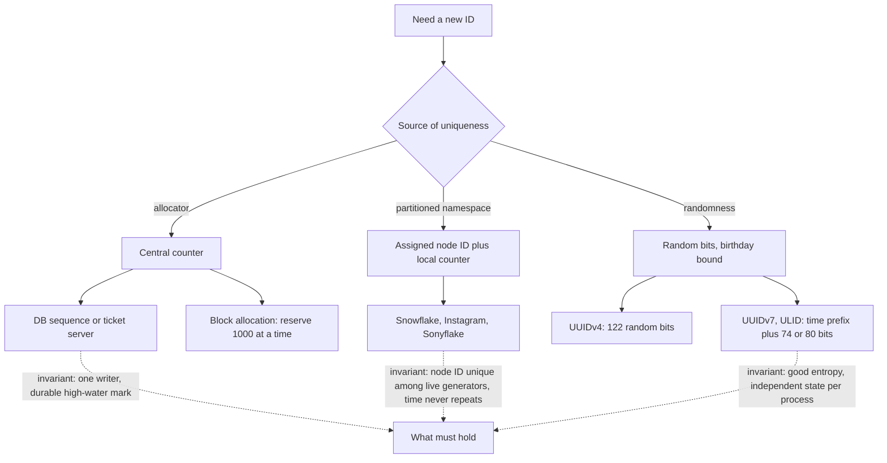
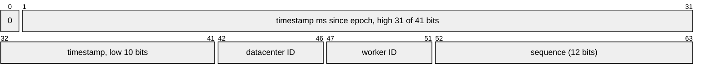
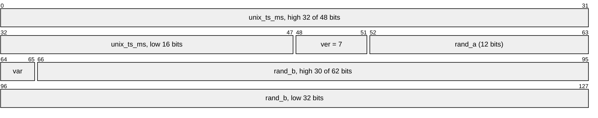
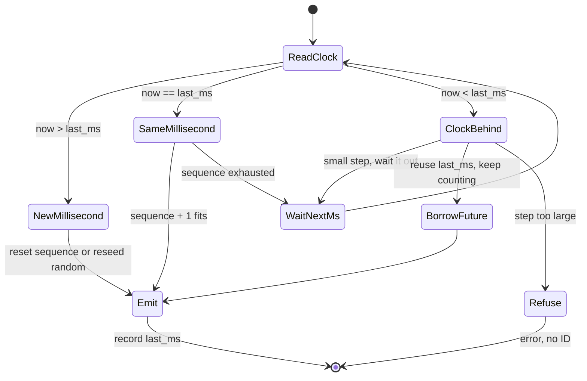
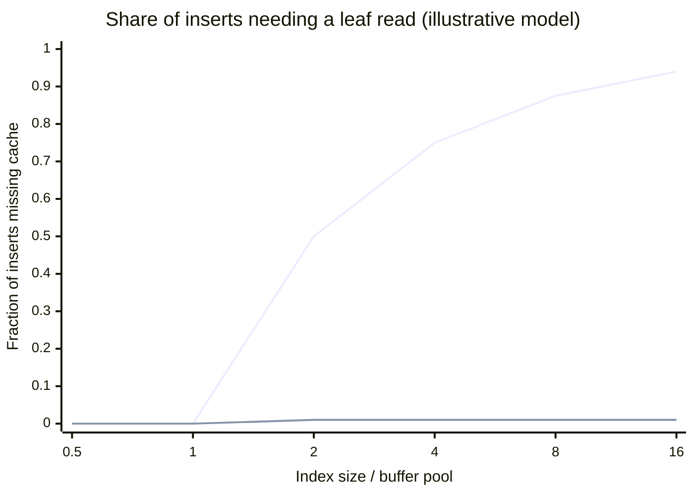

Dağıtık bir ID üreteci, her tanımlayıcı için tek bir otoriteye sormadan çok sayıda süreç arasında benzersiz olan tanımlayıcılar üretir. Benzersizlik yalnızca üç kaynaktan gelebilir: numara dağıtan merkezi bir dağıtıcı (allocator), her üretecin ayrık bir dilime sahip olacağı şekilde önceden bölünmüş bir ad alanı (namespace) ya da iki üretecin aynı değeri seçmesini ihmal edilebilir derecede olası kılan yeterli sayıda rastgele bit. Snowflake, UUIDv7, ULID ve MongoDB'nin ObjectId'si dahil kullanımdaki her şema bu üçünden biridir ya da bir birleşimidir; çoğunlukla başa bir zaman damgası eklenir ki zaman olarak birbirine yakın yaratılan tanımlayıcılar sıralamada da birbirine yakın düşsün.

Asıl denge koordinasyon, yerellik (locality) ve boyut arasındadır. Bir dağıtıcı yoğun, küçük ve kusursuz sıralı tamsayılar verir; bedeli tek bir yazara yapılan bir round trip ve onun erişilebilirliğine bağımlılıktır. Bölünmüş bir ad alanı 64 bite sığar ve ID başına koordinasyon gerektirmez, ama dilimi atamak için üreteç başına bir kez koordinasyon ister ve bozulduğu yer de tam olarak bu atamadır. Rastgelelik hiç koordinasyon gerektirmez, ama 128 bit ister ve zaman öneki olmadan eklemeleri index'in tamamına saçar. Zaman öneki B-tree index'lere ekleme yerelliğini geri kazandırır; aynı hamlede aralık bazlı partition'lanmış bir depoda tüm yazmaları tek bir anahtar aralığına yığar ve yaratılma zamanlarını ID'yi elinde tutan herkese açık eder.

Zaman önekli bir tanımlayıcı bir saat değildir: farklı makinelerden gelen ID'ler o makinelerin duvar saatlerine (wall clock) göre sıralanır ve bu saatler milisaniyeler ya da daha fazlası kadar birbirinden ayrışabilir; dolayısıyla ID sırası nedensel sırayı tersine çevirebilir. Fiziksel zaman damgaları için genel durum [Hibrit Mantıksal Saatler](/distributed-systems/tr/foundations/time-and-ordering/hybrid-logical-clocks/) sayfasında açıklanır. Zaman sıralı ID'ler benzersizlik ve yaklaşık yaratılma sırası vaat eder, daha güçlü bir şey değil.

## Benzersizlik Nereden Gelir: Dağıtıcılar, Bölünmüş Ad Alanları ve Rastgelelik

Benzersizliğin her kaynağı farklı bir değişmeze (invariant) dayanır ve her değişmez kendine özgü bir biçimde bozulur.


*Benzersizliğin üç kaynağı ve her birinin dayandığı değişmez. Hibrit şemalar bir zaman önekini bu üç kaynaktan biriyle birleştirir.*

Dağıtıcı dalı en eskisidir. Bir veritabanı sequence'i ya da ayrılmış bir ticket sunucusu bir sayacı artırır ve yeniden başlatmanın hiçbir numarayı tekrar vermemesi için bir yüksek su işaretini (high-water mark) kalıcı olarak saklar. Flickr bunun ucuz ve kanonik sürümünü 2010'da yayımladı: auto-increment değerinin ilerlemesi için `REPLACE INTO` ile güncellenen tek satırlı bir MySQL tablosu; artışı 2, offset'leri 1 ve 2 olarak ayarlanmış iki sunucu, biri tek, diğeri çift numaralar verir. Numara uzayını statik olarak bölmek dağıtıcıyı tek hata noktası olmaktan çıkarır; bedeli, dağıtıcılar arasında artık sıralı olmayan ID'lerdir. Blok dağıtımı ise ID başına round trip'i ortadan kaldırır: istemci tek bir transaction'da örneğin 1.000 değerlik bir aralık ayırır ve bunları yerelde dağıtır; PostgreSQL sequence'lerinin `CACHE` seçeneği ve Hibernate'in pooled optimizer'ları bunu yapar. İki varyant da bir çökme sonrasında numara atlar; bu tanımlayıcılar için kabul edilebilir, ardışık olması gereken fatura numaraları için kabul edilemez.

Bölünmüş ad alanı dalı dağıtıcıyı istek yolundan tamamen çıkarır. Her üreteç başlangıçta bir kez bir node tanımlayıcısı alır ve sonra bunu bir zaman damgası ve yerel bir sayaçla birleştirir. Benzersizlik iki olgudan çıkar: canlı hiçbir iki üreteç aynı node ID'yi tutmaz ve tek bir üreteç aynı (zaman damgası, sayaç) çiftini asla iki kez üretmez. İlki deployment anında çözülen bir koordinasyon problemi, ikincisi üretecin saatini ele alış biçimiyle çözülen yerel bir durum problemidir ve ikisini de neredeyse doğru yapmak, doğru yapmaktan çok daha kolaydır.

Rastgelelik dalı iki değişmezin yerine bir olasılık koyar. Her ID bağımsız olarak çekilmiş `b` rastgele bit taşıyorsa, `n` ID'nin herhangi bir tekrar içerme olasılığı yaklaşık `n^2 / 2^(b+1)` olur; buna doğum günü sınırı (birthday bound) denir. "Bağımsız olarak çekilmiş" ifadesinde saklı değişmez, iki sürecin asla rastgele sayı üreteci durumunu paylaşmamasıdır; bunun nasıl bozulduğu hata bölümünde anlatılır.

### Rastgele ve Zaman Önekli ID'ler için Çakışma Hesabı

122 rastgele bitli UUIDv4 için bir trilyon ID'nin çakışma olasılığı `(10^12)^2 / 2^123`, yani yaklaşık `9.4 * 10^-14`'tür; pratikte görülen bir tekrar kötü şansı değil, bozuk bir üreteci gösterir.

Zaman önekli ID'ler hesabı değiştirir, çünkü iki ID yalnızca aynı zaman damgasını paylaşıyorsa çakışabilir. Sürüm dışındaki 74 bitin tamamı rastgele ve zaman damgası milisaniye çözünürlüklü bir UUIDv7'de çakışmalar yalnızca aynı milisaniyede üretilen ID'ler arasında olur; dolayısıyla birim zamanda beklenen çakışma sayısı `R^2 * tau / 2^(b+1)`'dir. Burada `R` sistem genelindeki üretim hızı, `tau` zaman damgası çözünürlüğü, `b` ise rastgele bit sayısıdır. Örnek olarak saniyede bir milyon ID'de bu, saniyede `10^12 * 10^-3 / 2^75`, yani yılda yaklaşık `8.4 * 10^-7` eder; saniyede on milyon ID'de yılda yaklaşık `8.4 * 10^-5`, kabaca 12.000 yılda bir beklenen çakışmadır. ULID'nin 80 rastgele biti aynı rakamları 64'e böler.

Formülün ince bir sonucu, rastgele bitlerin bir kısmını daha hassas bir zaman damgası için kullanmanın bağımsız üreteçler arasındaki çakışma hızını değiştirmemesidir. PostgreSQL 18'in `uuidv7()` fonksiyonu `rand_a` alanına 12 bitlik bir milisaniye altı kesir koyar ve 62 rastgele bit bırakır: `tau` 4.096 kat küçülür, `2^b` de aynı oranda küçülür, dolayısıyla `R^2 * tau / 2^(b+1)` değişmez. Kesrin kazandırdığı şey benzersizlik değil, milisaniye içi sıralamadır. Rastgele başlatılmış bir sayaç biraz daha kötüdür: iki üreteç, ardışık değer dizileri örtüşürse çakışır ve bu olasılık dizi uzunluğuyla büyür; RFC 9562'nin sayaç genişliklerini sınırlamasının ve başlangıç değerinin özenle seçilmesini istemesinin bir nedeni budur.

## Bit Yerleşimleri ve Üreteç Mekaniği

Formatlar genişlikte, zamana ayırdıkları bit sayısında ve geri kalanı neyin doldurduğunda ayrışır; bu seçimler ömrü, üreteç başına hızı ve bir ID'nin neyi açığa vurduğunu belirler.

### Snowflake: Atanmış Node ID ile 64 Bit

Twitter, Snowflake'i tweet'lerin MySQL auto-increment anahtarlarının yerini alması için Haziran 2010'da duyurdu. Format, işaret biti sıfırda kalan işaretli 64 bitlik bir tamsayıdır; ardından özel bir epoch'tan bu yana geçen milisaniyeler için 41 bit, makine kimliği için 10 bit (orijinal Scala uygulamasında 5 bitlik bir veri merkezi ID'si ve 5 bitlik bir worker ID'si olarak bölünmüş) ve 12 bitlik bir sıra numarası (sequence) gelir.


*Twitter'ın Snowflake yerleşimi. Zaman damgası işaret bitinden sonraki yüksek anlamlı bitleri kaplar; bu yüzden iki ID'yi tamsayı olarak karşılaştırmak önce zaman damgalarını karşılaştırır.*

Genişlikler şemanın sınırlarını belirler. 41 bitlik milisaniye `2^41` ms, yani yaklaşık 69,7 yıl dayanır; Twitter'ın epoch'u olan Unix milisaniyesi 1288834974657, 4 Kasım 2010'a denk gelir, dolayısıyla ID'leri Temmuz 2080'de tükenir. 10 makine biti 1.024 eşzamanlı üretece, 12 sequence biti üreteç başına milisaniyede 4.096 ID'ye izin verir. Özel epoch süs değildir: 1970'ten saymak, ilk ID üretilmeden 41 bitlik aralığın kırk yılını harcamış olurdu.

Varyantlar aynı 63 biti yeniden dağıtır. Instagram 2011'de ID'leri PostgreSQL içinde, her mantıksal shard için bir PL/pgSQL fonksiyonuyla üretti: 41 bit milisaniye, 13 bit mantıksal shard ID'si ve shard tablosunun sequence'inin 1.024'e göre modundan 10 bit. Böylece node kimliği makine değil shard'dı ve ID'ler shard'larla birlikte sunucular arasında taşınabiliyordu. Sonyflake 10 milisaniyelik birimlerle 39 bit zaman, 8 bitlik bir sequence ve varsayılan olarak host'un özel IP adresinin alt 16 biti olan 16 bitlik bir makine ID'si kullanır; üreteç başına hızdan (10 ms'de 256 ID) yaklaşık 174 yıllık bir ömür karşılığında feragat eder.

### UUIDv7: 128 Bit, Atanmış Kimlik Yok

RFC 4122'nin yerini almak üzere 2024'te yayımlanan RFC 9562, UUID sürüm 7'yi milisaniye cinsinden 48 bitlik big-endian bir Unix zaman damgası, 4 bitlik sürüm alanı, `rand_a` adlı 12 bit, 2 bitlik varyant alanı ve `rand_b` adlı 62 bit olarak tanımlar. Zaman damgası başta geldiği ve kodlama big-endian olduğu için iki UUIDv7 değerinin bayt bayt karşılaştırılması onları milisaniyeye göre sıralar.


*RFC 9562'deki UUIDv7 yerleşimi. rand_a ve rand_b içindeki 74 bit tamamen rastgele olabilir ya da yüksek anlamlı kısımlarında bir milisaniye altı kesir veya bir sayaç tutabilir.*

RFC milisaniye içi sıralamayı bilinçli olarak uygulamaya bırakır ve üç yaklaşım tarif eder. 74 bitin tamamı rastgele olabilir; bu, milisaniye içinde hiçbir sıra vermez. En anlamlı kısımları, rastgele başlatılan ve aynı milisaniyedeki her ID için artırılan 12 ila 42 bitlik bir sayaç tutabilir. Ya da en soldaki bitler ek saat hassasiyeti, yani `rand_a` içinde en fazla 12 bitlik bir kesir taşıyabilir. Toplu (batch) üretim yapmayan bir üreteç, her yeni ID'den önce zaman damgasının ilerlediğinden emin olarak monotonluğu basitçe elde edebilir. RFC ayrıca bir uygulamanın, sayaç taştı diye bile bile tekrar eden değer döndürmemesini şart koşar: ya bir sonraki milisaniyeyi bekleyecek ya da zaman damgasını gerçek zamanın ötesine ilerletip sayacı sıfırlayacaktır.

Bir UUIDv7 hiçbir node kimliğine ihtiyaç duymaz; bu, Snowflake'in gerektirdiği deployment anı koordinasyonunu ortadan kaldırır. Bedeli 8 yerine 16 bayttır. 48 bitlik milisaniye alanı 10889 yılına kadar yeter.

### ULID: Aynı Fikir, Sıralanabilir Metin Olarak

ULID, UUIDv7'den eskidir ve aynı biçime sahiptir: 48 bitlik bir milisaniye zaman damgası ve ardından 80 rastgele bit. Katkısı metin biçimidir: yanlış okumayı önlemek için I, L, O ve U harflerini dışarıda bırakan, büyük/küçük harfe duyarsız, tire gerektirmeyen ve alttaki baytlarla aynı sırada sözlük sırasına (lexicographic) göre sıralanan 26 karakterlik Crockford base32.

ULID spesifikasyonu bir monoton mod tanımlar: iki ID aynı milisaniyeye düştüğünde üreteç yeni bir değer çekmek yerine önceki rastgele bileşeni bir artırır ve 80 bitlik bileşen taşacaksa hata vererek durur. Yan etkisi, bir üretecin sonraki ID'sinin bir öncekinden tahmin edilebilir olmasıdır; birisi ID'leri tahmin edilmesi zor değerler olarak görüyorsa bu önemlidir. ULID bir standart değil, topluluk spesifikasyonudur ve sürüm ya da varyant biti yoktur; bu yüzden bir UUID sütununda 16 bayt olarak saklanan bir ULID geçerli bir RFC 9562 UUID'si değildir.

### Milisaniye Başına Durum Makinesi

Monoton, zaman önekli her üreteç her çağrıda aynı durum makinesini çalıştırır: saati, ürettiği son ID'nin zaman damgasıyla karşılaştırır.


*Her çağrıdaki üreteç durumları. ClockBehind'dan çıkan üç yol, uygulamaları birbirinden ayıran politika seçimleridir.*

İlginç durum `ClockBehind`'dır: bir NTP daemon'ı saati geri adımladığı (step), bir sanal makine bir snapshot'tan devam ettiği ya da bir operatör saati elle ayarladığı için duvar saati son üretilen zaman damgasından daha erken bir değer okuduğunda girilir; saatlerin neden ve nasıl adım attığı [Fiziksel Saatler](/distributed-systems/tr/foundations/time-and-ordering/physical-clocks/) sayfasında ele alınır. O anki okumayla ID üretmek, daha önce verilmiş (zaman damgası, sequence) çiftlerini yeniden kullanmak demektir ve Snowflake'te bu tekrar eden ID'ler anlamına gelir. Twitter'ın orijinal uygulaması reddederdi: saatin kaç milisaniye geri gittiğini bildiren bir exception fırlatır ve saat yetişene kadar hiçbir ID vermezdi. Beklemek, hata yerine uyku kullanan aynı politikadır ve birkaç milisaniyelik adımlar için makuldür. Gelecekten ödünç almak ise, PostgreSQL 18'in `uuidv7()` fonksiyonunun bir backend içinde yaptığı gibi, son zaman damgasını korur ve saymaya devam eder; asla bloklamaz, ama gömülü zaman damgaları gerçek zamanın önüne geçer, büyük bir adımdan sonra dakikalarca.

Bellek içi korumanın doğruluk argümanı yereldir: süreç yaşadığı sürece `last_ms` yalnızca büyür ve sequence yalnızca o büyüdüğünde sıfırlanır, dolayısıyla hiçbir (zaman damgası, sequence) çifti tekrar etmez. Yeniden başlatmalar argümanın dışında kalır. Geri adımdan sonra yeniden başlayan bir üreteç `last_ms` olmadan başlar, daha erken saat okumasını kabul eder ve çökmeden önce ürettiği çiftleri yeniden verebilir. RFC 9562 çareyi adıyla söyler: son zaman damgasını kalıcı olarak sakla ya da yeniden başlatmayı yeni bir batch gibi ele alıp daha yüksek tekrar riskini kabul et. Snowflake için pratik çareler, bir yüksek su işaretini kalıcı saklayıp başlangıçta onu bekleyerek geçmek ya da her başlangıçta yeni bir node ID almaktır; böylece yeniden başlayan bir süreç önceki hâliyle asla aynı ad alanını paylaşmaz.

```text
next_id():
  now = wall_clock_ms() - EPOCH
  if now < last_ms:                      # clock stepped backward
    if last_ms - now <= MAX_WAIT_MS:     # policy knob, e.g. a few ms
      sleep_until(last_ms); now = last_ms
    else:
      raise ClockRegression(last_ms - now)   # refuse, as Twitter did
  if now == last_ms:
    seq = (seq + 1) & SEQ_MASK           # SEQ_MASK = 4095 for 12 bits
    if seq == 0:                         # 4096 IDs already used this ms
      now = spin_until_after(last_ms)
  else:
    seq = 0
  last_ms = now                          # persist periodically for restarts
  return (now << 22) | (node_id << 12) | seq
```

`MAX_WAIT_MS`, durum makinesinin sizin yerinize veremeyeceği tek politika kararıdır: küçük bir değer, birkaç milisaniyeden büyük her adımı o node'da bir ID kesintisine çevirir; büyük bir değer ise yanlışlıkla çalıştırılmış bir `date -s` komutunu dakikalarca bloklanmış isteklere dönüştürür. İki sonucu da sayın, çünkü üretecin sessizce soğurduğu bir adım aksi hâlde görünmez kalır.

## Index Yerelliği, Aralık Sıcak Noktaları ve Sıralamanın Bedeli

Zaman öneki büyük ölçüde depolama motorları için vardır. Bir B-tree'de ekleme, anahtarını kapsayan yaprak (leaf) sayfaya düşer. UUIDv4 gibi rastgele anahtarlarda hedef yaprak index'in tamamına düzgün dağılmıştır; index buffer pool'u aştığında eklemelerin büyük bir kısmı önce diskten bir yaprak okumak zorunda kalır ve index'teki her sayfa değişiklik adayıdır. Zaman sıralı anahtarlarda eklemeler en sağdaki yaprağa ya da ona yakın birkaç yaprağa düşer; sıcak çalışma kümesi bir avuç sayfadır ve index'in geri kalanı soğuktur.

Rastgele ekleme ayrıca yer israf eder. Dolan bir yaprak yarı dolu iki sayfaya bölünür ve rastgele eklemede ortalama yaprak doluluğu yaklaşık %69'a (`ln 2`) oturur; bu, rastgele B-tree eklemesi için klasik bir sonuçtur. En sağdaki yaprağa sıralı ekleme ise motorların asimetrik bölmesine izin verir: örneğin PostgreSQL'in B-tree'si en sağdaki yaprağı bölerken sol sayfayı fill factor'üne (varsayılan %90) kadar doldurur. LSM-tree motorları rastgele anahtarlara daha iyi dayanır, çünkü yazmaları bellekte biriktirip yazmadan önce sıralarlar; ama rastgele anahtarlar yine de diske yazılan her dosyanın anahtar aralığında diğerleriyle örtüşmesine yol açar ve bu compaction işini artırır. Yazma yolları [LSM-Tree ve B-Tree](/distributed-systems/tr/data-management/storage-engines/lsm-tree-vs-b-tree/) sayfasında ele alınır.


*Üstteki çizgi: rastgele anahtarlar; index I, buffer pool'daki payı B'yi aştığında ıskalama oranı 1 - B/I. Alttaki çizgi: yalnızca en sağdaki yapraklara dokunan zaman sıralı anahtarlar. Model, iç sayfaları ve iş yükünün cache için yarışan kendi okumalarını göz ardı eder.*

Eğri, rastgele UUID'lerin geliştirme ortamında neden iyi performans gösterip production'da bozulduğunu gösterir: index belleği aşana kadar maliyet sıfırdır, sonra rastgele anahtar üzerindeki her index için ekleme başına bir rastgele okumaya yaklaşır. InnoDB'de etki daha geniştir, çünkü tablonun kendisi primary key'e göre kümelenmiştir (clustered) ve her secondary index girdisi primary key'i taşır.

### Sayısal Örnek: Rastgele Anahtar Üzerinde İki Milyar Satır

Saniyede 20.000 ekleme alan, 2 milyar satır tutan ve B-tree primary key index'i olan bir PostgreSQL tablosu varsayalım; tüm rakamlar örnek amaçlıdır. Bir yaprak girdisi `uuid` anahtar için yaklaşık 28 bayt (16 bayt anahtar, 8 baytlık index tuple başlığı ve 4 baytlık satır işaretçisi), `bigint` için yaklaşık 20 bayt tutar.

%69 dolulukta UUIDv4 anahtarlarla index `2 * 10^9 * 28 / 0.69`, yani yaklaşık 81 GB, kabaca 9,9 milyon adet 8 KB'lık yapraktır. %90 dolulukta UUIDv7 anahtarlarla yaklaşık 62 GB, Snowflake `bigint` anahtarlarla yaklaşık 44 GB'tır. Bu index için 32 GB buffer pool ayrılabildiğini varsayalım. UUIDv4'te yaprakların yaklaşık %39'u cache'tedir; dolayısıyla eklemelerin yaklaşık %61'i, saniyede 12.000 kadarı, ilerleyebilmek için önce bir rastgele okuma gerektirir. UUIDv7 ya da Snowflake'te eklemeler cache'teki birkaç sağ uç yaprağa isabet eder.

Write-ahead log (WAL) ikinci bir maliyet ekler. Full-page write açıkken PostgreSQL, yırtık (torn) bir sayfanın kurtarma sırasında onarılabilmesi için her sayfa bir checkpoint'ten sonra ilk kez değiştirildiğinde onun tam bir görüntüsünü log'a yazar; nedeni [Write-Ahead Log](/distributed-systems/tr/data-management/storage-engines/write-ahead-log/) sayfasında açıklanır. Varsayılan beş dakikalık checkpoint aralığında, 9,9 milyon yaprağa düzgün dağılmış 6 milyon ekleme yaklaşık `9.9 * 10^6 * (1 - e^(-6 / 9.9))`, kabaca 4,5 milyon farklı sayfaya dokunur. Her görüntü sayfanın boş alanını dışarıda bırakır, %69 dolulukta yaklaşık 5,6 KB eder; dolayısıyla yalnızca tam sayfa görüntüleri aralık başına yaklaşık 25 GB'a, toplamı belki saniyede birkaç megabayt tutan satırlar için saniyede yaklaşık 84 MB WAL'a ulaşır. UUIDv7'de aynı eklemeler sırayla yaklaşık 23.000 sayfa doldurur, kabaca 200 kat daha az; replikasyon, arşivleme ve yedekler bu farkı devralır.

### Aynı Sıra, Aralık Bazlı Partition'lanmış Bir Depoda Sıcak Noktadır

Tek bir B-tree içindeki yerellik, anahtar uzayı node'lar arasında aralıklara bölündüğünde bir yüke dönüşür. Spanner, Bigtable, HBase ya da CockroachDB gibi [anahtar aralığı bölümlemeli](/distributed-systems/tr/data-management/data-partitioning/key-range-partitioning/) bir depoda zaman sıralı bir primary key her yeni satırı en yüksek anahtarları tutan partition'a gönderir; bir node tüm ekleme yükünü üstlenirken diğerleri boşta kalır ve o aralığı bölmek sıcak kenarı yalnızca yeni en sağdaki aralığa taşır. Spanner'ın şema tasarımı rehberi bunu doğrudan söyler: monoton anahtarlar tüm yeni girdilerin aynı aralığa yazılmasına neden olur; rehber anahtarlar için UUID sürüm 4'ü önerir, zaman damgasını yüksek anlamlı bitlere koyduğu için sürüm 1 UUID'lere karşı uyarır ve tamsayı anahtarları benzersiz tutarken anahtar uzayına yayan bit-reversed sequence'ler sunar. Genel örüntü [Çarpıklık ve Hot-Spot Problemleri](/distributed-systems/tr/data-management/data-partitioning/skew-hot-spots/) sayfasında ele alınır.

Dolayısıyla seçim depolama topolojisine bağlıdır. Tek node'lu ya da yerleşimin zaten rastgeleleştirildiği [hash bölümlemeli](/distributed-systems/tr/data-management/data-partitioning/hash-partitioning/) bir depoda zaman sıralı ID'ler her partition içinde bedelsiz yerellik sağlar. Aralık bazlı partition'lanmış bir depoda rastgele anahtarlar, hash'lenmiş ya da bit-reversed bir önek veya tenant ID gibi doğal olarak yayılmış bir baş sütun kullanın; yaratılma zamanına göre aralık taramaları gerekiyorsa zaman sıralı ID'yi baş olmayan bir sütun olarak tutun.

## Şemaların Karşılaştırılması

Tablo, şemaları dayandıkları benzersizlik kaynağına göre karşılaştırır; çünkü hem ihtiyaç duydukları koordinasyonu hem de bozulma biçimlerini bu kaynak belirler.

| Şema | Boyut | Benzersizlik kaynağı | Koordinasyon | Sıra | Sızdırdığı bilgi | Ne zaman tercih edilmeli |
|---|---|---|---|---|---|---|
| DB sequence ya da ticket sunucusu | 8 bayt | Dağıtıcı | ID ya da blok başına round trip | Tek dağıtıcıda kesin; bölünmüş dağıtıcılar arasında yok | Kesin sayılar ve yaratılma sırası | Eklemeler zaten tek bir primary veritabanından geçiyorsa |
| Snowflake ve varyantları | 8 bayt | Bölünmüş ad alanı | Başlangıçta node ID ataması | Node içinde kesin; node'lar arasında saate göre, sapma payıyla | Yaratılma zamanı, üreteç, node başına hacim | 8 baytlık anahtar önemliyse ve node kimliği zaten yönetiliyorsa |
| UUIDv4 | 16 bayt | Rastgelelik, 122 bit | Yok | Yok | Hiçbir şey | Herkese açık tanımlayıcılar, aralık bazlı partition anahtarları, hiçbir şeyin sızmaması gerektiğinde |
| UUIDv7 | 16 bayt | Zaman öneki artı 62 ila 74 rastgele ya da sayaç biti | Yok | Node'lar arasında milisaniyeye göre; milisaniye içinde ancak üreteç eklerse | Yaratılma zamanı | UUID farkındalığı olan veritabanları ve kütüphaneler üzerindeki yeni sistemlerde varsayılan |
| ULID | 16 bayt, 26 karakter metin | Zaman öneki artı 80 rastgele bit | Yok | Milisaniyeye göre; monoton modda üreteç içinde | Yaratılma zamanı; monoton modda sonraki ID | İnsanların okuduğu ya da yazdığı ID'ler, URL'ler ve log'lar |
| MongoDB ObjectId | 12 bayt | Saniye öneki, süreç başına 5 baytlık rastgele değer, 3 baytlık sayaç | Yok | Saniyeye göre; saniye içinde süreç değerine, sonra sayaca göre | Saniye hassasiyetinde yaratılma zamanı | Sürücünün ürettiği MongoDB dokümanları |

Beklentilerin gerçeklikten en sık ayrıldığı yer sıra sütunudur. Tek bir üretecin ID'leri kesin olarak artar; iki makinenin ID'leri ise saatlerine göre sıralanır, yani bir host 5 ms ileri gidiyorsa onun ID'leri başka yerde 5 ms'ye kadar daha sonra yaratılmış ID'lerin arkasına sıralanır. Bu sıraların hiçbiri nedensel değildir ve hiçbiri boşluksuz değildir. Kayıtları "son görülenden büyük ID" mantığıyla sayfalayan tüketiciler, daha küçük bir ID ile geç commit edilen satırları bu yüzden kaçırabilir; çünkü üretim sırası ile commit sırası farklı sıralardır.

### Saklama Tipleri, Kodlamalar ve Üretim Noktaları

Saklama tipi format kadar önemlidir. 36 karakterlik metin olarak saklanan bir UUID 36 bayt ya da daha fazlasına ve her karşılaştırmada collation işine mal olur; yerel bir `uuid` tipinde ya da `BINARY(16)` içinde ise 16 bayt tutar. PostgreSQL 18, `rand_a` içindeki 12 bitlik milisaniye altı kesri kullanan ve bir backend oturumu içinde monoton kalan yerleşik bir `uuidv7()` fonksiyonu ekledi ve `uuid_extract_timestamp()` fonksiyonunu sürüm 7 değerlerini okuyacak şekilde genişletti. .NET 9 da `Guid.CreateVersion7()` metodunu ekledi.

```sql
-- PostgreSQL 18+: server-generated, time-ordered key
CREATE TABLE orders (
  id          uuid PRIMARY KEY DEFAULT uuidv7(),
  customer_id bigint NOT NULL,
  total_cents bigint NOT NULL
);
-- The creation time is recoverable by anyone who sees the ID
SELECT uuid_extract_timestamp(id) FROM orders LIMIT 1;
```

ID'nin nerede üretildiği, sırasının ne anlama geldiğini değiştirir. Yukarıdaki gibi veritabanında üretildiğinde tek sunucudan gelen ID'ler tek bir saat altında monotondur. Uygulama instance'larında üretildiğinde instance'lar arasında yalnızca saat sapması (clock skew) payıyla sıralıdır, ama uygulama ID'yi eklemeden önce bilir; bu sayede onu retry'lar için bir idempotency anahtarı olarak kullanabilir ([Idempotency](/distributed-systems/tr/communication/api-gateway/idempotency/)) ve aynı transaction içinde bir outbox'a yazabilir ([Outbox Deseni](/distributed-systems/tr/coordination/distributed-transactions/outbox-pattern/)). Veritabanı dışında üretmenin daha güçlü gerekçesi çoğu zaman budur.

:::caution[SQL Server, UUIDv7'yi zamana göre sıralamaz]
SQL Server, `uniqueidentifier` değerlerini son altı baytın en anlamlı olduğu alışılmadık bir bayt sırasıyla karşılaştırır. Orada saklanan bir UUIDv7 zaman damgasını en az anlamlı konuma koyar; bu yüzden eklemeler rastgele GUID'lerdeki kadar dağınıktır. SQL Server 2022 üzerinde yayımlanmış bir test, UUIDv7 için `NEWID()` ile aynı fragmentasyonu ölçmüştür. Değeri ya `BINARY(16)` olarak saklayın ya da `NEWSEQUENTIALID()`'nin yaptığı gibi baytları, zaman damgası SQL Server'ın ilk karşılaştırdığı baytlara düşecek şekilde yeniden düzenleyin.
:::

Snowflake'in node ID'si, bir kilit kadar titiz bir atama mekanizması gerektirir. Statik yapılandırma, klonlanan ilk sanal makinede bozulur. Sonyflake'in varsayılanı olan IP'den türetilmiş bir ID, ancak adres aralığı ID genişliğine sığıyorsa ve eski bir süreç yaşarken adresler yeniden kullanılmıyorsa işe yarar. Bir Kubernetes StatefulSet ordinal'ı tek bir StatefulSet içinde benzersizdir, aynı manifest'i çalıştıran iki cluster arasında değil. Sağlam yaklaşım, etcd lease'i ya da ZooKeeper ephemeral node'u gibi bir koordinasyon servisinden alınan bir lease'tir; üreteç, lease'inin hâlâ geçerli olduğunu kanıtlayamadığı anda durur. Lease semantiği ve sınırları [Kiralama Tabanlı Kilitleme](/distributed-systems/tr/coordination/distributed-locking/lease-based-locking/) sayfasında ele alınır.

:::tip[64 bitlik bir ID, bir JavaScript sayısı değildir]
JavaScript sayıları IEEE 754 double'larıdır ve tamsayıları ancak `2^53`'e kadar tam olarak temsil eder. Bir Snowflake ID'si, zaman damgası alanı `2^31` milisaniyeyi, yani epoch'tan yaklaşık 24,9 gün sonrasını geçtiği anda bu sınırı aşar; dolayısıyla production'daki hemen her Snowflake ID'si `JSON.parse` tarafından sessizce yuvarlanır. Twitter'ın API dokümantasyonu istemcilere bu nedenle `id` yerine string alan `id_str`'yi kullanmalarını söyler. 64 bitlik ID'leri ilk sürümden itibaren her JSON API'de string olarak serialize edin.
:::

## Hata Modları ve İmzaları

Üreteç hataları nadir ve sessizdir. Servisi nadiren durdururlar; saatler sonra unique constraint ihlali olarak ya da hiçbir kısıtın olmadığı yerde sessiz üzerine yazmalar olarak ortaya çıkan ara sıra tekrarlar üretirler.

### Saat Gerilemesi

Tetikleyici: üreteç çalışırken ya da yeniden başlamadan önce duvar saati geri adım atar. Belirtiler: politikaya bağlı olarak bir node'da bir `ClockRegression` hatası sağanağı, tam olarak adımın uzunluğu kadar gecikme duraklamaları, gömülü zaman damgası gerçek zamanın önüne geçmiş ID'ler ya da yeniden başlatma sonrası tekrar eden anahtarlar. Tespit: reddedilen, bekletilen ve ödünç alınan çağrılar için üreteç sayaçları, en yeni ID'nin gömülü zaman damgası ile şimdiki zaman arasındaki fark ve [Fiziksel Saatler](/distributed-systems/tr/foundations/time-and-ordering/physical-clocks/) sayfasında anlatılan, zaman daemon'ının kendi adım mesajları. Hafifletme: zaman senkronizasyonunu açılıştan sonra adım atmak yerine kaydıracak (slew) şekilde yapılandırmak, bir yüksek su işaretini kalıcı saklayıp başlangıçta onu bekleyerek geçmek ve bir üretecin soğurduğu her geri adım için alarm üretmek. Kurtarma: bir kısıtın reddettiği tekrarlar yeni ID'lerle yeniden denenebilir; kısıtı olmayan bir depoya yazılmış tekrarlar ise aynı ID'yi paylaşan kayıtlar karşılaştırılarak bulunmalıdır.

### Yeniden Kullanılan Node ID'leri

Tetikleyici: klonlanmış bir yapılandırma, cluster'lar arasında yeniden kullanılan bir ordinal ya da sahibi duraklatılmışken süresi dolan bir lease yüzünden iki canlı üretecin aynı Snowflake node ID'sini tutması. Belirtiler: yük altında nadir unique key ihlalleri; çünkü iki üreteç ancak ikisi de aynı milisaniyede aynı sequence değeriyle ID ürettiğinde çakışır. Düşük trafikte hata aylarca yaşayabilir.

```mermaid
sequenceDiagram
    autonumber
    participant A as Generator A
    participant E as etcd
    participant B as Generator B
    participant D as Database
    A->>E: Acquire node ID 7, lease TTL 10 s
    E-->>A: Granted
    A->>D: IDs with node 7
    rect rgb(70, 40, 40)
    Note over A: Stop-the-world pause or VM freeze, 15 s
    E->>E: Lease expires, node ID 7 released
    B->>E: Acquire a node ID
    E-->>B: Node ID 7
    B->>D: IDs with node 7
    Note over A: Resumes, still believes it holds node 7
    A->>D: IDs with node 7, same ms and sequence as B
    end
    D-->>A: Duplicate key violation, or silent overwrite on upsert
```


*İlk sahibi duraklatılmışken yeniden kullanılan, lease tabanlı bir node ID'si. Süreler örnek amaçlıdır.*

4 ile 7 arasındaki adımlar, tek başına bir lease'in kapatamadığı boşluktur. A kendi duraklamasını fark edemez ve devam ettiğinde lease'i kontrol etmeden önce ID üretebilir. İki önlem pencereyi daraltır. Üreteç her üretimden ya da her batch'ten önce, yerel monoton saatinden hesaplanmış bir son tarihi (deadline) şimdiki monoton zamanla karşılaştırır ve lease'in geçerli olduğunu artık kanıtlayamadığı anda ID vermeyi bırakır; bu son tarihin neden duvar saatini kullanmaması gerektiği [Monotonic Saatler ve Günlük Saat](/distributed-systems/tr/foundations/time-and-ordering/monotonic-vs-time-of-day/) sayfasında açıklanır. Ayrıca atama servisi, serbest bırakılan ID'leri makul her duraklamadan daha uzun bir süre karantinada tutar ve ancak sonra yeniden dağıtır. İki önlem de [Fencing Tokens](/distributed-systems/tr/coordination/distributed-locking/fencing-tokens/) anlamında bir fence değildir, çünkü aşağı akışta node ID'yi kontrol eden hiçbir şey yoktur; tek fence veritabanının unique constraint'idir ve yalnızca deponun bunu zorladığı yerde vardır.

:::danger[Tekrar eden ID'ler upsert depolarında sessizce üzerine yazar]
Cassandra'da var olan bir primary key ile yapılan `INSERT` satırın üzerine yazar; DynamoDB'nin `PutItem` işlemi de istek `attribute_not_exists` gibi bir koşul taşımadıkça var olan öğeyi değiştirir. Böyle bir depoya tekrar eden bir ID yazan üreteç hata almaz; başka bir varlığın verisinin yerine geçer ve log'larda hiçbir iz kalmaz. Varlık yaratımı için koşullu yazmalar (Cassandra lightweight transaction'ları, DynamoDB condition expression'ları) kullanın ya da orada ID benzersizliğinin doğrulanmamış bir varsayım olduğunu kabul edin.
:::

### Paylaşılan Rastgele Durum

Tetikleyici: iki sürecin sözde rastgele sayı üreteci durumunu paylaşması; örneğin ebeveyninin durumunu devralan bir `fork()` çocuğu ya da aynı snapshot'tan geri yüklenen sanal makineler. Belirtiler: farklı süreçlerden özdeş rastgele ID dizileri, doğum günü sınırının mertebelerce üzerinde bir çakışma oranıyla. Gerçek bir örnek: Python'un `uuid` modülü, daha iyi bir kaynağı olmayan platformlardaki yedek yolunda `random` modülünü kullanıyordu; bu modül Python 3.7'den önce `fork()` sonrasında yeniden tohumlanmıyordu (reseed), bu yüzden ebeveyn ve çocuk özdeş sürüm 1 UUID'ler üretebiliyordu. `uuid4()` ise `os.urandom()` okuduğu için etkilenmedi. Hafifletme: RFC 9562 ve ULID spesifikasyonunun önerdiği gibi işletim sisteminin kriptografik kaynağından çekmek ya da fork sonrasında yeniden tohumlamak.

### Sequence Tükenmesi ve Aralık Sıcak Noktaları

Sequence tükenmesi, bir toplu içe aktarma ya da bir retry fırtınası sırasında tek bir üreteç tick başına kapasitesinden fazla istek aldığında görülür. Throughput, Snowflake için tam olarak milisaniyede 4.096 ID'de düzleşir; tespit, tükenmiş durumdaki beklemeleri sayan bir sayaçtır ve çözüm daha fazla üreteç ya da tick başına daha fazla bittir. Aralık sıcak noktası ise eşleri boşta beklerken tam yazma yükündeki tek bir depolama node'u olarak görünür ve kapasite değil, anahtar tasarımı değişikliği gerektirir.

| Hata | Belirti | Tespit sinyali | Hafifletme |
|---|---|---|---|
| Saat gerilemesi | Hatalar, duraklamalar ya da gerçek zamanın önündeki ID'ler; yeniden başlatma sonrası tekrarlar | Reddedilen, bekletilen ve ödünç alınan sayaçları; gömülü zamanın öne geçmesi | Yalnızca slew yapan senkronizasyon, kalıcı yüksek su işareti, soğurulan adımlarda alarm |
| Yeniden kullanılan node ID | Yük altında nadir tekrar eden anahtarlar | Node ID bitlerine göre gruplanmış unique ihlalleri | Monoton son tarihli lease'ler, serbest bırakılan ID'lerin karantinası |
| Paylaşılan rastgele durum | Doğum günü sınırının çok üzerinde çakışma oranı | Farklı süreçlerden tekrar eden ID'ler | İşletim sisteminin kriptografik rastgeleliği, fork sonrası yeniden tohumlama |
| Sequence tükenmesi | Node başına sınırda throughput düzleşmesi | Üreteçteki bekleme sayacı | Daha fazla üreteç, daha geniş sequence |
| Aralık sıcak noktası | Tek bir depolama node'u doygun | Aralık başına yazma throughput'u | Rastgele ya da hash'lenmiş anahtar öneki |
| 64 bit hassasiyet kaybı | İstemciler yanlış nesneyi arar | İstemci log'larında yuvarlanmış basamaklarla biten ID'ler | ID'leri string olarak serialize etmek |

## Bir Tanımlayıcı Şeması Seçmek

Her ekleme zaten tek bir primary veritabanından geçiyorsa ve ID'lerin eklemeden önce var olması gerekmiyorsa bir veritabanı sequence'i kullanın. En küçük, en yoğun ve en sade seçenek odur; orada dağıtık bir şema bir darboğazı kaldırmadan hata modları ekler.

ID'leri çok sayıda süreçte ya da eklemeden önce üreten yeni sistemlerde varsayılan olarak UUIDv7 kullanın. Node kimliği gerektirmez, mevcut UUID sütunlarına ve kütüphanelerine uyar ve deponun onu big-endian bayt sırasıyla sıralaması şartıyla, veri kaybının diğer tüm kaynaklarının çok altında çakışma oranlarıyla B-tree yerelliği sağlar. Tanımlayıcıları insanlar okuyor, yazıyor ya da yapıştırıyorsa ve belirleyici etken metin biçimiyse bunun yerine ULID kullanın.

8 baytlık anahtar gerçekten önemliyse, yani secondary index'leri primary key'i taşıyan çok büyük tablolar ya da anahtarı yarıya indirmenin belleğe sığan şeyi değiştirdiği bellekte yaşayan yapılar söz konusuysa ve node kimliği yukarıda anlatılan disiplinle lease'lenebiliyorsa Snowflake ya da bir varyantını kullanın. Aksi hâlde kazanılan 8 bayt tekrar riskine değmez.

Aralık bazlı partition'lanmış bir depoda hiçbir türden zaman sıralı ID'yi baş anahtar olarak kullanmayın; orada hareket eden bir sıcak nokta yaratırlar. Bunun yerine UUIDv4, hash'lenmiş bir önek ya da bit-reversed bir sequence kullanın. Yaratılma zamanının ya da hacmin hassas olduğu yerde zaman sıralı hiçbir ID'yi kullanmayın: bir Snowflake ID dizisi, bir rakibin milisaniyede kaç nesne yarattığını açığa vurur (Alman tankı problemi olarak bilinen çıkarım) ve her UUIDv7 ya da ULID yaratılma zamanını açığa vurur. RFC 9562, UUID'lerin güvenlik yetkisi (security capability) olarak kullanılmaması gerektiğini söyler; herkese açık token'lar için UUIDv4 kullanın ya da herkese açık tanımlayıcıları dahili olanlara eşleyin ve yetkilendirmeyi asla bir ID'nin tahmin edilemez olmasına bağlamayın. Makineler arasında ID sırasını olay sırası olarak kullanmayın: nedenselliği değil, saat sapmasını taşır. Bir ID bir varlığı adlandırır, bir zaman damgası olayları sıralar, bir sürüm ise tek bir varlığa yapılan güncellemeleri sıralar; zaman önekli bir ID ekipleri tek bir değeri üç rol için kullanmaya özendirir, ama olay sırası [Lamport Zaman Damgaları](/distributed-systems/tr/foundations/time-and-ordering/lamport-timestamps/) ve [Hibrit Mantıksal Saatler](/distributed-systems/tr/foundations/time-and-ordering/hybrid-logical-clocks/) sayfalarındaki mantıksal saatlere, güncelleme sırası ise varlık başına bir sürüme aittir.

## İleri Okuma

- K. Davis, B. Peabody, and P. Leach, *Universally Unique IDentifiers (UUIDs)*, IETF RFC 9562, 2024.
- Ryan King, *Announcing Snowflake*, Twitter Engineering Blog, 2010.
- Kay Kremerskothen, *Ticket Servers: Distributed Unique Primary Keys on the Cheap*, Flickr Code Blog, 2010.
- Instagram Engineering, *Sharding & IDs at Instagram*, Instagram Engineering Blog, 2011.
- Alizain Feerasta and contributors, *Universally Unique Lexicographically Sortable Identifier (ULID) specification*, GitHub ulid/spec, living document.
- Google Cloud, *Schema design best practices*, Spanner documentation, continuously updated.
