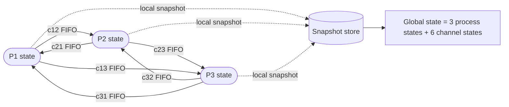
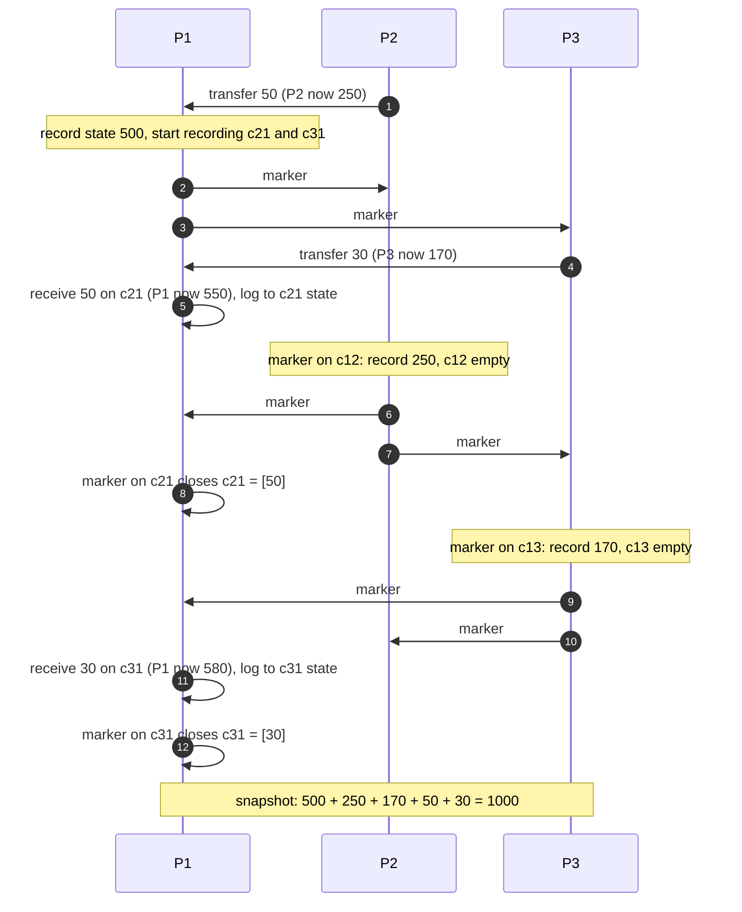
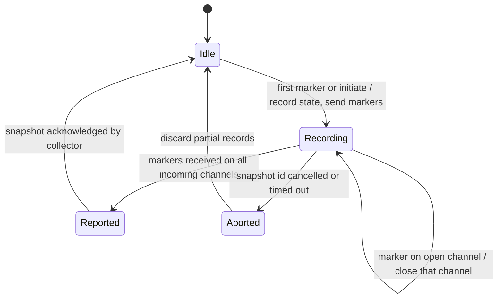
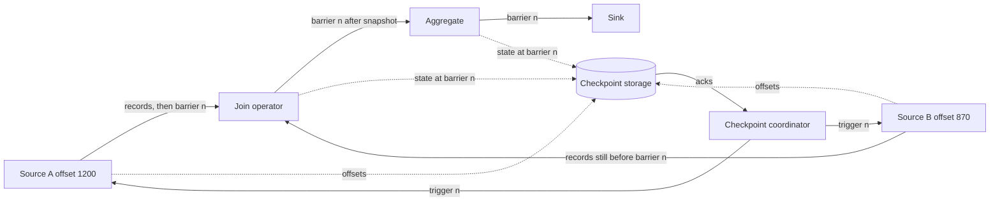
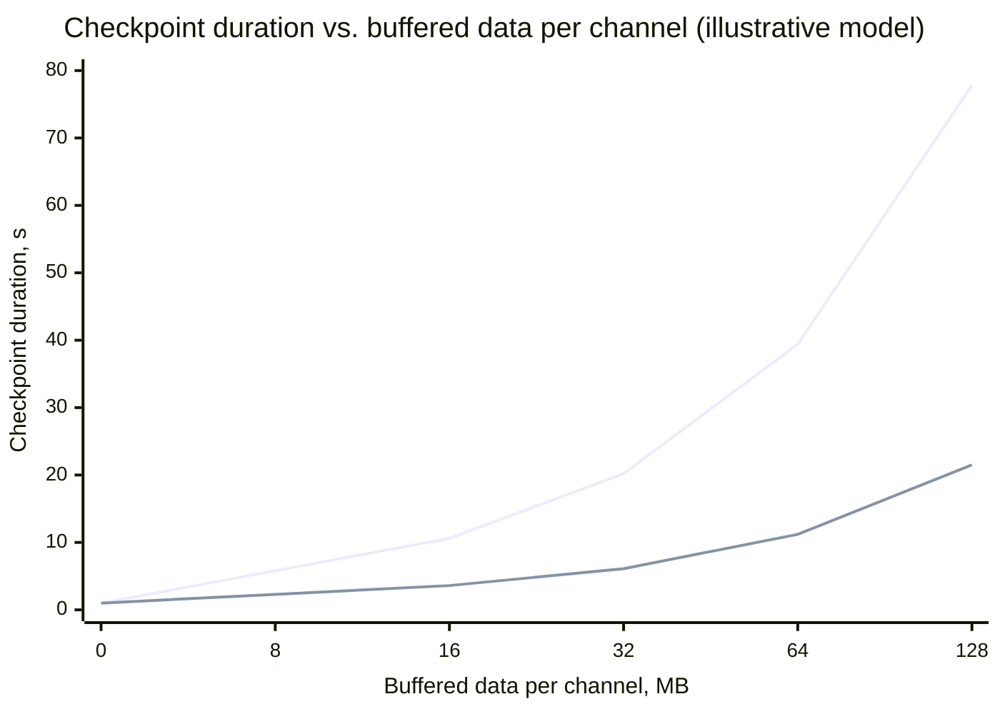
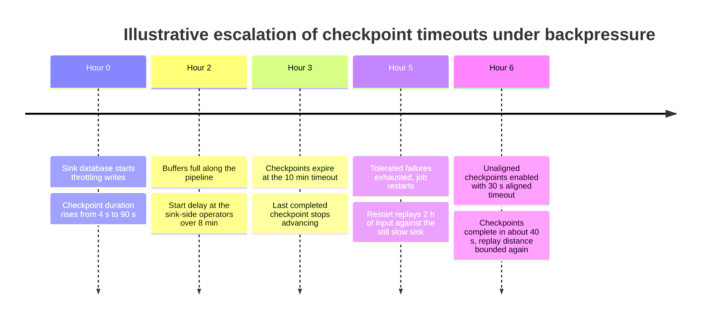
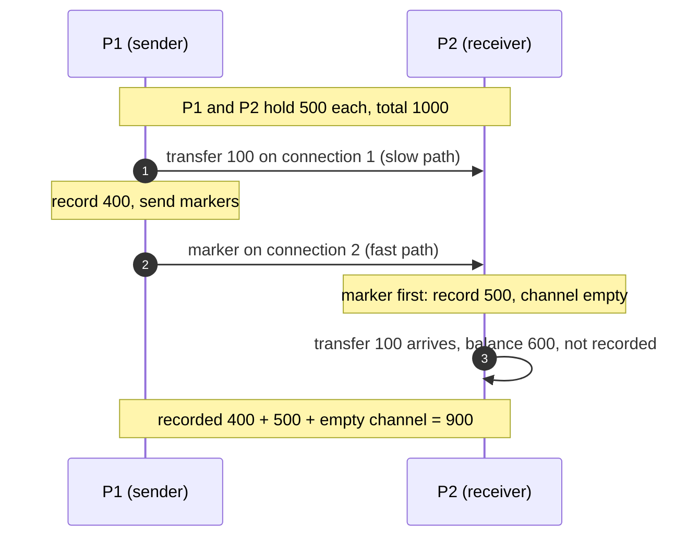

Dağıtık snapshot (dağıtık anlık görüntü), çalışan bir sistemin global durumunun kaydıdır: her process'in yerel durumu ve kayıt anında her kanalda yolda olan mesajlar. Zorluk, hiçbir process'in diğerlerini anlık olarak gözlemleyememesidir. "Herkes şimdi kaydetsin" diyebilecek kadar hassas, paylaşılan bir saat yoktur ve sistem, sunduğu hizmeti durdurmadan duraklatılamaz. Her process'i bağımsız olarak kaydetmek, farklı anlarda alınmış durumlardan oluşan bir kolaj üretir ve bir kolaj, bir sonucu nedeni olmadan içerebilir: bir transferin alıcısındaki alacak kaydedilmişken, gönderendeki borç, gerçekleşmeden önceki bir anda kaydedilmiş olabilir. Böyle bir duruma dayanan her karar, ister bir kurtarma noktası, ister bir deadlock raporu, ister bir denetim toplamı olsun, sistemin hiçbir zaman içinde bulunamayacağı bir durum hakkında verilmiş bir karardır.

Chandy ve Lamport'un 1985 tarihli algoritması bu problemi, uygulama mesajlarıyla aynı kanallarda dolaşan ve işaretçi (marker) adı verilen kontrol mesajlarıyla çözer. Her marker, tek bir kanal üzerinde, göndericisinin durumunu kaydetmeden önce gönderdiği mesajları sonra gönderdiklerinden ayırır. Process'ler ilk marker geldiğinde durumlarını kaydeder ve kalan marker'lar gelene kadar kanal içeriklerini kaydeder. Sonuç tutarlı bir kesittir (consistent cut): snapshot'ın başladığı durumdan ulaşılabilir olduğu ve snapshot'ın bittiği duruma kendisinden ulaşılabildiği garanti edilen bir global durum; gerçek zamanın hiçbir anı ona birebir karşılık gelmemiş olsa bile.

Asıl denge, duraklatmak ile kaydetmek arasındadır. Dünyayı durduran (stop-the-world) bir snapshot tüm process'leri dondurur, yoldaki mesajları boşaltır ya da atar ve tek bir anda var olmuş bir durumu kaydeder; bedeli, en yavaş katılımcıyla orantılı bir erişilemezlik aralığıdır. Marker tabanlı bir snapshot sistemi hiç durdurmaz, ama kanal durumunu kaydetmek zorundadır, ilk giren ilk çıkar (FIFO) kanallar ya da ek mekanizmalar gerektirir, ancak marker'ların en yavaş yoldan yayılabildiği hızda tamamlanır ve kaydettiği şey gözlemlenmiş değil, mümkün olan bir durumdur. Apache Flink gibi akış işleme motorları bu yelpazede açıkça hareket eder: hizalı (aligned) checkpoint'ler girdileri kısa süreliğine bloklayarak kanal durumu kaydetmekten kaçınır; hizasız (unaligned) checkpoint'ler ise Chandy-Lamport'un her zaman kaydettiği kanal durumunu kaydederek bloklamaktan kaçınır.

Altta yatan nedensellik muhakemesi, yani happened-before ilişkisi ve yetim (orphan) mesajlar üzerinden tutarsız kesit tanımı, [Happened-Before İlişkisi](/distributed-systems/tr/foundations/time-and-ordering/happened-before/) sayfasında tanıtılır. Snapshot algoritmalarının, doğruluklarının ve production varyantlarının kanonik sayfası budur.

## Global Durum Neleri İçerir: Process Durumu, Kanal Durumu ve Kesit

Sistem modeli, yönlü kanallarla birbirine bağlı bir process kümesidir. Bir process'in yerel durumu vardır (değişkenler, bir key-value store, bir dataflow'daki operatör durumu) ve bu durumu yalnızca olaylarla değiştirir: bir iç adım, bir mesaj göndermek ya da almak. Kanalın da durumu vardır: üzerinde gönderilmiş ama henüz alınmamış mesajların dizisi. Global durum, tüm process durumlarının ve tüm kanal durumlarının toplamıdır. Kanal durumunu unutmak, gelişigüzel tasarlanmış snapshot çözümlerinin çoğunun yaptığı ilk hatadır.

Birbirine para transferi yapan iki banka şubesi düşünün. A Şubesi'nde 600, B Şubesi'nde 400 birim var. A, B'ye 100 gönderiyor. Gönderme ile alma arasında A'da 500, B'de 400 vardır ve 100 birim yoldadır. Bu anda yalnızca process durumlarını kaydeden bir snapshot toplamı 900 olarak raporlar ve 100 birimi kaybeder. Para kaybolmamıştır; kanaldadır. Doğru bir snapshot ya bu mesajı kanalın durumunun parçası olarak kaydetmeli ya da process'leri böyle bir mesajın bulunmadığı bir noktada kaydetmelidir.


*Chandy-Lamport sistem modeli: yönlü, güvenilir, FIFO kanallarla bağlı process'ler. Her process snapshot'ın kendi parçasını yazar; global durumu birleştirmek ayrı bir adımdır.*

Modelin iki özelliği önemlidir. Her kanal yönlüdür; dolayısıyla çift yönlü bir bağlantı, durumları birbirinden bağımsız iki kanaldır ve üç process'li tam bir mesh'te kaydedilecek üç değil, altı kanal durumu vardır. Ayrıca algoritma yalnızca yerel kayıtlar üretir; bunları tek bir yerde toplamak ve snapshot'ı tamamlanmış ilan etmek 1985 algoritmasının parçası değildir ve pratikte operasyonel hataların çoğu tam da burada yaşanır. Kesikli oklar, gerçek sistemlerin mühendisliğini yapmak zorunda olduğu kısımdır: dayanıklı bir depolama, tüm parçaların ne zaman geldiğini bilen bir koordinatör ve atomik bir "tamamlandı" işareti.

### Kesitler, Tutarlılık ve "Mümkün" Ne Demektir

Kesit (cut), her process için geçmişinde bir nokta seçmektir: o process'in bu noktadan önce yaptığı her şey kesitin içinde, sonra yaptığı her şey dışındadır. Bir kesitteki global durum, her process'in kendi noktasındaki durumundan ve her kanal için kesitin içinde gönderilip dışında alınan mesajlardan oluşur. Bir kesit, yetim mesaj içermediğinde tutarlıdır: alımı kesitin içinde, gönderimi dışında olan hiçbir mesaj yoktur. Eşdeğer olarak, tutarlı bir kesit happened-before altında kapalıdır; bir olayı içeriyorsa, o olaydan nedensel olarak önce gelen her olayı da içerir.

Tek bir yürütmenin tutarlı kesitlerinin kümesi bir kafes (lattice) oluşturur: altta boş kesit, üstte yürütmenin tamamı ve aradaki her tutarlı kesit mümkün bir ara durumdur. Kafeste tutarlılığı koruyarak her seferinde bir olay ekleyip yukarı çıkan her yol, mesaj teslimi ve zamanlamanın farklı olduğu bir durumda gerçekleşebilecek bir yürütmedir ve her process bunu gerçekleşen yürütmeden ayırt edilemez bulur. Bir snapshot durumunun "mümkün" olmasının kesin anlamı budur: hiçbir process, sistemin o durumdan geçmediğini anlayamaz.

Bu, garantinin kesin biçimini verir. Chandy ve Lamport, kaydedilen `S*` durumunun algoritmanın başlatıldığı `S_start` durumundan ulaşılabilir olduğunu ve algoritmanın sonlandığı `S_end` durumuna da `S*`'tan ulaşılabildiğini kanıtlar. Buradan, kararlı (stable) her özelliğin, yani bir kez doğru olduğunda doğru kalan her özelliğin, doğru tespit edildiği çıkar: `S*`'ta geçerliyse `S_end`'de de geçerlidir; `S_start`'ta geçerliyse `S*`'ta da geçerlidir. Deadlock, sonlanma (termination), bir nesneye yönelik tüm referansların kaybı ve "token kayboldu" kararlı özelliklerdir. Kararsız özellikler ise güvenilir biçimde tespit edilemez: "kuyruk uzunluğu bir an 1.000'i aştı" yürütme sırasında doğru olup snapshot'ın kaydettiği tek durumda yanlış olabilir; snapshot ayrıca hiçbir gerçek anda birlikte geçerli olmamış bir değerler bileşimini de raporlayabilir. Kararsız bir yüklemin (predicate) muhtemelen ya da kesinlikle geçerli olup olmadığını tespit etmek, tutarlı kesitlerin tüm kafesini incelemeyi gerektirir; Cooper ve Marzullo bunu 1991'de formelleştirmiştir ve genel durumda process sayısına göre üsteldir.

Algoritma üç şeyi açıkça garanti etmez. Gerçek zamanın herhangi bir anındaki durumu döndürmez; dolayısıyla tüm sistemin linearizable bir okuması değildir. Snapshot sırasında process çökmelerine ya da mesaj kaybına dayanmaz; özgün model güvenilir kanallar ve hatasız bir çalışma varsayar. Dış etkileri de tutarlı kılmaz: bir process durumunu kaydettikten sonra bir e-posta gönderdiyse ya da bir karttan ödeme çektiyse, o durumu geri yüklemek eylemin yeniden gerçekleşmesine yol açar.

## Chandy-Lamport Algoritması: FIFO Kanallarda Marker'lar

Algoritma; güvenilir (her mesaj tam olarak bir kez teslim edilir) ve FIFO (bir kanaldaki mesajlar gönderildikleri sırayla alınır) kanallar, her process'in başlatıcıdan ulaşılabilir olduğu bir graf ve çalışma süresince hata olmamasını gerektirir. Herhangi bir process snapshot'ı başlatabilir ve birden fazla process aynı snapshot'ı eşzamanlı olarak başlatabilir.

Algoritmayı iki kural tanımlar. Marker gönderme kuralı: bir process durumunu kaydettiğinde, başka herhangi bir uygulama mesajı göndermeden önce, hemen her giden kanala bir marker gönderir. Marker alma kuralı: bir process `c` kanalından bir marker aldığında, durumunu henüz kaydetmemişse durumunu kaydeder, `c`'nin durumunu boş olarak kaydeder, gönderme kuralını uygular ve diğer tüm gelen kanalları kaydetmeye başlar. Durumunu zaten kaydetmişse `c`'yi kaydetmeyi bırakır; `c`'nin durumu, process'in kendi durumunu kaydettiği an ile bu marker'ın geldiği an arasında `c` üzerinden gelen mesajların dizisidir. Bir process'in snapshot'taki payı, her gelen kanaldan bir marker aldığında tamamlanır.

```text
on initiate or first marker(snapshot_id) received on channel c0:
    record local_state
    channel_state[c0] = empty            # only if triggered by a marker
    for each outgoing channel out:
        send marker(snapshot_id) on out  # before any further app message
    recording = all incoming channels except c0

on app message m received on channel c:
    if c in recording: append m to channel_state[c]
    deliver m to the application as usual   # the system never pauses

on marker(snapshot_id) received on channel c (already recorded):
    remove c from recording              # channel_state[c] is now final
    if recording is empty: report local_state and channel_state
```

Uygulamaya mesaj teslimi hiç durmaz. Snapshot normal işlemenin yanında alınır: kaydedilen bir kanal mesajı yine teslim edilir ve işlenir; snapshot yalnızca, kaydedilen global durumda bu mesajın hâlâ kanalda olduğunu not eder.

### Örnek Bir Çalıştırma: Üç Şube ve 1.000 Birim Para

Üç process para tutuyor: P1'de 500, P2'de 300, P3'te 200, toplam 1.000. Transferler mesajlardır; alıcı tutarı aldığı anda bakiyesine ekler. Tüm tutarlar örnek amaçlıdır. P1, iki transfer yoldayken bir snapshot başlatıyor.


*Üç process'le bir Chandy-Lamport çalıştırması. P1 üzerindeki kendine dönen oklar, adı geçen kanaldaki bir mesajın alındığı anı gösterir. Yoldaki iki transfer, herhangi bir process durumunda değil, kanal durumunda yer alır.*

Adım 1'de P2, P1'e 50 gönderir; P1 snapshot'ı başlattığında mesaj hâlâ yoldadır. P1 500'ü kaydeder, gelen kanalları `c21` ve `c31`'i kaydetmeye başlar, ardından 2. ve 3. adımlarda marker'ları gönderir. Adım 4'te P3, henüz hiçbir marker görmeden P1'e 30 gönderir; dolayısıyla bu mesaj P3'ün kaydının "öncesi" tarafına aittir. Adım 5'te P1 50'yi alıp işler, canlı bakiyesi 550 olur ve `c21` kaydedildiği için 50 o kanalın durumuna eklenir. Ardından P2, P1'in marker'ını alır, 250'yi kaydeder (1. adımdaki borç zaten yansımıştır) ve 6. ve 7. adımlarda kendi marker'larını gönderir. P2'nin `c21` üzerindeki marker'ı 8. adımda P1'e ulaşır ve `c21`'i `[50]` durumuyla kapatır. P3, P1'in marker'ı kendisine ulaştığında 170'i kaydeder (4. adımdaki borç yansımıştır) ve 9. ve 10. adımlarda marker'larını gönderir. Adım 11'de 30, P3'ün marker'ından önce P1'e ulaşır; çünkü önce gönderilmiştir ve kanal FIFO'dur; `c31`'e kaydedilir. Adım 12 `c31`'i kapatır.

Kaydedilen global durum şudur: P1 = 500, P2 = 250, P3 = 170, `c21` = [50], `c31` = [30], diğer tüm kanallar boş; toplam 1.000. Sondaki canlı durum P1 = 580, P2 = 250, P3 = 170'tir; o da 1.000. Sistem hiçbir gerçek anda tam olarak kaydedilen bileşimi tutmamıştır: P1'de 500 varken P3'te hâlâ 200 vardı. Yine de kaydedilen durum, P3'ün transferi gecikmiş olsaydı yürütmenin içinden geçebileceği bir durumdur ve korunum değişmezi (invariant) bu durumda geçerlidir; bir denetçinin önemsediği özellik de budur.

Bu çalıştırmanın maliyeti kolayca sayılabilir ve genellenebilir. Her yönlü kanal snapshot başına tam olarak bir marker taşır; dolayısıyla `E` kanallı bir sistemde snapshot `E` kontrol mesajına mal olur. 40 process'lik tam bir mesh'te `40 * 39 = 1,560` kanal vardır ve snapshot, her biri birkaç bayt olan 1.560 marker'a mal olur. Kanal kaydı, kayıt penceresi boyunca, yani alıcının durumunu kaydettiği an ile kanalın marker'ının geldiği an arasındaki sürede o kanala gelen trafikle orantılı bellek ya da depolama tüketir. Örnek olarak her kanalın saniyede 1 KB'lık 2.000 mesaj taşıdığını ve marker'ların, alıcının kaydından ortalama 25 ms sonra geldiğini varsayalım: her kanal yaklaşık `2,000 * 0.025 * 1 KB = 50 KB` kayıtlı durum biriktirir; 39 gelen kanalı olan her process ise yaklaşık 2 MB. Pencereyi, marker'ın alıcıya giden yolunun kaydı tetikleyen yoldan ne kadar uzun olduğu ve kanaldaki kuyruklanma belirler. Birikmiş kuyruğu olan bir kanal, hem penceresi en uzun hem trafiği en yüksek olan kanaldır; yani kanal durumu tam olarak sistemin zaten baskı altında olduğu yerde yoğunlaşır.

Tamamlanma süresi, bir marker'ın başlatıcıdan en uzun en kısa yolu geçmesi için gereken süre artı son marker'ın kalan her kanalı, önündeki kuyruk dahil, geçmesi için gereken süreyle sınırlıdır. Tek bir veri merkezindeki boşta bir mesh'te bu birkaç round trip'tir. Derin kuyruklu bir pipeline'da ise bir marker kuyruktaki her mesajın arkasında bekler; snapshot gecikmesi kuyruk boşaltma süresine eşit olur ve akış işlemede baskın olan dinamik budur.

### Kaydedilen Kesit Neden Tutarlıdır

Kanıt kısadır ve tamamen gönderme kuralına ve FIFO'ya dayanır. `m` mesajının `p` process'i tarafından `c` kanalı üzerinden `q` process'ine gönderildiğini ve gönderimin snapshot kesitinin dışında olduğunu, yani `p`'nin `m`'yi gönderdiğinde durumunu zaten kaydetmiş olduğunu varsayalım. Gönderme kuralına göre `p`, başka bir mesaj göndermeden önce `c`'ye bir marker göndermiştir; dolayısıyla marker `c` üzerinde `m`'den öncedir. FIFO gereği `q` marker'ı `m`'den önce alır. `q` bu marker'ı aldığında ya durumunu zaten kaydetmiştir ya da şimdi kaydeder; her iki durumda da `q`, `m`'yi almadan önce kaydeder. Dolayısıyla `m`'nin alımı da kesitin dışındadır ve yetim mesaj yoktur. Kesit tutarlıdır.

Kanal durumunun doğruluğu benzer bir argümana dayanır. `c`'de kaydedilmesi gereken mesajlar, tam olarak kesitin içinde gönderilen (`p` kaydetmeden önce) ve kesitin dışında alınan (`q` kaydettikten sonra) mesajlardır. `p` kaydetmeden önce gönderilen mesajlar `c` üzerinde marker'dan öncedir; sonra gönderilenler onu izler. Dolayısıyla `q`'nun durumunu kaydettikten sonra ve marker'dan önce `c` üzerinden aldığı mesajlar, tam olarak `p`'nin kaydından önce gönderilmiş ve `q`'nun kaydı sırasında henüz alınmamış mesajlardır; bu da kanalın kesitteki durumunun tanımıdır. Marker'ın `q`'nun kaydını tetiklediği kanal doğru biçimde boştur: `p`'nin marker'dan önce gönderdiği her şey, `q` kaydetmeden önce alınmıştır.

Ulaşılabilirlik bir yeniden sıralama argümanından çıkar. Bir olayı, kendi process'i kaydetmeden önce gerçekleştiyse kayıt-öncesi, aksi hâlde kayıt-sonrası olarak adlandıralım. Tutarlılık argümanı, hiçbir kayıt-sonrası olayın bir kayıt-öncesi olayın nedeni olmadığını gösterir; çünkü her nedensel zincir bir kanaldan geçer ve hiçbir mesaj sonradan önceye gitmez. Dolayısıyla gerçek yürütme, hiçbir process'in yerel görünümü değişmeden, önce tüm kayıt-öncesi olaylar, sonra tüm kayıt-sonrası olaylar gerçekleşecek biçimde yeniden sıralanabilir. İki grup arasındaki durum tam olarak `S*`'tır. Snapshot'ın bir an olmamasına rağmen işe yaramasının nedeni budur: sistemin içinden bakıldığında bir andan ayırt edilemez.


*Tek bir snapshot kimliği için process başına snapshot yaşam döngüsü. Aborted yolu 1985 algoritmasında yoktur; her production uygulaması onu ekler.*

Bu durum makinesi teorinin nerede bitip mühendisliğin nerede başladığını gösterir. Idle'dan Reported'a kadar olan geçişler özgün algoritmadır: bir durum kaydı, ardından her marker için bir kanalın kapanması. Reported durumu, parçaları birinin toplamasını gerektirir. Aborted yolu ise gerçek sistemlerde bir marker'ın hiç gelmeyebileceği için vardır: göndericisi çökmüş, kanalı kapatılmış ya da bir operatör snapshot'ı iptal etmiş olabilir. Her marker'ı bir snapshot kimliğiyle etiketlemek, bir process'in farklı durumlarda birkaç snapshot'ı aynı anda tutmasını ve bir koordinatörün sonrakini etkilemeden birini iptal etmesini mümkün kılar.

## Varyantlar: FIFO Olmayan Kanallar, Dataflow'lar ve Zaman Damgası Kesitleri

Özgün algoritma, gerçek sistemlerin sıklıkla bozduğu iki varsayımda bulunur: kanalların FIFO olduğu ve kanal durumunu kaydetmenin karşılanabilir olduğu. Her varyant ailesi bunlardan birinden vazgeçer.

### FIFO Olmadan: Renklendirme ve Sayma

Kanallar sırayı bozabiliyorsa bir marker, kendisinden önce gönderilmiş bir mesajı geçebilir; alıcı çok erken kaydeder ve geç gelen mesaj yetim kalır. Tutarlılık argümanının tamamını FIFO taşıyordu. Lai ve Yang'ın 1987 tarihli algoritması marker'ların yerine renklendirmeyi koyar. Her process durumunu kaydedene kadar beyaz, sonrasında kırmızıdır ve her uygulama mesajı, tek bir bitlik ek (piggyback) olarak göndericisinin rengini taşır. Kırmızı bir mesaj alan beyaz bir process, o mesajı işlemeden önce durumunu kaydeder; bu, sıra ne olursa olsun yetim mesajları doğrudan engeller. Bir kanalın durumu, kırmızı bir process'in aldığı beyaz mesajların kümesidir. "Bu kanaldan artık beyaz mesaj gelmeyecek" diyen bir marker olmadığından, her process kendisine kaç beyaz mesaj gönderildiğini öğrenmek zorundadır. Olağan çözüm, her process'in kanal başına gönderdiği beyaz mesajların sayısını ya da logunu tutması ve bunu kaydettiği duruma eklemesidir; böylece alıcı ya da toplayıcı hepsinin ne zaman geldiğini belirleyebilir. Mattern'in 1993 tarihli algoritmaları bunu vektör saatler ve mesaj sayımıyla iyileştirir; böylece snapshot önceden belirlenmiş bir kesitte alınabilir ve tamamlanması gönderim geçmişi yollamadan tespit edilebilir.

Maliyet kanaldan her mesaja (bir bit ya da bir vektör girdisi) ve her process'teki hesap tutmaya kayar. Renklendirme, hiç kırmızı mesaj almayan bir process'i kırmızıya çevirmek için de bir yol gerektirir; bu genellikle ayrı bir kontrol mesajıdır. Dolayısıyla FIFO olmayan algoritmalar da bir miktar kontrol trafiğine ihtiyaç duyar.

### Dataflow'larda Asenkron Barrier Snapshot'ı

Akış işleyen bir dataflow, kanallarla birbirine bağlı, genellikle döngüsüz (acyclic) yönlü bir operatör grafıdır: source'lar dayanıklı bir log'dan okur, operatörler yerel durumla dönüştürme ve toplama yapar, sink'ler sonuçları yazar. Carbone ve arkadaşları, Apache Flink için Asenkron Barrier Snapshot'ını (Asynchronous Barrier Snapshotting, ABS) 2015'te tarif etti. Bir koordinatör periyodik olarak her source'a snapshot almasını söyler; her source girdideki konumunu kaydeder (bir Kafka source'u için partition offset'leri) ve her çıktısına bir barrier enjekte eder; barrier, marker'ın dataflow'daki karşılığıdır. Birden fazla girdisi olan bir operatör, bir girdiden barrier aldığında o girdiden tüketmeyi bırakır, diğerlerinden tüketmeye devam eder ve barrier her girdiye ulaştığında durumunun snapshot'ını alır, barrier'ı tüm çıktılarına iletir ve tüm girdilerini yeniden açar. Bu bloklamaya hizalama (alignment) denir.


*Hizalı barrier snapshot'ı: join, A girdisinde barrier n'i görmüştür ve barrier n B girdisine gelene kadar A'yı bloklar. Snapshot'tan önce hiçbir şey bir barrier'ı geçmediği için kanal durumu kaydedilmez.*

Hizalama, ABS'nin kanal durumu kaydetmekten kaçınma yoludur. Chandy-Lamport'ta bir process, marker'ı henüz gelmemiş bir kanaldan almaya devam eder ve bu mesajları kanal durumu olarak kaydeder. Hizalı ABS'de ise operatör bekler: B girdisinin barrier n'den önceki kayıtları işlenir ve durumun parçası olur; A girdisinin barrier n'den sonraki kayıtları işlenmeden A'nın buffer'ında kalır ve bu snapshot'ın parçası değildir. Operatör snapshot aldığında her girdi tam olarak kendi barrier'ındadır; dolayısıyla kaydedilen kanal durumu yapısı gereği boştur. Kurtarmada sistem operatör durumlarını geri yükler ve source'ları kaydedilen offset'lere geri sarar; dayanıklı log, onlardan sonraki her şeyi yeniden oynatır. Döngüsüz graflar için bu yeterlidir. Döngülü graflarda Flink makalesi, geri kenarlardaki (back-edge) yoldaki kayıtları kanal durumu olarak kaydeder; bu, Chandy-Lamport'un kanal kaydının yalnızca hizalamanın işlemediği yerde uygulanmasıdır.

Hizalamanın bedeli bloklanan girdideki gecikmedir ve backpressure altında bu gecikmenin üst sınırı yoktur. Barrier akıştaki bir kayıttır; dolayısıyla önündeki her buffer'lanmış kaydın arkasında bekler. B girdisi onlarca saniyelik buffer'lanmış veriyle backpressure altındaysa barrier n, A girdisi üzerinden ulaştıktan onlarca saniye sonra join'e ulaşır ve A girdisi bu sürenin tamamında bloklu kalır. Flink 1.11 hizasız checkpoint'leri ekledi: barrier'ın girdi ve çıktı buffer'larındaki kayıtları geçmesine izin verilir, operatör ilk barrier gelir gelmez snapshot alır ve geçilen yoldaki kayıtlar checkpoint'in parçası olarak kalıcı hâle getirilir. Bu tam olarak Chandy-Lamport'un seçimidir: beklemek yerine kanal durumunu kaydetmek. Checkpoint süresi büyük ölçüde backpressure'dan bağımsız hâle gelir; checkpoint boyutu ise buffer'lanmış veri miktarıyla büyür. Flink bir de melez seçenek sunar: hizalı checkpoint zaman aşımı (aligned checkpoint timeout). Bu seçenekte her checkpoint hizalı başlar ve süresi yapılandırılan değeri aştığında hizasıza geçer. Hazelcast Jet de kendi Chandy-Lamport uygulamasını aynı ayrımla belgeler: exactly-once modu barrier'ı teslim etmiş girdileri bloklar; at-least-once modu ise tüketmeye devam eder ve barrier sonrası kayıtların duruma girmesine izin verir, bu kayıtlar da yeniden başlatmadan sonra tekrar işlenir.

### Zaman Damgası Kesitleri ve Senkron Sınırlar

Farklı bir yol marker'lardan tamamen kaçınır. Her olay happened-before'a uyan bir zaman damgası taşıyorsa, zaman damgası herhangi bir `t` değerine eşit ya da ondan küçük olan olayların kümesi tutarlı bir kesittir; çünkü bir neden her zaman sonucundan daha küçük bir zaman damgasına sahiptir. Çok sürümlü (multiversion) veritabanları bunu kullanır: CockroachDB ya da Spanner'da `t` zaman damgası "itibarıyla" (as of) alınan bir yedek ya da okuma, her anahtarın `t`'ye eşit ya da ondan küçük en son sürümünü okur. Commit zaman damgaları bir hibrit mantıksal saatten ya da TrueTime'dan geldiği için sonuç, marker'sız ve kanal durumu olmadan tutarlı bir snapshot'tır; tek kanal veritabanının replikasyon log'udur. Zaman damgalarını nedensel olarak güvenli kılan mekanizmalar [Hibrit Mantıksal Saatler (HLC)](/distributed-systems/tr/foundations/time-and-ordering/hybrid-logical-clocks/) ve [Google TrueTime & Spanner](/distributed-systems/tr/foundations/time-and-ordering/truetime-spanner/) sayfalarında anlatılır. Ham fiziksel zaman damgaları bu koşulu sağlamaz: [Fiziksel Saatler](/distributed-systems/tr/foundations/time-and-ordering/physical-clocks/) sayfasının gösterdiği gibi host'lar arasındaki offset'ler çoğu zaman veri merkezi içi mesaj gecikmesini aşar; dolayısıyla "herkes 12:00:00'da kaydetsin" yetim mesajlar üretir.

Micro-batch motorları üçüncü yolu seçer: kesiti senkron hâle getirirler. Spark Structured Streaming, her micro-batch'in girdi offset'lerini batch'i çalıştırmadan önce write-ahead bir offset log'una yazar ve tamamlanmayı sonrasında kaydeder. Her batch sınırı, aşamalar arasında yolda verinin bulunmadığı global bir barrier'dır; dolayısıyla snapshot kendiliğinden tutarlıdır. Bedeli, en az bir batch aralığı kadar gecikme ve her batch'te bir zamanlama bariyeridir. Batch motorlarının kurtarma için lineage ve checkpoint'leri nasıl kullandığı [Checkpointing ve Hata Toleransı](/distributed-systems/tr/data-processing/batch-processing/checkpointing-fault-tolerance/) sayfasında ele alınır.

## Snapshot Stratejisini Seçmek ve Yapılandırmak

Yaklaşımlar üç eksende ayrışır: işlemenin durup durmadığı, process durumunun ötesinde neyin kaydedilmesi gerektiği ve kanalların neyi garanti etmesi gerektiği.

| Yaklaşım | Duraklama | Process durumu dışında kaydedilen | Kanal gereksinimi | Ne zaman tercih edilmeli |
|---|---|---|---|---|
| Dünyayı durduran dondurma | Tüm sistem, en yavaş katılımcı onaylayana kadar | Kanallar önce boşaltılırsa hiçbir şey | Herhangi biri, artı bir koordinatör | Küçük sistemler, bakım pencereleri ya da snapshot'ın gerçek bir an olması gerektiğinde |
| Chandy-Lamport marker'ları | Yok | Kanal başına yoldaki mesajlar | Güvenilir ve FIFO | FIFO bağlantılı ve kanal başına trafiği orta düzeyde mesajlaşan sistemler |
| Lai-Yang renklendirme ve sayma | Yok | Kanal başına beyaz mesajlar, artı gönderim sayıları ya da logları | Güvenilir, herhangi bir sıra | Taşıma katmanı sırayı bozan sistemler; örneğin çok yollu (multipath) ya da mantıksal bağlantı başına birden fazla connection |
| Hizalı barrier'lar (ABS) | Yalnızca bloklanan girdiler, hizalama penceresi boyunca | Yalnızca source offset'leri (döngülüyse geri kenarlar) | Kanal başına FIFO, yeniden oynatılabilir source'lar | Sürekli backpressure yaşamayan ve küçük checkpoint'lerin önemli olduğu dataflow'lar |
| Hizasız barrier'lar | Buffer'ların kalıcılaştırılması dışında yok | Yoldaki ağ buffer'ları | Kanal başına FIFO, yeniden oynatılabilir source'lar | Checkpoint gecikmesinin sınırlı kalması gereken, backpressure altındaki dataflow'lar |
| Zaman damgası kesiti (MVCC) | Yok | Hiçbir şey; eski sürümler okunana kadar tutulur | Nedensel olarak tutarlı zaman damgaları | HLC ya da TrueTime commit zaman damgalı veritabanları; yedekler ve tutarlı okumalar |
| Senkron micro-batch | Her batch sınırında | Batch başına offset'ler | Yeniden oynatılabilir source'lar | Basit kurtarma karşılığında batch aralığı kadar gecikmeyi kabul eden iş yükleri |

Tablodaki konumlar birbirinden bağımsız değildir. Bir sistem zaman damgası kesitini ancak her yazmada nedensel olarak güvenli zaman damgalarının bedelini zaten ödüyorsa kullanabilir. Bir dataflow hizalı modda kanal durumunu yalnızca source'ları yeniden oynatılabilir olduğu için atlayabilir: snapshot "offset 1200'e kadar okundu" bilgisini kaydeder ve sonrasını tutması için Kafka ya da benzeri bir log'a güvenir. Source yeniden oynatılabilir değilse, örneğin hiç saklanmayan telemetri alan bir socket'se, dataflow'un hiçbir snapshot'ı, hizalı olsun olmasın, yolda olan veriyi kurtaramaz; çünkü snapshot'ın dış dünyaya açılan kanalı hiç kaydedilmemiştir.

### Backpressure Altında Hizalı ve Hizasız: Bir Model

Beklemek ile kaydetmek arasındaki takas tahmin edilebilir. Örnek olarak source ile sink arasında üç exchange'li bir pipeline varsayalım: backpressure altında her kanal `Q` megabayt buffer'lanmış kayıt tutuyor, her kanal 5 MB/s hızla boşalıyor, exchange başına 16 paralel kanal var ve her exchange'in kanalları checkpoint depolamasına toplam 100 MB/s hızla yükleme yapıyor. Hizalı modda bir barrier üç exchange'in her birinde `Q` megabaytın arkasında bekler; dolayısıyla checkpoint yaklaşık `3 * Q / 5` saniye sürer. Hizasız modda barrier buffer'ları geçer ve iş bunun yerine buffer'lanmış veriyi kalıcı hâle getirir: tüm buffer'ların yakalandığı en kötü durumda exchange başına `16 * Q` megabayt ve üç exchange paralel yükleme yaptığında yaklaşık `16 * Q / 100` saniye artı durum yüklemesi için sabit bir saniye.


*Üst çizgi: hizalı, 1 s taban artı 3Q/5. Alt çizgi: hizasız, 1 s taban artı 16Q/100. Tüm parametreler örnek amaçlıdır; önemli olan sayılar değil, eğrilerin şeklidir.*

İki çizgi de buffer'lanmış veriyle doğrusal büyür, ama eğimleri çok farklıdır; ayrıca hizalı çizgi süresinin büyük kısmında girdi kanallarını bloklar, bu da throughput'u düşürür ve ona yol açan backpressure'ı derinleştirebilir. Kanal başına 64 MB buffer'lanmış veride hizalı checkpoint yaklaşık 39 saniye, hizasız checkpoint yaklaşık 11 saniye sürer; ancak hizasız checkpoint, checkpoint depolamasına ve kurtarmada geri okunması gereken veriye exchange başına `16 * 64 = 1,024` MB'a kadar ekler. Darboğaz checkpoint depolamasının bant genişliğiyse eğimler yer değiştirir ve hizalı mod daha hızlı olur. Hizalı başlayıp yalnızca hizalama zaten yavaşken geçiş yapan bir zaman aşımının genellikle iki sabit seçeneği de geçmesinin nedeni budur: backpressure'ın olmadığı olağan durumda checkpoint'ler küçüktür; backpressure altında ise süreleri sınırlı kalır.

### Production Yapılandırması ve Operasyonel Sinyaller

Production'daki bir snapshot sisteminin makalenin dışarıda bıraktığı dört parçası vardır: aralığı olan bir tetikleyici, onayları izleyen bir koordinatör, asenkron yazılan dayanıklı bir depolama ve atomik bir tamamlanma kaydı. Aralık, kaybedilen ilerlemenin üst sınırını belirler: 60 saniyelik bir aralıkta bir çökme, 60 saniyeye kadar girdiyi artı devam eden checkpoint'in süresini yeniden oynatır. Koordinatörün zaman aşımı, takılan bir snapshot'tan ne zaman vazgeçileceğine karar verir. Asenkron yükleme önemlidir; çünkü snapshot'ın senkron kısmı, yani bir process'in durumunu kopyaladığı ya da dondurduğu an, işlemeyi durdurur. Flink bu kısmı, state backend'in copy-on-write ya da dosya düzeyindeki bir snapshot'ını senkron alıp yüklemeyi arka planda yaparak kısa tutar. Tamamlanma kaydı en son ve atomik olarak yazılmalıdır; çünkü bir geri yükleme, bazı parçaları eksik bir snapshot'ı asla seçmemelidir.

Flink'te önemli parametreler, güncel dokümantasyondaki varsayılanlarıyla şunlardır: checkpoint aralığı (`execution.checkpointing.interval`; varsayılanı yoktur, dolayısıyla ayarlanana kadar checkpoint kapalıdır), checkpoint zaman aşımı (`execution.checkpointing.timeout`, 10 dakika), checkpoint'ler arası minimum duraklama (`execution.checkpointing.min-pause`, 0), eşzamanlı checkpoint sayısı (`execution.checkpointing.max-concurrent-checkpoints`, 1), iş başarısız sayılmadan önce tolere edilen ardışık hata sayısı (`execution.checkpointing.tolerable-failed-checkpoints`, 0), hizasız checkpoint'ler ve hizalı checkpoint zaman aşımı. Hizasız checkpoint anahtarı güncel dokümantasyonda `execution.checkpointing.unaligned.enabled`, onu tanıtan 1.x sürümlerinde ise `execution.checkpointing.unaligned` biçimindedir. Anahtarı kullandığınız sürüme göre kontrol edin; çünkü yanlış yazılmış bir anahtar reddedilmez, yok sayılır.

```yaml
execution.checkpointing.interval: 60 s
execution.checkpointing.timeout: 10 min
# Leave room for processing between checkpoints that run long
execution.checkpointing.min-pause: 20 s
execution.checkpointing.tolerable-failed-checkpoints: 3
# Start aligned; switch to unaligned when a checkpoint has run 30 s
execution.checkpointing.unaligned.enabled: true
execution.checkpointing.aligned-checkpoint-timeout: 30 s
# Shrinks in-flight buffers, which shrinks both alignment time and unaligned state
taskmanager.network.memory.buffer-debloat.enabled: true
```

Yukarıdaki değerler örnek amaçlı seçimlerdir, her iş için öneri değildir. Minimum duraklama, yavaş bir checkpoint bittiğinde bir sonrakinin hemen başladığı ve işin tüm zamanını checkpoint almakla geçirdiği patolojiyi önler. Sıfırdan büyük bir başarısız checkpoint toleransı, depolamadaki tek bir aksaklığın işi yeniden başlatmasını önler; bedeli, tolere edilen pencere boyunca yeniden oynatma mesafesinin büyüyebilmesidir. Flink 1.14'ten beri mevcut olan buffer debloating, ağ buffer'larını gerçekte gözlemlenen throughput'a göre boyutlandırır; böylece bir barrier'ın önünde daha az kuyruklanmış veri ve kalıcılaştırılacak daha az yoldaki veri olur.

:::tip[Start delay ile hizalamayı ayrı okuyun]
Flink'in checkpoint geçmişi, subtask başına Start Delay (barrier'ın oluşturulmasından ilk barrier'ın subtask'a ulaşmasına kadar geçen süre), Alignment Duration (o subtask'ta ilk ve son barrier arasındaki süre), Sync Duration ve Async Duration değerlerini raporlar. Bir operatörde uzun start delay, barrier'ların onun upstream'indeki verinin arkasında kuyrukta beklediği anlamına gelir: backpressure. Start delay'i kısa olan bir join'de uzun hizalama, girdilerden birinin diğerinden çok daha yavaş olduğu anlamına gelir: girdiler arası çarpıklık. Uzun async süresi depolamanın yavaş olduğunu gösterir. Üçünün çözümleri farklıdır ve tek başına uçtan uca süre bunları birbirinden ayırt etmez.
:::

Aynı ayrım Flink dışında da geçerlidir. Marker tabanlı her sistem, snapshot başına her process'in ne zaman kaydettiğini, her kanalın ne zaman kapandığını, kaç bayt kanal durumu kaydedildiğini ve toplayıcının tamamlanmayı ne zaman ilan ettiğini dışa açmalıdır. Kanal başına kapanma zamanları olmadan, takılan bir snapshot yalnızca "hâlâ devam ediyor" olarak görünür ve asıl teşhis olan, marker'ı eksik kanal görünmez kalır.

## Hata Modları ve İzleri

### Snapshot Sırasında Katılımcı Çökmesi ya da Kanal Kaybı

Tetikleyici: bir process snapshot tetiklemesini aldıktan sonra çöker ya da kuyruğunda bir marker bekleyen bir bağlantı kapatılır. Belirtiler: snapshot hiç tamamlanmaz; özgün algoritmada, ölü process'ten marker bekleyen her process sonsuza kadar bekler. Tespit: beklenen süreden eski, devam eden snapshot'lar; kanal başına "marker alınmadı" durumu; Flink'te zaman aşımında süresi dolan ya da yeniden başlayan bir task tarafından reddedilen checkpoint'ler. Hafifletme: snapshot'ları kimliklerle etiketlemek, zaman aşımında ya da herhangi bir katılımcı hatasında iptal etmek, kısmi parçaları atmak ve üyelik kararlı hâle geldiğinde yeni bir snapshot başlatmak. Kurtarma: tamamlanma kaydı bulunan son snapshot'tan geri yüklemek. Tamamlanma kaydı olmayan hiçbir snapshot'tan geri yükleme yapılmadığı sürece, çökme devam eden snapshot'ı tehlikeli değil, yalnızca işe yaramaz kılar.

### Backpressure Her Snapshot'ı Zaman Aşımına Uğratır

Tetikleyici: downstream'de süregelen bir yavaşlama, örneğin veritabanı yazmaları kısıtlayan (throttling) bir sink, pipeline boyunca buffer'ları doldurur. Barrier'lar buffer'lanmış verinin arkasında bekler, hizalı operatörler girdileri bloklar ve checkpoint'ler zaman aşımına yaklaşır. Belirtiler: checkpoint süresi saatler içinde büyür, ardından checkpoint'ler zaman aşımında başarısız olmaya başlar; son tamamlanan checkpoint'in yaşı büyür; iş yeniden başlarsa o checkpoint'ten bu yana her şeyi yeniden oynatır ve problem ne kadar uzun sürdüyse bu da o kadar uzun sürer.


*Yavaş bir sink'in sınırsız yeniden oynatmaya nasıl dönüştüğünü gösteren varsayımsal bir olay; gerçek bir postmortem değildir.*

Tehlikeli adım 5. saattir. Backpressure altında yeniden başlatma backpressure'ı hafifletmez; aynı yavaş sink'e karşı saatlerce verinin yeniden oynatılmasını ekler ve bir sonraki checkpoint yine tamamlanamaz. Bu metastabil bir döngüdür: kurtarma eylemi, hataya yol açan koşulu derinleştirir; bu desen [Retry Fırtınaları ve Metastabil Hatalar](/distributed-systems/tr/resilience/flow-control/retry-storms-metastable-failures/) sayfasında ele alınır. Tespit: ilk zaman aşımından önce yükselen start delay ve hizalama süresi, operatör başına backpressure göstergeleri ve alarm metriği olarak en son tamamlanan checkpoint'in yaşı. Hafifletme: checkpoint'lerin backpressure altında tamamlanması için hizasız checkpoint'lere ya da hizalı zaman aşımına geçmek, buffer debloating'i etkinleştirmek ve yavaş sink'i düzeltmek. Yalnızca checkpoint zaman aşımını yükseltmek, sonunda gelecek yeniden oynatmayı uzatmaktan başka bir şey yapmaz.

### Sırayı Bozan Kanallar FIFO Varsayımını Kırar

Tetikleyici: snapshot uygulaması FIFO varsayar, ama taşıma katmanı uçtan uca FIFO değildir. Yaygın nedenler şunlardır: bir connection havuzu üzerinden taşınan mantıksal bir kanal; eski bağlantıdan yeniden iletilen mesajların yeni mesajlardan sonra geldiği bir yeniden bağlanma; gönderici ile alıcı arasında birden fazla tüketicisi olan, yük dengelemeli bir kuyruk; ya da sıralaması partition başına olan, ama mantıksal kanalı birden fazla partition'a yayılan bir mesaj veriyolu.


*Marker, kendisinden önce gönderilmiş bir mesajı geçer. Snapshot hiçbir hata vermeden 100 birim kaybeder. Taşıma ayrıntıları varsayımsaldır.*

Adım 1'de P1 bir bağlantı üzerinden transfer gönderir; 3. adımda, kaydettikten sonra marker'ı daha hızlı olan başka bir bağlantı üzerinden gönderir. P2 önce marker'ı alır, durumunu transfer olmadan kaydeder ve kanalı boş olarak kapatır. Transfer 5. adımda geldiğinde onu hiçbir şey kaydetmez. Snapshot 900 raporlar. Sıra bozulması diğer yönde olsaydı snapshot doğru olurdu; dolayısıyla hata yalnızca yük altında ya da ağ olaylarından sonra ortaya çıkar ve hiçbir zaman bir hata fırlatmaz.

:::danger[FIFO ihlali snapshot'ları sessizce bozar]
Chandy-Lamport'un tutarlılığı tamamen FIFO'ya dayanır. Bir marker daha önce gönderilmiş bir mesajı geçebiliyorsa, snapshot yoldaki veriyi kaybedebilir ya da simetrik olarak gönderimi kesitin dışında olan bir alımı içerebilir; ondan geri yüklemek de durumu hiçbir hata vermeden kaybeder ya da çoğaltır. FIFO'yu TCP düzeyinde değil, mantıksal kanal düzeyinde doğrulayın: kanal başına tek bağlantı, yeniden bağlanmalar arasında sıra bozulması olmaması (boşluk tespitli sıra numaraları) ve gönderici ile alıcı arasında yük dengeleme olmaması. Taşıma katmanı bunu garanti edemiyorsa, bunun yerine bir renklendirme algoritması kullanın.
:::

Tespit dolaylıdır: geri yüklenen durum üzerinde değişmez kontrolleri (toplamlar, sayımlar, kanal başına sıra numaraları) ve mümkünse her mesajda sıra numarası; böylece alıcı, marker'dan sonraki hiçbir şeyin ondan önceki herhangi bir şeyden daha düşük bir numaraya sahip olmadığını doğrulayabilir. Kurtarma, taşıma katmanı değiştiğinden bu yana üretilen snapshot'ları atmayı gerektirir; çünkü hiçbirine güvenilemez.

### Kanal Durumu Patlar

Tetikleyici: trafik sürerken bir kanalın marker'ı uzun süre gecikir; örneğin birikmiş bir kanalda ya da marker'ları iletmekte yavaş kalan bir process'te. Belirtiler: bir snapshot açıkken alıcılarda bellek büyümesi; hizasız Flink checkpoint'lerinde checkpoint boyutunun megabaytlardan gigabaytlara sıçraması ve kalıcılaştırılmış yoldaki verinin önce geri okunup yeniden işlenmesi gerektiği için kurtarmanın yavaşlaması. Tespit: snapshot başına kaydedilen kanal durumu baytı (Flink, checkpoint başına işlenen ya da kalıcılaştırılan yoldaki veriyi raporlar) ve kaydı yapan bileşenin belleği ya da diski. Hafifletme: kanal durumunu bellek yerine diske taşırmak (spill), bir üst sınır koyup sınıra ulaşıldığında snapshot'ı iptal etmek, buffer boyutlarını küçültmek (debloating) ve yavaş ileticiyi düzeltmek.

### Geri Yüklenen Durum Dış Yan Etkileri Tekrarlar

Tetikleyici: bir process durumunu kaydettikten sonra bir dış eylem gerçekleştirir, örneğin e-posta gönderir, karttan ödeme çeker ya da transactional olmayan bir sink'e yazar; ardından sistem hata verir ve snapshot geri yüklenir. Belirtiler: son tamamlanan snapshot ile hata arasında gerçekleştirilen her eylem için yinelenen dış etkiler. Bu, rollback kurtarmanın çıktı commit problemidir (output commit problem): bir snapshot yalnızca kapsadığı process'ler arasında tutarlıdır ve dış dünya bunlardan biri değildir. Tespit: yeniden başlatmalardan sonra dış sistemde yinelenen anahtarlar ya da idempotency anahtarı çakışmaları. Hafifletme: çıktıları snapshot protokolünün parçası yapmak, örneğin onları yalnızca snapshot tamamlandığında commit edilen bir transaction içinde yazmak (Flink'in iki aşamalı commit sink'leri ya da [Tam Olarak Bir Kez Semantiği](/distributed-systems/tr/case-studies/apache-kafka/exactly-once-semantics/) sayfasında anlatılan Kafka transaction'ları) veya tekrarın zararsız olması için dış etkiyi idempotent yapmak.

:::caution[Tamamlanmamış bir snapshot tamamlanmış gibi görünür]
Snapshot parçaları birbirinden bağımsız yazılır; dolayısıyla depolama, hiç tamamlanmamış bir snapshot'ın parçalarının çoğunu tutuyor olabilir. "En yeni snapshot dizinini" seçen bir geri yükleme prosedürü, "tamamlanma kaydı olan en yeni snapshot" yerine bazı process'leri eksik ya da bazıları başka bir snapshot'tan gelen bir global durumu geri yükler. Tamamlanma kaydını en son ve atomik olarak yazın ve geri yükleme yolunun yalnızca bu kaydı okumasını sağlayın.
:::

### Eşzamanlı ve Örtüşen Snapshot'lar

Tetikleyici: önceki snapshot tamamlanmadan yenisi başlar; bunun nedeni aralığın süreden kısa olması ya da birden fazla başlatıcının bağımsız olarak başlatması olabilir. Marker'larda kimlik varsa bu doğrudur, ama açık her snapshot kendi kanal kaydını tutar ve kaynaklar yoldaki snapshot sayısıyla çarpılır. Flink varsayılan olarak tek bir eşzamanlı checkpoint'e izin verir ve eşzamanlı hizasız checkpoint'leri desteklemez; savepoint'ler de onlarla eşzamanlı çalışamaz. Tespit: devam eden snapshot sayısı ve bunların toplam kaydedilmiş baytı. Hafifletme: snapshot'lar arasında minimum duraklama ve ölçülmüş bir gerekçe olmadıkça bir olan eşzamanlılık sınırı.

## Dağıtık Snapshot Ne Zaman Kullanılmalı, Ne Zaman Kullanılmamalı

Duraklatılamayan, birbiriyle haberleşen process'lerden oluşan ve yoldaki mesajların, process başına alınan saf bir snapshot'ta kaybolacak ya da çoğalacak bir anlam taşıdığı bir sistem için bir kurtarma noktasına ya da global durum analizine ihtiyacınız olduğunda marker tabanlı bir snapshot kullanın: durumlu operatörlü akış işleme, kalıcı durumlu actor sistemleri, dağıtık simülasyonlar ve deadlock, sonlanma ya da global çöp gibi kararlı özelliklerin tespiti. Source'lar yeniden oynatılabilir ve backpressure nadirse hizalı barrier varyantını kullanın; checkpoint süresi yükle ilişkili hâle gelir gelmez hizasız checkpoint'leri ya da hizalı zaman aşımını ekleyin.

Veri zaten nedensel olarak tutarlı zaman damgalarına sahipse bir marker protokolü kurmayın: hibrit mantıksal saat ya da TrueTime zaman damgalarıyla commit eden çok sürümlü bir veritabanı, bir zaman damgasında okuyarak tutarlı bir snapshot elde eder ve bu hem daha ucuz hem daha sağlamdır. İlgilenilen durum tek bir replike log'da yaşıyorsa da kullanmayın; çünkü bir consensus grubunun durumu zaten tamamen sıralıdır ve log'un bir index'teki snapshot'ı yapısı gereği tutarlıdır; etcd ve Raft snapshot'ları bu durumdur ve [etcd](/distributed-systems/tr/coordination/consensus-algorithms/etcd/) ile [Raft](/distributed-systems/tr/coordination/consensus-algorithms/raft/) sayfalarında ele alınır. "14:00:00'daki kesin durum neydi" gibi gerçek zamana ilişkin soruları yanıtlamak için de kullanmayın; çünkü tutarlı bir kesit gözlemlenmiş bir an değil, mümkün bir durumdur; bunun aracı, belirsizliği bilinen senkronize saatler üzerinde alınan bir zaman damgası kesitidir. Geçici bir kuyruk sıçraması gibi kararsız koşulları tespit etmek için de snapshot kullanmayın; çünkü snapshot o anı içermeyebilir; bunun yerine sürekli izleme ya da trace'ler üzerinde yüklem tespiti kullanın.

"Snapshot" kelimesi birbiriyle ilgisiz birkaç mekanizmayı da adlandırır. Event sourcing snapshot'ı, tek bir aggregate'in olaylarının önbelleğe alınmış bir katlamasıdır (fold) ve yeniden oynatmayı kısaltır; [Anlık Görüntüler: Uzun Olay Zincirlerini Optimize Etmek](/distributed-systems/tr/microservice-patterns/event-sourcing-cqrs/snapshots/) sayfasında ele alınır. Depolama birimi (volume) snapshot'ı tek bir diskin belirli bir andaki kopyasıdır ve yalnızca o disk için crash-consistent'tır; makineler arasındaki bir birim kümesi bir tutarlılık grubuna (consistency group) ya da uygulama düzeyinde bir kesite ihtiyaç duyar. Zamanda belirli bir noktaya kurtarma (point-in-time recovery) içeren bir veritabanı yedeği, tek bir sistemin log'unu bir zaman damgasına geri yükler; [Yedekleme, Belirli Bir Ana Geri Dönüş (PITR) ve Geri Yükleme Testleri](/distributed-systems/tr/resilience/multi-region-dr/backup-pitr-restore/) sayfasında ele alınır. Snapshot isolation bir transaction izolasyon seviyesidir; [Zayıf İzolasyon ve MVCC](/distributed-systems/tr/data-management/consistency-models/weak-isolation-mvcc/) sayfasında ele alınır. Hiçbiri bu sayfanın ele aldığı problemi, yani mesajlarla haberleşen bağımsız process'ler arasında tutarlı bir durumu kaydetmeyi çözmez.

:::note[Flink operasyonlarının ele alındığı yer]
Bu sayfa, Flink'in kullandığı snapshot algoritmasını ve iki hizalama modunu ele alır. State backend'ler, savepoint'ler, geri yüklenen durumun yeniden ölçeklenmesi ve Flink'in operasyonel modeli [Apache Flink](/distributed-systems/tr/data-processing/stream-processing/apache-flink/) sayfasında ele alınır.
:::

## İleri Okuma

- K. Mani Chandy and Leslie Lamport, *Distributed Snapshots: Determining Global States of Distributed Systems*, ACM Transactions on Computer Systems, 1985.
- Ten H. Lai and Tao H. Yang, *On Distributed Snapshots*, Information Processing Letters, 1987.
- Friedemann Mattern, *Efficient Algorithms for Distributed Snapshots and Global Virtual Time Approximation*, Journal of Parallel and Distributed Computing, 1993.
- Paris Carbone, Gyula Fora, Stephan Ewen, Seif Haridi, and Kostas Tzoumas, *Lightweight Asynchronous Snapshots for Distributed Dataflows*, arXiv:1506.08603, 2015.
- E. N. Elnozahy, Lorenzo Alvisi, Yi-Min Wang, and David B. Johnson, *A Survey of Rollback-Recovery Protocols in Message-Passing Systems*, ACM Computing Surveys, 2002.
- Apache Flink dokümantasyonu, *Checkpointing under Backpressure* ve *Monitoring Checkpointing*, Apache Software Foundation.
