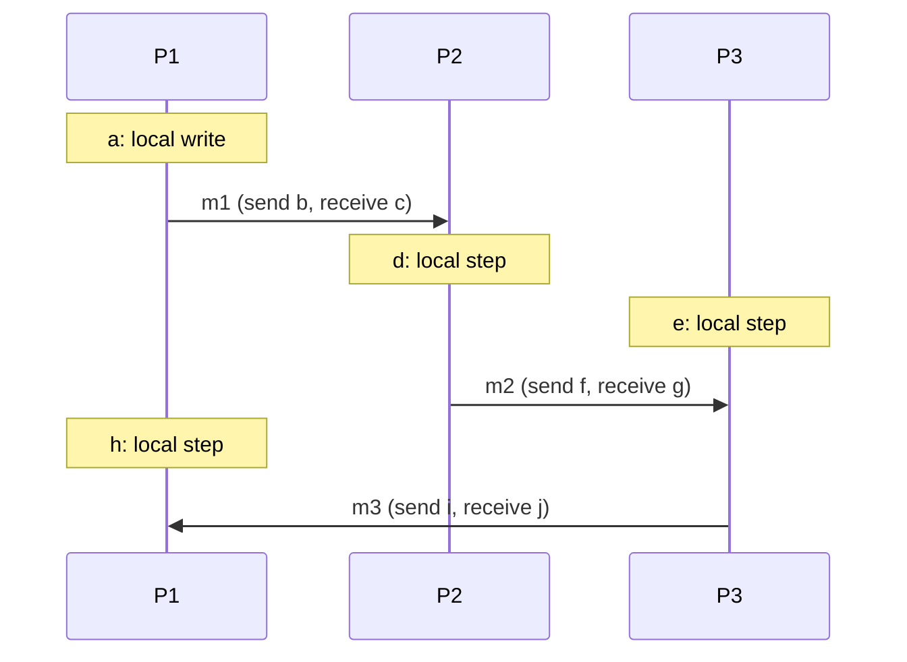
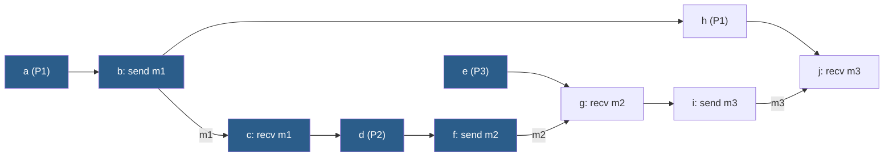
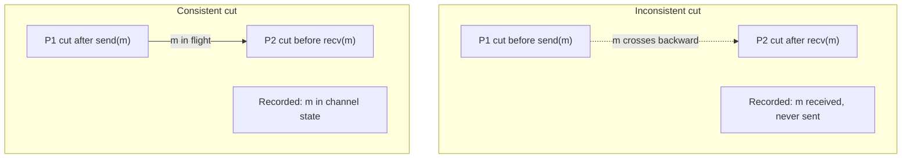
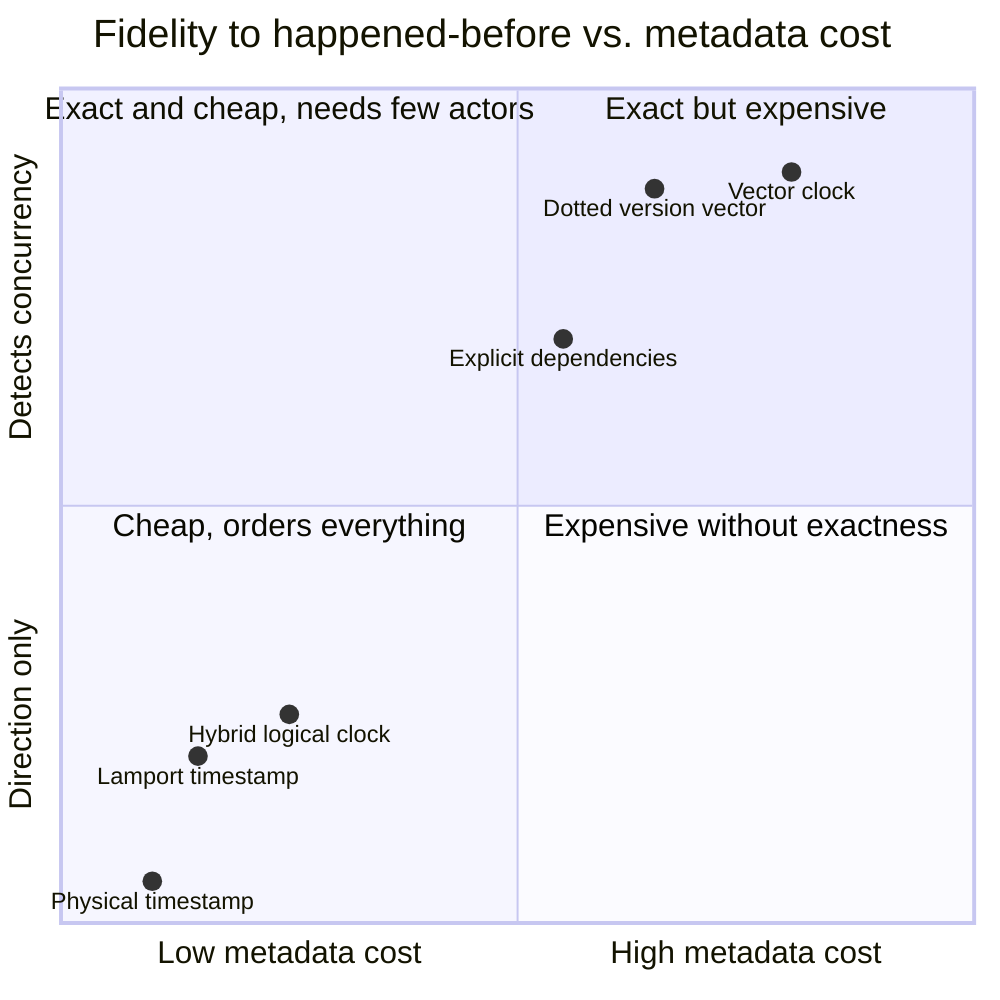

`a -> b` şeklinde yazılan happened-before ilişkisi, dağıtık bir sistemdeki iki olayı yalnızca birinciden ikinciye bilgi akmış olabiliyorsa sıralar: ya ikisi de aynı process üzerinde çalışmıştır ve `a` önce gelmiştir, ya da `a`'dan `b`'ye uzanan bir mesaj zinciri vardır. Ne `a -> b` ne de `b -> a` geçerliyse olaylar eşzamanlıdır (concurrent), `a || b` şeklinde yazılır ve sistemin içindeki hiçbir gözlemci hangisinin önce olduğunu söyleyemez. Leslie Lamport bu ilişkiyi 1978'de, bir sistemin hiçbir saate başvurmadan sıralama hakkında akıl yürütebilmesi için tanımladı. Her mantıksal saat, her nedensel tutarlılık modeli, her çakışma dedektörü ve her dağıtık snapshot ya bu ilişkinin bir kodlamasıdır ya da onu tüketir.

Çözdüğü problem şudur: herkesin sezgisel olarak istediği sıralama, yani gerçek zaman sıralaması, gözlemlenebilir değildir. [Fiziksel Saatler](/distributed-systems/tr/foundations/time-and-ordering/physical-clocks/) sayfasında gösterildiği gibi her node'un kendine ait, kendi hatasını taşıyan bir saati vardır ve [asenkron model](/distributed-systems/tr/foundations/system-models/network-models/) altında ağ sınırsız gecikme ekler. Farklı makinelerde 300 mikrosaniye arayla yapılan iki yazma, zaman damgalarını herhangi bir sırada taşıyabilir. Happened-before, "zamanda hangisi önce oldu" sorusunun yerine her process'in kendi geçmişinden cevaplayabileceği bir soru koyar: "birincisi ikincisini etkilemiş olabilir mi?" Cevap, bir cevabın var olduğu yerde kesindir; olmadığı yerde ise açıkça "hiçbiri"dir.

Asıl denge, doğruluk (fidelity) ile metadata arasındadır. İlişkiyi tam olarak yakalamak, yani eşzamanlılığı sıralamadan ayırt edebilmek, bağımsız aktör sayısıyla büyüyen bir metadata gerektirir; Charron-Bost 1991'de, eleman eleman karşılaştırılan bir vektör zaman damgasının `n` process için ilişkiyi karakterize edebilmesi için en az `n` elemana ihtiyaç duyduğunu kanıtladı. Tek bir sayaç ilişkinin yönünü korur ama eşzamanlılığı tanıyamaz; fiziksel bir zaman damgası ise yönü bile güvenilir biçimde koruyamaz. Bunlardan biri üzerine kurulan bir sistem, hiç sıralanmamış olayları sessizce sıralar.

## İlişkiyi Bir Process'in Gözlemleyebildiklerinden Tanımlamak

Bir process tam olarak iki tür sıralama gözlemler. Olayları birer birer yürüttüğü için kendi olaylarının sırasını bilir. Ve hiçbir şey geriye doğru ilerlemediği için, aldığı bir mesajın varmadan önce gönderilmiş olduğunu bilir. Happened-before, bu iki gerçeği içeren ve geçişli (transitive) olan en küçük ilişkidir:

```text
Events: local steps, sends, and receives on processes P1..Pn.

Rule 1 (program order): a and b on the same process, a before b  =>  a -> b
Rule 2 (messages):      a = send(m) and b = receive(m)            =>  a -> b
Rule 3 (transitivity):  a -> b and b -> c                          =>  a -> c

Concurrency:  a || b  iff  not (a -> b) and not (b -> a)
Causal past:  past(e) = { x : x -> e }
Consistent cut C:  e in C and x -> e  =>  x in C
```

İki yerel gözlemi global bir yapıya dönüştüren Kural 3'tür: program sırası adımlarından ve mesajlardan oluşan, potansiyel olarak birçok process'e yayılan bir zincir, nedeni sonuca bağlar. İlişki dönüşsüz değildir (irreflexive); `a -> a` hiçbir zaman geçerli olmaz, çünkü bir mesaj gönderilmeden varamaz ve bir process kendinden önce gelemez. Yapısı gereği de geçişlidir; dolayısıyla kesin bir kısmi sıralamadır (strict partial order). Burada belirleyici kelime "kısmi"dir. Gerçek zaman olayları tam olarak sıralar; happened-before ise bazı çiftleri bilinçli olarak sırasız bırakır.


*Üç process'in uzay-zaman diyagramı. Her process'in zaman çizgisi yukarıdan aşağı akar; oklar mesajlardır. Olaylar: P1'de a, b, h, j; P2'de c, d, f; P3'te e, g, i.*

Diyagramı bir ilişkiler kümesi olarak okuyalım: program sırasından `a -> b`, `m1` mesajından `b -> c`, P2'de `c -> d -> f`, `m2`'den `f -> g`, P3 ve P1'de `g -> i -> j`; dolayısıyla üç process'in hepsinden geçen bir zincir üzerinden `a -> j`. İlginç olan çiftler sırasız olanlardır. P3'teki `e` olayı program sırasıyla `g`'den önce gelir, ama `a`, `b`, `c`, `d`, `f` ve `h` ile eşzamanlıdır: `e`'den önce P3'e hiçbir mesaj ulaşmamış ve P3'ten hiçbir mesaj çıkmamıştır. P1'deki `h` olayı `c`, `d`, `e`, `f`, `g` ve `i` ile eşzamanlıdır: P1 `m1`'i göndermiştir ama `j`'ye kadar karşılık almamıştır. Bu olayların çizimdeki dikey konumu yalnızca yerleşimin bir sonucudur.

Eşzamanlılık geçişli değildir: diyagramda `h || e` ve `e || b` olduğu hâlde `b -> h` geçerlidir. "Karşılıklı eşzamanlı" olayları, eşzamanlılık bir denklik ilişkisiymiş gibi gruplayan bir tasarım çelişkiler üretir.

### Nedensel Geçmiş, Nedensel Gelecek ve Işık Konisi Benzetmesi

Her `e` olayı, yürütmenin geri kalanını üç kümeye ayırır: nedensel geçmişi (onu etkilemiş olabilecek her şey), nedensel geleceği (onun etkileyebileceği her şey) ve onunla eşzamanlı olan her şey. Lamport bu benzetmeyi açıkça özel göreliliğe dayandırır: orada uzay-zamandaki bir noktayı etkileyebilecek olayların kümesi o noktanın geçmiş ışık konisidir ve iki koninin de dışında kalan olayların değişmez (invariant) bir sırası yoktur; farklı gözlemciler bu sıra konusunda meşru biçimde anlaşamaz. Mesajlar sinyallerin, ağ gecikmesi de ışığın sonlu hızının rolünü üstlenir.


*Aynı yürütmenin yönlü döngüsüz çizge (DAG) olarak gösterimi. Gölgeli node'lar g olayının nedensel geçmişidir; kenarlar program sırası ve mesajlardır.*

Çizge biçimi, uzay-zaman diyagramının gizlediği iki özelliği görünür kılar. Birincisi, ilişki tam olarak erişilebilirliktir (reachability): `x -> y` ancak ve ancak `x`'ten `y`'ye yönlü bir yol varsa geçerlidir; dolayısıyla çizge yapısı gereği döngüsüzdür ve yeniden oluşturulmuş bir çizgedeki herhangi bir döngü, zamanda yolculuğun değil bir loglama ya da saat hatasının kanıtıdır. İkincisi, `g`'nin nedensel geçmişi (gölgeli kısım), P3'ün `g`'yi yürütürken bilebileceği her şeydir; `h` bu kümede değildir, dolayısıyla P3'ün `g` anında verdiği her karar, duvar saatleri ne derse desin, `h`'den habersiz verilir. Bir node'un sistem görüşünün "bayat" olmasının kesin anlamı budur: görüşü bir zaman gecikmesiyle değil, nedensel geçmişiyle sınırlıdır.

### Bu Tanım Neden Doğru Tanımdır

Happened-before'un doğru sıralama olduğu iddiası, iki yönlü bir argümana dayanır.

`a -> b` ise, her fiziksel yürütmede `a` gerçek zamanda `b`'den önce gerçekleşmiştir. Program sırası tanımı gereği ardışıktır ve bir mesaj gönderildikten sonra alınır; dolayısıyla zincirin her halkası zamanda ileriyi gösterir, zincirin tamamı da öyle. Happened-before bu nedenle fizikle hiçbir zaman çelişmez.

`a || b` ise, hiçbir process bu iki olayın gerçek zaman sırasını belirleyemez. Herhangi bir yürütmeyi alın ve her process'in zaman çizgisini, her mesajın gönderimi alımından önce kalacak şekilde, bir lastik bant gibi gerdiğinizi ya da sıkıştırdığınızı düşünün. Her process aynı yerel olay dizisini ve aynı mesaj içeriklerini görür; dolayısıyla gerilmiş yürütme her katılımcı için ayırt edilemezdir. Eşzamanlı olaylar için bu germelerden biri `a`'yı `b`'den önceye, bir diğeri `b`'yi `a`'dan önceye yerleştirir. Sistemin içindeki hiçbir algoritma bu yürütmeleri birbirinden ayıramaz; dolayısıyla `a` ile `b`'ye atadığı her sıralama bir keşif değil, bir seçimdir.

Bu iki yön birlikte, happened-before'un hem doğru hem de gözlemlenebilir olan en güçlü sıralama olduğunu söyler. Tam sıralama (total order) gibi daha güçlü her şey, sistemin sahip olmadığı bir bilgiyi ekler. Daha zayıf her şey ise sistemin gerçekten gözlemlediği bir sıralamayı atar. İlişkinin bu bölümdeki her mekanizmanın altında yer almasının nedeni budur: [Lamport zaman damgaları](/distributed-systems/tr/foundations/time-and-ordering/lamport-timestamps/) onu keyfi bir eşitlik bozucuyla (tie-break) tam sıralamaya genişletir, [vektör saatler](/distributed-systems/tr/foundations/time-and-ordering/vector-clocks/) onu tam olarak temsil eder, [hibrit mantıksal saatler](/distributed-systems/tr/foundations/time-and-ordering/hybrid-logical-clocks/) ise duvar saati zamanına yakın kalırken yönünü korur.

Kısmi sıralama ile herhangi bir tekil tam sıralama arasındaki farkın büyüklüğünü küçümsemek kolaydır. Aralarında hiç mesaj olmayan ve her biri üç olay loglayan iki process 20 geçerli serpiştirmeye (interleaving) izin verir; bir process'in ilk olayından diğerinin ikinci olayına giden tek bir mesaj bunu 16'ya, üçüncü olaya geri dönen bir yanıt ise 12'ye indirir. Her biri dört bağımsız olaya sahip üç process 34.650 serpiştirmeye izin verir. Zaman damgasına göre sıralanmış birleşik bir log, bu serpiştirmelerden yalnızca birini gösterir ve onu tarihin kendisiymiş gibi sunar.

## İlişkinin Mümkün Kıldıkları: Kesitler, Teslim ve Çakışmalar

Üç dağıtık algoritma ailesi bu ilişkinin doğrudan uygulamasıdır ve doğruluk argümanları da onun hakkındaki önermelerdir.

### Tutarlı Kesitler ve Global Snapshot'lar

Kesit (cut), her process için o process'in geçmişinin bir önekini (prefix) içeren bir olay kümesidir: "P1'in buraya kadar yaptığı her şey, P2'nin şuraya kadar yaptığı her şey." Bir kesit, nedensel geçmiş altında kapalıysa tutarlıdır (consistent): bir olayı içeriyorsa, o olaydan önce gerçekleşen her olayı da içerir. Tutarlı bir kesitte kaydedilen global durum, gerçek zamanın hiçbir anı ona birebir karşılık gelmemiş olsa bile, sistemin içinden geçmiş olabileceği bir durumdur.


*Bir mesajın bir kesiti geçebileceği iki yol. Kesitten sonra gönderilip kesitten önce alınan bir mesaj (yetim mesaj, orphan) kesiti tutarsız kılar.*

Tehlikeli olan tutarsız durumdur, çünkü bir sonucu nedeni olmadan kaydeder. Bir ödeme sisteminde, tutarsız bir kesitte alınan hesap bakiyesi snapshot'ı, gönderendeki borçlandırmayı dışarıda bırakırken alıcıdaki alacaklandırmayı içerebilir; böylece kaydedilen toplam, hiç var olmamış parayı da içerir. Tutarlı durum ise çalışan bir sistemin olağan hâlidir: bir mesaj yoldadır ve doğru bir snapshot, hiçbir şey kaybolmasın diye onu kanal durumu (channel state) olarak kaydeder. Her node'un durumunu "kendi saatine göre 12:00:00.000'da" almak, bir mesajın aktarım süresi uç noktaları arasındaki saat farkından (offset) küçük olduğunda tutarsız bir kesit üretir ve tek bir veri merkezi içinde bu çoğu zaman böyledir.

Chandy ve Lamport'un 1985 tarihli snapshot algoritması, sistemi durdurmadan ve saat kullanmadan tutarlı bir kesit üretir. Başlatıcı kendi durumunu kaydeder ve her giden kanala bir işaretçi (marker) gönderir; ilk işaretçisini alan bir process kendi durumunu kaydeder ve işaretçileri iletir, ayrıca kendi kaydından sonra ve o kanalın işaretçisinden önce bir kanaldan gelen her mesajı kanal durumu olarak kaydeder. Algoritma ilk giren ilk çıkar (FIFO) kanallar gerektirir: işaretçi, gönderenin kaydından önce gönderilen mesajları sonrakilerden ayırır ve FIFO bu ayrımın aktarım sırasında korunmasını garanti eder. Apache Flink'in checkpoint mekanizması bunun üretimdeki bir torunudur: veri akışına enjekte edilen barrier'lar işaretçi rolünü üstlenir ve bir operatör, Carbone ve arkadaşlarının 2015'te tarif ettiği gibi, durumunun snapshot'ını almadan önce girdilerinden gelen barrier'ları hizalar. Deadlock tespiti, sonlanma tespiti ve dağıtık çöp toplama (garbage collection), tutarlı bir kesit üzerinde bir yüklemi (predicate) değerlendirmeye indirgenir; hiçbirinin, node durumlarını aynı duvar saati anında örnekleyerek doğru biçimde yapılamamasının nedeni budur.

### Nedensel Teslim

Nedensel teslim (causal delivery), bir mesajın uygulamaya ancak ondan önce gerçekleşen her mesaj o alıcıda teslim edildikten sonra verilmesi kuralıdır. Alıcının bir sonucu nedeninden önce gözlemlemesini engeller: sorudan önce yanıtı, satırı oluşturan insert'ten önce o satıra yapılan bir güncellemeyi. Alıcı bunu, nedensel geçmişi henüz teslim etmediği bir mesaj içeren her mesajı bekleterek uygular; bu da gönderenin o geçmişi tarif edecek kadar metadata eklemesini gerektirir. Bu kural üzerine kurulan tutarlılık modeli ve ondan türeyen oturum garantileri [Nedensel Tutarlılık ve Oturum Garantileri](/distributed-systems/tr/data-management/consistency-models/causal-consistency-session-guarantees/) sayfasında ele alınır.

Nedensel teslim, potansiyel nedensellik üzerinden tanımlanır: bir mesaj, onu etkilemiş olabilecek herhangi bir şey eksikse, gerçekten etkilemiş olsun ya da olmasın bekletilir. Bir izleme heartbeat'i alıp ardından ilgisiz bir iş olayı gönderen bir process, Kural 1 gereği heartbeat'i o olayın nedensel geçmişinin parçası yapmıştır. Bu aşırı yaklaşıklık (over-approximation), aşağıdaki hata biçimlerinden biri olan sahte nedenselliğin (false causality) kaynağıdır.

### Eşzamanlı Yazmalar Sıralanacak Yarışlar Değil, Çakışmalardır

Aynı öğeye yapılan iki yazma sıralıysa, sonraki öncekinin yerini kayıpsız alır: ikinci yazmayı yapan, birinciyi nedensel geçmişinde bulunduruyordu ve onun üzerine yazmayı seçti. İki yazma eşzamanlıysa, yazanların hiçbiri diğerinden haberdar değildi ve aralarındaki hiçbir sıralama kimsenin niyetini yansıtmaz. Replike bir veri deposunun böyle bir çift için tam üç seçeneği vardır: ikisini de tutup çakışmayı açığa çıkarmak (orijinal Dynamo tasarımındaki gibi sibling'ler), sıraya bağlı olmayan bir fonksiyonla birleştirmek ([CRDT'ler](/distributed-systems/tr/data-management/consistency-models/crdts/)) ya da birini deterministik olarak seçip diğerini atmak. Last-write-wins (son yazan kazanır, LWW), seçici olarak fiziksel zaman damgası kullanan üçüncü seçenektir. Yalnızca eşzamanlı bir yazmanın kaybı kabul edilebilir olduğunda meşru bir politikadır; zaman damgaları nedensel olarak sıralı yazmaları da yanlış sıraladığında ise veri kaybına dönüşür. Bu iki durumu birbirinden ayırmak eşzamanlılığı tespit etmeyi gerektirir ve ucuz kodlamaların yapamadığı da tam olarak budur.

## İlişkiyi Kodlamak: Her Mekanizma Neyi Korur

İlişki bir yürütmenin tamamı üzerinde tanımlanır, ama çalışan bir sistem her olaya daha sonra karşılaştırılabilecek bir değer iliştirmek zorundadır. Her kodlamayı iki özellik sınıflandırır. Bir `C` kodlaması, `a -> b` iken `C(a) < C(b)` oluyorsa saat koşulunu (clock condition) sağlar: nedensel bir çifti hiçbir zaman tersine çevirmez. Tersi de geçerliyse, yani `C(a) < C(b)` iken `a -> b` oluyorsa güçlü saat koşulunu (strong clock condition) sağlar; bu durumda karşılaştırılamayan değerler tam olarak eşzamanlı çiftleri belirler.

| Mekanizma | Nedensel çifti asla tersine çevirmez | Eşzamanlı çiftleri belirler | Olay başına metadata | Ne zaman tercih edilmeli |
|---|---|---|---|---|
| Fiziksel zaman damgası | Hayır, saat hatasından yakın çiftleri tersine çevirir | Hayır | Bir tamsayı | Gösterim ve saklama süresi; makineler arası sıralamaya karar vermek için asla |
| Lamport zaman damgası | Evet | Hayır, keyfi bir sıra dayatır | Bir tamsayı | Nedensellikle tutarlı bir tam sıralama yeterliyse, örneğin zaman damgasıyla karşılıklı dışlama |
| Hibrit mantıksal saat | Evet | Hayır | Bir tamsayı artı küçük bir sayaç | Duvar saatine de yaklaşan, nedensel olarak güvenli zaman damgaları, örneğin MVCC snapshot'ları |
| Vektör saat ya da version vector | Evet | Evet | Aktör başına bir eleman | Saklanması ya da birleştirilmesi gereken çakışan yazmaları tespit etmek |
| Açık bağımlılık listesi | Evet, izlenen bağımlılıklar için | Evet, izlenen bağımlılıklar için | Doğrudan bağımlılık başına bir eleman | Aktörlerin çok, bağımlılıkların az olduğu geniş alan nedensel tutarlılığı |
| Tek leader log offset'i | Evet | Uygulanamaz: eşzamanlılık leader'da ortadan kalkar | Bir tamsayı | Bir kapsamdaki tüm yazmalar zaten tek bir sıralayıcıdan geçiyorsa |

Son satır, nedensellikle başa çıkmanın en ucuz yolunun çoğu zaman eşzamanlılığı ortadan kaldırmak olduğunu hatırlatır. Bir Kafka partition'ı ya da bir Raft log'u, içinden yazılan her şeyi tam olarak sıralar; dolayısıyla bu kapsam içinde offset kusursuz bir sıralamadır ve hiçbir nedensel metadata gerekmez. Partition'lar arasında ise hiçbir sıralama yoktur ve problem geri döner.


*Konumlar niteldir. Fiziksel zaman damgası en altta yer alır, çünkü yalnızca eşzamanlılığı tespit edemez olmakla kalmaz, nedensel çiftleri tersine de çevirebilir.*

Boş kalan sol üst çeyrek, Charron-Bost'un alt sınırının görselleştirilmiş hâlidir: sabit boyutlu metadata ile tam eşzamanlılık tespiti genel olarak imkânsızdır; dolayısıyla sistemler buna ancak aktör sayısını sınırlayarak ulaşır. Version vector'lar istemcileri değil replika sunucularını izlediğinde küçük kalır; Riak'ın kullandığı dotted version vector'lar bu sınırı korurken sunucu tarafı bir vektörün aksi hâlde üreteceği sahte çakışmalardan kaçınır. COPS'un (Lloyd ve arkadaşları, 2011) yaklaşımı olan açık bağımlılık takibi bu sınırdan başka bir yoldan kurtulur: yalnızca bir istemcinin gerçekten okuduğu en yakın bağımlılıkları kaydeder; istemci sayısı devasa olsa bile bunlar genellikle azdır. Her kodlama ilişkinin belirli bir kısmını atar ve atılan kısım, sistemin hangi sonuca varabileceğini belirler; mekanizmaların ayrıntısı kendi sayfalarına aittir.

### Sayısal Örnek: Tam Nedensellik, Skaler Bariyer ya da Hiçbiri

İki bölgeye replike edilmiş bir tartışma servisi varsayalım. Gönderiler ve yanıtlar farklı shard'larda tutulur; toplam 256 shard vardır ve her birinin A bölgesinden B bölgesine giden kendi asenkron replikasyon akışı bulunur. Alice A bölgesinde bir gönderi paylaşır; Bob gönderiyi A bölgesinde okur ve 3 saniye sonra yanıtlar; Carol ise başlığı B bölgesinde okur. Bu örnekteki tüm sayılar temsilidir.

Bob'un yanıtı Alice'in gönderisinden sonra gerçekleşmiştir: Bob gönderiyi okumuştur, yani `post -> read -> reply`. Gönderinin shard akışının B bölgesine gecikmesi, yanıtın kendi gecikmesi artı Bob'un harcadığı 3 saniyeyi aştığında Carol yanıtı gönderi olmadan görür. Her akışın, birbirinden bağımsız olarak, zamanın %0,05'inde 3 saniyeden fazla takıldığını ve servisin günde 20 milyon yanıt aldığını varsayalım. Hiç nedensel takip yoksa günde yaklaşık `0.0005 * 20,000,000 = 10,000` yanıt, B bölgesinde ana gönderisinden önce görünür hâle gelir. Hiçbir şey kaybolmaz, ama anomali görünürdür.

Birinci seçenek skaler bir bariyerdir; GentleRain (Du ve arkadaşları, 2014) gibi global kararlı zaman (global stable time) tasarımlarının yaklaşımıdır: her yanıt tek bir zaman damgası taşır ve B bölgesi yanıtı ancak her replikasyon akışı o zaman damgasına kadar her şeyi uyguladığında görünür kılar. Metadata açısından ucuzdur (bir tamsayı), ancak Bob'un nedensel geçmişinin skalerin yaklaşıkladığı hâlinin tamamını, yani Bob'un yanıtından önce her shard'a yazılan her şeyi bekler. Bu durumda 256 akıştan herhangi biri takıldığında yanıt gecikir: `1 - (1 - 0.0005)^256`, yani yanıtların yaklaşık %12'si, ana gönderileriyle ilgisi olmayan bir takılma yüzünden bekletilir. Anomali ortadan kalkar, ama sahte nedensellik %0,05'lik bir kuyruğu %12'lik bir kuyruğa dönüştürür.

İkinci seçenek akış başına tam takiptir: her shard akışı için 8 baytlık bir eleman içeren bir vektör her yanıta 2.048 bayt ekler, bu da tipik kısa bir yanıtın birkaç katıdır; buna karşılık B bölgesinin yalnızca Bob'un oturumunun gerçekten bir şey gözlemlediği akışları, Bob için pratikte gönderinin shard'ını, beklemesine izin verir. Üçüncü seçenek açık bağımlılık takibidir: yanıt tek bir bağımlılık taşır, gönderinin kimliği ve sürümü, yaklaşık 16 bayt; B bölgesi yanıtı yalnızca o belirli gönderi eksikse geciktirir ve bu, baştaki %0,05 oranında olur. Üç seçenek anomali oranını, gecikme oranını ve metadata boyutunu birbirine karşı takas eder; üçünü birden en aza indiren yalnızca sonuncusudur, çünkü gerçek bağımlılığın bir üst kümesini değil kendisini kodlar. Bedeli ise uygulamadadır: her okuma neyi gözlemlediğini kaydetmeli, her yazma da bu kaydı taşımalıdır.

## Hata Biçimleri: Bir Sistem Nedensellik Yerine Başka Bir Sıralama Kullandığında

Aşağıdaki her hatanın kökü aynıdır: bir sistem happened-before dışında bir şeyle sıraya karar vermiş ya da bir sınırda ilişkinin izini kaybetmiştir ve bunu hiçbir şey raporlamamıştır.

### Gizli Kanallar

Tetikleyici: nedensellik, sistemin gözlemlemediği bir yoldan akar. Lamport'un orijinal makalesi, bir bilgisayarda bir istek yapan ve ardından başka bir bilgisayarda ikinci bir istek yapacak arkadaşına telefon eden bir kişi örneğini kullanır; ikinci istek nedensel olarak birinciden sonradır, ama sistemin içinde ikisini bağlayan hiçbir mesaj yoktur, dolayısıyla sistem onları ters sırada sıralayabilir. Günümüzdeki karşılıkları; bir tarayıcı sekmesinde onay görüp başka bir sekmede işlem yapan kullanıcı, farklı bir endpoint üzerinden geri çağrı yapan üçüncü tarafa teslim edilen bir webhook, bir veritabanı dökümünü okuyan bir batch işi ve paylaşılan bir cache ya da nesne deposu üzerinden koordine olan iki servistir.

```mermaid
sequenceDiagram
    autonumber
    participant U as User
    participant W as Write API (region A)
    participant R as Replica (region B)
    participant X as Partner system
    U->>W: Create order 42
    W-->>U: 201 Created, order 42
    W->>X: Webhook: order 42 created
    Note over W,R: Replication of order 42 to region B delayed
    rect rgb(70, 40, 40)
    X->>R: GET /orders/42 (routed to nearest region)
    R-->>X: 404 Not Found
    Note over X: Partner marks order as invalid
    end
    W->>R: Replication of order 42 arrives
```


*Gizli bir kanal. 3. adımdaki webhook nedenselliği veritabanının replikasyon protokolünün dışına taşır; bu yüzden 4. adımdaki okumanın bekleyebileceği bir nedensel bağlamı yoktur.*

3. adımda webhook, partner'ın 4. adımdaki okumasını 1. adımdaki oluşturmadan nedensel olarak sonraya koyar, ama B bölgesindeki replikanın bunu bilmesinin hiçbir yolu yoktur: istek, göndericisinin ne gördüğünü tarif eden hiçbir token taşımaz. 5. adımdaki 404 bir replikasyon hatası değildir; replikasyon tasarlandığı gibi davranmaktadır. Belirtiler; yeniden denemede başarılı olan "bulunamadı" ya da bayat okumalar, yazmaların hemen ardından yoğunlaşmaları ve yeniden üretilemeyen bildirimlerdir. Tespit: okuma anında başvurulan nesnenin yaşını loglayın ve replikasyon gecikmesinden genç nesnelerin okunmasında alarm üretin; yeni oluşturulmuş ID'ler üzerindeki 404'leri replikanın gecikme metriğiyle ilişkilendirin. Çözüm, gizli kanalı sistemin içine çekmektir: webhook payload'ına nedensel bir token (bir commit sürümü, bir log konumu, bir HLC değeri) ekleyin ve bu token'ı sunan okumaların beklemesini ya da yetişmiş bir replikaya yönlendirilmesini zorunlu kılın. Cheriton ve Skeen'in nedensel sıralı multicast'e yönelik 1993 tarihli eleştirisi genel noktayı ortaya koyar: bir iletişim katmanı yalnızca içinden geçeni sıralayabilir, dolayısıyla nedensel garantiler uygulamanın bağımlılıklarının görünür olduğu seviyeye aittir.

### Duvar Saati Sırasının Nedensel Sıra Sayılması

Tetikleyici: bir veri deposu çakışmaları çözer ya da yazmaları fiziksel zaman damgasıyla sıralar ve nedensel olarak sıralı iki yazma, yazanlar arasındaki saat farkından daha yakındır. Belirtiler: onaylanmış bir güncelleme kaybolur ve öğe, hiçbir hata ya da çakışma loglanmadan eski bir değere döner. Kingsbury'nin 2013 tarihli Cassandra Jepsen analizi, yazanları harici bir kilit sıraya soktuğunda, yani her yazma bir öncekinden nedensel olarak sonra geldiğinde bile, zaman damgası tabanlı last-write-wins altında tek bir hücreye yapılan onaylanmış yazmaların sessizce atıldığını gösterdi. Kayıp sessiz olduğu için tespit zordur; işe yarayan sinyaller zaman daemon'ının saat farkı metrikleri, canary'lerde yazma sonrası okuma doğrulaması ve veri deposu sunuyorsa daha eski bir zaman damgasıyla reddedilen ya da üzerine yazılan yazmaların sayısıdır. Çözüm: nedensel olarak bağımlı yazmaları tek bir sıralayıcıdan geçirin, bir yazmanın neyin yerini aldığını belirtmesi için koşullu yazmalar (bir sürüm üzerinde compare-and-set) kullanın ya da nedensel çiftleri asla tersine çevirmeyen bir kodlama kullanın. "Fazla yakın"ın ne kadar yakın olduğuna dair hata sınırı hesabı [Fiziksel Saatler](/distributed-systems/tr/foundations/time-and-ordering/physical-clocks/) sayfasındadır.

:::danger[Last-write-wins eşzamanlı yazmaları tasarımı gereği atar]
Zaman damgası tabanlı bir last-write-wins register'ı, her eşzamanlı çiftin bir yazmasını kaybeder; saat kayması (clock skew) altında hayatta kalandan nedensel olarak sonra gelen bir yazmayı da kaybedebilir. Her iki kayıp da istemci başarı yanıtı aldıktan sonra gerçekleşir. Yalnızca kayıp bir güncellemenin kabul edilebilir olduğu veriler için kullanın; sayaçlar, bakiyeler ya da okunup değiştirilip geri yazılan herhangi bir değer için asla kullanmayın.
:::

### Neden ile Sonucu Ters Çeviren Birleşik Loglar

Tetikleyici: bir mühendis bir olayı (incident), birkaç host'un loglarını birleştirip zaman damgasına göre sıralayarak yeniden kurar. Belirtiler: bir istek gönderilmeden önce işlenmiş, bir retry kendisine yol açan hatadan önce gelmiş, bir leader seçilmeden önce harekete geçmiş gibi görünür. İnceleme bu durumda imkânsız bir sıralamanın ya da, daha kötüsü, makul ama yanlış bir sıralamanın peşine düşer. Tespit imkânsız olayın kendisidir: birleşik görünümde gönderiminden önce gelen her alım, o noktada saat farkının mesajın aktarım süresini aştığını kanıtlar. Çözüm: yalnızca zaman damgalarını değil, nedensel tanımlayıcıları da loglayın. Dağıtık izleme her span için bir üst (parent) span kaydeder; dolayısıyla bir trace, tek bir isteğin happened-before çizgesidir; bkz. [Dağıtık İzleme](/distributed-systems/tr/observability/logs-metrics-traces/distributed-tracing/). İstek dışı trafik için, her mesaj olayıyla birlikte bir Lamport ya da vektör damgası loglamak, ShiViz (Beschastnikh ve arkadaşları) gibi araçların sıradan loglardan uzay-zaman diyagramını yeniden kurmasını sağlar.

:::caution[Sıralanmış bir log tarihin kendisi değil, tek bir doğrusallaştırmadır]
Farklı host'lardan gelen olaylar eşzamanlıysa, birleşik sıralama saat farklarının ve log taşımanın bir yan ürünüdür. Birleşik bir logdaki host'lar arası sıralamayı ancak iki olayı bir mesaj, bir trace parent'ı ya da mantıksal bir damga bağlıyorsa anlamlı kabul edin.
:::

### Bir Sınırda Kaybolan Nedensel Bağlam

Tetikleyici: bir sistem nedenselliği bir bileşen içinde doğru biçimde izler, ama bir istek başka bir bileşene geçtiği yerde bağlam düşer: token'ı taşımayan bir mesaj kuyruğu, bir değeri sürümü olmadan döndüren bir cache, her istek için açılan yeni bir veritabanı oturumu, isteği orijinal header'lar olmadan yeniden kuran bir retry. MongoDB'nin nedensel tutarlı oturumları (causally consistent sessions) sonucu gösterir: garanti, yalnızca işlemler gözlemlenen cluster zamanını taşıyan oturumda ya da bu değerin açıkça aktarıldığı başka bir oturumda çalıştığı sürece geçerlidir; bunun dışında yapılan bir işlem hiçbir nedensel garanti almaz. Belirtiler gizli kanallarınkine benzer: kendi yazdığını okuma (read-your-writes) ihlalleri ve eksik üst kayıtlar, yalnızca belirli yollarda ortaya çıkar. Tespit: her adımda nedensel bir token'ın bulunup bulunmadığını kaydeden trace öznitelikleri ve token'sız gelen alt akış çağrılarının yüzdesini gösteren bir dashboard. Çözüm: token'a trace bağlamı gibi davranın; onu her handler değil, middleware yaysın.

:::tip[Nedensel bağlamı trace bağlamını yaydığınız gibi yayın]
W3C Trace Context header'larını her adımdan, kuyruktan ve retry'dan zaten geçiren sistemler, nedensel token'lar için tesisat problemini çözmüş durumdadır. Aynı middleware içinde bir commit sürümü ya da log konumu taşımak adım başına birkaç bayta mal olur ve sınır sızıntılarının çoğunu bir kerede kapatır.
:::

### Sahte Nedensellik ve Metadata Büyümesi

Tetikleyici: bir mekanizma potansiyel nedenselliği gerçek bağımlılıktan daha kaba bir taneciklikte izler. Belirtiler: sayısal örnekteki %12'lik gecikme oranında olduğu gibi ilgisiz akışlardaki takılmaların sürüklediği kuyruk gecikmesi (tail latency) ya da istemci sayısıyla büyüyerek depolamaya ve bant genişliğine hâkim olan metadata. Tespit: nedensel teslimdeki ya da bariyer beklemelerindeki bekletme süresini, beklemeye hangi bağımlılığın yol açtığına göre kırılımlı ölçün; nesne başına metadata boyutunu izleyin. Çözüm: izlenen bağımlılıkları daraltın (skaler bariyer yerine açık bağımlılıklar), aktör kümesini sınırlayın (istemcileri değil sunucuları izleyin) ve budamayı dikkatle yapın, çünkü bir vektör saati budamak tespit edilmiş bir çakışmayı sessizce yanlış sıralanmış bir yazmaya dönüştürebilir.

| Hata | Dışarıdan görünen belirti | Tespit sinyali | Çözüm |
|---|---|---|---|
| Gizli kanal | Yeni nesne bulunamıyor, yeniden denemede başarılı | Replikasyon gecikmesinden genç nesnelerin okunması | Bant dışı mesajda nedensel token |
| Duvar saati sıralaması | Onaylanmış güncelleme geri döndü, hata yok | Saat farkı ile yazma aralığı karşılaştırması; yazma sonrası okuma canary'leri | Sıralayıcı, koşullu yazmalar, mantıksal kodlama |
| Yanlış sıralanmış birleşik loglar | Olay zaman çizelgesinde gönderimden önce alım | Birleşik görünümde imkânsız çiftler | Trace parent'ları, loglarda mantıksal damgalar |
| Sınırda kaybolan bağlam | Bazı yollarda read-your-writes ihlali | Token'sız adımların payı | Middleware ile yayılım |
| Sahte nedensellik | İlgisiz takılmalardan kaynaklanan kuyruk gecikmesi | Engelleyen bağımlılığa göre bekletme süresi | Açık bağımlılıklar, sınırlı aktör kümeleri |

## Ne Zaman Happened-Before ile Düşünmeli, Ne Zaman Yanlış Araçtır

Bir tasarım kararı, ortak bir sıralayıcıyı paylaşmayan process'ler arasındaki sıralamaya bağlı olduğunda ilişki üzerinden açıkça düşünün: replike veri için bir çakışma çözüm politikası seçerken, bir cache invalidation'ının geçersiz kıldığı yazmayı sollayıp sollayamayacağına karar verirken, bir snapshot ya da checkpoint tasarlarken, read-your-writes garantisini servisler arasında yayarken ya da bir olayı birden çok host'tan yeniden kurarken. Uzay-zaman diyagramını çizip eşzamanlı çiftleri işaretlemek, sistemin nerede bir sıra seçmek zorunda olduğunu ve bu seçimi kimin yaptığını gösterir.

Önemli olan kapsamı tek bir sıralayıcı zaten sıralıyorsa nedensel bir mekanizma kurmayın. Tek leader'lı bir veritabanı, bir Raft grubu ya da tek bir Kafka partition'ı, kapsamındaki her yazmaya bir konum verir ve bu konum her türlü nedensel kodlamadan daha güçlüdür. İşlemleri sıralı olması gereken anahtara göre partition'layın ve işi log'a bırakın; nedensel takip o zaman yalnızca partition'lara yayılan işlemler için önem taşır.

Happened-before iki yaygın durumda da fazla zayıftır. Gereksinim, hiç iletişim kurmayan işlemler arasında gerçek zaman sıralamasıysa (bir istemcinin yazması, başka bir istemcinin okuması başlamadan tamamlanıyor ve okumanın onu görmesi gerekiyorsa), gereken garanti [linearizability](/distributed-systems/tr/data-management/consistency-models/linearizability/)'dir ve nedensellik tek başına bunu sağlayamaz; Spanner bunu, [TrueTime ve Spanner](/distributed-systems/tr/foundations/time-and-ordering/truetime-spanner/) sayfasında anlatıldığı gibi, sınırlı saat belirsizliğinden elde eder. Gereksinim birden çok öğe üzerinde bir değişmezse (invariant), örneğin hiçbir zaman negatife düşmemesi gereken bir bakiye, nedensellik hiçbir şey söylemez: iki eşzamanlı para çekme işlemi kendi nedensel geçmişlerinde ayrı ayrı geçerlidir ve ikisinin birden commit edilmesini yalnızca [serializability](/distributed-systems/tr/data-management/consistency-models/serializability/) ya da consensus engelleyebilir.

Son olarak, baskın bağımlılıkların enstrümante edilemeyen kanallardan geçtiği yerlerde nedensel garantilere güvenmeyin: bilgi aktaran insanlar, token taşımayacak üçüncü taraf sistemler, paylaşılan harici depolama. Orada dürüst tasarım ya işlemleri tek bir sahip üzerinden sıraya sokar ya da anomalileri tolere edip görünür kılar; sistemin korumaya yetecek kadar göremediği bir garantiyi iddia etmez.

İki komşu kavram bu ilişkiyle sürekli karıştırılır. Happened-before bir tutarlılık modeli değil, olaylar arasında bir ilişkidir; nedensel tutarlılık, her replikanın bu ilişkiye uymasını şart koşan modeldir. Bir korelasyon da değildir: aynı istek ID'sini paylaşan iki log satırı, ancak onları bir span parent'ı ya da bir mesaj bağlıyorsa sıralıdır.

## İleri Okuma

- Leslie Lamport, *Time, Clocks, and the Ordering of Events in a Distributed System*, Communications of the ACM, 1978.
- K. Mani Chandy and Leslie Lamport, *Distributed Snapshots: Determining Global States of Distributed Systems*, ACM Transactions on Computer Systems, 1985.
- Bernadette Charron-Bost, *Concerning the Size of Logical Clocks in Distributed Systems*, Information Processing Letters, 1991.
- Reinhard Schwarz and Friedemann Mattern, *Detecting Causal Relationships in Distributed Computations: In Search of the Holy Grail*, Distributed Computing, 1994.
- David R. Cheriton and Dale Skeen, *Understanding the Limitations of Causally and Totally Ordered Communication*, ACM SOSP, 1993.
- Wyatt Lloyd, Michael J. Freedman, Michael Kaminsky, and David G. Andersen, *Don't Settle for Eventual: Scalable Causal Consistency for Wide-Area Storage with COPS*, ACM SOSP, 2011.
