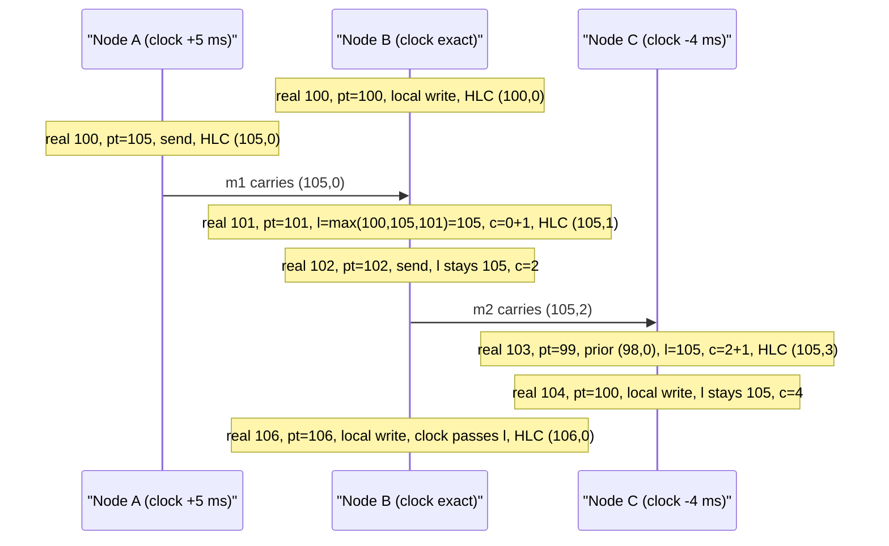
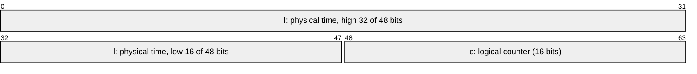
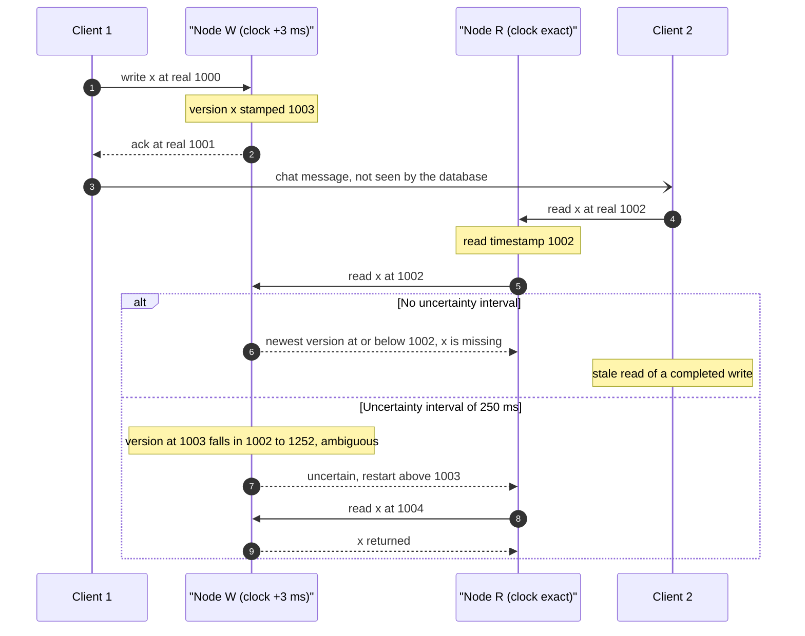
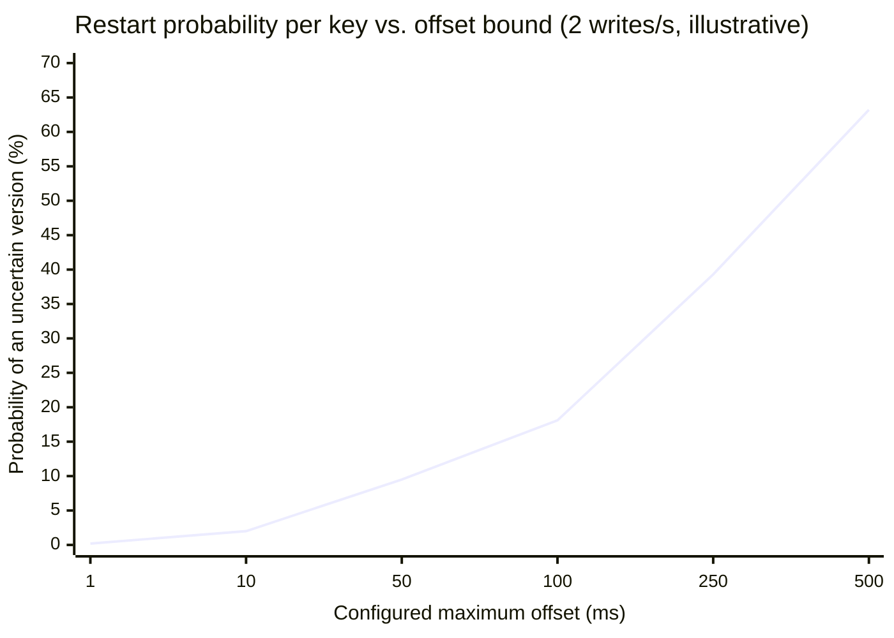
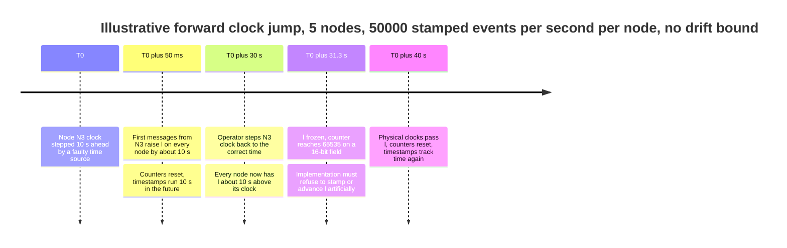

Hibrit mantıksal saat (hybrid logical clock, HLC), her node'un tuttuğu `(l, c)` biçiminde bir zaman damgasıdır. İlk alan olan `l`, node'un gördüğü en büyük fiziksel saat okumasıdır; bu değer ya node'un kendi saatinden ya da gelen bir mesajın üzerinden gelir. İkinci alan olan `c` ise aynı `l` değerini paylaşan olayları sıralayan bir sayaçtır. Lamport kurallarının bir çeşidi olan iki güncelleme kuralı, bu çifti nedensellikle tutarlı tutar: `a`, `b`'den önce gerçekleştiyse (happened before), `a`'nın `(l, c)` değeri sözlük sırasına (lexicographic) göre `b`'ninkinden küçüktür. Aynı zamanda `l` hiçbir zaman node'un kendi fiziksel saatinin gerisine düşmez ve onun önüne de cluster'daki saatler arasındaki en büyük sapmadan (offset) fazla geçmez. Çift 64 bit'e sığar ve bir NTP zaman damgası alanının yerine, alanın boyutunu değiştirmeden kullanılabilir.

Çözdüğü problem, bu bölümde daha önce ele alınan iki saatin arasında durur. Fiziksel bir zaman damgası insanlar ve deadline'lar için anlam taşır; ancak [Fiziksel Saatler](/distributed-systems/tr/foundations/time-and-ordering/physical-clocks/) sayfasında gösterildiği gibi senkronize iki sunucu bir milisaniye ya da daha fazla farklılaşabilir ve bu yüzden bir yanıt, ona neden olan istekten daha erken bir zaman damgası taşıyabilir. Bir [Lamport zaman damgası](/distributed-systems/tr/foundations/time-and-ordering/lamport-timestamps/) nedensel bir çifti asla ters çevirmez, ama değerinin zamanla hiçbir ilişkisi yoktur: bir sistem onunla "14:00:00 itibarıyla durum" isteyemez ya da veriyi bir saat sonra sona erdiremez. Çok sürümlü (multiversion) veritabanları iki özelliğe de tek bir alanda ihtiyaç duyar; çünkü `t` zaman damgasındaki bir snapshot okuması hem nedensel olarak tutarlı olmalı hem de gerçek bir âna karşılık gelmelidir ki "şimdi", "beş saniye önce" ve bir TTL söylediği şeyi ifade etsin.

Asıl denge şudur: HLC nedenselliği ve duvar saatine yakınlığı hiç beklemeden ve özel donanım olmadan sağlar; karşılığında birbiriyle iletişim kurmamış olaylar arasındaki gerçek zaman sırası hakkında hiçbir şey garanti etmez. Farklı node'larda yapılmış ve hiç mesaj alışverişi olmamış iki yazma, fiziksel saatlerine göre sıralanır; dolayısıyla aralarındaki fark saat sapmasından küçük olan çiftler yanlış sıralanabilir ve bir okuyucu, okuma başlamadan önce tamamlanmış bir yazmanınkinden daha küçük bir zaman damgası alabilir. HLC üzerine kurulan sistemler ya bunu kabul eder, ya zaman damgasını her nedensel yol boyunca taşır ya da bedeli belirsizlik aralıkları ve okuma yeniden başlatmalarıyla öder; [Google TrueTime & Spanner](/distributed-systems/tr/foundations/time-and-ordering/truetime-spanner/) ise belirsizliği her commit'te bekleyerek geçirir. HLC, Lamport saatlerinde olmayan bir bağımlılığı da miras alır: saati çok ileride olan tek bir node, diğer tüm node'ların `l` değerini kendisiyle birlikte sürükler.

## İki Alan ve Güncelleme Kuralları

Her `j` node'u, ikisi de sıfırdan başlayan `l.j` ve `c.j` değerlerini tutar ve fiziksel saati `pt.j`'yi okur, ama hiçbir zaman ayarlamaz. HLC, NTP ya da PTP'nin yerini almaz, onların üzerinde çalışan bir katmandır: kendine ait hiçbir mesaj eklemez ve `(l, c)` değerini sistemin zaten gönderdiği mesajlara iliştirir.

Bir gönderme ya da yerel olayda node `l.j = max(l.j, pt.j)` hesaplar. Fiziksel saat önceki `l` değerini geçmişse `l` saatin değerini alır ve `c` sıfırlanır; geçmemişse, ki bu node saati ileride olan bir eşten daha büyük bir `l` benimsediğinde olur, `l` aynı kalır ve `c` bir artar. `(l.m, c.m)` taşıyan bir alma olayında node, `l.j`'yi önceki `l` değeri, mesajdaki `l.m` ve kendi fiziksel saati arasındaki en büyük değere eşitler. Sayaç bundan sonra üçünden hangisinin kazandığına bağlıdır. Önceki değer ile mesaj en büyük değerde eşitse `c`, iki sayaçtan büyük olanın bir fazlası olur. Yalnızca önceki değer kazandıysa `c` bir artar. Yalnızca mesaj kazandıysa `c`, `c.m + 1` olur. Fiziksel saat tek başına kazandıysa `c` sıfırlanır. Olaylar önce `l`'ye, sonra `c`'ye göre karşılaştırılır.


*Saatleri kaymış üç node'un HLC kurallarını işletmesi. Gerçek zaman ve sapma değerleri örnek amaçlıdır, birimi milisaniyedir.*

İlk dikkat edilmesi gereken, B ve C'deki `l`'ye olanlardır: A'nın saati 5 ms ileridedir ve onun zaman damgası, kendi saatleri 101 ve 99'u gösterirken ikisini de `l = 105`'e çeker. Bundan sonra damgaladıkları her olay `l = 105` değerini korur ve yalnızca `c`'de farklılaşır; fiziksel zaman gerideyken sıranın doğru kalmasını sağlayan budur: B'nin `m2`'yi göndermesi ve C'nin iki olayı nedensel olarak A'nın gönderiminden sonradır ve 2, 3 ve 4 sayaçları onları bu gönderimin arkasına yerleştirir. İkinci dikkat edilmesi gereken son satırdır. B'nin saati 106'ya ulaştığında `l`'yi geçer, sayaç sıfırlanır ve B'nin zaman damgaları yeniden fiziksel saatine eşit olur. Tek bir saat tick'i içindeki birden fazla olay dışında sayaç yalnızca bir node duyduğu en büyük saatin gerisindeyken büyür ve bu gecikme saat sapmasıyla sınırlıdır; `c`'yi küçük tutan da budur.

Düz fiziksel zaman damgalarıyla C'nin gerçek zamanda 104'te yaptığı yazma 100 olarak damgalanırdı; yani kendisine neden olan gönderimden beş milisaniye önce. 102'deki bir snapshot sınırı da nedeni olmadan sonucu içerirdi. Lamport zaman damgalarıyla sıra doğru olurdu, ama değerlerin gerçek zamanla hiçbir ilişkisi olmazdı.

### Sıra Neden Nedenselliğe Uyar

İspat, [Happened-Before İlişkisi](/distributed-systems/tr/foundations/time-and-ordering/happened-before/) sayfasında tanımlanan yapıyı izler: tek bir node üzerindeki program sırası ile mesajlar, geçişlilik altında kapatılmış hâlde. Yerel ya da gönderme olayında `l` azalamaz, çünkü önceki `l` ile başka bir değerin maksimumudur. `l` arttıysa yeni çift `c`'den bağımsız olarak daha büyüktür; `l` aynı kaldıysa `c` artmıştır. Her iki durumda da yeni çift öncekinden kesin olarak büyüktür. Alma olayında yeni `l` hem önceki `l`'den hem de mesajdaki `l.m`'den küçük olamaz ve `c` üzerindeki durum analizi, `l` bunlardan birine eşit olduğunda `c`'nin ilgili sayaçtan kesin olarak büyük olmasını garanti eder. Her doğrudan nedensel bağlantı çifti kesin olarak artırır; dolayısıyla her nedensel zincir de artırır. Bu, Lamport argümanının ta kendisidir; `c`, `l`'nin ilerleyemediği durumları üstlenir.

İspat, fiziksel saatin okunmasından başka hiçbir özelliğini kullanmaz. İleri giden, geri kalan ya da geriye dönen bir saat nedenselliği bozmaz; yalnızca `l`'nin gerçek zamana ne kadar yakın kaldığını etkiler. Yani saat sorunları HLC zaman damgalarının sıralamasını değil, zaman anlamını bozar.

### l Neden Fiziksel Zamana Yakın Kalır

Kulkarni, Demirbas ve ortak yazarları, HLC'yi tanıtan 2014 tarihli makalede üç sınır kanıtladı. Birincisi, `l` hiçbir zaman node'un fiziksel saatinin altında değildir, çünkü her kural `pt`'yi de içeren bir maksimum alır. İkincisi, bir olayda `l`, `pt`'nin üzerindeyse, nedensel olarak daha önce gerçekleşmiş ve belki başka bir node'da bulunan, fiziksel saati tam olarak o `l`'yi gösteren bir olay vardır. Değer bir yerden gelmiştir; bir node'un saati onu göstermiştir. Üçüncüsü, ikisi birleştirildiğinde `l - pt`, node'lar arasındaki en büyük saat sapması `epsilon` ile sınırlıdır: `l`, yerel saati ancak başka bir saatin ondan ileride olduğu kadar aşabilir.

Sayacın da buna karşılık gelen bir sınırı vardır. Bir olaydaki `c`, aynı `l` değerine sahip nedensel olarak önceki olayların sayısından fazla olamaz; makale bunu node sayısı ile saat tick'i cinsinden ölçülen `epsilon`'un çarpımıyla orantılı bir değerle sınırlar. Yazarlar bu en kötü durumu neredeyse sıkı (almost tight) olarak niteler, ama ölçtükleri değerlerin çok üzerindedir. Amazon Web Services instance'larındaki deneylerinde olayların kabaca üçte ikisi ya da daha fazlası `c = 0` değerine sahipti ve sayaç nadiren tek haneli değerleri aştı; saati `epsilon` sınırında geride kalan simüle edilmiş bir straggler (geride kalan node) kendi sayacını 97'ye, beş kat daha geride kalan bir diğeri ise 514'e çıkardı. Dar bir sayaç alanını haklı çıkaran bu sınırdır; sınırın `epsilon`'a bağlı olması da hata bölümünde görüleceği gibi bozuk bir saati bir kapasite problemine dönüştürür.

### Kodlama: 64 Bit ve Varyantları

Makale, fiziksel zamanın en anlamlı 48 bit'ini yukarı yuvarlayarak `l` olarak tutmayı önerir ve bunun mikrosaniye düzeyinde çözünürlüğü koruduğunu belirtir; kalan 16 bit `c` için kullanılır. `l` yüksek bit'lerde olacak şekilde paketlendiğinde bir HLC zaman damgası tek bir işaretsiz tamsayı olarak karşılaştırılır, daha önce NTP zaman damgalarını sıralayan her index'te doğru sıralanır ve sayaç maskelenerek fiziksel zaman olarak okunabilir.


*Kulkarni ve arkadaşlarının önerdiği 64 bit'lik HLC yerleşimi. Sayaç düşük anlamlı bit'leri kapladığı için tamsayı karşılaştırması önce `l`'yi karşılaştırır.*

Sözlük sırasına göre karşılaştırmayı bit anlamlılığı yapar. Production'da önemli olan sonuç sayacın genişliğidir: 16 bit 65.536 değer tutar, dolayısıyla `l` değeri saatinin üzerinde donmuşken olay damgalayan bir node, yüksek olay hızlarında sayacı saniyenin küçük bir kesrinde tüketebilir. Production sistemleri farklı genişlikler seçer. CockroachDB'nin `hlc.Timestamp` yapısı, genellikle Unix epoch'tan bu yana nanosaniye cinsinden 64 bit'lik bir duvar saati değeri ve ayrı bir 32 bit'lik mantıksal sayaç taşır. MongoDB'nin cluster time değeri ise 32 bit'lik bir saniye değeri ile 32 bit'lik bir artım (increment) çiftidir; oplog zaman damgalarının formatı da budur.

## Bir HLC Zaman Damgası Ne Kazandırır, Ne Kazandırmaz

HLC zaman damgaları happened-before ilişkisine uyduğu için, herhangi bir `t` değerine eşit ya da ondan küçük zaman damgasına sahip tüm olayların kümesi nedensellik altında kapalıdır: bir olay kümedeyse, ondan önce gerçekleşen her şey de kümededir. Tutarlı kesitin (consistent cut) tanımı budur. Her sürümü bir HLC zaman damgasıyla damgalayan bir çok sürümlü eşzamanlılık denetimi (multiversion concurrency control, MVCC) deposu, bu nedenle `t`'deki bir snapshot okumasını her anahtar için `t`'ye eşit ya da ondan küçük en yeni sürümü döndürerek, her node'da bağımsız olarak ve hiçbir koordinasyon turu olmadan sunabilir. Snapshot nedensel olarak tutarlıdır; `l` fiziksel zamanın `epsilon` kadar yakınında olduğu için de cluster'ın `t - epsilon` ile `t` arasındaki gerçek bir andaki durumuna karşılık gelir. MVCC ve snapshot isolation'ın kendisi [Zayıf İzolasyon ve MVCC](/distributed-systems/tr/data-management/consistency-models/weak-isolation-mvcc/) sayfasında ele alınır.

Aynı özellik, Lamport zaman damgalı last-writer-wins'in bir partition'ın daha sakin tarafındaki yazmaları atmasına yol açan aktivite yanlılığını da düzeltir. HLC'de bir yazmanın `l` değeri yaklaşık olarak yapıldığı andaki fiziksel zamandır; dolayısıyla partition iyileştikten sonra dokuzuncu dakikada yapılan bir yazma, saatler `epsilon` içinde olduğu sürece, tarafların ne kadar yoğun olduğundan bağımsız olarak birinci dakikada yapılan bir yazmayı yener. Kural yine de eşzamanlı iki yazmadan birini atar ve aralarındaki fark `epsilon`'dan küçük olan yazmalar gerçek zamana aykırı sıralanabilir; HLC, last-writer-wins'i çakışmasız değil, nedensel olarak güvenli ve yaklaşık olarak en güncel hâle getirir. Çakışmayı çözmek yerine tespit etmek [vektör saatler](/distributed-systems/tr/foundations/time-and-ordering/vector-clocks/) gerektirir; atmanın ne zaman kabul edilebilir olduğu ise [Nihai Tutarlılık ve LWW](/distributed-systems/tr/data-management/consistency-models/eventual-consistency/) sayfasının konusudur.

HLC'nin sağlamadığı şey, zaman damgası alışverişi yapmamış işlemler arasındaki gerçek zaman sırasıdır. Bir istemcinin saati 3 ms ileride olan bir node üzerinden yazdığını, onayı aldığını ve ikinci bir istemciye veritabanının hiç görmediği bir kanaldan, bir sohbet mesajıyla haber verdiğini varsayalım. İkinci istemci saati doğru olan bir node üzerinden okur; bu node okumaya kendi HLC'sinden 1002 zaman damgasını atar: gerçek zamanda onaydan sonra, ama yazmanın 1003 değerinin altında. Okuma zaman damgasındaki snapshot yazmayı içermez. Nedensellik açısından hiçbir şey ihlal edilmemiştir, çünkü sohbet mesajı bir [gizli kanaldır](/distributed-systems/tr/foundations/time-and-ordering/happened-before/) (hidden channel); ancak okuma, bir yazma tamamlandıktan sonra başlayan okumanın onu görmesini şart koşan [linearizability](/distributed-systems/tr/data-management/consistency-models/linearizability/) ölçütüne göre bayattır.


*Gizli bir kanal üzerinden oluşan bayat okuma ve belirsizlik aralığıyla giderilmesi. Saat değerleri örnek amaçlıdır, birimi milisaniyedir.*

1'den 5'e kadar olan adımların hepsi HLC'nin kendi kurallarına göre doğrudur: yazmanın zaman damgası W'nin ileri giden saatinden, okumanınki R'nin doğru saatinden gelmiştir ve okuma damgalanmadan önce hiçbir mesaj W'nin zaman damgasını R'ye taşımamıştır. `alt` bloğu iki sonucu gösterir. Ek bir mekanizma yoksa 6. adım eski değeri döndürür. Belirsizlik aralığı varsa R, zaman damgası okuma zaman damgası ile okuma zaman damgasına yapılandırılmış en büyük saat sapmasının eklenmesiyle bulunan değer arasında kalan her sürümü gerçek zamanda daha önce yazılmış olabilecek bir sürüm olarak ele alır ve okumayı onun üzerindeki bir zaman damgasında yeniden başlatır. Garanti, sapma sınırının doğru olmasına bağlıdır: W'nin saati 250 ms'den fazla ileride olsaydı sürümü pencerenin üzerinde kalır ve okuma sessizce bayat veri döndürürdü.

HLC üzerine kurulan sistemler, çoğu zaman birlikte, üç çözüm kullanır. MongoDB'nin nedensel olarak tutarlı oturumlarının cluster time ile yaptığı gibi zaman damgasını her nedensel yol boyunca taşımak, aynı oturumu paylaşan işlemler için boşluğu kapatır; bu yaklaşım [Nedensel Tutarlılık ve Oturum Garantileri](/distributed-systems/tr/data-management/consistency-models/causal-consistency-session-guarantees/) sayfasında ele alınır. CockroachDB'deki gibi okuma yeniden başlatmalı belirsizlik aralıkları, boşluğu retry'lar pahasına tüm okumalar için kapatır; gözlemlenen zaman damgalarının (observed timestamps) pencereyi nasıl daralttığı dahil transaction düzeyindeki ayrıntılar [CockroachDB: Raft, HLC ve Parallel Commits](/distributed-systems/tr/case-studies/distributed-sql/cockroachdb-raft-hlc/) sayfasına aittir. Bir commit'i onaylamadan önce belirsizliği beklemek TrueTime'ın yaklaşımıdır ve ancak sınır birkaç milisaniye olduğunda pratiktir.

### Sayısal Örnek: Temkinli Bir Sapma Sınırının Bedeli

Belirsizlik penceresinin genişliği gerçek sapma değil, yapılandırılmış en büyük sapmadır ve ikisi genellikle birbirinden çok uzaktır. Fiziksel saatler sayfasındaki hata bütçesi, aynı veri merkezinde NTP ile senkronize iki host'u birbirinin yaklaşık 1,7 ms yakınına yerleştirir; yapılandırılan sınır ise çoğu zaman yüzlerce milisaniyedir, çünkü sınırın aşılması bir doğruluk hatasıdır, gereğinden büyük seçilmesi ise yalnızca bir performans maliyetidir. CockroachDB'nin varsayılan değeri 500 ms'dir ve dokümantasyonu, saat yönergelerine uyulduğunda 250 ms'yi genel olarak güvenli olarak tanımlar. Bu örnekteki diğer tüm sayılar örnek amaçlıdır.

Kısa bir transaction için pencere nadiren önem taşır: okuma zaman damgasının üzerindeki bir sürüm, yalnızca okuma damgalandıktan sonra, okumanın kendi ağ ve kuyruk gecikmesi sırasında ya da saati ileride olan bir node tarafından yazılmışsa var olabilir. Etkin penceresi bu gecikme artı gerçek sapmadır, yani birkaç milisaniye. Okumaları, zaman damgası seçildikten en az bir tam sapma sınırı sonra değerlendirilen uzun süreli ya da kuyrukta beklemiş bir transaction için ise okuduğu anahtarlara sınır içinde yazılan her sürüm, okuma anında zaten vardır ve her biri bir yeniden başlatmaya yol açar.

Böyle bir transaction'ın, saniyede iki yazmalık bir Poisson süreciyle yazma alan bir anahtarı okuduğunu varsayalım. `w` saniyelik bir pencereye en az bir yazmanın düşme olasılığı `1 - e^(-2w)`'dir. `w = 0.25`'te bu `1 - e^(-0.5)`, yani yaklaşık %39,3'tür; `w = 0.5`'te yaklaşık %63,2; 10 ms'lik bir sınırda ise %2,0 olurdu. Bu türden on anahtar okuyan bir transaction, 250 ms'lik sınırda `1 - e^(-2 * 0.25 * 10) = 1 - e^(-5)`, yani yaklaşık %99,3 olasılıkla belirsiz bir sürüme rastlar.


*Tek bir anahtarı okuyan uzun süreli bir okumanın belirsizlik penceresinde bir sürüme rastlama olasılığı, `1 - e^(-2w)`. x ekseni kategoriktir ve aralıkları eşit değildir.*

Saatler her sütunda aynıdır; değişen yalnızca yapılandırılmış varsayımdır. Sınırı 500 ms'den 50 ms'ye indirmek, uzun okumalar için anahtar başına yeniden başlatma olasılığını yaklaşık 6,6 kat azaltır, ama bir saatin sınır ihlal edilmeden önce sahip olduğu payı da daraltır. Fiziksel saatler sayfasındaki holdover aritmetiği doğrudan geçerlidir: en kötü durumda 50 ppm'lik bir kaymada zaman kaynağını kaybeden bir node 1.000 saniyede, yani 17 dakikadan kısa sürede 50 ms kayar; 500 ms kayması ise yaklaşık 2,8 saat sürer. Sınır tipik sapmaya göre değil, ölçülen en kötü durum sapmasına filonun kayan bir node'u tespit edip çıkarması için gereken sürenin eklenmesiyle belirlenmelidir.

## HLC'nin Diğer Saatlerle Karşılaştırılması

| Mekanizma | Happened-before'a uyar | Eşzamanlılığı tespit eder | Gerçek zamanla ilişkisi | Metadata | Commit'te bekler | Ne zaman tercih edilmeli |
|---|---|---|---|---|---|---|
| Fiziksel zaman damgası | Hayır; sapmadan yakın çiftleri ters çevirir | Hayır | Hatasıyla birlikte saatin kendisidir | 8 bayt | Hayır | Gösterim, loglar, metrikler, kaba TTL'ler |
| Lamport zaman damgası | Evet | Hayır | Yok | 8 bayt | Hayır | Her replikanın aldığı işlemlerin deterministik sırası |
| Vektör saat ya da version vector | Evet | Evet | Yok | Aktör başına bir girdi | Hayır | Eşzamanlı yazmaların tespit edilip saklanması ya da birleştirilmesi gerekiyor |
| Hibrit mantıksal saat | Evet | Hayır | `l` yerel saatin asla altında değil, en fazla `epsilon` üzerinde | 8 ila 12 bayt | Hayır; bayat okumalar token'lar ya da yeniden başlatmalarla ele alınır | MVCC snapshot zaman damgaları, nedensel olarak güvenli LWW, sıradan saatlerle zaman sınırlı okumalar |
| Commit wait ile TrueTime | Evet, ayrıca iletişim kurmayan istemciler arasında gerçek zaman sırası | Hayır | `2 * epsilon` genişliğinde açık bir aralık | Zaman damgası başına 8 bayt | Evet, belirsizlik sınırının yaklaşık iki katı | Saat sınırının birkaç milisaniye olduğu durumlarda external consistency |

Tablo HLC'nin konumunu netleştirir. HLC, sayacı fiziksel zamandan başlayan bir Lamport saatidir; dolayısıyla Lamport zaman damgalarının garanti ettiği her şeyi korur ve zaman anlamını ekler, bunun bedeli de o anlam için saat davranışına bağımlı olmaktır. Daha zayıf bir TrueTime değildir: TrueTime garanti edilmiş bir sınıra sahip bir aralık sağlar ve onu beklemek için kullanır, HLC ise tek bir değer sağlar ve sınırın yorumlanmasını üstteki katmana bırakır. Bir vektör saat de değildir: eşzamanlı olaylardan gelen iki HLC zaman damgası sıralanmıştır ve hiçbirinde olayların eşzamanlı olduğunu söyleyen bir bilgi yoktur.

HLC sıklıkla zamana göre sıralı kimliklerle de karıştırılır. Bir Snowflake ID ya da UUIDv7 yüksek bit'lerinde fiziksel bir zaman damgası içerir, ama alma kuralı olmadan üretilir; bu yüzden nedensel çiftleri tam olarak fiziksel zaman damgaları gibi ters çevirir. Bu formatlar [Dağıtık ID Üretimi](/distributed-systems/tr/foundations/time-and-ordering/distributed-id-generation/) sayfasında ele alınır.

## HLC'yi Production'da Çalıştırmak

CockroachDB her node'da bir HLC çalıştırır ve onu dahili RPC'lerinde ve transaction kayıtlarında taşınan zaman damgalarıyla günceller; transaction zaman damgaları gateway node'un HLC'sinden gelir. Doğruluğu, her node saati çiftinin yapılandırılmış en büyük sapma içinde kalmasına bağlıdır; bu değer `--max-offset` ile ayarlanır ve varsayılanı 500 ms'dir. Node'lar eşlerine olan sapmalarını periyodik olarak ölçer ve diğer node'ların en az yarısına göre sapması en büyük değerin %80'ini aşan bir node, bayat okuma sunma riskine girmek yerine kendini kapatır. HLC paketi, en büyük sapmadan daha ileride olan uzak zaman damgalarını saati değiştirmeden reddetmeyi de desteklemiştir; kontrollerin ayrıntıları ve flag adları sürümler arasında değiştiği için kullanılan sürüme göre doğrulanmalıdır.

MongoDB'nin 3.6'da nedensel olarak tutarlı oturumlarla birlikte gelen cluster time değeri, farklı bir ilerleme kuralına sahip hibrit bir saattir: her gönderme ve almada değil, yalnızca bir primary replikasyon log'una (oplog) yazdığında ilerler ve her node ile driver, gönderdiği mesajlara bildiği en büyük cluster time değerini ekler. Aşırı büyük tek bir değer her yere yayılacağı ve bir replica set'i yazamaz hâle getirebileceği için MongoDB cluster time değerlerini yalnızca sunucu process'lerinin tuttuğu anahtarlarla imzalar; kendininkinden büyük bir cluster time alan node imzayı doğrular ve eşleşmezse mesajı reddeder, böylece istemciler saati ilerletemez. Sunucu ayrıca gelen bir cluster time'ın kendi saatinden ne kadar ileride olabileceğini de sınırlar; varsayılan değer bir yıldır.

YugabyteDB, düşük değere sahip node'un yukarı çıkması için RPC'ler üzerinde hibrit bir zaman alışverişi yapar ve çakışma çözümü yapılandırılmış en büyük saat kaymasına (clock skew) bağlıdır.

Güncelleme kuralları birkaç satıra sığar; uygulamaların farklılaştığı kısım, almadaki savunma kontrolüdür.

```text
now():                                   # send or local event
    pt <- physical_clock()
    if pt > l:  l, c <- pt, 0            # clock passed l, counter resets
    else:       c <- c + 1               # still behind the largest l seen
    if c > C_MAX: refuse or advance l    # never wrap the counter
    return (l, c)

update(lm, cm):                          # receive event
    pt <- physical_clock()
    if lm > pt + MAX_DRIFT: reject, alert   # bound damage from a bad clock
    l_old <- l
    l <- max(l_old, lm, pt)
    if   l == l_old and l == lm: c <- max(c, cm) + 1
    elif l == l_old:             c <- c + 1
    elif l == lm:                c <- cm + 1
    else:                        c <- 0
    return (l, c)
```

`MAX_DRIFT` ve `C_MAX` yapılandırma anahtarı değil, pseudocode adlarıdır. Makale de aynı savunmayı önerir: `l - pt`'yi cömert bir değerle sınırlamak, onu aşacak mesajları reddetmek ve bir operatörü uyarmak. Bir mesajı reddetmek nedensellik açısından güvenlidir, çünkü sınırı ihlal edecek olay basitçe kabul edilmez; ancak bu, bir saat hatasını, bozuk zaman damgasını taşıyan yollarda bir erişilebilirlik hatasına dönüştürür ve bu genellikle doğru tercihtir.

| Parametre | Etkisi | Ayar önerisi |
|---|---|---|
| En büyük saat sapması (belirsizlik sınırı) | Belirsizlik penceresinin genişliği; bir sürüm pencereye düştüğünde okumalar yeniden başlar | Ölçülen en kötü durum ikili sapma artı tespit süresi; asla tipik sapmaya göre belirlenmemeli |
| Uzak kayma sınırı (`MAX_DRIFT`) | Gelen bir `l`'nin reddedilmeden önce yerel saatten ne kadar ileride olabileceği | Veritabanları için sapma sınırında ya da biraz üzerinde; cömert bir sınır ancak alternatif erişilemezlikse |
| Sayaç genişliği | `l` saatin üzerinde donmuşken bir node'un damgalayabileceği olay sayısı | 16 bit yalnızca bir kayma sınırıyla; 32 bit çok saniyelik sıçramalar için pay bırakır |
| `l`'nin fiziksel çözünürlüğü | Sıralama ayrıntısının `l` ile mi `c` ile mi taşındığı | Mikrosaniye ya da daha ince; saniye çözünürlüğü saniye içi tüm sıralamayı sayaca iter |
| Yeniden başlatma davranışı | Bir process ya da host yeniden başladıktan sonra `l`'nin gerileyip gerilemeyeceği | Bir üst sınırı kalıcı hâle getirmek ya da hizmet vermeden önce saatin son verilen `l`'yi geçmesini beklemek |

:::tip[l eksi pt değerini metrik olarak dışa aktarın]
Bir node'un HLC `l` değeri ile fiziksel saati arasındaki fark çoğu zaman sıfırdır, diğer zamanlarda da gerçek saat sapmasıyla sınırlıdır. Birkaç milisaniyenin üzerinde süregelen bir değer, bir node'un saatinin bu node'dan ileride olduğu anlamına gelir; saniyelerle sıçrayan bir değer ise cluster'ın bir yerinde bir saat hatası olduğunu gösterir ve çoğu zaman saat sapması kontrollerinden önce ortaya çıkar. Bunu node başına, saniye başına en büyük sayaç değeriyle birlikte grafiğe dökün.
:::

## Hata Modları ve Dışarıdan Görünüşleri

Aşağıdaki hataların hiçbiri tek başına nedensel sıralamayı bozmaz; fark edilmeleri bu yüzden zordur: bozulan şey zaman damgalarının zaman anlamı, sayacın kapasitesi ya da sapma sınırına güvenen okumalardır.

### Tek Bir İleri Saat Cluster'ı Sürükler

Tetikleyici: tek bir node'un saati hatalı bir zaman kaynağı, elle yapılan bir tarih değişikliği, saati yanlış olarak geri yüklenen bir sanal makine ya da açılışta senkronizasyondan önce okunan bir donanım saati yüzünden çok ileri atlar. Gönderdiği her mesaj kendi `l` değerini taşır ve alma kuralı bu değeri tek bir iletişim turu içinde her node'a yayar. Belirtiler: cluster genelindeki HLC zaman damgaları bir anda biri dışında tüm saatlerin saniyeler ya da daha fazla önüne geçer; bunlar üzerine kurulu zamana dayalı mantık topluca hatalı davranır: zaman damgalarından hesaplanan TTL'ler, yeni yazmalar gelecekte damgalandığı için hiçbirini görmeyen "şimdi eksi beş saniye" türünden bounded-staleness okumaları ve artık loglarla uyuşmayan change stream zaman damgaları. Bozuk saat daha sonra düzeltilirse her node'un `l` değeri fiziksel zaman yetişene kadar saatinin üzerinde donar ve bu arada her olay `c`'yi artırır.


*Kayma sınırı olmadan yaşanan ileri yönlü bir saat sıçramasının varsayımsal zaman çizelgesi; gerçek bir olay değildir.*

Dördüncü girdinin arkasındaki aritmetik basittir: `l` donmuşken damgalanan her olay `c`'yi artırır; dolayısıyla saniyede 50.000 olay damgalayan bir node 16 bit'lik bir sayacı `65,536 / 50,000`, yani yaklaşık 1,3 saniyede tüketir. CockroachDB'deki gibi 32 bit'lik bir sayacın tükenmesi `2^31 / 50,000`, yani yaklaşık 43.000 saniye sürerdi; bu sıçramayı atlatır, ama zaman anlamının kaybını engellemez. Hasarı, uygulamanın tükenme anında ne yaptığı belirler: damgalamayı reddetmek node'u saati yetişene kadar yazmalara kapatır, `l`'yi bir tick ilerletmek cluster'ı geleceğe daha da iter, sayacı başa sarmak (wrap) ise sırayı sessizce ters çevirir ve veriyi bozan tek sonuç budur. Tespit: node başına `l - pt` değerinin milisaniyelerden saniyelere sıçraması, en büyük sayaç değerinde bir ani artış ve bozuk saatli node'un saat sapması metriği; CockroachDB node başına ortalama sapmayı Prometheus çıktısında `clock_offset_meannanos` olarak dışa aktarır. Hafifletme: olayı cluster genelinde bir kaymadan tek bir node'dan gelen reddedilmiş mesajlara dönüştüren, almadaki bir kayma sınırı ve saat sapması sınırı aşan node'ların kendini kapatması. Toparlanmanın kısa yolu yoktur: `l` monotonluğu ihlal etmeden düşürülemez; dolayısıyla cluster fiziksel zamanın yetişmesini bekler, yıllarca süren bir sıçramada ise kalıcı hâle getirilmiş zaman damgalarının koordineli olarak onarılması gerekir.

### Yapılandırılmış Sınırın Ötesinde Saat Sapması

Tetikleyici: bir node'un gerçek sapması, node hizmet vermeye devam ederken yapılandırılmış en büyük değeri aşar; örneğin konuk saatini duraklatan canlı bir sanal makine taşımasından (live migration) sonra, holdover'daki uzun bir zaman kaynağı kesintisi sırasında ya da iki sapma kontrolü arasında. Belirtiler: veritabanı düzeyinde hiçbiri; okumalar tamamlanmış yazmaları kaçırır ve ilk sinyal genellikle yeniden üretilemeyen bir uygulama invariant ihlalidir. Tespit: yapılandırılmış sınıra karşı, sınırın epey altında alarm veren sapma metrikleri ve her host'ta NTP ya da PTP sapması ve senkronizasyon durumu. Hafifletme: CockroachDB'nin %80 kuralında olduğu gibi node'ları sınırın bir kesrinde uyarıp çıkarmak; saat sürekliliği olmayan canlı taşımayı kapatmak ya da sonrasında yeniden senkronizasyonu zorlamak. Toparlanma, node'un hizmet verdiği pencereyi bulmayı ve o sırada okuduklarını denetlemeyi gerektirir.

:::danger[Sapma sınırı bir ayar düğmesi değil, bir doğruluk varsayımıdır]
Belirsizlik aralıklarına dayanan HLC tabanlı bir veritabanı, ancak her saat çifti yapılandırılmış en büyük sapma içinde kaldığı sürece linearizable'dır. Sınırın aşılması hiçbir hata ya da retry üretmez; okumalar tamamlanmış yazmaları sessizce kaçırır. Saat senkronizasyonunu veritabanının depolama katmanının bir parçası olarak ele alın: onu aynı ciddiyetle izleyin ve sapması bilinmeyen hâlde hizmet vermeye devam eden bir node yerine kendini kapatan bir node'u tercih edin.
:::

### Yeniden Başlatma Sonrası Gerileme

Tetikleyici: bir process HLC'si yalnızca bellekte tutulurken yeniden başlar ve host'un saati artık process'in yeniden başlatmadan önce verdiği en büyük `l`'den düşük bir değer gösterir; çünkü saat geri alınmıştır, bir snapshot geri yüklenmiştir ya da önceki `l` ileri saatli bir eşten gelmiştir. Belirtiler: node kendi önceki zaman damgalarının altında zaman damgaları üretir; bir leaseholder zaten sunduğu bir okumanın altındaki bir zaman damgasında yazma kabul edebilir ve bu, yazmanın bir okuyucunun zaten gözlemlediği geçmişi değiştirmesine izin verir. Tespit: başlangıçtan sonra verilen ilk zaman damgasını node'un kalıcı log'undaki en büyük zaman damgasıyla karşılaştırmak. Hafifletme: verilen `l` için bir üst sınırı periyodik olarak kalıcı hâle getirmek ve açılışta saatin onu geçmesini beklemek ya da hizmet vermeden önce `l`'yi kalıcı durumdaki en büyük zaman damgasından ve bir eşten başlatmak; zaman daemon'u senkronizasyonu bildirmeden hizmet vermeye başlamamak, örneğin açılışı `chronyc waitsync` komutuna bağlamak.

### Belirsizlik Kaynaklı Yeniden Başlatma Fırtınaları

Tetikleyici: sayısal örnekteki gibi geniş bir sapma sınırı altında uzun süreli transaction'lar, büyük taramalar ya da sıcak anahtarlar. Belirtiler: saatler sağlıklıyken ve cluster başka açılardan boşken okuma ağırlıklı transaction'larda yüksek retry oranları ve tail latency; CockroachDB'de sunucu tarafı retry mümkün olmadığında istemcilere dönen `ReadWithinUncertaintyIntervalError` adlı hatalar. Tespit: nedene göre yeniden başlatma sayaçları, retry sayısına göre ayrıştırılmış transaction gecikmesi. Hafifletme: daha kısa transaction'lar, bayatlığın kabul edilebildiği yerlerde okumanın başlamasından sonra yazılan sürümlerle karşılaştırma ihtiyacını ortadan kaldıran sabit bir geçmiş zaman damgasında okumak, daha iyi saat senkronizasyonuyla desteklenen daha dar bir sınır ve uzun taramalarda sıcak anahtarlardan kaçınmak.

:::caution[HLC zaman damgaları tek başına benzersiz değildir]
İki node olayları birebir aynı `(l, c)` çiftiyle damgalayabilir; örneğin aynı fiziksel tick'te `c = 0` ile yapılan iki yazma. Bir HLC zaman damgasını tek başına primary key ya da tekilleştirme (deduplication) anahtarı olarak kullanmak farklı olayları birbirine katar. Lamport zaman damgalarında olduğu gibi eşitliği bozmak için bir node kimliği ekleyin ya da kimlik için ayrı bir tanımlayıcı kullanıp HLC'yi yalnızca sıralama için kullanın.
:::

| Hata | Dışarıdan belirti | Tespit sinyali | Hafifletme |
|---|---|---|---|
| İleri saat sıçraması | Cluster zaman damgaları saniyelerce ileride; TTL'ler ve yeni okumalar hatalı | `l - pt` sıçraması, sayaç artışı, node başına sapma | Almada kayma sınırı, kendini kapatma |
| Sınırın ötesinde sapma | Sessiz bayat okumalar | Sapma ve sınır, zaman daemon'unun senkronizasyon durumu | Sınırın altında alarm, node'u çıkarma, saat sürekliliği |
| Sayaç tükenmesi | Yazmalar reddedilir ya da `l` yapay olarak ilerletilir | Saniye başına en büyük `c` | Kayma sınırı, 32 bit'lik sayaç |
| Yeniden başlatma sonrası gerileme | Node'un kendi önceki zaman damgalarının altında zaman damgaları | İlk verilen değer ve kalıcı maksimum | Kalıcı üst sınır, açılışta bekleme |
| Yeniden başlatma fırtınaları | Saatler sağlıklıyken yüksek retry oranı | Nedene göre yeniden başlatma sayaçları | Kısa transaction'lar, geçmiş zamanlı okumalar, daha dar sınır |
| Gerçek zaman sırası olarak okunması | Sapmadan yakın yazmalarda nadir terslikler | Tasarım incelemesi | Açık nedensellik, version vector'lar, TrueTime sınıfı sistemler |

## Hibrit Mantıksal Saat Ne Zaman Kullanılmalı

Zaman damgalarının hem nedensel olarak tutarlı olması hem de zamanı ifade etmesi gerektiğinde HLC kullanın: dağıtık bir veritabanındaki MVCC sürüm zaman damgaları, geçmiş bir andaki snapshot okumaları, konumlarının duvar saati zamanlarıyla karşılaştırılabilmesi gereken change-data akışları ve kazananın nedensel olarak güvenli ve yaklaşık olarak en güncel olması gereken last-writer-wins. Filonun en kötü durum sapması bilinen sıradan bir NTP ya da PTP senkronizasyonu olduğunda ve özel zaman donanımı mevcut olmadığında ya da istenmediğinde uygundur.

Gereksinim birbiriyle iletişim kurmayan istemciler arasındaki gerçek zaman sırasıysa ve sistem belirsizlik kaynaklı yeniden başlatmaları ya da token taşıyan oturumları kaldıramıyorsa HLC kullanmayın; bu external consistency'dir ve TrueTime türünden bir sınır ile beklemeyi ya da tek bir serileştirme noktasını gerektirir. Çakışan yazmaları tespit etmek için kullanmayın; onları sıralar ve eşzamanlı olduklarına dair bilgiyi atar, [vektör saatler](/distributed-systems/tr/foundations/time-and-ordering/vector-clocks/) ise bu bilgiyi korur. Kapsamdaki her şeyi zaten tek bir sıralayıcı (sequencer) sıralıyorsa, örneğin tek bir leader'ın log'u ya da tek bir partition'ın offset'leri, kullanmayın; orada bir sıra numarası daha ucuzdur ve saat bağımlılığı yoktur. Herhangi bir katılımcının, örneğin public bir API'deki istemcilerin, kimlik doğrulaması olmadan zaman damgası enjekte edebildiği yerlerde, gelen değerler MongoDB'nin yaptığı gibi imzalanmıyor ya da sınırlanmıyorsa kullanmayın. Saatlerin izlenmediği yerlerde kullanmayın: bir HLC ancak duyduğu en kötü saat kadar gerçek zamana yakındır ve zaman damgalarında bunun hangi saat olduğunu gösteren hiçbir şey yoktur. Lease'leri de ona göre kontrol etmeyin: lease güvenliği happened-before'a değil, lease sahibi ile onu veren taraf arasındaki sınırlı saat hızlarına bağlıdır; bu konu [Kiralama Tabanlı Kilitleme](/distributed-systems/tr/coordination/distributed-locking/lease-based-locking/) ve [Fencing Tokens](/distributed-systems/tr/coordination/distributed-locking/fencing-tokens/) sayfalarında ele alınır.

## İleri Okuma

- Sandeep S. Kulkarni, Murat Demirbas, Deepak Madappa, Bharadwaj Avva ve Marcelo Leone, *Logical Physical Clocks*, OPODIS, 2014.
- Leslie Lamport, *Time, Clocks, and the Ordering of Events in a Distributed System*, Communications of the ACM, 1978.
- James C. Corbett vd., *Spanner: Google's Globally-Distributed Database*, USENIX OSDI, 2012.
- Rebecca Taft vd., *CockroachDB: The Resilient Geo-Distributed SQL Database*, ACM SIGMOD, 2020.
- Misha Tyulenev vd., *Implementation of Cluster-wide Logical Clock and Causal Consistency in MongoDB*, ACM SIGMOD, 2019.
