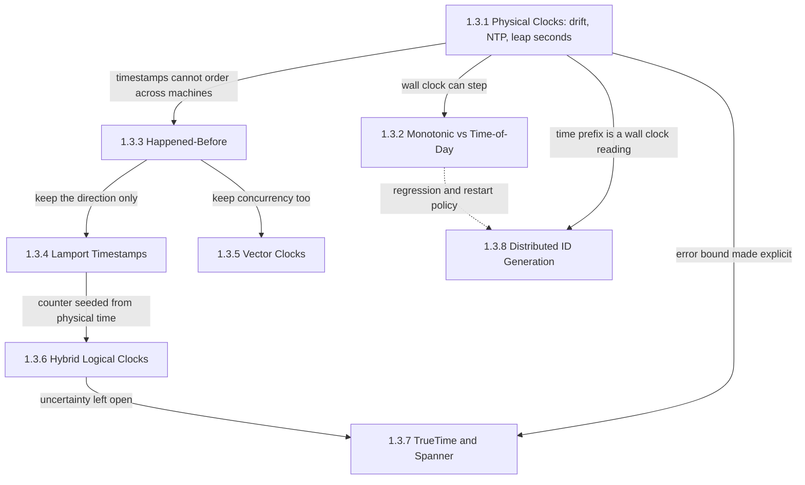
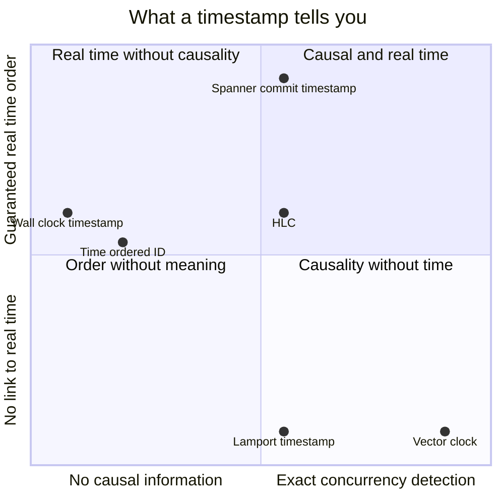
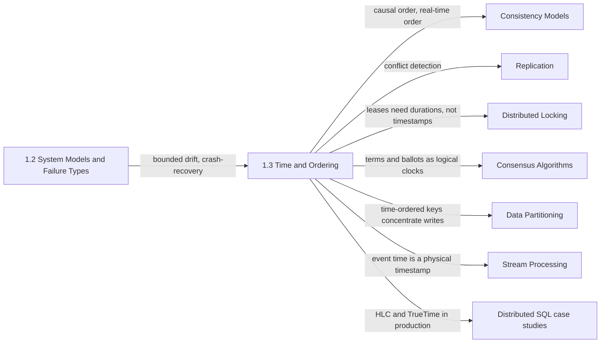

Dağıtık bir sistemin "şimdi"si yoktur. Her makine kendi osilatörünü okur; onu düzelten senkronizasyon protokolü, tek yönlü gecikmelerini ölçemediği bir ağ üzerinden offset'i yalnızca tahmin edebilir. Aynı veri merkezindeki iki makine arasında bir mesajın ulaşma süresi, iki makinenin saatleri arasındaki farktan bile kısa olabilir. Buna rağmen replike edilmiş bileşenlerin neredeyse hepsi bir sıralama sorusuna cevap vermek zorundadır: iki yazmadan hangisi daha yeni, bir lease'in süresi doldu mu, bir okuma bir değeri döndürebilir mi yoksa beklemeli mi, bir snapshot hangi olayları içermeli ve hangi ID önce sıralanır. Bu bölüm, eldeki tek saatler bilinmeyen bir miktarda yanlışken bu sorulara nasıl cevap verileceğini anlatır.

Bölümün ele aldığı tek problem, ortak bir saat olmadan makineler arasında olayların nasıl sıralanacağı ve ortaya çıkan sıranın neyi ifade edip neyi etmediğinin nasıl bilineceğidir. Bunun yalnızca üç cevabı vardır ve sekiz konu bu cevapların izini sürer. Bir sistem fiziksel zamana güvenip hata sınırını açıkça taşıyabilir; fiziksel zamanı yok sayıp olayları hangisinin hangisini etkilemiş olabileceğine göre sıralayabilir; ya da ikisini birleştirip nedensel sırayı korurken duvar saatine "beş saniye önce" ifadesinin hâlâ bir anlam taşıyacağı kadar yakın kalabilir.

Her konudan geçen gerilim anlam ile güvenlik arasındadır ve bedel üç para biriminden biriyle ödenir. Fiziksel bir zaman damgası sistemin dışında da anlam taşır; insanlar, deadline'lar ve TTL'ler için kullanılabilir. Ama farklı makinelerden gelen iki damga yanlış sıralanabilir, dolayısıyla bedeli hata penceresi içindeki bir doğruluk riskidir. Mantıksal bir saat hiçbir nedensel çifti tersine çevirmez, ancak gerçek zaman hakkında hiçbir şey söylemez; eşzamanlılığı sıradan ayırt etmek ise bağımsız aktör sayısıyla büyüyen bir metadata gerektirir. Fiziksel bir zaman damgasını gerçek zaman sırası için güvenli kılmanın bedeli beklemedir: Spanner her commit'i, zaman damgası her yerde kesin olarak geçmişte kalana kadar bekletir. Bölümdeki her mekanizma risk, metadata ve gecikmeden hangisini ödeyeceğini seçer; her sayfadaki hata modları da hiçbirini ödemediğine inanan sistemlerden gelir.

## Osilatörlerden Tanımlayıcılara: Konular Birbirinin Üzerine Nasıl Kurulur

Bölüm bir argüman gibi sıralanmıştır. Bir saat okumasının nasıl üretildiğiyle başlar, bir process'in okuyabileceği iki saati birbirinden ayırır, ardından fiziksel zamanı bir kenara bırakıp bir sistemin gerçekten gözlemleyebileceği sırayı tanımlar. Bu sıranın biri minimal, diğeri tam iki kodlaması gelir; son üç konu ise fiziksel zamanı, her biri hata sınırıyla farklı bir sözleşme altında, yeniden devreye sokar.

*Bölümdeki konular arasındaki bağımlılıklar. Düz oklar her sayfanın bir sonrakine hangi sonucu devrettiğini gösterir; kesikli ok, ID üreticilerinin saat okuma sayfasından devraldığı bir politika sorusunu işaret eder.*

Fiziksel saatler köktür, çünkü diğer her sayfa onun sonucuna tepki verir: bir makineden alınan zaman damgası ile başka bir makineden alınan arasındaki fark genellikle küçük, bazen büyük ve kullanım anında asla tam olarak bilinmeyen bir miktardır. İki sayfa bu sonucu zıt yönlere taşır: monotonic saat sayfası, tek bir makinede bile duvar saatinin süre ölçmek için yanlış araç olduğunu, çünkü adım atlayarak (step) düzeltilebildiğini gösterir; happened-before sayfası ise fiziksel zamanı bırakır ve sırayı olası etki üzerinden tanımlar.

Lamport zaman damgaları ve vektör saatler bu ilişkiyi kodlamanın iki ucudur. Bir Lamport sayacı her nedensel çiftin yönünü sekiz byte'ta korur ama eşzamanlı olayları da keyfi biçimde sıralar; bir vektör saat ise aktör başına bir girdi karşılığında eşzamanlılığı sıradan tam olarak ayırt eder. Hibrit mantıksal saatler Lamport kurallarını alır ve sayacı fiziksel saatten başlatır; bu, nedenselliği korurken duvar saatine sınırlı bir yakınlık ekler, fakat hiç mesajlaşmamış iki istemcinin durumunu açık bırakır. TrueTime bu durumu, hata sınırını ölçüp onu bekleyerek kapatır. Dağıtık ID üretimi fiziksel saat sayfasına iki kez dayanır: zaman öneki bütün hatasıyla birlikte bir duvar saati okumasıdır ve saat geriye gittiğindeki davranışı, monotonic saat sayfasının süreler için tartıştığı politika seçiminin aynısıdır.

## Her Konunun Yanıtladığı Soru

[Fiziksel Saatler: Quartz Kayması, NTP Sınırları, Artık Saniye Problemi](/distributed-systems/tr/foundations/time-and-ordering/physical-clocks/), bir sunucunun saatinin şu anda ne kadar yanlış olduğunu, bu hatanın nereden geldiğini ve onun için nasıl bütçe ayrılacağını yanıtlar. İki makineden gelen zaman damgalarını karşılaştıran herhangi bir mantığı yazmadan önce ve zaman senkronizasyonu daemon'ını yapılandırırken ya da izlerken bu sayfayı açın.

[Monotonic Saatler ve Günlük Saat: Hangisini Kullanmalı](/distributed-systems/tr/foundations/time-and-ordering/monotonic-vs-time-of-day/), bir process'in hangi amaçla hangi saati okuması gerektiğini ve makineler arasında lease'lerin ve timeout'ların zaman damgası yerine süreler kullanılarak nasıl ölçüleceğini yanıtlar. Deadline, backoff ya da lease süresi dolma kodunu incelerken bu sayfayı açın.

[Happened-Before İlişkisi: Nedenselliğin Temeli](/distributed-systems/tr/foundations/time-and-ordering/happened-before/), dağıtık bir sistemin gerçekte hangi sırayı gözlemleyebildiğini ve bunun neden nedenselliğin doğru tanımı olduğunu yanıtlar. Bölümdeki sonraki her sayfa bu ilişkinin bir kodlaması ya da tüketicisidir; bu yüzden bir tasarım, ortak bir sıralayıcıyı (sequencer) paylaşmayan process'ler arasındaki sıraya dayandığında bu sayfayı açın.

[Lamport Zaman Damgaları: Nedenselliği Yakalamak](/distributed-systems/tr/foundations/time-and-ordering/lamport-timestamps/), process başına tek bir sayacın, her katılımcının aynı biçimde hesapladığı ve sebep-sonuç ilişkisiyle hiçbir zaman çelişmeyen bir sırayı nasıl ürettiğini yanıtlar. Aynı fikir Raft term'lerinin ve Paxos ballot numaralarının altında da çalışır. Bir algoritma koordinatör olmadan deterministik bir toplam sıraya ihtiyaç duyduğunda ve bu sıranın iki olayın eşzamanlı olup olmadığı hakkında neden hiçbir şey söylemediğini öğrenmek için bu sayfayı açın.

[Vektör Saatler: Eşzamanlılığı Tespit Etmek](/distributed-systems/tr/foundations/time-and-ordering/vector-clocks/), replike bir veri deposunun "bu yazma öncekinin yerini aldı" ile "bu iki yazar birbirini hiç görmedi" durumlarını nasıl ayırt edebileceğini ve bu kesinliğin bedelini yanıtlar. Çok liderli ya da lidersiz bir çakışma yönetimi tasarlarken bu sayfayı açın.

[Hibrit Mantıksal Saatler (HLC): Fiziksel ve Mantıksal Zamanı Birleştirmek](/distributed-systems/tr/foundations/time-and-ordering/hybrid-logical-clocks/), tek bir 64 bitlik zaman damgasının nasıl hem nedenselliğe saygı gösterip hem de duvar saatinin clock offset sınırı içinde kalabildiğini yanıtlar; çok sürümlü (multiversion) veritabanlarının snapshot okumaları için ihtiyaç duyduğu şey tam olarak budur. CockroachDB ya da YugabyteDB işletirken, MongoDB cluster time üzerine düşünürken veya sıradan saatler üzerinde bir MVCC tasarımı için zaman damgası seçerken bu sayfayı açın.

[Google TrueTime & Spanner: Belirsizlikle Çalışmak](/distributed-systems/tr/foundations/time-and-ordering/truetime-spanner/), hiç iletişim kurmayan istemciler arasındaki gerçek zaman sırasının saatlerle nasıl garanti edilebileceğini ve bu garantinin commit başına neye mal olduğunu yanıtlar. Bir gereksinim bölgeler arasında "bir yazma bittikten sonra başlayan okuma onu görmelidir" dediğinde ya da bir sağlayıcının saat sınırı (clock-bound) servisini değerlendirirken bu sayfayı açın.

[Dağıtık ID Üretimi: UUIDv7, Snowflake, ULID](/distributed-systems/tr/foundations/time-and-ordering/distributed-id-generation/), her tanımlayıcı şemasında benzersizliğin nereden geldiğini, bir zaman önekinin B-tree index'lerine ve aralık bazlı partition'lanmış depolara ne yaptığını ve üreticilerin saat geriye gitmesi ile yeniden kullanılan node ID'leri yüzünden nasıl bozulduğunu yanıtlar. Bir primary key formatı seçerken ve biri ID'ye göre sıralamayı nedene göre sıralamanın yerine koymayı önerdiğinde bu sayfayı açın.

| Konu | Yanıtladığı soru | Ne zaman açılmalı |
|---|---|---|
| [Fiziksel Saatler](/distributed-systems/tr/foundations/time-and-ordering/physical-clocks/) | Saat hatası şu anda ne kadar büyük ve nereden geliyor? | Makineler arasında zaman damgası karşılaştırırken, NTP veya PTP yapılandırırken, artık saniyelere hazırlanırken |
| [Monotonic ve Günlük Saat](/distributed-systems/tr/foundations/time-and-ordering/monotonic-vs-time-of-day/) | Hangi saat bir süreyi ölçer, hangisi bir olayı etiketler? | Timeout, backoff, rate limit, lease kontrolü ve gecikme metriklerini incelerken |
| [Happened-Before](/distributed-systems/tr/foundations/time-and-ordering/happened-before/) | Sistem hangi sırayı gözlemleyebilir, hangi olaylar eşzamanlıdır? | Snapshot, çakışma politikası, servisler arası read-your-writes ve olay zaman çizelgesi tasarlarken |
| [Lamport Zaman Damgaları](/distributed-systems/tr/foundations/time-and-ordering/lamport-timestamps/) | Her replika koordinatör olmadan aynı sırayı nasıl türetebilir? | Her replikaya ulaşan işlemleri sıralarken, term veya ballot mantığını okurken |
| [Vektör Saatler](/distributed-systems/tr/foundations/time-and-ordering/vector-clocks/) | Bu iki yazma sıralı mıydı, eşzamanlı mı? | Çok liderli veya lidersiz çakışma tespiti kurarken, sibling'leri debug ederken |
| [Hibrit Mantıksal Saatler](/distributed-systems/tr/foundations/time-and-ordering/hybrid-logical-clocks/) | Bir zaman damgası aynı anda hem nedensel hem duvar saatine yakın nasıl olabilir? | MVCC zaman damgası seçerken, bir HLC veritabanı işletirken, ileri kaçmış bir saati araştırırken |
| [TrueTime ve Spanner](/distributed-systems/tr/foundations/time-and-ordering/truetime-spanner/) | Hiç iletişim kurmayan istemciler arasında gerçek zaman sırası nasıl korunur? | Bölgeler arası external consistency gerektiğinde, commit gecikmesini saat sınırına göre değerlendirirken |
| [Dağıtık ID Üretimi](/distributed-systems/tr/foundations/time-and-ordering/distributed-id-generation/) | Benzersizlik nereden gelir, zaman sırası index'e neye mal olur? | Anahtar formatı seçerken, node ID atarken, insert hot spot'larını teşhis ederken |

Bölümün mekanizmaları, girişte adı geçen iki özelliğe göre de birbirine karşı konumlandırılabilir: bir zaman damgasının nedensellik hakkında ne kadar şey söylediği ve gerçek zaman hakkında ne kadar şey söylediği. Grafik nitel bir haritadır; kesin karşılaştırma hibrit mantıksal saatler sayfasındaki tablodadır.

*Bölümdeki mekanizmaların nitel konumları. Yatay eksen: hiç nedensel bilgi olmamasından, nedensel çiftlerin yönünü korumaya, oradan eşzamanlılığı tespit etmeye. Dikey eksen: gerçek zamanla hiçbir ilişki olmamasından, yaklaşık yakınlığa, oradan garanti edilmiş gerçek zaman sırasına.*

Öğretici olan, boş kalan köşedir. Bölümdeki hiçbir mekanizma sağ üstün en ucuna ulaşmaz; çünkü tam eşzamanlılık tespiti ile garanti edilmiş gerçek zaman sırası farklı para birimleriyle ödenir: biri aktör başına metadata, diğeri ölçülmüş bir sınır üzerinde beklemedir ve hiçbir production sistemi ikisini aynı zaman damgası üzerinde birden ödemez. Lamport zaman damgaları, HLC ve Spanner aynı nedensel konumda durur; yönü korurlar ama eşzamanlılığı tespit etmezler. Onları dikeyde ayıran şey, fiziksel zamanın yok sayılması, bir sınır içinde olduğunun varsayılması ya da beklenerek aşılmasıdır.

## Okuma Sırası ve Gerekçesi

İlk okumada bölümü kenar çubuğundaki sırayla okuyun. Fiziksel saat sayfası, sonraki her sayfanın ya tolere ettiği ya da ortadan kaldırdığı hatayı ortaya koyar; happened-before sayfası ise mantıksal saat sayfalarının yeniden türetmeden kullandığı kavramları (eşzamanlı, nedensel geçmiş, tutarlı kesit) tanımlar. Lamport zaman damgaları hem vektör saatlerden hem HLC'den önce gelmelidir: vektör saatler tek sayacı process başına bir girdiye genelleştirir, HLC ise onun güncelleme kurallarını yeniden kullanır. TrueTime en iyi, onu motive eden açık bayat okuma (stale read) durumunu bırakan HLC'den sonra okunur; ID üretimi ise en sona, zaman önekinin receive kuralı olmayan bir duvar saati okuması olduğu anlaşıldıktan sonraya kalır.

Üç kısayol makuldür. Tek bir serviste timeout, lease ya da gecikme ölçümü hatalarını düzelten bir mühendis ilk iki sayfayı okuyup durabilir. Replike veri için çakışma yönetimi tasarlayan bir mühendis happened-before, Lamport zaman damgaları ve vektör saatleri okumalı, ardından tutarlılık modelleri bölümüne geçmelidir. Dağıtık bir SQL veritabanı seçen ya da işleten bir mühendis fiziksel saatleri, HLC'yi ve TrueTime'ı birlikte okumalıdır; çünkü bu üç sayfa aynı sorunun cevaplarından oluşan tek bir yelpazeyi anlatır: clock offset sınırı hakkında ne yapılacağı.

## Bölümün El Kitabındaki Yeri

Bölüm, [Sistem Modelleri ve Hata Türleri](/distributed-systems/tr/foundations/system-models/) bölümünü ve özellikle onun iki sonucunu varsayar. [Ağ Modelleri](/distributed-systems/tr/foundations/system-models/network-models/), sınırlı saat kaymasını bir zamanlama varsayımı olarak ele alır; bu bölüm o varsayımı kaynağı ve hata modu olan bir sayıya dönüştürür. [Hata Modelleri](/distributed-systems/tr/foundations/system-models/failure-models/) ise yeniden başlatılan bir process'in daha önce verdiği bir sayacı, node ID'sini ya da zaman damgasını tekrar kullanabildiği model olan crash-recovery'yi tanımlar; bu bölümdeki hata modlarının birçoğu, o hafıza kaybının bir saate uygulanmış halidir.

*Bölümün mekanizmalarının ileride nerede kullanıldığı. Her ok, hedef bölümün bu bölümden neyi devraldığını adlandırır.*

Diyagram, bu bölümün sıraları sağladığını, sonraki bölümlerin ise hangi sırayı vaat edeceğini seçtiğini gösterir. [Linearizability](/distributed-systems/tr/data-management/consistency-models/linearizability/), TrueTime'ın karşılanabilir kıldığı gerçek zaman sırasıdır; [nedensel tutarlılık ve oturum garantileri](/distributed-systems/tr/data-management/consistency-models/causal-consistency-session-guarantees/), istemcilere sunulan happened-before ilişkisidir; [CRDT'ler](/distributed-systems/tr/data-management/consistency-models/crdts/) ve [zayıf izolasyon ile MVCC](/distributed-systems/tr/data-management/consistency-models/weak-isolation-mvcc/) ise Lamport tarzı işlem ID'lerini ve HLC snapshot zaman damgalarını tüketir. Vektör saatlerin tespit ettiği eşzamanlı yazmalar [lidersiz](/distributed-systems/tr/data-management/replication/leaderless-replication/) ve [çok liderli replikasyonda](/distributed-systems/tr/data-management/replication/multi-leader-replication/) çözülür; Dynamo soyunun hikâyesi [Dynamo Makalesinde Vektör Saatler](/distributed-systems/tr/case-studies/dynamodb-cassandra/vector-clocks-conflict-resolution/) sayfasında anlatılır.

Saat okuma kuralları, duraklatılmış ya da saati kaymış bir sahibin [fencing token'ları](/distributed-systems/tr/coordination/distributed-locking/fencing-tokens/) zorunlu kıldığı [Kiralama Tabanlı Kilitleme](/distributed-systems/tr/coordination/distributed-locking/lease-based-locking/) sayfasında geri döner; mantıksal saat fikri de [Raft](/distributed-systems/tr/coordination/consensus-algorithms/raft/) içinde term numarası olarak yeniden karşımıza çıkar. Zaman sıralı ID'lerin index maliyeti, [Anahtar Aralığı Bölümleme](/distributed-systems/tr/data-management/data-partitioning/key-range-partitioning/) ve [Çarpıklık ve Hot-Spot Problemleri](/distributed-systems/tr/data-management/data-partitioning/skew-hot-spots/) sayfalarında bir partition'lama problemine dönüşür. [Olay Zamanı ve İşleme Zamanı](/distributed-systems/tr/data-processing/stream-processing/event-time-vs-processing-time/), fiziksel saat hatasını stream pencerelerine uygular. Son olarak, bölümdeki yelpazenin tepesindeki iki production tasarımı [CockroachDB: Raft, HLC ve Parallel Commits](/distributed-systems/tr/case-studies/distributed-sql/cockroachdb-raft-hlc/) ile [Spanner: TrueTime, Paxos Grupları ve External Consistency](/distributed-systems/tr/case-studies/distributed-sql/spanner-architecture/) sayfalarında uçtan uca incelenir; [dağıtık izleme](/distributed-systems/tr/observability/logs-metrics-traces/distributed-tracing/) ise saat kaymasının her gün, ebeveyninden önce başlayan bir alt span olarak görüldüğü yerdir.
