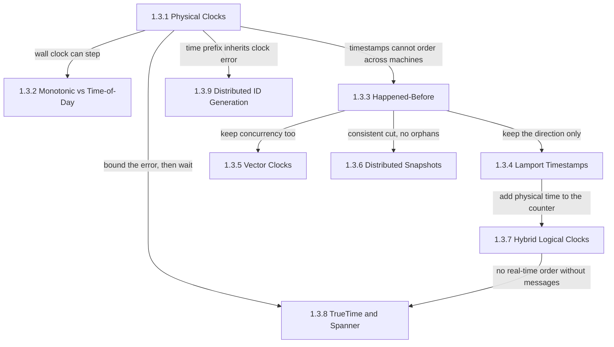
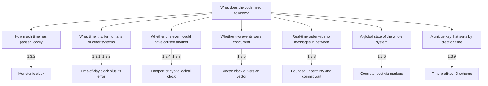
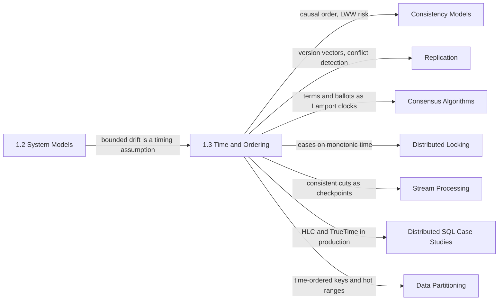

Aynı veri merkezindeki, ikisi de Network Time Protocol (NTP) ile senkronize edilen iki sunucu, şu anki zaman konusunda çoğu zaman bir paketin aralarında gidip gelmesinden daha uzun bir farkla anlaşamaz. Bu yüzden bir yanıt, ona yol açan istekten daha erken bir zaman damgası taşıyabilir ve hiçbir yer hata bildirmez. Yine de her replike bileşen sıralama sorularına karar vermek zorundadır: iki yazmadan hangisi daha yeni, bir lease'in süresi doldu mu, bir okuma şimdi mi dönebilir yoksa beklemeli mi, bir kurtarma noktasına hangi olaylar girer, hangi tanımlayıcı önce sıralanır. Bu bölüm, eldeki her saatin kullanım anında kimsenin ölçmediği bir miktar kadar yanlış olduğu koşullarda bu sorulara cevap verir.

Bölümün ele aldığı tek problem, paylaşılan bir saat olmadan makineler arasında olayların nasıl sıralanacağı ve ortaya çıkan sıralamanın tam olarak neyi vaat edip neyi etmediğinin nasıl bilineceğidir. Dokuz konu üç cevap ve iki uygulama sunar. Bir sistem fiziksel zamana güvenip hatasını açıkça taşıyabilir; fiziksel zamandan vazgeçip olayları hangisinin hangisini etkilemiş olabileceğine göre sıralayabilir; ya da ikisini birleştirerek nedensel sırayı korurken duvar saatine "beş saniye önce" ifadesinin hâlâ bir anlam taşıyacağı kadar yakın kalabilir. Uygulamalar ise çalışan bir sistemin tutarlı bir global durumunu kaydetmek ve sırası oluşturulma zamanına yaklaşan tanımlayıcılar üretmektir.

Her sayfadan geçen gerilim şudur: sıralamanın her zaman bir bedeli vardır; seçilebilen tek şey hangi para birimiyle ödeneceğidir. Fiziksel bir zaman damgası sistemin dışında da anlam taşır; insanlar, deadline'lar ve süre dolumları için kullanılabilir. Ama farklı makinelerden gelen iki damga yanlış sıralanabilir, dolayısıyla bedeli hata penceresi içindeki bir doğruluk riskidir. Mantıksal bir saat bir nedeni ve onun sonucunu asla ters çevirmez, ancak gerçek zaman hakkında hiçbir şey söylemez; eşzamanlı olayları sıralı olanlardan ayırt etmek de bağımsız aktör sayısıyla büyüyen bir metadata gerektirir. Fiziksel bir zaman damgasını gerçek zaman sırası için güvenli hale getirmenin bedeli ise gecikmedir: sistem belirsizlik geçene kadar beklemek zorundadır. Bölümdeki her mekanizma risk, metadata ya da bekleme arasından birini seçer; her sayfadaki hata modları da hiçbirini ödemediğine inanan sistemlerden doğar.

## Osilatörlerden Tanımlayıcılara: Argümanın Yapısı

Bölüm bir katalog olarak değil, tek bir argüman olarak sıralanmıştır. Bir saat okumasının nasıl üretildiği ve ne kadar yanlış olabileceğiyle başlar, aralıkları ölçen saati anları adlandıran saatten ayırır, ardından fiziksel zamanı tamamen bir kenara bırakıp bir sistemin gerçekten gözlemleyebileceği sırayı tanımlar. Bu sıranın iki kodlaması, onu iş başında gösteren bir snapshot algoritması gelir; son üç konu ise fiziksel zamanı, her biri hatasıyla farklı bir sözleşme altında, yeniden devreye sokar.

*Bölümdeki konular arasındaki bağımlılıklar. Her ok, bir sayfanın bir sonrakine devrettiği sonucu ya da sınırlamayı adlandırır.*

Fiziksel saatler köktedir, çünkü sonraki her sayfa onların hatasına verilmiş bir tepkidir. Tepkilerden biri tek bir makineye özgüdür: duvar saati ileri ya da geri atlatılabildiği için (step) aralıklar, atlatılamayan bir saatle ölçülmelidir. Diğerleri makineleri karşılaştırmakla ilgilidir. Happened-before, makineler arası zaman damgalarına güvenilmediğinde geriye kalan sıradır ve ondan çıkan üç ok üç kullanımı gösterir: yalnızca yönünü tek bir tamsayıda tutmak, onu bir vektörde birebir tutmak ya da geçmişi onun boyunca keserek var olmuş olabilecek bir durumu kaydetmek.

Diyagramın sağ tarafı, hatası açık hale getirilmiş fiziksel zamana geri döner. Hibrit mantıksal saat bir Lamport sayacını fiziksel saate bağlar; beklemeden gerçek zamana yakın kalır, ama hiç mesaj alışverişi yapmamış olayları sıralayamaz. TrueTime aynı başlangıç noktasından ters yöne gider: saat hatasını bir aralık olarak ölçer ve bu aralığı bekleyerek geçirir; karşılığında birbiriyle ilişkisiz transaction'lar arasında gerçek zaman sırası elde eder. Zaman önekli tanımlayıcılar saat hatasını doğrudan devralır, bu yüzden sıraları yalnızca yaklaşıktır.

## Her Konunun Yanıtladığı Soru

[Fiziksel Saatler: Quartz Kayması, NTP Sınırları, Artık Saniye Problemi](/distributed-systems/tr/foundations/time-and-ordering/physical-clocks/), saat hatasının ne kadar büyük olduğunu, nereden geldiğini ve bir senkronizasyon protokolünün asimetrik ağ yollarından kaynaklanan kısmını neden ölçemediğini yanıtlar. Düzeltmelerin kendisini, yani step, slew ve artık saniye smear'ini de bir kesinti kaynağı olarak ele alır. Saat sapması için sınır belirleyen herhangi bir parametreyi ayarlamadan önce bu sayfayı açın.

[Monotonic Saatler ve Günlük Saat: Hangisini Kullanmalı](/distributed-systems/tr/foundations/time-and-ordering/monotonic-vs-time-of-day/), bir process'in okuyabildiği iki saatten hangisinin bir timeout'a, lease kontrolüne, gecikme metriğine ya da veritabanı sütununa ait olduğunu ve bir makinede hesaplanan deadline başka bir makinede yorumlandığında neyin bozulduğunu yanıtlar. Zamanlayıcı hatalarının çoğu, bir aralık kastedilen yerde kullanılmış bir duvar saati okumasıdır.

[Happened-Before İlişkisi: Nedenselliğin Temeli](/distributed-systems/tr/foundations/time-and-ordering/happened-before/), dağıtık bir sistemin gerçekte hangi sırayı gözlemleyebileceğini ve "hangisi önce oldu" sorusunun yerini neden "ilk olay ikinciyi etkilemiş olabilir mi" sorusunun aldığını yanıtlar. Sonraki her sayfa onun nedensel sıra, eşzamanlılık ve tutarlı kesit kavramlarını kullanır.

[Lamport Zaman Damgaları: Nedenselliği Yakalamak](/distributed-systems/tr/foundations/time-and-ordering/lamport-timestamps/), process başına tek bir tamsayının nedenselliğe asla aykırı düşmeyen ve her process'in aynı biçimde hesapladığı bir sırayı nasıl üretebildiğini yanıtlar. Bu sıranın eşzamanlı olaylar için neden keyfi olduğunu ve Raft term'lerinin ile Paxos ballot'larının aynı fikri nasıl kullandığını açıklar.

[Vektör Saatler: Eşzamanlılığı Tespit Etmek](/distributed-systems/tr/foundations/time-and-ordering/vector-clocks/), replike bir deponun "bu yazma öncekinin yerini aldı" durumunu "bu yazarlar birbirini hiç görmedi" durumundan nasıl ayırt edebileceğini yanıtlar; bu ayrım, bir sürümü güvenle atmakla bir yazmayı sessizce kaybetmek arasındaki farktır. Sayfanın büyük kısmı bunun bedeliyle ilgilidir: kimin aktör sayılacağı ve vektör büyüdüğünde ne olacağı.

[Dağıtık Anlık Görüntüler: Chandy-Lamport ve Tutarlı Kesitler](/distributed-systems/tr/foundations/time-and-ordering/distributed-snapshots/), sistemi durdurmadan her process'in ve yoldaki her mesajın durumunun, sonucun hiçbir zaman nedeni olmayan bir sonuç içermeyeceği şekilde nasıl kaydedileceğini yanıtlar. Akış işleyicilerdeki checkpoint'lerin arkasındaki teori budur; kaydedilen durumun neden tek bir anda gözlemlenmiş değil, mümkün olmuş bir durum olduğunu da açıklar.

[Hibrit Mantıksal Saatler (HLC): Fiziksel ve Mantıksal Zamanı Birleştirmek](/distributed-systems/tr/foundations/time-and-ordering/hybrid-logical-clocks/), bir zaman damgasının hem nedensel olarak tutarlı olup hem de gerçek bir ana karşılık gelmesinin nasıl mümkün olduğunu yanıtlar; çok sürümlü (multiversion) veritabanları snapshot okumaları ve zamana bağlı süre dolumları için buna ihtiyaç duyar. Saati çok ileride olan tek bir node'un diğer tüm node'ların zaman damgalarını nasıl peşinden sürüklediğini gösteren sayfa da budur.

[Google TrueTime & Spanner: Belirsizlikle Çalışmak](/distributed-systems/tr/foundations/time-and-ordering/truetime-spanner/), hiç mesaj paylaşmayan transaction'ları, her transaction kendisi başlamadan önce commit edilmiş her şeyi görecek şekilde sıralamanın neye mal olduğunu yanıtlar. Saat belirsizliğinin bir doğruluk riski olmaktan çıkıp bir gecikme maliyetine dönüşmesini ve bunun altyapı ile kilit tutma süresi açısından bedelini gösterir.

[Dağıtık ID Üretimi: UUIDv7, Snowflake, ULID](/distributed-systems/tr/foundations/time-and-ordering/distributed-id-generation/), her şemada benzersizliğin nereden geldiğini, bir zaman önekinin index yerelliğini ve yazma hot spot'larını nasıl değiştirdiğini ve saat geri gittiğinde üreticilerin nasıl davrandığını yanıtlar.

| Konu | Yanıtladığı soru | Ne zaman açılmalı |
|---|---|---|
| [Fiziksel Saatler](/distributed-systems/tr/foundations/time-and-ordering/physical-clocks/) | Bir sunucu saati ne kadar yanlıştır ve senkronizasyon hatanın tamamını neden ölçemez? | Azami saat sapmasını belirlerken, NTP ile PTP arasında seçim yaparken, artık saniyelere hazırlanırken |
| [Monotonic ve Günlük Saat](/distributed-systems/tr/foundations/time-and-ordering/monotonic-vs-time-of-day/) | Bir timeout'a, lease'e, metriğe ya da saklanan bir zaman damgasına hangi saat aittir? | Zamanlayıcı kodu yazarken, lease kontrollerini incelerken, negatife düşen bir gecikme metriğinin peşindeyken |
| [Happened-Before](/distributed-systems/tr/foundations/time-and-ordering/happened-before/) | Bir sistem hangi sırayı gözlemleyebilir ve "eşzamanlı" tam olarak ne demektir? | Nedensel tutarlılık, çakışmalar ya da "önce" üzerine kurulu herhangi bir argüman hakkında akıl yürütürken |
| [Lamport Zaman Damgaları](/distributed-systems/tr/foundations/time-and-ordering/lamport-timestamps/) | Process'ler zaman üzerinde anlaşmadan tek bir sıra üzerinde nasıl anlaşabilir? | Replike bir log, epoch'lar, term'ler ya da toplam sıra için bir eşitlik bozucu (tie-break) tasarlarken |
| [Vektör Saatler](/distributed-systems/tr/foundations/time-and-ordering/vector-clocks/) | Bir depo iki yazmanın eşzamanlı olduğunu tahmin etmeden nasıl tespit edebilir? | Çok liderli ya da lidersiz replikasyon için çakışma tespitini seçerken |
| [Dağıtık Anlık Görüntüler](/distributed-systems/tr/foundations/time-and-ordering/distributed-snapshots/) | Çalışan bir sistem gerçekten var olmuş olabilecek bir global durumu nasıl kaydeder? | Akış checkpoint'lerini yapılandırırken, kurtarma noktaları kurarken, kalıcı (stable) özellikleri tespit ederken |
| [Hibrit Mantıksal Saatler](/distributed-systems/tr/foundations/time-and-ordering/hybrid-logical-clocks/) | Tek bir zaman damgası hem nedensel hem de duvar saatine yakın nasıl olabilir? | Nedensel sıralı bir depoda MVCC okumaları, belirli bir zamana göre okumalar ya da TTL'ler kurarken |
| [TrueTime ve Spanner](/distributed-systems/tr/foundations/time-and-ordering/truetime-spanner/) | İlişkisiz transaction'lar arasında gerçek zaman sırasının bedeli nedir? | External consistency'yi, commit gecikmesini ya da bir veritabanının saat varsayımlarını değerlendirirken |
| [Dağıtık ID Üretimi](/distributed-systems/tr/foundations/time-and-ordering/distributed-id-generation/) | Üreticiler koordinasyon olmadan nasıl benzersiz kalır ve zaman önekinin bedeli nedir? | Birincil anahtar biçimi seçerken, yinelenen ID'leri ya da sıcak bir anahtar aralığını debug ederken |

## Soruyu Doğru Saatle Eşleştirmek

Bu alandaki production hatalarının çoğu yanlış algoritmalardan değil, doğru algoritmanın başka bir soruyu yanıtlamasından kaynaklanır. Duvar saatiyle yapılan bir lease kontrolü, bir aralığı atlayabilen bir saatle ölçer; duvar saati zaman damgalarını karşılaştıran bir last-write-wins deposu, nedensel sıraya ihtiyaç duyduğu yerde fiziksel sırayı kullanır; tek bir sayaç üzerine kurulu bir çakışma dedektörü, sayacın hiçbir zaman sahip olmadığı eşzamanlılık bilgisini ister. Diyagram bölümü tersten, sorudan cevabın sahibi olan sayfaya doğru okur.

*Bir kod parçasının sorduğu sorudan, onu yanıtlayan mekanizmaya ve bölümdeki sayfaya. Her mekanizma yalnızca kendi sorusu için doğrudur.*

Dallar birbirinin yerine geçmez ve her birinin kendi bedeli vardır. Monotonic saat bedavadır ama yereldir. Günlük saat okuması bedavadır ama bütçelenmesi gereken bir hata taşır. Lamport ya da hibrit saat mesaj başına birkaç bayta mal olur ve her nedensel yolun onu taşıması gerekir; bir vektör aktör başına bir girdiye mal olur; gerçek zaman sırası her commit'te beklemeye mal olur. Tutarlı bir kesit kontrol mesajlarına ve akış işleyicilerde ya bloklanan girdilere ya da kaydedilen yoldaki verilere mal olur. Nedensel dalda duran ve sonradan gerçek zaman sırası istenen bir tasarım bir ayar değişikliğine değil, farklı bir mekanizmaya ihtiyaç duyar.

## Okuma Sırası ve Gerekçesi

İlk okumada bölümü sidebar sırasıyla okuyun. Her sayfa, önceki sayfaların sonuçlarını yeniden türetmek yerine onlara bağlantı verir: mantıksal saat sayfaları, zaman damgalarının makineler arasında olayları sıralayamayacağı iddiası için fiziksel saatler sayfasına, snapshot sayfası tutarlı kesitin tanımı için happened-before'a dayanır; TrueTime sayfası da kendini hibrit mantıksal saatlerle karşılaştırır.

Üç kısa yol makuldür. Zamanlayıcı, timeout ya da lease kodunu düzelten bir mühendisin yalnızca fiziksel saatlere ve monotonic ile günlük saat sayfasına ihtiyacı vardır. Replike bir depo için çakışma yönetimini seçen bir mühendis happened-before, Lamport zaman damgaları ve vektör saatleri bu sırayla okumalıdır; çünkü ikinci ve üçüncü sayfa birincinin iki kodlamasıdır ve tam olarak eşzamanlılığı tespit edip etmedikleri noktasında ayrışırlar. Dağıtık bir SQL veritabanını değerlendiren bir mühendis fiziksel saatleri, hibrit mantıksal saatleri ve TrueTime'ı birlikte okumalıdır, çünkü bu sayfalar bu veritabanlarının kullandığı iki saat tasarımını karşılaştırır. Snapshot ve ID üretimi sayfaları, happened-before ve fiziksel saatler tanıdık hale geldikten sonra tek başına okunabilir.

## Bölümün El Kitabındaki Yeri

Bölüm, [Sistem Modelleri ve Hata Türleri](/distributed-systems/tr/foundations/system-models/) bölümünün, özellikle de [Ağ Modelleri](/distributed-systems/tr/foundations/system-models/network-models/) sayfasının üzerine kurulur: saat kaymasına konan bir sınır bir zamanlama varsayımıdır ve güvenliği ona dayanan her algoritma, bu varsayımın çiğnenme riskini devralır. Bölüm [Temeller & Fiziğin Yasaları](/distributed-systems/tr/foundations/) bölümünü kapatır; ardından gelen veri ve koordinasyon bölümlerinin çoğu, buradaki mekanizmalardan birini kullanır.

*Bölümün mekanizmalarının daha sonra nerede kullanıldığı. Her ok, hedef bölümün bu bölümden aldığı şeyi adlandırır.*

Tutarlılık modelleri bölümü happened-before'u istemcinin göreceği garantilere dönüştürür: [Nedensel Tutarlılık ve Oturum Garantileri](/distributed-systems/tr/data-management/consistency-models/causal-consistency-session-guarantees/) nedensel sıranın bir sözleşme olarak sunulmuş halidir; [Linearizability](/distributed-systems/tr/data-management/consistency-models/linearizability/), TrueTime'ın sağlamak için bedel ödediği gerçek zaman sırasıdır; [Nihai Tutarlılık](/distributed-systems/tr/data-management/consistency-models/eventual-consistency/) ise last-write-wins'i ve saatler anlaşamadığında kaybettiği yazmaları ele alır. Replikasyon bölümü version vector'leri [Çok Liderli Replikasyon](/distributed-systems/tr/data-management/replication/multi-leader-replication/) ve [Lidersiz Replikasyon](/distributed-systems/tr/data-management/replication/leaderless-replication/) sayfalarında uygular; [CRDT'ler](/distributed-systems/tr/data-management/consistency-models/crdts/) de aynı nedensel metadata'nın üzerine kurulur.

Koordinasyon tarafında [Raft](/distributed-systems/tr/coordination/consensus-algorithms/raft/) ve [Paxos](/distributed-systems/tr/coordination/consensus-algorithms/paxos/), monoton artan term'leri ve ballot'ları burada bir Lamport saatinin oynadığı rolde kullanır. [Kiralama Tabanlı Kilitleme](/distributed-systems/tr/coordination/distributed-locking/lease-based-locking/) monotonic saat disiplinine, saatlerin ya da duraklamaların bu disiplini bozduğu durumlar için de [Fencing Token'lara](/distributed-systems/tr/coordination/distributed-locking/fencing-tokens/) dayanır. Tutarlı kesitler [Apache Flink](/distributed-systems/tr/data-processing/stream-processing/apache-flink/) sayfasında checkpoint olarak yeniden karşımıza çıkar. Production'daki iki saat tasarımı [Spanner: Paxos Grupları, Yerleşim ve Kilitsiz Salt Okunur İşlemler](/distributed-systems/tr/case-studies/distributed-sql/spanner-architecture/) ve [CockroachDB: Raft, HLC ve Parallel Commits](/distributed-systems/tr/case-studies/distributed-sql/cockroachdb-raft-hlc/) sayfalarında uçtan uca incelenir; zaman sıralı anahtarların aralık bazlı bölümlenmiş depolarda yarattığı yazma hot spot'ları ise [Çarpıklık ve Hot-Spot Problemleri](/distributed-systems/tr/data-management/data-partitioning/skew-hot-spots/) sayfasında ele alınır.
