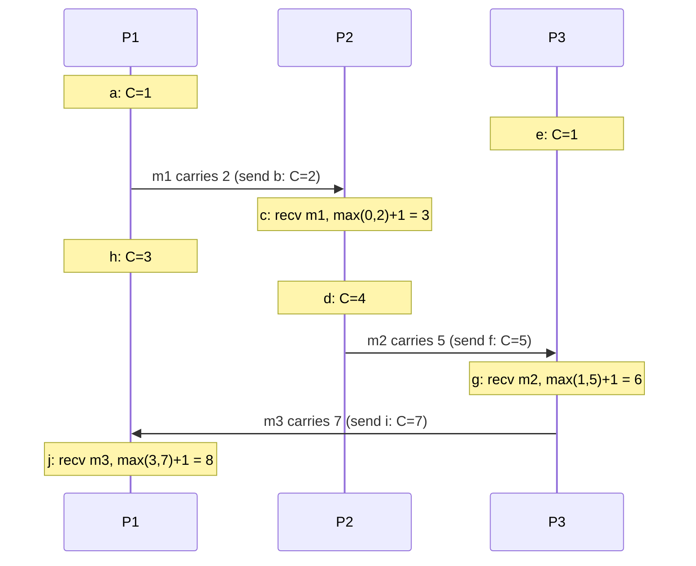
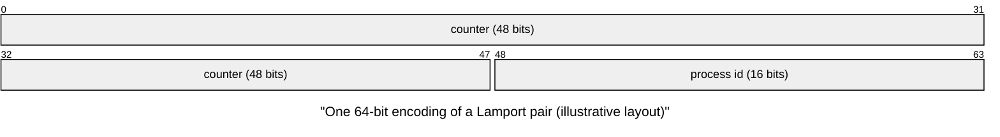
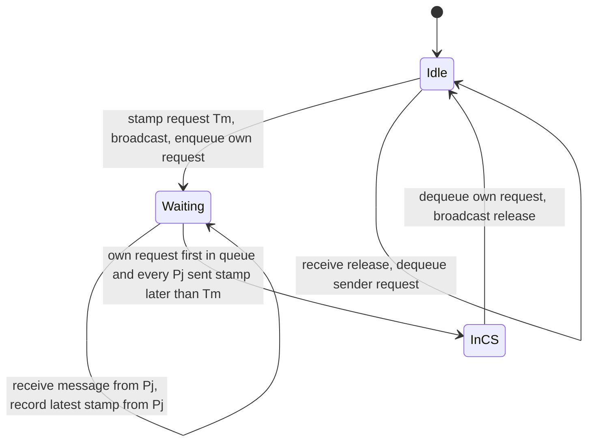
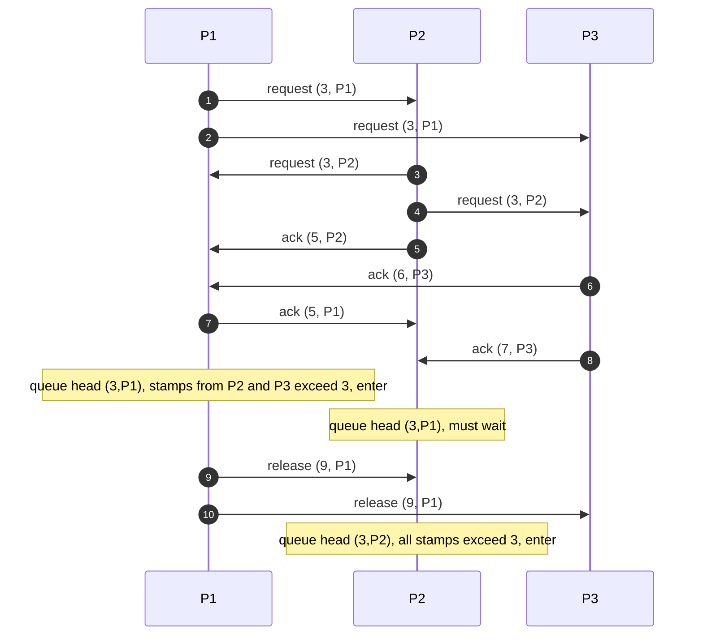
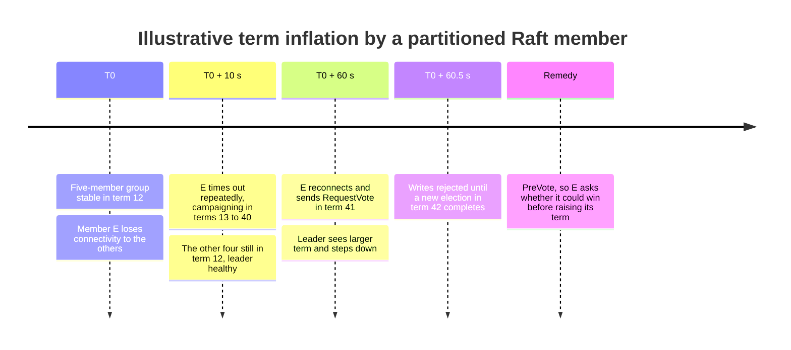

Lamport zaman damgası, her process'in tuttuğu bir tamsayı sayaçtır. Process bu sayacı yürüttüğü her olaydan önce artırır, gönderdiği her mesaja ekler ve her alımda mesajın taşıdığı değerin ötesine taşır. Sonuçta her `e` olayı için tam olarak tek bir garanti taşıyan bir `C(e)` sayısı elde edilir: `a`, `b`'den önce olduysa (happened before) `C(a) < C(b)`'dir. Sayacı bir process kimliğiyle eşleştirip çiftleri sözlük sırasıyla (lexicographic) karşılaştırmak, bunu tüm olaylar üzerinde her process'in aynı şekilde hesapladığı bir tam sıralamaya (total order) genişletir; bunun için ne bir koordinatör ne senkronize saatler gerekir ve mesaj başına metadata tek bir tamsayıdır.

Çözdüğü problem, zaman üzerinde uzlaşmadan sıralama üzerinde uzlaşmaktır. Aynı işlemleri farklı sıralarda uygulayan replikalar birbirinden ayrışır ve fiziksel zaman damgaları sıralamayı belirleyemez: [Fiziksel Saatler](/distributed-systems/tr/foundations/time-and-ordering/physical-clocks/) sayfasında gösterildiği gibi senkronize iki sunucu, bir mesajın veri merkezini geçmesi için gereken süreden daha fazla birbirinden sapar; dolayısıyla bir yanıt, ona neden olan istekten daha erken bir duvar saati değeri taşıyabilir. Lamport'un 1978'deki gözlemi, çoğu algoritmanın aslında hiçbir zaman gerçek zamana ihtiyaç duymadığıydı. İhtiyaç duydukları şey, her katılımcının aynı biçimde türettiği ve [happened-before ilişkisi](/distributed-systems/tr/foundations/time-and-ordering/happened-before/) ile tanımlanan neden-sonuç ilişkisiyle hiçbir zaman çelişmeyen bir sıralamadır. Bunun için process başına tek bir sayaç yeterlidir.

Asıl denge, sıralamanın tutarlı ama tam da en çok önem taşıdığı yerde keyfi olmasıdır. Lamport zaman damgaları eşzamanlı olayları da sıralar; bunu hangi process'in sayacı daha büyükse ona göre yapar ve iki zaman damgasındaki hiçbir şey olayların nedensel olarak ilişkili mi yoksa eşzamanlı mı olduğunu ele vermez. Bunu tespit etmek için metadata'sı process sayısıyla büyüyen [vektör saatler](/distributed-systems/tr/foundations/time-and-ordering/vector-clocks/) gerekir. Değerin duvar saatiyle hiçbir ilişkisi yoktur; ona yakın kalmak için [hibrit mantıksal saatler](/distributed-systems/tr/foundations/time-and-ordering/hybrid-logical-clocks/) gerekir. Ve bir zaman damgası henüz alınmamış olaylar hakkında hiçbir şey söylemez: sıralamanın bir önekinin kesinleştiğini bilmek her katılımcıdan haber almayı gerektirir; bu da sıralama üzerine kurulan her algoritmayı en yavaş ya da ölü üyesinin rehinesi yapar. Lamport saatlerinin bittiği ve consensus'un başladığı yer bu son maliyettir.

## Sayaç, İki Kuralı ve Saat Koşulu

Lamport mekanizmayı iki uygulama kuralıyla ifade etti. IR1: her process, art arda gelen herhangi iki olay arasında sayacını artırır. IR2: bir gönderme olayı göndericinin sayaç değeri `Tm`'yi taşır ve mesajı alan process sayacını hem mevcut değerinden hem de `Tm`'den büyük bir değere ayarlar. Yaygın somut biçim, her yerel olaydan ya da gönderimden önce artırmak ve alımda `C = max(C, Tm) + 1` yapıp alım olayını sonuçla damgalamaktır.

```text
on local event or send(m):
    C := C + 1
    stamp event with C; if send, m.ts := C

on receive(m):
    C := max(C, m.ts) + 1
    stamp receive event with C

total order:  (Ca, Pa) < (Cb, Pb)  iff  Ca < Cb  or  (Ca = Cb and Pa < Pb)

safe inference:    C(a) >= C(b)              =>  not (a -> b)
unsafe inference:  C(a) <  C(b)              =>  a -> b      (FALSE in general)
equal counters on different processes        =>  a || b
```

Alımdaki `+ 1` süs değildir. O olmasaydı bir alım, gönderimiyle aynı değeri taşıyabilirdi ve saat koşulu process'ler arasını geçen tek bağlantıda bozulurdu. Bilgiyi taşıyan kısım `max`'tır: bir process'in sayacı başka yerlerdeki olayları bu yolla öğrenir. Hatalı bir değerin yayıldığı tek yol da budur ve bu, ileride ele alınan hata modları için önemlidir.


*Happened-before sayfasında kullanılan yürütmenin Lamport sayaçlarıyla damgalanmış hâli. Olaylar: P1'de a, b, h, j; P2'de c, d, f; P3'te e, g, i.*

Diyagramdaki her nedensel zincir kesin olarak artandır: `a=1 -> b=2 -> c=3 -> d=4 -> f=5 -> g=6 -> i=7 -> j=8`. Bilgi veren çiftler eşzamanlı olanlardır. P1'deki `h` olayı ile P2'deki `c` olayı ikisi de 3 taşır; farklı process'lerdeki eşit sayaçlar yalnızca eşzamanlı olaylara ait olabilir ve process ID ile eşitlik bozma, P1 P2'den küçük olduğu için `h`'yi öne koyar; bu, fiziksel hiçbir anlamı olmayan bir karardır. P3'teki `e` olayının sayacı 1'dir, yani `b`'nin 2'sinin altındadır; yine de `e` ile `b` eşzamanlıdır: `e` çalıştığında P3 hiçbir şey almamıştı. `h`'nin sayacı 3'tür, `f`'nin 5'inin altındadır ve bu ikisi de eşzamanlıdır. `C(h) < C(f)` görüp `h`'nin `f`'ye neden olmuş olabileceği sonucuna varan bir okuyucu yanılır ve iki tamsayıdaki hiçbir şey onu uyarmaz.

### Saat Koşulu Neden Sağlanır

Saat koşulu, yani `a -> b` ise `C(a) < C(b)` olması, `a -> b`'yi tanıklayan zincirin uzunluğu üzerinden tümevarımla çıkar. Bir zincirde iki tür bağlantı vardır. Program sırası bağlantısı tek bir process üzerindeki art arda iki olayı birleştirir ve IR1 sonrakini kesin olarak büyük yapar. Mesaj bağlantısı bir gönderimi alımına bağlar ve IR2 alımı, gönderimin değeri olan `Tm`'den kesin olarak büyük yapar. Her bağlantı kesin bir artıştır, kesin eşitsizlik geçişlidir; dolayısıyla zincirin tamamı kesin olarak artandır. Argümanın hiçbir yerinde gerçek zaman, mesaj gecikmesi ya da saat hızları geçmez; bu yüzden tamamen [asenkron model](/distributed-systems/tr/foundations/system-models/network-models/) altında da geçerlidir.

Argüman, bir uygulamanın bozabileceği iki özelliğe dayanır. Sayaç hiçbir process'te, çökme ve yeniden başlatma dahil, hiçbir zaman azalmamalıdır; aksi hâlde bir program sırası bağlantısı aşağıyı gösterebilir. Ve her mesaj, artırmadan önce okunmuş ya da sonraki bir olaydan sonra alınmış bir değeri değil, kendi gönderim olayının değerini taşımalıdır; aksi hâlde bir mesaj bağlantısı düz kalabilir. Ciddi her Lamport saati hatası bu ikisinden birinin ihlalidir.

### Ters Yönün Başarısızlığı Pratikte Ne Anlama Gelir

Ters yön, yani `C(a) < C(b)` ise `a -> b` olması, tek bir tamsayının hangi process'in olaylarını saydığını söylememesi nedeniyle başarısız olur. `C(f) = 5`, `f`'de biten beş olaylık bir zincirin var olduğunu söyler; her process'in 5'e kadarki olaylarının `f`'nin geçmişinde olduğunu söylemez. Happened-before sayfasında ele alınan Charron-Bost alt sınırı, hiçbir skalerin bunu düzeltemeyeceğini gösterir.

Geriye kalan, saat koşulunun karşıt tersidir (contrapositive): `C(a) >= C(b)` ise `a`, `b`'den önce olmamıştır. Lamport saatleri üzerine kurulan algoritmaların gerçekte kullandığı şey bu tek yönlü çıkarımdır. 7 damgalı bir mesajı tutan process, 7 ya da daha yüksek damgalı hiçbir şeyin o mesajı etkilemiş olamayacağını bilir. Kendi mevcut sayacının altında damgalı bir istek gören bir replika yalnızca isteğin kendi geleceğinden gelmediğini bilir; isteğin yaptıklarından nedensel olarak önce mi yoksa onlarla eşzamanlı mı olduğunu bilmez.

:::caution[Ters çıkarım yanılgısı]
Daha küçük bir Lamport zaman damgası hiçbir zaman "neden oldu" anlamına gelmez; "sonra gelmedi" anlamına gelir. Log'ları Lamport damgasına göre birleştirip küçük değerden büyüğe ok çizen araçlar, daha düşük damgayı "geçersiz kılınmış" sayan çakışma dedektörleri ve damgaları nedensel bir anlatı gibi okuyan olay zaman çizelgeleri aynı hatayı yapar. Damgaları nedenselliği dışlamak için kullanın, kanıtlamak için asla kullanmayın.
:::

### Kısmi Sıralamadan Tam Sıralamaya

Lamport tam sıralama `=>`'yi şöyle tanımladı: `C(a) < C(b)` ise ya da sayaçlar eşitse ve `a`'nın process'i, process kimliklerinin sabit bir sıralamasında `b`'nin process'inden önce geliyorsa `a => b`'dir. Saat koşulu sağlandığı için `=>` happened-before'u genişletir: her nedensel çift doğru yönde sıralanır, her eşzamanlı çift de bir şekilde sıralanır. Karşılaştırma yalnızca `(C, pid)` çiftini kullandığı için, aynı damgalı olay kümesini tutan her process bunları hiçbir iletişim olmadan aynı biçimde sıralar. Bütün değer önerisi budur: kısmi sıralamanın, mesaj başına tek bir tamsayıya mal olan deterministik bir doğrusallaştırması.

Bu doğrusallaştırma pek çok doğrusallaştırmadan yalnızca biridir. Happened-before sayfası, her biri dört bağımsız olay yürüten üç process için 34.650 geçerli iç içe geçme (interleaving) sayar; `=>` bunlardan birini keyfi bir kuralla seçer. Farklı bir eşitlik bozma kuralı ya da biraz farklı mesaj zamanlamasıyla aynı yürütme başka birini seçer ve ikisi de doğrudur. Dolayısıyla sistemin, hangi eşzamanlı olayın `=>` altında önce geldiğine bağlı her özelliği yürütmenin değil, eşitlik bozma kuralının bir özelliğidir.


*Sayacı yüksek bitlere, process ID'yi düşük bitlere yerleştirmek, işaretsiz tamsayı karşılaştırmasını çiftin sözlük sırası karşılaştırmasına eşit kılar. Bit dağılımı örnek amaçlı bir tercihtir, bir standart değildir.*

Paketlenmiş biçim bir sıralama anahtarı, bir veritabanı sütunu ya da bir map anahtarı olarak kullanışlıdır ve bit dağılımı bir kapasite kararıdır. 48 bitlik sayaç saniyede bir milyon artışla yaklaşık dokuz yıl dayanır; bu, tek bir hatalı eş aralığın tepesine yakın bir değer gönderip her alıcı onu `max` kuralıyla benimseyene kadar bol görünür. 16 bitlik process ID, kimlikler hiç yeniden kullanılmazsa sistemi ömrü boyunca 65.536 farklı kimlikle sınırlar; process'ler kısa ömürlü container'lar olduğunda bu, sayaç genişliğinden daha önemlidir. Pek çok uygulama çifti iki alan olarak tutar, 64 bitlik bir sayaç ve ayrı bir kimlik, ve daha büyük bir karşılaştırma anahtarını kabul eder.

## Sıralamayı Kullanmak: Karşılıklı Dışlama ve Replike Durum Makineleri

Lamport'un makalesi tam sıralamayı somut bir problemi çözmek için kullandı: merkezî bir kilit sunucusu olmadan, paylaşılan bir kaynağı istek sırasına göre her seferinde tek bir process'e vermek. Algoritma, sıralamanın hem ne kazandırdığını hem de neye mal olduğunu en temiz biçimde gösterir.

Her process `=>`'ye göre sıralanmış bir istek kuyruğu tutar. Kaynağı istemek için `Pi` bir isteği sayacıyla damgalar, kendi kuyruğuna koyar ve diğer her process'e gönderir. İsteği alan process onu kuyruğuna koyar ve zaman damgalı bir onayla (acknowledgment) yanıt verir. Bırakmak için `Pi` kendi isteğini çıkarır ve her process'e zaman damgalı bir bırakma (release) mesajı gönderir; her biri isteği kendi kuyruğundan çıkarır. `Pi` kritik bölgeye iki koşul sağlandığında girebilir: kendi isteği `=>`'ye göre kuyruğunda ilk sıradadır ve diğer her process'ten isteğinden daha sonra damgalanmış bir mesaj almıştır. Algoritma güvenilir, ilk giren ilk çıkar (first-in-first-out, FIFO) kanallar ve çökmeyen process'ler varsayar.


*Lamport karşılıklı dışlama algoritmasında tek bir process'in durumu. Waiting'den InCS'e geçişteki koşul, kararlılık koşuludur.*

İlginç olan ikinci koşuldur. Bu bir kararlılık (stability) testidir: `Pi`, `Pj`'den `Tm`'den daha sonra damgalı bir mesaj aldığında, `Pj`'nin `=>` altında `Pi`'nin isteğinden önce gelen hiçbir isteği artık yolda olamaz. Bu garantiyi iki olgu verir. `Pj`'nin sayacı hiçbir zaman azalmaz; dolayısıyla `Pj`'nin bu sonra damgalı mesajdan sonra yaptığı her isteğin damgası `Tm`'den büyüktür. Ve FIFO teslimat, `Pj`'nin bu mesajdan önce yaptığı her isteğin çoktan ulaştığı anlamına gelir. Yani `Pi`'nin kuyruğu, kendi isteğinden önce gelen her isteği zaten içerir. Her process aynı istekleri aynı `=>` ile sıraladığı için, kendi isteğini başta görüp tüm kararlılık koşullarını sağlamış durumda olan en fazla bir process olabilir; bu karşılıklı dışlamadır. İstekler `=>` sırasıyla verilir; bu da nedensellikle tutarlı bir adilliktir.


*Sayaçları eşit iki eşzamanlı istek. Process ID ile eşitlik bozma önce P1'e izin verir; P2, 9. ve 10. adımlardaki bırakma mesajını bekler.*

İki istek de 3 sayacını taşır, çünkü hiçbir process diğerinin isteğinden haberdar değildi: istekler eşzamanlıdır ve kararı eşitlik bozma kuralı verir. 5. ile 8. adımlar arasındaki onaylar, her process'in diğerleri hakkındaki bilgisini kararlı hâle getirir. 8. adımdan sonra P2 iki isteği de tutar ve herkesten daha sonraki damgaları duymuştur, ancak kendi isteği kuyrukta ikinci sıradadır, bu yüzden bekler. P2'nin ilerlemesini sağlayan 9. adımdaki bırakma mesajıdır. İzde hiçbir şey herhangi bir saatin diğeriyle uyuşmasına bağlı değildir; her process'ten gelen her mesajın sırasıyla ulaşmasına bağlıdır.

Mesaj maliyeti giriş başına `3(N - 1)`'dir: `N - 1` istek, `N - 1` onay ve `N - 1` bırakma. Ricart ve Agrawala'nın 1981 algoritması, onayı bırakma mesajıyla birleştirerek bunu `2(N - 1)`'e indirir: bir process, `=>` altında kendi bekleyen isteğinden sonra gelen bir isteğe yanıtını erteler ve kritik bölgeden çıktığında gönderir. İkisi de belirleyici bir zayıflığı paylaşır: çöken ya da yanıt vermeyi bırakan bir process, diğerlerinin kararlılık testlerinin beklediği damgayı hiçbir zaman göndermez ve sonraki her istek sonsuza kadar bloklanır. Algoritma tek bir hata noktasını (bir kilit sunucusu) `N` hata noktasıyla takas eder.

:::note[Bakery algoritması değildir]
Lamport'un bakery algoritması (1974), belleği paylaşan process'ler için farklı bir karşılıklı dışlama algoritmasıdır; her process okuduğu maksimumdan bir büyük bir "bilet" alır. Bilet bir Lamport sayacına benzer ve process ID ile eşitlik bozma aynıdır, ancak algoritma mesaj alışverişi yerine paylaşılan register'ları okur ve bu sayfadaki kanallar ya da kararlılıkla ilgili hiçbir şey ona uygulanmaz.
:::

### Durum Makinesi Yaklaşımı

Lamport aynı makalede karşılıklı dışlama yapısını genelleştirdi: her process deterministik bir durum makinesiyse ve her process aynı komutları aynı sırayla uyguluyorsa, tüm process'ler aynı durumlardan geçer. Sıralama `=>` olabilir. Her komut damgalanır ve yayınlanır; bir process bir komutu kararlı olduğunda uygular, yani diğer her process'ten daha büyük damgalı bir mesaj almışsa ve dolayısıyla `=>` içinde daha önce gelen hiçbir komut artık gelemeyecekse. Bu, Lamport saatlerinden inşa edilmiş tam sıralı yayındır (total order broadcast) ve her replike log'un kavramsal atasıdır.

Yaklaşımın tükendiği nokta da burasıdır. Kararlılık `N` process'in hepsinden haber almayı gerektirir; dolayısıyla çöken tek bir process tüm replikaları durdurur, yavaş bir process de herkesin gecikmesini belirler. Schneider'in durum makinesi yaklaşımı üzerine 1990 tarihli incelemesi iki gereksinimi, komut kümesi üzerinde uzlaşma ile sıraları üzerinde uzlaşmayı birbirinden ayırır ve hata toleransının yalnızca bir quorum ile ilerleyebilen bir protokol gerektirdiğini gösterir. Bu protokol consensus'tur: [Paxos](/distributed-systems/tr/coordination/consensus-algorithms/paxos/) ve [Raft](/distributed-systems/tr/coordination/consensus-algorithms/raft/), "herkesten duy" kuralını "çoğunluktan duy" ile değiştirir ve bunun bedelini bir leader ve bir oylama protokolüyle öder. [FLP imkansızlık sonucu](/distributed-systems/tr/coordination/consensus-algorithms/flp-impossibility/), tamamen asenkron modelde hiçbir deterministik protokolün bunu bir zamanlama varsayımı olmadan neden yapamayacağını açıklar.

### Sayısal Örnek: Tüm Process'lerde Kararlılık ve Çoğunluk Commit'i

Üç bölgede beş process varsayalım: A bölgesinde P1 ve P2, B bölgesinde P3 ve P4, C bölgesinde P5. Tek yönlü gecikmeler bölge içinde 0.5 ms, A ile B arasında 30 ms, A ile C arasında 70 ms, B ile C arasında 50 ms. Her process her komutu hemen onaylar. Bu bölümdeki tüm sayılar örnek amaçlıdır.

Lamport tam sıralı yayınında, P1'den gelen bir komut P3'te, P3 diğer her process'ten daha sonraki bir damga tuttuğunda kararlı hâle gelir. Diğer her process onayını komut kendisine ulaştığında gönderir; dolayısıyla `Pj`'den gelen damga P3'e, P1'den `Pj`'ye olan gecikme artı `Pj`'den P3'e olan gecikme sonunda ulaşır. P2 için bu `0.5 + 30 = 30.5` ms, P4 için `30 + 0.5 = 30.5` ms, P5 için `70 + 50 = 120` ms'dir. Komut P3'te 120 ms sonra uygulanır ve bu süreyi tamamen en uzaktaki process belirler. Komutu yayınlayan P1'de en yavaş damga P5'in onayıdır, `70 + 70 = 140` ms; P5'te ise P3'ün ya da P4'ün onayıdır, `30 + 50 = 80` ms. Komut başına mesaj sayısı: 4 yayın artı her biri 4 eşe gönderilen 4 onay, yani `4 + 16 = 20` mesaj.

Leader'ı P1 olan çoğunluk commit'inde leader komutu dört follower'a gönderir ve ikisi onayladığında commit eder; P2 bir round trip uzaklıkta (1 ms), P3 ya da P4 60 ms uzaklıkta olduğundan bu 60 ms sonra gerçekleşir. Follower'lar commit'i bir sonraki append ile öğrenir, dolayısıyla P3 komutu yaklaşık 30 ms sonra, 90 ms'de uygular. Komut başına mesaj sayısı: 4 append artı 4 onay, toplam 8. Komutu yayınlayan, komutunun kesinleştiğini 140 ms yerine 60 ms sonra görür, çünkü quorum en yavaş process'i değil medyan process'i bekler; protokol mesajların yarısından azını kullanır; ve belirleyici olarak, P5 çöktüğünde çalışmaya devam eder. Lamport sıralamasında P5'in bir saniyeliğine çökmesi, o saniye içinde yayınlanan her komutu her replikada durdurur.

Aynı aritmetik, Lamport sıralı yayının pratikte neden yalnızca katılımcı kümesinin küçük ve kararlı olduğu ya da kararlılığın sessiz process'leri çıkaran bir üyelik servisi tarafından ilan edilebildiği yerlerde hayatta kaldığını açıklar; o noktada üyelik servisi sistem adına consensus yapıyordur.

## Production Sistemleri Lamport Saatlerini Nasıl Kullanır

Her olayı bir Lamport sayacıyla damgalayan production sistemi azdır. Pek çoğu aynı iki kuralı dar bir olay sınıfına, genellikle liderlik değişikliklerine uygular; bu durumda sayaca term, epoch, ballot ya da view number denir.

### Raft Term'leri: Yalnızca Seçimlerde İlerleyen Bir Lamport Saati

Raft zamanı ardışık tamsayılarla numaralandırılmış term'lere böler ve Raft makalesi, Lamport'a atıf yaparak term'lerin mantıksal bir saat işlevi gördüğünü söyler. Kurallar, tek bir olay türüyle sınırlandırılmış Lamport kurallarıdır. Bir sunucu mevcut term'ini yalnızca bir seçim başlattığında artırır. Her mesaj göndericinin term'ini taşır. Daha büyük bir term alan sunucu onu benimser ve candidate ya da leader ise follower'a geri döner. Daha küçük bir term alan sunucu isteği reddeder. Alımda `+ 1` yoktur, çünkü term tek tek olayları damgalamaz; bir dönemi adlandırır ve maksimumu benimsemek eski leader'ları tanınabilir kılmak için yeterlidir.

Raft eşitlik bozmayı da değiştirir. İki candidate aynı term'de seçim başlatabilir; bu, Lamport terimleriyle sayaçları eşit bir çift eşzamanlı olaydır. Raft bunları sunucu ID'sine göre sıralamak yerine ikisinin birden kazanmasını engeller: her sunucu bir term'de oy verdiği candidate'ı kalıcı olarak saklar ve term başına en fazla bir kez oy verir; dolayısıyla en fazla bir candidate çoğunluk toplayabilir. Leader'ların tam sıralaması yalnızca term'e göredir ve bir term içindeki teklik bir kimlikten değil bir quorum'dan gelir. Garanti, term'in ve oyun yeniden başlatmalardan sağ çıkmasına bağlıdır; Raft'ın bir sunucunun yanıt vermeden önce `currentTerm` ve `votedFor` değerlerini kalıcı depolamaya yazmasını şart koşmasının nedeni budur.

### Paxos Ballot'ları: Lamport Çiftinin Tam Kullanımı

Paxos teklif numaraları benzersiz ve tam sıralı olmalıdır ve standart yapı Lamport çiftidir: bir tur numarası ile teklifçinin kimliğinin birleşimi, önce tura göre karşılaştırılır. Ballot `b` için söz vermiş bir acceptor daha küçük ballot'lu her teklifi reddeder; daha yüksek bir ballot'u öğrenen teklifçi onun üzerinde yeni bir tur seçer; bu da IR2'nin `max` kuralının tekliflere uygulanmasıdır. Viewstamped Replication'daki view numaraları ve ZooKeeper'daki epoch'lar kendi protokollerinde aynı rolü oynar. Bunların hepsinde eski leader'ları güvenle reddetmeyi mümkün kılan saat koşuludur: görevden alınmış bir leader'ın gönderdiği her şey, onun yerine geçen leader'ların gönderdiği her şeyden daha küçük bir numara taşır.

### Bir Otoritenin Atadığı Epoch'lar Lamport Saati Değildir

Kafka'nın leader epoch'u, KIP-101 tarafından, o önerinin anlattığı veri kaybı ve ayrışma senaryolarından sonra high watermark'a göre kesmenin (truncation) yerini almak üzere getirildi; partition başına monoton artan bir sayıdır, ancak controller tarafından atanır ve her yeni leader'a iletilir. [Fencing Tokens](/distributed-systems/tr/coordination/distributed-locking/fencing-tokens/) sayfasında ele alınan, bir kilit servisinin verdiği fencing token'ları da benzerdir. Bunlar bir sıralayıcının (sequencer) çıktılarıdır: tek bir otorite artan sayılar dağıtır, dolayısıyla yapıları gereği tam sıralıdırlar ve eşitlik bozmaya ihtiyaç duymazlar. Tüketici tarafındaki kuralı, görülen en yüksek değerin altındaki her şeyi reddetmeyi, Lamport saatleriyle paylaşırlar; yeniden başlatma gereksinimini de paylaşırlar. Ancak zor problemi, bir sonraki sayıyı kimin dağıtacağı üzerinde uzlaşmayı, otoritenin kendi consensus protokolüne taşırlar.

### Replike Veri Türlerinde İşlem ID'leri

Ortak düzenleme (collaborative editing) ve replike veri türü kütüphaneleri işlemleri adlandırmak için Lamport çiftlerini kullanır. Automerge'ün binary format spesifikasyonu, işlem ID'lerinin bir sayaç ve bir actor ID'den oluşan, önce sayaca sonra actor ID'ye göre karşılaştırılan Lamport zaman damgaları olduğunu ve bunun bir tam sıralama getirdiğini belirtir. Bu sıralama her replikaya, aynı liste konumuna yapılan iki eşzamanlı eklemeden hangisinin önce geleceği ya da bir map anahtarına yapılan iki eşzamanlı atamadan hangisinin varsayılan görünür değer olacağı gibi sorulara aynı deterministik cevabı verir. Keyfi bir sıralamanın meşru kullanımı budur: herhangi bir tutarlı seçim kabul edilebilir olduğunda, Lamport çiftleri seçimi her yerde aynı kılar. Bir veri türünün seçmek yerine birleştirmesi gerekip gerekmediği [CRDTs](/distributed-systems/tr/data-management/consistency-models/crdts/) sayfasının konusudur.

### Lamport Zaman Damgasıyla Last-Writer-Wins ve Aktivite Yanlılığı

Lamport çiftlerini bir last-writer-wins register'ının sürümü olarak kullanmak yaygındır ve nedensel olarak güvenlidir: başka bir yazmayı okuduktan sonra yapılan yazma her zaman daha büyük bir damga alır, dolayısıyla nedensel olarak sonra gelen bir yazma hiçbir zaman kaybetmez. Eşzamanlı yazmalarda ise sayacı daha büyük olan process'inkini seçer ve bir process'in sayacı zamanla değil, tüm olaylarıyla büyür. Bu yüzden bir partition'ın daha yoğun tarafı, hangi yazmanın daha sonra yapıldığından bağımsız olarak her çakışmayı kazanır.

```mermaid
sequenceDiagram
    autonumber
    participant A as Node A (busy side)
    participant B as Node B (quiet side)
    participant K as Key k after heal
    Note over A,B: Both counters at 1,000,000 when the partition starts
    rect rgb(70, 40, 40)
    Note over A: 5,000 events/s on all keys
    A->>A: minute 1: write k = "old", stamp 1,300,000
    Note over B: 50 events/s on all keys
    B->>B: minute 9: write k = "new", stamp 1,027,000
    end
    Note over A,B: Partition heals at minute 10
    A->>K: version (1,300,000, A)
    B->>K: version (1,027,000, B)
    Note over K: LWW keeps "old", the write made 8 minutes later is discarded
```


*Lamport zaman damgalı last-writer-wins'te aktivite yanlılığı. Olay hızları ve damgalar örnek amaçlıdır.*

1. dakikaya gelindiğinde A node'u `60 * 5,000 = 300,000` olay yürütmüştür, dolayısıyla `k`'ye yaptığı yazma 1.300.000 ile damgalanır. Saniyede 50 olayla çalışan B node'u ise 9. dakikaya kadar yalnızca `540 * 50 = 27,000` ilerlemiştir. Partition iyileştikten sonra `k`'nin iki sürümü eşzamanlıdır ve büyük damga kazanır: sekiz dakika sonra yapılan yazma sessizce atılır. B'nin hızında, sessiz taraftaki bir yazma A'nın 1. dakikadaki yazmasını ancak `300,000 / 50 = 6,000` saniye sonra, yani partition'ın 100. dakikasında geçebilir. Hata saatteki bir bug değildir; saatten hiçbir zaman yeniliği temsil etmesi istenmemişti. Hibrit mantıksal saatler, HLC sayfasında açıklandığı gibi sayacı fiziksel zamandan başlatarak bu özel yanlılığı düzeltir; vektör saatler ise yazmaların eşzamanlı olduğunu tespit ederek alttaki problemi çözer.

## Production Dengeleri ve Uygulama Kararları

### Lamport Zaman Damgaları ve Alternatifleri

Tablo, Lamport zaman damgalarını bir tasarımın olayları sıralamak için kullanabileceği mekanizmalar arasına, her birinin neyi garanti ettiğine ve neye mal olduğuna göre yerleştirir.

| Mekanizma | Nedensel çifti asla ters çevirmez | Eşzamanlılığı tespit eder | Gerçek zamanla ilişkisi | Sıralamayı kullanmanın canlılık maliyeti | Ne zaman tercih edilmeli |
|---|---|---|---|---|---|
| Fiziksel zaman damgası | Hayır | Hayır | Hatasıyla birlikte saatin kendisi | Yok, garanti de yok | Gösterim, log'lar, saklama süresi, kaba TTL'ler |
| Lamport çifti | Evet | Hayır | Yok | Kesinlik her process'ten daha sonraki bir damga gerektirir | Her replikanın aldığı eşzamanlı işlemlerin deterministik sıralanması; term ve ballot numaralandırma |
| Vektör saat | Evet | Evet | Yok | Actor başına metadata | Çakışmalar keyfi biçimde çözülmek yerine saklanmalı ya da birleştirilmeli |
| Hibrit mantıksal saat | Evet | Hayır | Saat sapma sınırı içinde | Sınırlı saat sapmasına bağlı | Duvar saatine de yaklaşan, nedensel olarak güvenli zaman damgaları; örneğin MVCC snapshot'ları |
| Sıralayıcı (leader log offset'i, controller epoch'u) | Evet, kendi kapsamında | Uygulanamaz; eşzamanlılığı ortadan kaldırır | Yok | Sıralayıcının ve seçiminin erişilebilirliği | Bir kapsamdaki tüm yazmalar zaten tek bir sahipten geçiyor |
| Consensus log'u | Evet | Uygulanamaz | Yok | Herkes değil, çoğunluk gerekir | Komutların hataya dayanıklı tam sıralaması |

Çoğu tasarımı iki sütun belirler. Eşzamanlılık sütunu Lamport'u vektör saatlerden ayırır: birbirini hiç görmemiş iki yazmanın ikisi de hayatta kalmalı ya da birleştirilmeliyse, Lamport çifti ne kadar ucuz olursa olsun yanlış araçtır. Canlılık sütunu Lamport'u consensus'tan ayırır: bir Lamport sıralamasını hesaplamak bedavadır ama kesinleştirmek pahalıdır, çünkü kesinlik herkesin gelecekteki mesajları hakkında bir ifadedir. Sıralamanın kesin değil yalnızca deterministik olması gerektiğinde, CRDT işlem ID'lerinde olduğu gibi, canlılık maliyeti ortadan kalkar; Lamport çiftlerinin bugün çekincesiz kullanıldığı ortam tam olarak budur.

### Doğruluğu Belirleyen Dört Karar

Bir Lamport saatinin olağan anlamda ayarlanacak parametresi yoktur. Doğruluğu dört uygulama kararına dayanır ve bunlardan her biri yanlış verildiğinde aşağıdaki hata modlarından birini üretir.

Birincisi kalıcılıktır. Bir process yeniden başladığında sayaç geri gitmemelidir; dolayısıyla kalıcı durumdan kurtarılmalı ya da process'in kendi write-ahead log'undaki en büyük damga gibi kalıcı bir şeyden yeniden türetilmelidir. Sayacı her artışta diske yazmak pahalıdır; standart teknik bir rezervasyonu, örneğin `C + 10,000`'i kalıcı yazmak ve sayaç ona ulaşana kadar bellekte devam etmek, ulaştığında da yeni bir rezervasyon yazmaktır. Çökmeden sonra process son rezervasyondan yeniden başlar ve en fazla bir blok değeri atlar; boşluklar saat koşulunu hiçbir zaman ihlal etmediği için bu zararsızdır. Raft'ın yanıt vermeden önce `currentTerm`'ü kalıcı yazma şartı, gruplama (batching) olmadan aynı kuraldır; seçimler nadir olduğu için bunu karşılayabilir.

İkincisi eşitlik bozmada kullanılan kimliktir. Bu kimlik, bir yedekten geri yüklemeden önce var olmuş process'ler dahil, damga alışverişi yapabilecek tüm process'ler arasında benzersiz olmalıdır. Yerine geçen bir node tarafından yeniden kullanılan bir host adı ya da öncülünün kimliğini alan bir container, farklı olaylar için aynı `(C, pid)` çiftini üretebilen iki process ortaya çıkarır. Bir üyelik servisinden alınan ya da rastgele 64 bitlik değerlerden oluşan kimlikler bunu önler; elle yapılandırılmış küçük tamsayılar önlemez.

Üçüncüsü genişlik ve sıçramalar üzerindeki sınırdır. Depolama izin vermiyor değilse sayaç 64 bit olmalıdır: saniyede bir milyon artışla 32 bit `2^32 / 10^6` saniyede, yani yaklaşık 4.300 saniyede ya da 72 dakikada tükenir. Bir alıcı, kendi sayacının çok üzerindeki bir damgayı reddetmeli ya da en azından bunun için alarm üretmelidir, çünkü `max` kuralı tek bir kötü değeri herkesin değerine dönüştürür. Eşik uygulamaya özgüdür ve gözlenen en yüksek artış hızı ile akla yatkın en uzun partition süresinin çarpımından gelmelidir.

Dördüncüsü sayacın neyle ilerlediğidir. Ders kitabındaki gibi her iç olayda ilerlemek, bilgiyi ve şişmeyi birlikte en üst düzeye çıkarır. Yalnızca diğer process'lere görünen olaylarda (gönderimler, yazmalar, seçimler) ilerlemek, bu olaylar arasında saat koşulu için yeterlidir ve sayacın büyümesini sıralanması gereken trafikle orantılı tutar.

:::tip[Sayacı zaten kalıcı yazdığınız log'dan türetin]
Damgalı işlemleri bir write-ahead log'a ekleyen bir process, Lamport sayacını log'un sonundaki en büyük damga olarak kurtarabilir; fsync edilecek ayrı bir durum gerekmez. Bu, sayacı ve sıraladığı veriyi yapıları gereği tutarlı tutar: çökmeden sağ çıkmamış bir işlem kurtarılan sayacı da ilerletmemiştir ve bir sonraki işlem taze bir damga alır.
:::

## Hata Modları ve Dışarıdan Görünüşleri

Lamport saatleri sessizce bozulur. Bozuk bir saat geçerli görünen damgalar üretir ve sistem, saate atfedilebilecek hiçbir hata vermeden olayları yanlış sıralar ya da takılır.

### Yeniden Başlatma Sonrası Sayacın Geri Gitmesi

Tetikleyici: bir process, sayacı sıfırlanmış ya da eski bir snapshot'tan, bir container image'ından veya bir yedekten geri yüklenmiş olarak yeniden başlar. Belirtiler: aynı process üzerinde damgaları yanlış sırada olan iki olay; farklı işlemler için yinelenen `(C, pid)` çiftleri; tekilleştirme (deduplication) yapan bir depoda, eski bir işlemin kopyası sanılıp atılan yeni bir işlem. Raft benzeri bir protokolde karşılığı, term'ini ya da oyunu unutan bir sunucudur; bu sunucu bir term'de iki kez oy verebilir ve iki leader'a izin verebilir. Tespit: başlangıçta kurtarılan sayacı process'in kendi kalıcı çıktısındaki en büyük damgayla karşılaştırmak; eşlerde, FIFO bir kanalda aynı process'ten daha önce görülmüş bir değerin altında damga taşıyan her mesaj için alarm üretmek. Hafifletme: rezervasyonları kalıcı yazmak ya da sayacı log'dan türetmek; bir yedekten geri yüklemeden sonra eski ve yeni damgalar çakışmasın diye yeni bir process kimliği atamak.

:::danger[Unutulan bir term ya da oy split brain demektir]
Kalıcı yazdığı term ve oy olmadan yeniden başlayan bir consensus sunucusu, zaten oy verdiği bir term'de ikinci bir oy verebilir ve iki candidate'ın her biri bir çoğunluk toplayabilir. İkisi de leader gibi davranır, ikisi de yazma kabul eder ve onaylanmış yazmaların bir kümesi daha sonra kaybolur. Bir consensus üyesini kalıcı durumu geçici (ephemeral) depolamadayken asla çalıştırmayın ve bir üyeyi son oyundan daha eski bir snapshot'tan, önce gruptan çıkarmadan asla geri yüklemeyin; bkz. [Split-Brain Problemi ve Fencing Tokens](/distributed-systems/tr/coordination/consensus-algorithms/split-brain-fencing/).
:::

### Tek Bir Process Kaynaklı Sayaç Şişmesi

Tetikleyici: bir process; bir bug, bellek bozulması, yanlış yapılandırılmış bir başlangıç değeri ya da yalnızca term'li varyantta partition altındayken tekrarlanan seçimler yüzünden herkesinkinden çok daha yüksek damgalar üretir. Her alıcı maksimumu benimsediği için şişmiş değer tek bir iletişim turunda tüm sisteme yayılır. Term varyantı Raft'ta belgelenmiş bir problemdir: leader'a ulaşamayan bir sunucu timeout'a düşmeye ve term'ini artırmaya devam eder, yeniden katıldığında daha büyük term'i sağlıklı leader'ı görevi bırakmaya zorlar. Ongaro'nun doktora tezinde anlatılan Raft PreVote uzantısında candidate, term'ini artırmadan önce kazanıp kazanamayacağını sorar; etcd, yıkıcı biçimde yeniden katılan sunucuları azaltmak için v3.4'te bir `--pre-vote` flag'i ekledi; 3.4 changelog'u bu sürümde varsayılanın false olduğunu ve v3.5'in onu varsayılan olarak etkinleştireceğini belirtir.


*PreVote olmadan term şişmesi. Zamanlar ve term numaraları örnek amaçlıdır.*

Leader'ın T0 + 60 s'de görevi bırakması Lamport kuralı altında doğru davranıştır: daha büyük bir term, leader'ın eskimiş olabileceğini kanıtlar. Kesinti, hiçbir yeni bilgi taşımayan daha büyük bir değeri kabul etmekten gelir. Genel olarak şişmenin belirtileri, sayacın olay hızının açıklayabileceğinden daha hızlı ilerlemesi, leader'da hiçbir hata olmadan liderlik değişiklikleri ve paketlenmiş kodlamalarda taşmadır (overflow). Tespit: sayacı ya da term'i bir metrik olarak dışa aktarmak ve değişim hızı ile alımda gözlenen en büyük tek sıçrama için alarm kurmak; Raft uygulamalarında saat başına term ve leader değişikliklerini izlemek. Hafifletme: term'ler için PreVote; olay damgaları için bir sınırın üzerindeki sıçramaları reddetmek ve göndericiyi karantinaya almak. Şişmiş bir olay sayacından kurtulmak genellikle yeni değeri kabul etmek anlamına gelir, çünkü onu her yerde düşürmek saat koşulunu bozar; yapılması gereken, kaynağı tekrarlamayacak şekilde düzeltmektir.

### Last-Writer-Wins'te Aktivite Yanlılığı

Tetikleyici: tek bir öğeye yapılan eşzamanlı yazmaların Lamport damgasıyla çözülmesi ve yazarların sayaçlarının farklı hızlarda ilerlemesi; en görünür hâliyle bir partition'dan sonra. Belirtiler: partition iyileştikten sonra sessiz taraftan gelen onaylanmış yazmalar, her seferinde aynı yönde kaybolur; yakın zamanda değiştirilmiş bir ayar eski bir değere geri döner. Tespit: kaybeden sürümün kazananla eşzamanlı olduğu üzerine yazmaları saymak, ki bu deponun bunu bilecek kadar metadata tutmasını gerektirir; ya da sürümlerin yanında kaydedilen fiziksel yazma zamanlarını karşılaştırmak. Hafifletme: LWW'nin yaklaşmaya çalıştığı şey yenilikse hibrit mantıksal saatler, eşzamanlı yazmalar tespit edilmeliyse version vector'ler, hiç olmamalılarsa öğe başına tek bir sahip. Eşzamanlı bir yazmayı atmanın ne zaman kabul edilebilir olduğu genel sorusu [Nihai Tutarlılık ve LWW](/distributed-systems/tr/data-management/consistency-models/eventual-consistency/) sayfasına aittir.

### Damgayı Nedensellik ya da Zaman Olarak Okumak

Tetikleyici: bir operatör ya da bir araç `C(a) < C(b)`'den nedensellik çıkarır ya da hiç iletişim kurmamış olayların damgalarından gerçek zaman sıralaması çıkarır. Belirtiler: bir isteğin hiç ulaşmadığı bir olaya neden olmuş gibi göründüğü bir olay zaman çizelgesi; her yazma çifti sıralı olduğu için hiç çakışma raporlamayan bir çakışma dedektörü. İkinci varyantı Lamport bizzat 1978'de tanımladı: nedensellik sistemin dışındaki bir kanaldan, örneğin bilgiyi telefonla aktaran bir insandan akarsa, `=>` sonucu nedenden önce sıralayabilir; bu, happened-before sayfasında incelenen gizli kanal (hidden channel) anomalisidir. Tespit: aralarında hiçbir mesaj, trace parent'ı ya da ortak oturum olmayan, damgaya göre sıralanmış çiftleri aramak. Hafifletme: damgayı bant dışı kanal üzerinden taşımak, istek nedenselliği için trace parent'larını, eşzamanlılığın görünür olması gereken yerlerde vektör damgaları kullanmak.

### Takılan Kararlılık

Tetikleyici: Lamport karşılıklı dışlaması ya da Lamport sıralı yayını gibi her process'ten daha sonraki bir damga bekleyen bir algoritma tek bir katılımcıyı ya da tek bir kanalı kaybeder. Belirtiler: her istekçi bloklanır, uygulanmamış komut kuyruğu tüm replikalarda büyür ve takılma, sessiz process geri dönene ya da çıkarılana kadar sürer. Tespit: alınan en son damganın eş başına yaşı ve herhangi bir eşin yaşı birkaç heartbeat aralığını aştığında alarm; damgalanmış ama henüz kararlı olmamış mesajların kuyruk uzunluğu. Hafifletme: boşta ama canlı process'lerin de diğerlerinin kararlılığını ilerletmesi için heartbeat'ler ve sessiz üyeleri çıkaran bir üyelik protokolü; bu da pratikte tüm process'lerde kararlılığı bir consensus protokolüyle değiştirmek demektir.

### Yinelenen Process Kimlikleri

Tetikleyici: canlı iki process aynı eşitlik bozma kimliğini paylaşır. Belirtiler: aynı çifte sahip iki farklı olay; bu durumda eşitliği varış sırası gibi başka bir özniteliğe göre bozan replikalar tam sıralama üzerinde anlaşamaz ve ayrışır; replike bir veri türünde çakışan işlem ID'leri. Tespit: üyelik kaydına karşı periyodik benzersizlik kontrolleri ve alımda, daha önce görülmüş bir çiftin aynı içeriği taşıdığına dair bir doğrulama (assertion). Hafifletme: lease'li bir kayıttan alınan ya da rastgele 64 bitlik kimlikler; yerine geçen node'larda yeniden kullanılan, elle atanmış küçük tamsayılar asla.

| Hata | Dışarıdan belirti | Tespit sinyali | Hafifletme |
|---|---|---|---|
| Sayacın geri gitmesi | Yinelenen damgalar, çift oy, kopya sanılıp atılan işlemler | Kurtarılan sayaç, kendi log'undaki maksimumun altında | Rezervasyonları kalıcı yazmak; geri yüklemeden sonra yeni kimlik |
| Sayaç şişmesi | Olay hızından hızlı sayaç; leader'lar hata olmadan görevi bırakıyor | Sayaç hızı ve alım başına en büyük sıçrama; saat başına term değişikliği | PreVote; bir sınırın üzerindeki sıçramaları reddetmek |
| Aktivite yanlılığı | İyileşmeden sonra sessiz tarafın sonraki yazmaları kayboluyor | Eşzamanlı sürümlerin üzerine yazılması; kazananın ve kaybedenin fiziksel zamanları | HLC, version vector'ler ya da tek sahip |
| Damgayı nedensellik ya da zaman olarak okumak | İmkânsız nedensel anlatılar; hiç çakışma raporlanmıyor | Aralarında mesaj olmayan, damgaya göre sıralı çiftler | Trace parent'ları, vektör damgalar, gizli kanalda token |
| Takılan kararlılık | Tüm istekçiler ya da replikalar bloklanıyor | En son damganın eş başına yaşı | Heartbeat'ler, üyelikten çıkarma, consensus |
| Yinelenen process kimlikleri | Replikalar eşitliklerde ayrışıyor; çakışan işlem ID'leri | Benzersizlik kontrolleri; aynı çift, farklı içerik | Kayıttan atanan ya da rastgele kimlikler |

## Lamport Saati Ne Zaman Doğru Araçtır

Her replikanın eşzamanlı işlemler arasında aynı seçimi yapması gerektiğinde ve herhangi bir tutarlı seçim kabul edilebilir olduğunda Lamport çiftlerini kullanın: ortak düzenleme veri türlerinde işlem kimlikleri ve ekleme sırası, eşzamanlı bir değeri kaybetmenin kabul edilebildiği çakışma çözümünde deterministik eşitlik bozma ve teklifler ya da liderlik dönemleri için benzersiz, tam sıralı sayılara ihtiyaç duyan her protokol. Bir protokolün katılımcılarının eski bir leader'ı tanıyıp reddedebilmesi gerektiğinde term tarzı varyantı kullanın: saat koşulu, görevden alınmış bir leader'dan gelen her mesajın, ardıllarından gelen mesajlardan daha küçük bir numara taşımasını garanti eder. Mesajlaşan sistemlerin log ve trace'lerinde, amaç olaylar arasındaki nedenselliği dışlamaksa, fiziksel zaman damgalarına ucuz bir tamamlayıcı olarak Lamport damgalarını kullanın.

Çakışmaları tespit etmek için Lamport zaman damgalarını kullanmayın; iki eşzamanlı yazma her zaman sıralı olarak karşılaştırılır, dolayısıyla Lamport damgasıyla çözüm yapan bir depo bir çakışmanın yaşandığını raporlayamaz. Bunun yerine [vektör saatler](/distributed-systems/tr/foundations/time-and-ordering/vector-clocks/) kullanın. Sıralamanın, iletişim kurmamış yazarlar arasında yeniliği yansıtması gereken yerlerde, örneğin kullanıcıya görünen ayarlarda last-writer-wins için kullanmayın; aktivite yanlılığı sonraki yazmaları atar ve en az hibrit mantıksal saat gerekir. Gereksinim bir işlemin, başlamadan önce gerçek zamanda tamamlanmış her şeyi görmesiyse kullanmayın; bu [linearizability](/distributed-systems/tr/data-management/consistency-models/linearizability/)'dir ve hiçbir mantıksal saat bunu sağlamaz. Hataya dayanıklı bir replike servisi Lamport sıralı yayın üzerine kurmayın; kesinliği her process'e bağlıdır, dolayısıyla tek bir hata sistemi durdurur ve [Raft](/distributed-systems/tr/coordination/consensus-algorithms/raft/) ya da [Paxos](/distributed-systems/tr/coordination/consensus-algorithms/paxos/) tam olarak bu bağımlılığı ortadan kaldırmak için vardır. Ve zaten bir sıralayıcısı olan bir kapsama Lamport saati eklemeyin: tek bir leader'ın log offset'i ya da bir Kafka partition offset'i o kapsamdaki her şeyi zaten sıralar ve ikinci bir sıralama yalnızca onunla çelişebilir.

Lamport zaman damgalarıyla sık karıştırılan iki komşu vardır. Bir istemcinin istek sayacı ya da idempotent bir producer'ın sıra numarası gibi process başına monoton sıra numaraları hiçbir zaman uzak bir maksimumu benimsemez; dolayısıyla tek bir process'in olaylarını sıralar ama process'ler arasında hiçbir şey söylemez. Snowflake ID'leri ya da UUIDv7 gibi zamana göre sıralı kimlikler ise alım kuralı olmadan fiziksel bir zaman damgası içerir, dolayısıyla nedensel çiftleri ters çevirebilir; bunlar [Dağıtık ID Üretimi](/distributed-systems/tr/foundations/time-and-ordering/distributed-id-generation/) sayfasında ele alınır.

## İleri Okuma

- Leslie Lamport, *Time, Clocks, and the Ordering of Events in a Distributed System*, Communications of the ACM, 1978.
- Glenn Ricart ve Ashok K. Agrawala, *An Optimal Algorithm for Mutual Exclusion in Computer Networks*, Communications of the ACM, 1981.
- Fred B. Schneider, *Implementing Fault-Tolerant Services Using the State Machine Approach: A Tutorial*, ACM Computing Surveys, 1990.
- Leslie Lamport, *Paxos Made Simple*, ACM SIGACT News, 2001.
- Diego Ongaro ve John Ousterhout, *In Search of an Understandable Consensus Algorithm*, USENIX ATC, 2014.
- Diego Ongaro, *Consensus: Bridging Theory and Practice*, doktora tezi, Stanford University, 2014.
