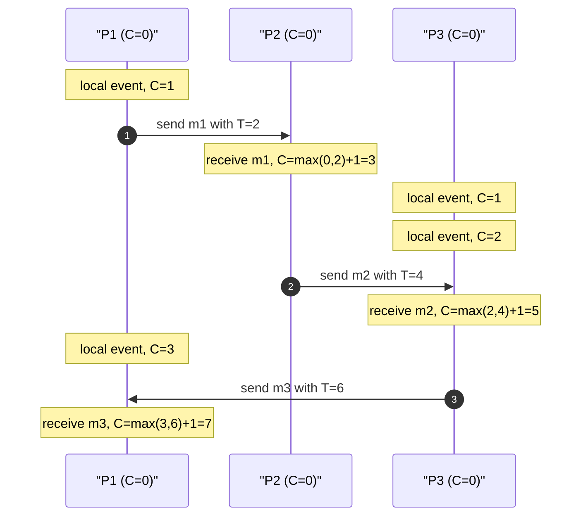
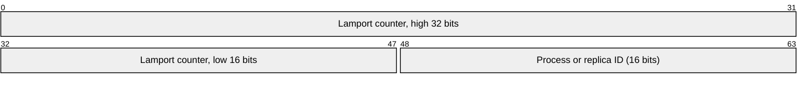
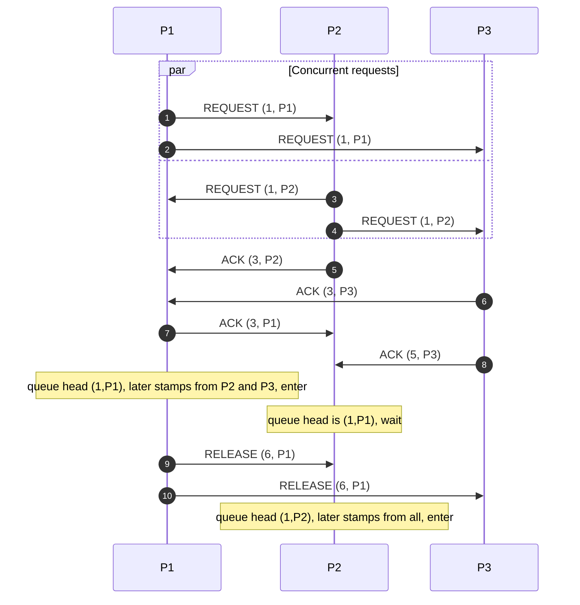
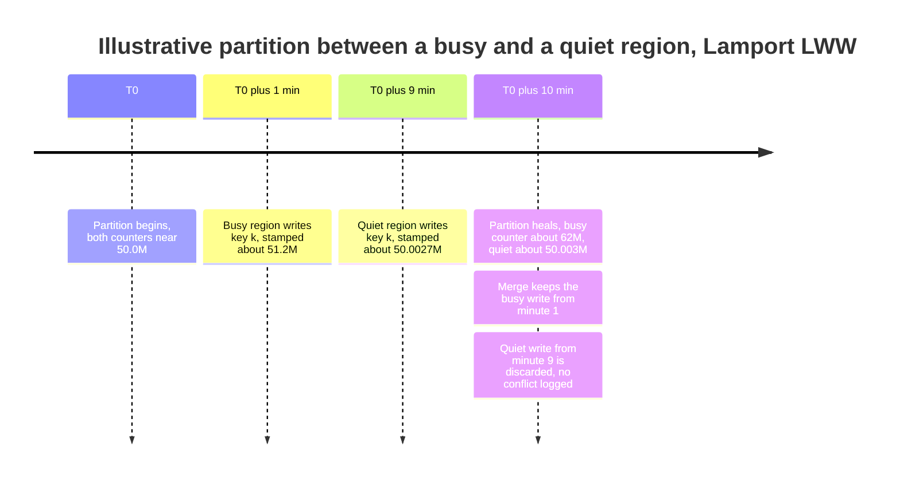

Lamport zaman damgası, her process'in tuttuğu, her yerel olaydan ve her gönderimden önce artırılan, her alımda ise gelen mesajın taşıdığı zaman damgasının ötesine ilerletilen bir tamsayı sayaçtır. Sonuçta her `e` olayı için tek bir garanti taşıyan bir `C(e)` sayısı elde edilir: `a`, `b`'den önce olduysa (happened before), `C(a) < C(b)`'dir. Sayaç bir process kimliğiyle eşleştirilip çiftler sözlük sırasıyla (lexicographic) karşılaştırıldığında bu garanti, tüm olaylar üzerinde her process'in aynı biçimde hesapladığı bir tam sıralamaya (total order) genişler; koordinatör olmadan, senkronize saatler olmadan ve mesaj başına sekiz baytlık metadata ile.

Çözdüğü problem, sıralama üzerinde uzlaşmadır. Aynı operasyonları farklı sıralarda uygulayan replikalar birbirinden ayrışır ve fiziksel zaman damgaları bunu düzeltemez: [Fiziksel Saatler](/distributed-systems/tr/foundations/time-and-ordering/physical-clocks/) sayfasının gösterdiği gibi iki makinenin saati, bir mesajın veri merkezini geçmesi için gereken süreden daha fazla farklılık gösterir; dolayısıyla bir yanıt, ona neden olan istekten daha erken bir duvar saati değeri taşıyabilir. Lamport'un 1978'deki kavrayışı, çoğu sistemin gerçek zaman sıralamasına hiç ihtiyaç duymadığıydı. İhtiyaç duydukları şey, her katılımcının aynı biçimde türettiği ve [happened-before ilişkisinin](/distributed-systems/tr/foundations/time-and-ordering/happened-before/) tanımladığı neden-sonuç bağıntısıyla asla çelişmeyen bir sıralamadır. Bunun için process başına bir sayaç yeterlidir.

Bedeli, sıralamanın tutarlı ama tam da önemli olduğu yerde keyfî olmasıdır. Lamport zaman damgaları hiçbir nedensel çifti tersine çevirmez, ancak eşzamanlı olayları da sıralar; hangi process'in sayacı o an daha büyükse ona göre. İki zaman damgasında, olayların nedensel olarak bağlı mı yoksa eşzamanlı mı olduğunu gösteren hiçbir şey yoktur. Zaman damgası ayrıca bir process'e henüz görmediği olaylar hakkında hiçbir şey söylemez: 1.000 değeri, 1'den 999'a kadarki olayların ulaştığı anlamına gelmez. Eşzamanlılığı tespit etmek, metadata'sı process sayısıyla büyüyen [vektör saatleri](/distributed-systems/tr/foundations/time-and-ordering/vector-clocks/) gerektirir; duvar saatine yakın kalmak [hibrit mantıksal saatleri](/distributed-systems/tr/foundations/time-and-ordering/hybrid-logical-clocks/) gerektirir; bir sıralamanın kesinleştiğini bilmek ise her katılımcıdan haber almayı gerektirir ve Lamport saatlerinin yetmediği, consensus'un başladığı nokta burasıdır.

## İki Kural ve Saat Koşulu

Her `Pi` process'i, başlangıçta sıfır olan tek bir `Ci` tamsayısı tutar. Lamport algoritmayı iki uygulama kuralı olarak ifade etti ve her üretim varyantı bunların yeniden ifadesidir. Birinci kural: bir process, art arda gelen her iki olay arasında sayacını artırır; pratikte bu, her yerel olaydan ve her gönderimden önce artırmak demektir ve olay yeni değeri zaman damgası olarak alır. İkinci kural: her mesaj göndericinin zaman damgası `Tm`'yi taşır ve mesajı alan process sayacını `max(Ci, Tm) + 1` yapar, bu değeri de alım olayına atar.

Mekanizmanın tamamı ikinci kuraldadır. Birinci kural tek başına her process'in kendi geçmişini sıralar, ancak sessiz bir process'in sayacı yoğun bir process'in sayacının çok gerisinde kalabilir; bu durumda yoğun process'ten gelen bir mesaj, gönderildiği zaman damgasından daha küçük bir değerle alınmış olurdu. Alıcıyı göndericinin değerinin bir fazlasına çekmek, iki sayaç daha önce birbirinden ne kadar uzak olursa olsun, her mesajın alımını sayaç uzayında gönderiminden kesin olarak sonraya yerleştirir.


*İki kuralı işleten üç process. Her gönderim sayacı artırır ve mesajı damgalar; her alım, yerel sayaç ile taşınan damganın büyüğünün bir fazlasına sıçrar.*

Alım kuralı P2'yi 0'dan 3'e, P3'ü 2'den 5'e, P1'i 3'ten 7'ye sıçratır. Dikkat edilmesi gereken ilk şey atlanan değerlerdir: sayaçlar olay saymaz ve bir process üzerindeki iki zaman damgası arasındaki boşluk, başka yerlerde kaç olay olduğu hakkında hiçbir şey söylemez. İkinci dikkat edilecek şey, P1'in `C=3` değerli yerel olayı ile P3'ün `C=1` ve `C=2` değerli yerel olaylarıdır. Üçü de birbiriyle eşzamanlıdır, yine de zaman damgaları onları sıralar; P3 `m2`'yi almadan önce bir yerel olay daha gerçekleştirmiş olsaydı, onları farklı sıralardı. Eşzamanlı olaylar, olayların kendilerinin yaptığı hiçbir şeye değil, aktiviteye bağlı bir sıra alır.

### Sayaç Neden Hiçbir Nedensel Çifti Tersine Çevirmez

Saat koşulu (clock condition) adı verilen garanti şudur: `a -> b` ise `C(a) < C(b)`. Kanıt, ilişkinin yapısını izler. Happened-before iki tür doğrudan bağdan kurulur, tek process üzerindeki program sırası ve gönderimden alıma uzanan bir mesaj, ve geçişlilik altında kapatılır. Program sırası bağında birinci kural, sayacın art arda gelen olaylar arasında kesin olarak arttığını garanti eder; dolayısıyla sonraki olay daha büyük değeri taşır. Mesaj bağında gönderim olayının zaman damgası `Tm`'dir, alım olayınınki ise en az `Tm + 1` olan `max(Ci, Tm) + 1`'dir. Demek ki her doğrudan bağ zaman damgasını kesin olarak artırır; her uzunluktaki nedensel zincir doğrudan bağlardan oluşan bir dizi olduğu için kesin eşitsizlik zincirin tamamı boyunca taşınır.

Kanıt gerçek zamana, mesaj gecikmesine veya saat hızlarına hiç dayanmaz; bu yüzden tamamen [asenkron model](/distributed-systems/tr/foundations/system-models/network-models/) altında da geçerlidir. Ancak bir uygulamanın bozabileceği iki şeye dayanır. Her process'in sayacı, çökme ve yeniden başlatma dahil, asla azalmamalıdır; ve nedensellik taşıyan her mesaj damgayı da taşımalıdır. Bir sayaç sıfırlaması ya da damgasız bir kanal argümandan bir bağı çıkarır ve eşitsizlik bu bağdan geçen her zincir için bozulabilir.

### Zaman Damgasının Söylemedikleri

Saat koşulunun tersi yanlıştır: `C(a) < C(b)`, `a -> b` anlamına gelmez. Diyagramda P3'ün ilk olayının zaman damgası 1, P1'in üçüncü olayınınki 3'tür, ama ikisi eşzamanlıdır. Lamport zaman damgasının izin verdiği tek çıkarım ters-karşıtıdır (contrapositive): `C(a) >= C(b)` ise `b`, `a` tarafından neden olunmuş olamaz, yani `a -> b` dışlanır. `C(a) < C(b)` gören bir sistem yalnızca `b -> a`'nın imkânsız olduğunu öğrenmiştir; `a -> b` ve `a || b` hâlâ açık seçeneklerdir. [Vektör saatlerin](/distributed-systems/tr/foundations/time-and-ordering/vector-clocks/) eklediği bilgi tam olarak budur ve happened-before sayfasında ele alınan Charron-Bost alt sınırı, sabit boyutlu hiçbir zaman damgasının bunu genel olarak ekleyemeyeceğini söyler.

Zaman damgası tamlık hakkında da hiçbir şey söylemez. 100 damgalı bir olayı tutan bir process, 100'ün altında damgalanmış her olayı gördüğü sonucuna varamaz: başka bir process 57 damgalı bir olay üretmiş olabilir ve bu olay hâlâ yolda olabilir. Sıralamanın bir önekinin tamamlandığını bilmek ya her diğer process'ten daha büyük damgalı bir mesaj almayı ve buna ek olarak ilk giren ilk çıkar (FIFO) kanalları, ya da harici bir sıralayıcıyı (sequencer) gerektirir. Aşağıdaki karşılıklı dışlama algoritması ilk seçenek üzerine kuruludur ve maliyeti, çoğu sistemin ikinciyi seçmesinin nedenidir.

Son olarak zaman damgası bir zaman değildir: 1.000 ve 2.000 damgalı olaylar arasında bir mikrosaniye de olabilir bir hafta da, ve tek bir mesaj bir sayacı keyfî ölçüde yukarı itebilir.

## Kısmi Sıralamadan Tam Sıralamaya: Eşitlik Bozma ve Kullanım Alanları

Farklı process'lerdeki iki eşzamanlı olay aynı sayaç değerini taşıyabilir; diyagramda P1'in ilk olayı ile P3'ün ilk olayı ikisi de `C=1` değerindedir. Her çifti sıralayabilmek için Lamport zaman damgasını process'ler üzerinde keyfî ama sabit bir tam sıralama ile, pratikte benzersiz bir process kimliğiyle genişletti ve `(Ca, Pa)`'yı, `Ca < Cb` ise ya da `Ca = Cb` ve `Pa < Pb` ise `(Cb, Pb)`'den önce kabul etti. Karşılaştırmada sayaç baskın olduğu için genişletme saat koşuluna uymaya devam eder; kimlik yalnızca sayacın ayıramadığı olaylar arasındaki eşitliği bozar ve bunların hepsi eşzamanlıdır, çünkü farklı process'lerdeki eşit sayaçlar nedensel olarak bağlı olamaz, tek process üzerindeki sayaçlar ise birbirinden farklıdır.

Genellikle çift okla `=>` yazılan sonuç ilişkisi, tüm olaylar üzerinde kesin bir tam sıralamadır ve replikasyon için önemli olan özelliğe sahiptir: yalnızca olayların zaman damgalarının deterministik bir fonksiyonudur. Aynı damgalı olay kümesini tutan herhangi iki process, başka bir mesaj alışverişi yapmadan onları aynı diziye sıralar.

Uygulamalar genellikle çifti tek bir makine sözcüğüne paketler; böylece tek bir işaretsiz tamsayı karşılaştırması sözlük sırasını gerçekleştirir.


*Bir Lamport zaman damgasının örnek niteliğinde 64 bitlik paketlenmesi. Sayaç yüksek anlamlı bitleri kaplar; böylece paketlenmiş tamsayıları karşılaştırmak önce sayaçları, sonra kimlikleri karşılaştırır.*

Bit anlamlılığı sözlük sırası kuralını kodlar: sayaçtaki herhangi bir fark, kimlikteki herhangi bir farktan ağır basar. Bu bölüşümün hatayla ilgili iki sonucu vardır. 16 bitlik bir kimlik, kimlik uzayının ömrü boyunca 65.536 farklı process'e izin verir ve iki canlı process tarafından yeniden kullanılan bir kimlik, sıralamanın bozamayacağı eşitlikleri geri getirir. 48 bitlik bir sayaç yaklaşık `2.8 * 10^14` değer tutar; örnek olarak saniyede sürekli bir milyon artışta bu yaklaşık 8,9 yıl eder. Burada önemli olan hız ortalama değil, sistemdeki en hızlı sayacın hızıdır, çünkü alım kuralı maksimumu herkese yayar.

### Lamport'un Karşılıklı Dışlama Algoritması: Tam Sıralamayı Koordinatörsüz Kullanmak

Lamport makalesinde tam sıralamayı, merkezi bir kilit sunucusu olmadan karşılıklı dışlamayı (mutual exclusion) çözerek gösterdi. Her process, tam sıralamaya göre sıralanmış bir istek kuyruğu tutar. Kaynağı istemek için bir process bir isteği damgalar, kendi kuyruğuna ekler ve diğer her process'e gönderir. İsteği alan process onu kuyruğuna ekler ve damgalı bir onay (acknowledgment) ile yanıt verir. Bırakmak için process kendi isteğini kuyruktan çıkarır ve herkese damgalı bir bırakma mesajı gönderir; her alıcı da isteği kendi kuyruğundan çıkarır. Bir process kritik bölgeye iki koşul sağlandığında girebilir: kendi isteği tam sıralamaya göre kuyruğunun başındadır ve diğer her process'ten, isteğinden daha sonra damgalanmış bir mesaj almıştır. Algoritma güvenilir FIFO kanalları varsayar.


*Eşit sayaçlı iki eşzamanlı istek, process ID ile eşitlik bozularak çözülüyor. Sayaç değerleri başka trafik olmadığını ve her process'in P1'in isteğini P2'ninkinden önce işlediğini varsayar.*

P1 ve P2 eşzamanlı olarak, ikisi de sayaç 1 ile istekte bulunur; eşitlik bozma `(1, P1)`'i her kuyrukta `(1, P2)`'nin önüne yerleştirir. Böylece hiçbiri karar vermeden üç process de P1'in önce gireceği konusunda uzlaşır. Bunu güvenli kılan ikinci giriş koşuludur. P1 girdiğinde P2'nin 3 damgalı onayını ve P3'ün 3 damgalı onayını almıştır; ikisi de isteğinden sonradır. P2'nin saati asla azalmadığından, P2'nin gönderebileceği ve `(1, P1)`'den önce sıralanan herhangi bir istek, 3 damgalı onaydan önce gönderilmiş olurdu; FIFO teslim, bu isteğin P1'in kuyruğunda zaten bulunacağı anlamına gelir. Her process'ten gelen daha sonra damgalanmış mesaj, o process'ten daha erken bir isteğin hâlâ yolda olmadığının kanıtıdır. Lamport tam sıralamasının her kullanımının arkasındaki genel ilke budur: bir olayın konumu, ancak diğer her process'ten daha sonraki bir zaman damgasıyla haber alındığında kesinleşir.

Kilitlerin ötesine genellendiğinde: her process operasyonlarını damgalayarak yayınlar ve bunları ancak bu anlamda kararlı (stable) hâle geldiklerinde tam sıralamaya göre uygularsa, tüm replikalar aynı operasyonları aynı sırada yürütür; bu, Lamport'un aynı makalede tarif ettiği durum makinesi (state machine) yaklaşımıdır. Yaklaşımın hataya hiç toleransı yoktur: çöken, hatta yalnızca mesaj göndermeyi bırakan bir process, daha sonra damgalanmış mesajı hiçbir zaman sağlamaz ve diğer tüm process'ler sonsuza kadar bekler. Algoritma her karar için `N` process'in tamamının canlı ve erişilebilir olmasını gerektirir; yalnızca çoğunluğa ihtiyaç duyan bir [quorum](/distributed-systems/tr/coordination/consensus-algorithms/paxos/)'un tam tersi. Hataya dayanıklı bir tam sıralamaya ihtiyaç duyan üretim sistemleri bunun yerine [Raft](/distributed-systems/tr/coordination/consensus-algorithms/raft/) gibi consensus protokollerini kullanır ve üretimdeki kilitler de bunların üzerine kurulur; bkz. [Kilit Temelleri](/distributed-systems/tr/coordination/distributed-locking/lock-fundamentals/).

### Sayısal Örnek: Tam Sıralama Üzerinden Koordinasyonun Bedeli

Tek bir veri merkezinde `N` process'ten oluşan bir küme, 0,5 ms medyan round trip ve 5 ms'lik 99. yüzdelik round trip varsayalım; yani tekil round trip'lerin %1'i 5 ms'den uzun sürer. Bu örnekteki tüm sayılar örnek niteliğindedir.

Kritik bölgeye giriş başına mesaj maliyeti: Lamport'un algoritması `N - 1` istek, `N - 1` onay ve `N - 1` bırakma mesajı, toplam `3(N - 1)` mesaj gönderir. Ricart ve Agrawala'nın 1981 tarihli iyileştirmesi bırakma mesajını ertelenmiş bir yanıta katlar ve `2(N - 1)` mesaja ihtiyaç duyar. Merkezi bir kilit sunucusu yaklaşık üç mesaj gerektirir: istek, izin, bırakma. `N = 5` için bu 12, 8 ve 3 mesaj; `N = 50` için 147, 98 ve 3 mesaj eder.

Gecikme: giriş, `N - 1` yanıtın en yavaşını bekler. 49 yanıttan en az birinin 5 ms kuyruğunu aşma olasılığı `1 - 0.99^49`, yani yaklaşık %38,9'dur; dolayısıyla `N = 50`'de, her bağlantı zamanın yalnızca %1'inde yavaş olsa bile girişlerin üçte birinden fazlası kuyruk gecikmesini öder. `N = 5`'te aynı olasılık `1 - 0.99^4`, yaklaşık %3,9'dur.

Trafik yokken kararlılık: algoritma kilit istekleri yerine bir yayın operasyonları akışını sıralamak için kullanıldığında, gönderecek bir şeyi olmayan bir process herkes için teslimi bloke eder, çünkü diğerleri ondan daha sonraki bir damga göremez. Olağan çözüm, güncel sayacı taşıyan periyodik boş bir mesajdır. 10 ms'lik bir heartbeat aralığıyla, bir operasyonun kararlı hâle gelmesinden önceki en kötü durum gecikmesi yaklaşık 10 ms artar ve heartbeat yükü aralık başına `N(N - 1)` mesajdır: `N = 5`'te her 10 ms'de 20 mesaj, saniyede 2.000; `N = 50`'de her 10 ms'de 2.450 mesaj, saniyede 245.000.

Lamport'un karşılıklı dışlama algoritmasının öğretilip nadiren kullanılmasının nedeni budur: karesel mesaj ve heartbeat maliyeti, en yavaş üyenin belirlediği gecikme ve herhangi bir üye çöktüğünde tamamen durma. Beş replikalı bir consensus grubu bir çoğunluk round trip'i öder ve iki hataya dayanır; Lamport tam sıralaması en iyi, ek maliyet getirmediği yerde kullanılır: her replikanın zaten alacağı operasyonları sıralamak için.

## Üretim Sistemlerinde Lamport Saatleri

Kuralların üretimdeki kullanımlarının çoğu Lamport saati olarak adlandırılmaz ve birçoğu kuralların yalnızca bir kısmını korur; hata biçimleri ise adı ne olursa olsun kalıbı izler.

Raft'ın term'leri, seçimlerle sınırlandırılmış bir Lamport saatidir. Her mesaj göndericinin güncel term'ini taşır ve daha büyük bir term gören sunucu onu benimser; bu, alım kuralıdır. Raft makalesi term'lerin mantıksal bir saat işlevi gördüğünü açıkça söyler. Tam bir Lamport saatinden farklı olarak term yalnızca bir sunucu seçim başlattığında ilerler, her olayda değil; görevi de operasyonları sıralamak değil, herhangi bir sunucunun bir mesajın eski (stale) bir leader'dan geldiğini fark etmesini sağlamaktır. Paxos öneri numaraları eşitlik bozmayı kullanır: her proposer numaralarını ayrık bir kümeden çeker, geleneksel olarak bir tur numarasının proposer kimliğiyle eşleştirilmesiyle; daha yüksek bir numaradan haberdar olan proposer daha büyük bir tur seçer, bu da yine alım kuralıdır. Zab'ın `zxid`'i bir epoch ile bir sayacı, yukarıdaki diyagramla aynı paketlemeyle tek bir 64 bitlik değerde birleştirir; ancak sayacı Lamport kurallarıyla değil tek bir leader tarafından atanır; bkz. [Zab](/distributed-systems/tr/coordination/consensus-algorithms/zab-zookeeper/).

Operasyon tabanlı [CRDT'ler](/distributed-systems/tr/data-management/consistency-models/crdts/) en saf modern kullanımdır. Automerge'ün ikili format spesifikasyonu, operasyon ID'lerinin Lamport zaman damgaları olduğunu belirtir: bir actor ID ile eşleştirilmiş bir sayaç, önce sayaca göre karşılaştırılır, eşitliği actor ID bozar. Sıralama (sequence) CRDT'leri bu sırayı, aynı konuma yapılan eşzamanlı eklemeleri her replikada deterministik olarak yerleştirmek için kullanır; CRDT kütüphanelerindeki last-writer-wins register'ları da kazananı seçmek için onu kullanır. Keyfîlik kabul edilebilirdir, çünkü veri tipi gerçek zaman doğruluğuna değil uzlaşmaya ihtiyaç duyar.

Sıralamanın duvar saatine yaklaşmasını isteyen sistemler, sayacın başlangıç noktası olarak fiziksel zamanı kullanır. Bir [hibrit mantıksal saat](/distributed-systems/tr/foundations/time-and-ordering/hybrid-logical-clocks/), aynı maksimum-al-ve-artır alım kuralını, yerel fiziksel saat öndeyken onu izleyen bir değere uygular; böylece saat koşulunu korurken zaman damgalarının gerçek son tarihlerle (deadline) karşılaştırılmasına izin verir. CockroachDB ve MongoDB'nin cluster time'ı bu fikir üzerine kuruludur. Bir [fencing token](/distributed-systems/tr/coordination/distributed-locking/fencing-tokens/) sıklıkla Lamport zaman damgasıyla karıştırılır; oysa tek bir otoritenin verdiği monoton bir sayıdır ve doğruluğu alım kuralına değil, o otoritenin linearizability'sine dayanır.

| Sıralama kaynağı | Nedenselliğe uyar | Eşzamanlılığı tespit eder | Gerçek zamana yakın | Üye hatasına dayanır | Ne zaman tercih edilmeli |
|---|---|---|---|---|---|
| Eşitlik bozmalı Lamport zaman damgası | Evet | Hayır | Hayır | Damgalama evet; kesinliğe karar verme hayır | Her replikanın alacağı operasyonların deterministik sıralaması (operasyon tabanlı CRDT'ler, replike logların birleştirilmesi) |
| Vektör saat veya version vector | Evet | Evet | Hayır | Evet | Çakışan yazmalar tespit edilip saklanmalı veya birleştirilmeli |
| Hibrit mantıksal saat | Evet | Hayır | Saat hatası sınırları içinde | Evet | Snapshot'lara, TTL'lere ve zaman sınırlı okumalara da hizmet eden, nedensel olarak güvenli zaman damgaları |
| Tek sıralayıcı veya partition log offset'i | Evet, kapsamı içinde | Uygulanamaz, eşzamanlılık ortadan kalkar | Hayır | Failover gerektirir | Kapsamdaki tüm yazmalar zaten tek bir leader'dan geçiyor |
| Consensus log'u (Raft, Paxos) | Evet | Uygulanamaz | Hayır | Evet, azınlığa kadar | Kesinliğin bilinmesi gereken, hataya dayanıklı bir tam sıralama |
| Fiziksel zaman damgası | Hayır, yakın çiftleri tersine çevirir | Hayır | Evet | Evet | Gösterim, saklama süresi ve metrikler; makineler arası sıralama için asla |

### Doğruluğu Belirleyen Uygulama Tercihleri

Hangi olaylar sayacı artırır. Kanıt, sayacın sıralanmış herhangi iki olay arasında artmasını gerektirir; ancak process'ten hiç çıkmayan olaylarda artırmak sayaç uzayını boşa harcar ve alım kuralı yoluyla her eşi (peer) şişirir. Uygulamalar genellikle yalnızca damgalanan olaylarda artırır: gönderimler, yazmalar ve damga taşıyan alımlar.

Kalıcılık. Sayacı sıfırdan başlayarak yeniden başlayan bir process, daha önce kullandığı zaman damgalarını yeniden verebilir; bu durumda aynı process'ten gelen sonraki bir olay öncekinden önce sıralanabilir. Sayaç kalıcı olmalıdır, ama her artışta diske yazmak olay başına bir senkron yazma demektir. Sıra üreteçlerinin (sequence generator) kullandığı standart çözüm bir aralık ayırmaktır: güncel değerin epey üzerinde bir tavanı kalıcı olarak yazın, altında serbestçe artırın ve yeniden başlatmada kalıcı tavandan devam edin.

Sıçramayı sınırlamak. Alım kuralı göndericiye güvenir. Sayaç aralığının tepesine yakın bir damga gönderen hatalı veya bozulmuş bir eş, tek bir gossip turundan sonra her process'i oraya taşır ve kalan uzayı tüketir; zaman damgaları paketlenmişse bir sonraki artış kimlik bitlerine taşar ya da başa sarar (wrap). Savunmacı bir uygulama, kendi sayacından yapılandırılmış bir mesafeden daha ileride olan damgaları reddeder ya da karantinaya alır. Kasıtlı olarak kötü niyetli bir eşe karşı bu yeterli değildir; bu bir saat problemi değil, bir [Bizans hatası](/distributed-systems/tr/foundations/system-models/byzantine-faults/) problemidir.

Kimlik benzersizliği. Eşitlik bozma, ancak iki canlı process aynı kimliği paylaşmadığında bir tam sıralamadır. Hostname'lerden, container imajı varsayılanlarından veya küçük yapılandırılmış tamsayılardan türetilen kimlikler klonlama veya yeniden dağıtım sonrasında çakışır; CRDT kütüphanelerinin kullandığı gibi rastgele 64 veya 128 bitlik actor ID'leri, daha geniş bir zaman damgası pahasına çakışmaları ihmal edilebilir kılar.

```text
on start:
    C <- load(ceiling)                  # never reuse a stamp issued before a crash
    reserve(C + RESERVE)                 # durable write before issuing anything

tick():
    C <- C + 1
    if C >= ceiling: reserve(C + RESERVE)   # one fsync per RESERVE ticks
    return (C, NODE_ID)

on_receive(Tm):
    if Tm > C + MAX_JUMP: reject, alert     # bound damage from a corrupt peer
    C <- max(C, Tm)
    return tick()
```

Ayırma boyutu, yeniden başlatma boşlukları ile yazma hızı arasında bir dengedir. Örnek olarak bir milyonluk bir ayırmayla, saniyede 100.000 kez artış yapan bir process tavanını her 10 saniyede bir yazar ve yeniden başlatma başına en fazla bir milyon değer atlar; bu, 48 bitlik bir uzayın ihmal edilebilir bir payıdır. `MAX_JUMP` eşiği ise eşler arasındaki en büyük meşru farkın üzerinde olmalıdır; buna, diğerleri artmaya devam ederken partition'da kalmış bir eş de dahildir.

:::caution[Sıfırdan yeniden başlamak saat koşulunu sessizce bozar]
Yalnızca bellekte tutulan bir Lamport sayacı her birim testinden ve her kararlı durum çalışmasından geçer. İlk çökme, yeniden dağıtım veya container'ın yeniden zamanlanması onu sıfırdan başlatır ve process'in ardından ürettiği her olay, yeniden başlatmadan önce ürettiği olayların önüne sıralanır. Hiçbir hata oluşmaz; replikalar operasyonları nedensellikle çelişen bir sırada uygular. Bir tavanı kalıcı olarak yazın ya da trafik kabul etmeden önce sayacı kalıcı durumdaki en büyük damgadan başlatın.
:::

## Hata Biçimleri ve Dışarıdan Görünüşleri

Aşağıdaki her hata, kanıtın bozulmuş bir varsayımı ya da sıralamanın anlamının yanlış kullanılmasıdır. Hiçbiri varsayılan olarak bir hata mesajı üretmez.

### Yeniden Başlatma Sonrası Sayaç Gerilemesi

Tetikleyici: bir process'in sayacı kalıcı değildir ya da eski bir snapshot'tan, yedekten geri yüklenmiş bir volume'den veya daha eski bir kopyadan terfi ettirilmiş bir replikadan geri yüklenmiştir. Belirtiler: bir replikanın operasyonları eşlerde sırası bozulmuş olarak uygulanmış görünür; bir CRDT belgesi, bir eklemeyi ondan önce yazılmış metnin önüne yerleştirilmiş gösterir; aynı process'ten gelen iki farklı olay aynı `(C, ID)` çiftini taşır.

```mermaid
sequenceDiagram
    autonumber
    participant A as "Replica A (ID 1)"
    participant B as "Replica B (ID 2)"
    A->>B: op x stamped (900, 1)
    Note over B: B applies x, C_B = 901
    rect rgb(70, 40, 40)
    Note over A: crash and restart, counter in memory only, C_A = 0
    A->>B: op y stamped (1, 1), written after x by the same user
    Note over B: y sorts before x, B reorders history
    end
    B->>A: op z stamped (902, 2)
    Note over A: C_A = 903, counter recovers but y keeps its stamp
```


*Kalıcı sayaç olmadan yeniden başlatma. Sayaç 5. adımda düzelir, ancak gerileme penceresinde damgalanan operasyon yanlış konumunu kalıcı olarak korur.*

3. adım sessiz kısımdır: `(1, 1)` damgası biçim olarak geçerlidir ve B'deki hiçbir şey onun gerilemiş bir sayaç tarafından verildiğini anlayamaz, çünkü B "A'nın hiç almadığım 1 numaralı olayı" ile "A'nın 1 olarak damgalanmış yeni olayı"nı ayırt edemez. 5. adımdaki alım sayacı yeniden doğru hâle getirir; hatanın kendini gizlemesinin nedeni budur: pencere yalnızca yeniden başlayan process bir eşten haber alana kadar sürer, ama içinde damgalanan her şey sonsuza kadar yanlış yerde kalır. Tespit: bir process daha önce verdiği en yüksek damgadan daha düşük bir damga verdiğinde alarm üretin (bu, düzeltmenin de ihtiyaç duyduğu kalıcı yüksek su işaretini (high-water mark) gerektirir) ve alıcıların gördüğü yinelenen `(C, ID)` çiftlerini sayın. Azaltma: yukarıdaki ayırma şeması ya da yazma kabul etmeden önce sayacı process'in kalıcı durumundaki ve en az bir eşteki en büyük damgadan kurtarmak. Yanlış yerleşmiş operasyonların kurtarılması genellikle uygulama düzeyinde onarım gerektirir, çünkü sıralama zaten her yerde uygulanmıştır.

### Partition Sonrası Aktivite Yanlılığı

Tetikleyici: Lamport zaman damgaları, partition'a uğrayan ve farklı hızlarda ilerleyen gruplar arasında eşzamanlı yazmalar için kazanan kuralı, yani `(C, ID)`'ye göre last-writer-wins olarak kullanılır. Belirtiler: partition iyileştikten sonra çakışan her anahtar, sessiz tarafın gerçek zamanda çok daha sonra yaptığı yazmalar dahil, yoğun taraf lehine çözülür. Sessiz taraftaki kullanıcılar, hiçbir çakışma raporlanmadan son düzenlemelerinin kaybolduğunu görür.


*Örnek niteliğinde bir zaman çizelgesi. Sayaç değerleri, partition süresince yoğun bölgenin saniyede 20.000, sessiz bölgenin saniyede 5 kez artış yaptığını varsayar.*

Aritmetik mekaniktir. 10 dakikalık partition boyunca yoğun bölgenin sayacı `20,000 * 600 = 12,000,000`, sessiz bölgeninki `5 * 600 = 3,000` ilerler. Yoğun bölgenin birinci dakikada yaptığı bir yazma, başlangıç noktasının zaten yaklaşık 1,2 milyon üzerinde damgalanmıştır; sessiz bölgenin dokuzuncu dakikada yaptığı yazma ise yalnızca yaklaşık 2.700 üzerinde damgalanır. İki yazma eşzamanlıdır, dolayısıyla happened-before bir cevap vermez ve Lamport sıralaması her seferinde daha fazla trafiği olan tarafı kayıran bir cevap üretir. Sonuç deterministik ve yakınsaktır, yani tam sıralamanın vaat ettiği şeydir; ama kullanıcıların uyguladığı tek ölçüte göre yanlıştır. Tespit: kaybeden yazmanın duvar saati zamanının, kazananınkinden saat hata sınırından daha fazla sonra olduğu her last-writer-wins üzerine yazmasını loglayın; partition sırasında ve sonrasında sıfırdan farklı bir oran bu hatadır. Azaltma: bir hibrit mantıksal saat, fiziksel saatler hata sınırları içindeyken sessiz tarafın daha sonraki yazmasını kazandırır; version vector'ler yazmaların eşzamanlı olduğunu tespit eder ve uygulamanın onları birleştirmesine ya da görünür kılmasına izin verir; eşzamanlı bir yazmayı atmanın ne zaman kabul edilebilir olduğu [Nihai Tutarlılık ve LWW](/distributed-systems/tr/data-management/consistency-models/eventual-consistency/) sayfasında ele alınır.

:::danger[Lamport kazananı tutarlıdır, doğru değil]
Lamport zaman damgasına göre last-writer-wins, her replikanın aynı değeri tutmasını garanti eder. Tutulan değerin en yeni, en çok amaçlanan ya da herhangi bir kullanıcının en son gördüğü değer olduğunu garanti etmez. Partition'lar altında daha az trafiği olan tarafın yazmalarını, bu yazmalar onaylandıktan sonra, sistematik olarak atar. Yalnızca herhangi bir eşzamanlı yazmayı kaybetmenin kabul edilebilir olduğu veriler için kullanın.
:::

### Sayaç Şişmesi ve Taşma

Tetikleyici: bir process çok büyük bir damga yayar; bunun nedeni bir hata (bir kod yolunda duvar saati nanosaniyelerinden, diğerinde bir sayaçtan başlatılan damga), bellek bozulması, üretime bağlanmış bir fuzzing veya test istemcisi ya da kasıtlı kötüye kullanım olabilir. Alım kuralı bunu tek bir iletişim turunda her process'e yayar. Belirtiler: filo genelinde sayaç büyüme hızı tek adımda büyüklük mertebeleri kadar sıçrar; paketlenmiş formatlarda sayaç daha sonra kimlik bitlerine taşar ve çok geçmişe sıralanan damgalar üretir ya da karşılaştırma başa sarar. Tespit: sayacı process başına bir gauge olarak dışa aktarın (bu, yeniden başlatmaları düşüş, partition'ları ise ayrışan eğimler olarak da gösterir) ve değişim hızı olay hızına göre saptığında alarm üretin; damgası yerel sayacı sıçrama sınırından fazla aşan her alımı loglayın. Azaltma: sıçrama sınırı; geniş sayaçlar (yalnızca sayaç için 64 bit); eşlere güvenilmeyen yerlerde kimliği doğrulanmış damgalar. Şişmiş bir filodan kurtulmak zordur, çünkü sayaç saat koşulunu ihlal etmeden düşürülemez; taşmaya ulaşan sistemler koordineli bir epoch değişikliğiyle daha geniş bir formata geçmek zorunda kalır.

### Kimlik Çakışmaları

Tetikleyici: iki canlı process eşitlik bozma kimliğini paylaşır; tipik olarak bir sanal makine veya container yapılandırmasıyla birlikte klonlandıktan sonra ya da küçük bir kimlik uzayı eski bir process hâlâ canlıyken yeniden atandığında. Belirtiler: aynı durumu tutması gereken replikalar, tam olarak sayaçta eşit gelen operasyonlarda ayrışır, çünkü bunlar arasındaki sıralama artık varış sırasına bağlıdır. Ayrışma nadirdir ve rastgele görünür; bu da onu bir depolama hatası gibi gösterir. Tespit: aynı `(C, ID)` çiftine sahip iki farklı operasyon gören bir alıcı, çakışmanın kanıtına sahiptir; bu kontrol ucuzdur ve alarm üretmeye değer. Azaltma: 64 bit veya daha geniş, rastgele üretilmiş actor ID'leri ya da lease'li, linearizable bir kayıt servisinden ayrılan kimlikler.

### Lamport Sırasının Gerçek Zaman Sırası Olarak Okunması

Tetikleyici: bir operatör veya bileşen `C(a) < C(b)`'yi "`a` önce oldu" diye okur: bir olayı yeniden kurgularken, zamana dayalı saklama süresi hesaplarken ya da bir damgayı tazelik kanıtı olarak kullanırken. Belirtiler, yanlış olay zaman çizelgeleri ve damgaların hiç geçmediği kanallar üzerinden oluşan nedensel anomalilerdir; bunlar happened-before sayfasında anlatılan [gizli kanallardır](/distributed-systems/tr/foundations/time-and-ordering/happened-before/). Tespit metriklerle değil tasarım incelemesiyle yapılır: Lamport damgalarını süreler veya son tarihlerle karşılaştıran kodu arayın. Azaltma: bir değerin hem sıra hem zaman anlamına gelmesi gereken yerde hibrit mantıksal saat kullanın.

| Hata | Dışarıdan görünen belirti | Tespit sinyali | Azaltma |
|---|---|---|---|
| Sayaç gerilemesi | Bir replikanın operasyonları yeniden başlatma sonrası yeniden sıralanır | Process'in önceki yüksek su işaretinin altında damga; yinelenen `(C, ID)` | Kalıcı tavan veya kalıcı durumdan kurtarma |
| Aktivite yanlılığı | Partition sonrası sessiz tarafın son yazmaları kaybolur | Duvar saati zamanı kazanandan sonra olan LWW kaybedenleri | HLC, version vector'ler, açık birleştirme |
| Şişme ve taşma | Sayaç hızı büyüklük mertebeleri kadar sıçrar; sonra başa sarar | Sayaç gauge hızı ile olay hızı; aşırı büyük alımlar | Sıçrama sınırı, geniş sayaçlar, kimliği doğrulanmış damgalar |
| ID çakışması | Eşit gelen operasyonlarda nadir replika ayrışması | Aynı `(C, ID)` ile iki operasyon | Rastgele 64+ bit actor ID'leri veya lease'li ID'ler |
| Gerçek zaman olarak okuma | Yanlış olay zaman çizelgesi, yanlış saklama süresi | Tasarım incelemesi: zamanla karşılaştırılan damgalar | Değerin zaman anlamı taşıması gereken yerde HLC |

## Lamport Zaman Damgaları Ne Zaman Doğru Araçtır

Lamport zaman damgalarını şu koşullarda kullanın: bir replika kümesi operasyonların tek bir sırası üzerinde uzlaşmalı, her replika sonunda her operasyonu almalı ve eşzamanlı operasyonların sırası, her yerde aynı olduğu sürece keyfî olabilmeli. Operasyon tabanlı CRDT'ler, ortak düzenleme editörleri, okuma anında birleştirilen replike olay logları ve çakışma çözümünde deterministik eşitlik bozma bu üç koşulun tamamını karşılar. Amaç eskimişliği (staleness) tespit etmekse, tam sıralama olmadan yalnızca alım kuralını kullanın; Raft term'leri ve Paxos ballot'ları bunu yapar: daha büyük bir numara gören her katılımcı geride kaldığını öğrenir.

Çakışmaları tespit etmek için kullanmayın. Sistem iki yazmayı saklamak veya birleştirmek için onların eşzamanlı olup olmadığını bilmek zorundaysa, Lamport zaman damgası bu soruyu cevaplayamaz ve üzerine kurulan bir last-writer-wins kuralı eşzamanlı yazmaları yoğun yazıcılar lehine bir yanlılıkla atar; [vektör saatleri](/distributed-systems/tr/foundations/time-and-ordering/vector-clocks/) veya version vector'leri kullanın. Bir değerin aynı zamanda zaman da ifade etmesi gereken yerlerde, örneğin geçmiş bir andaki snapshot okumalarında, TTL'lerde veya tazelik sınırlarında kullanmayın; bir [hibrit mantıksal saat](/distributed-systems/tr/foundations/time-and-ordering/hybrid-logical-clocks/) kullanın. Gereksinim, hiç iletişim kurmayan istemciler arasında gerçek zaman sıralaması olduğunda kullanmayın; bu [linearizability](/distributed-systems/tr/data-management/consistency-models/linearizability/)'dir ve tek bir serileştirme noktası ya da [TrueTime ve Spanner](/distributed-systems/tr/foundations/time-and-ordering/truetime-spanner/) örneğindeki gibi sınırlı saat belirsizliği gerektirir. Herhangi bir üyenin çökebileceği yerlerde, Lamport'un karşılıklı dışlama algoritması gibi her process'in daha sonraki damgasını bekleyen bir koordinasyon kurmayın; consensus destekli bir servis kullanın. Ve onları dışarıya görünen, zamana göre sıralanabilir kimlikler olarak kullanmayın; bunun için tasarlanmış formatlar [Dağıtık ID Üretimi](/distributed-systems/tr/foundations/time-and-ordering/distributed-id-generation/) sayfasında ele alınır.

:::note[Lamport zaman damgaları ve gönderici başına sıra numaraları]
Yalnızca sahibi tarafından artırılan ve alımda asla ilerletilmeyen gönderici başına bir sıra numarası, tek bir göndericinin mesajlarını sıralar ve alıcının o göndericiden gelen boşlukları tespit etmesini sağlar; bunu bir Lamport zaman damgası yapamaz. Göndericiler arası nedensellik hakkında ise hiçbir bilgi taşımaz. Birçok protokol ikisini birlikte taşır: FIFO teslim ve boşluk tespiti için bir sıra numarası, process'ler arası sıralama için bir mantıksal zaman damgası.
:::

İki komşu kavram Lamport zaman damgalarıyla sıklıkla karıştırılır. [Happened-before ilişkisi](/distributed-systems/tr/foundations/time-and-ordering/happened-before/) bir mekanizma değil, yaklaşılmaya çalışılan sıralamadır. [Nedensel tutarlılık](/distributed-systems/tr/data-management/consistency-models/causal-consistency-session-guarantees/) ise replikaların bu ilişkiye uymasını şart koşan bir tutarlılık modelidir; Lamport zaman damgaları operasyonları sıralayabilir, ama bir replikaya hâlâ hangi bağımlılıkların eksik olduğunu tek başlarına söyleyemez.

## İleri Okuma

- Leslie Lamport, *Time, Clocks, and the Ordering of Events in a Distributed System*, Communications of the ACM, 1978.
- Glenn Ricart and Ashok K. Agrawala, *An Optimal Algorithm for Mutual Exclusion in Computer Networks*, Communications of the ACM, 1981.
- Michel Raynal and Mukesh Singhal, *Logical Time: Capturing Causality in Distributed Systems*, IEEE Computer, 1996.
- Diego Ongaro and John Ousterhout, *In Search of an Understandable Consensus Algorithm*, USENIX Annual Technical Conference, 2014.
- Martin Kleppmann and Alastair R. Beresford, *A Conflict-Free Replicated JSON Datatype*, IEEE Transactions on Parallel and Distributed Systems, 2017.
- Sandeep S. Kulkarni, Murat Demirbas, Deepak Madappa, Bharadwaj Avva, and Marcelo Leone, *Logical Physical Clocks*, OPODIS, 2014.
