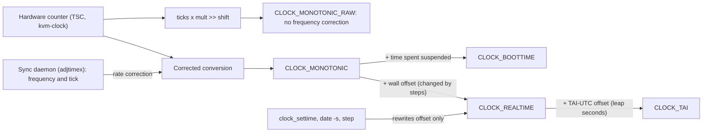
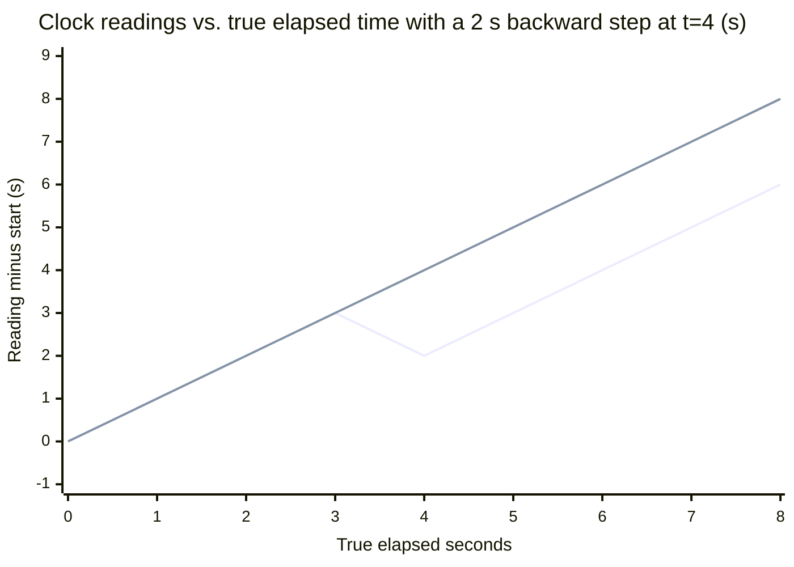
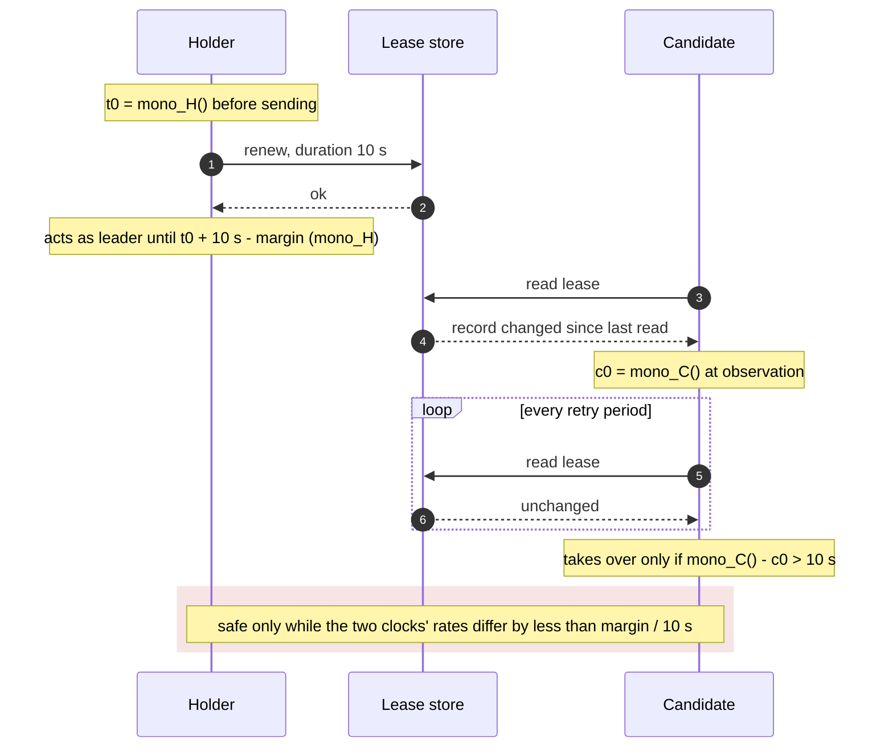
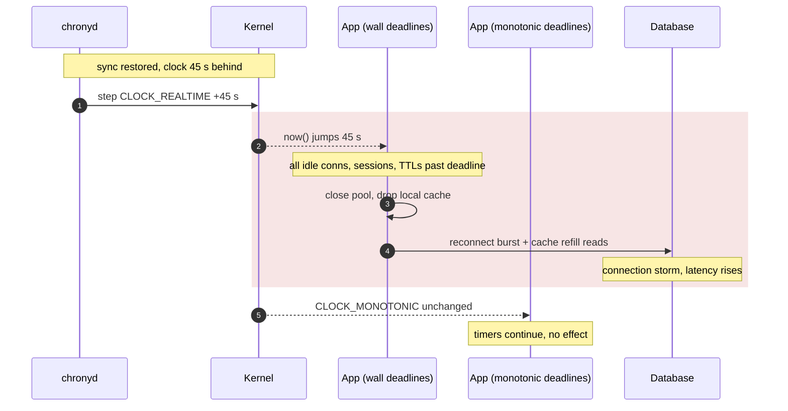
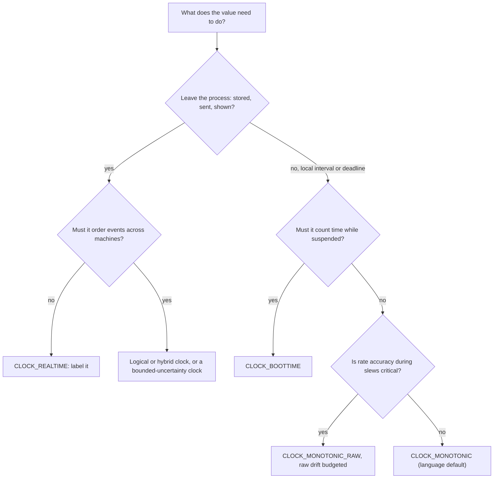

Bir bilgisayar, farklı sorulara yanıt veren en az iki saat sunar. Günlük saat (time-of-day clock; duvar saati ya da wall clock olarak da anılır) "saat kaç?" sorusunu yanıtlar: diğer makinelerle karşılaştırılabilen, veritabanına yazılabilen ve bir insana gösterilebilen bir Eşgüdümlü Evrensel Zaman (UTC) okuması döndürür. Monotonic saat ise "ne kadar zaman geçti?" sorusunu yanıtlar: keyfî bir başlangıç noktasından itibaren sayılan, tek başına hiçbir anlam taşımayan ve makine açık kaldığı sürece asla azalmayan bir nanosaniye değeri döndürür. İkisi de aynı osilatörden beslenir; farkları, onları kimin ve nasıl değiştirebildiğindedir.

Bu sayfanın ele aldığı problem, günlük saatin program çalışırken düzeltilmesidir. Bir senkronizasyon daemon'ı onu saniyelerce ileri ya da geri step'leyebilir, bir operatör elle ayarlayabilir, bir artık saniye bir saniyeyi yeniden oynatabilir; bunlar [Fiziksel Saatler](/distributed-systems/tr/foundations/time-and-ordering/physical-clocks/) sayfasında anlatılır. İki duvar saati okumasını birbirinden çıkararak süre hesaplayan ya da bir deadline'ı duvar saatinde "şimdi artı beş saniye" olarak hesaplayan her kod, bu düzeltmelerin her birini timeout'larında, rate limit'lerinde, retry backoff'larında, lease kontrollerinde ve gecikme metriklerinde bir hata olarak devralır. Monotonic saat, aralık ölçümünün step'lerden etkilenmemesi için vardır.

Asıl denge, anlam ile kararlılık arasındadır. Günlük saat sürecin dışında da anlam taşır ve tam da bu yüzden yanlış olabilir: harici bir referansa bağlıdır ve kaydıkça yeniden hizaya çekilmesi gerekir. Monotonic saat ise hiçbir harici anlam taşımadığı için kararlıdır: değeri makineler arasında, yeniden başlatmalar arasında ya da herhangi bir takvim tarihiyle karşılaştırılamaz. Buradan çıkan kural kısadır ve bu sayfanın büyük kısmı onun sınır durumlarıyla ilgilidir: aralıkları ve deadline'ları monotonic saatle ölçün, olayları günlük saatle etiketleyin ve başka bir makineye asla bir monotonic okuma ya da duvar saati deadline'ı göndermeyin.

## Tek Sayaç, Birden Fazla Saat: Linux Bunları Nasıl Türetir

Linux'ta çekirdeğin zaman tutma (timekeeping) çekirdeği, clocksource adı verilen bir donanım sayacını okur. Modern x86 sunucularda bu genellikle Time Stamp Counter'dır (TSC); sanal makinelerin içinde ise çoğunlukla `kvm-clock` gibi paravirtualize bir kaynaktır. Çekirdek sayaç tick'lerini bir çarpan ve bir kaydırma (shift) ile nanosaniyeye çevirir ve sonucu monotonic bir tabanda biriktirir. `clock_gettime()` ile okunabilen her saat, bu taban artı çekirdeğin tuttuğu bir offset'tir.


*Linux saat ailesi. Her saat, farklı düzeltmelerden geçirilmiş aynı sayaçtır; süreksiz biçimde yeniden yazılabilen tek şey duvar offset'idir.*

Diyagram, her özelliğin nereden geldiğini gösterir. `CLOCK_MONOTONIC_RAW`, hiçbir düzeltme uygulanmadan sabit bir oranla dönüştürülmüş sayaçtır; bu yüzden osilatörün ham frekans hatasını taşır. `CLOCK_MONOTONIC` aynı sayacın, senkronizasyon daemon'ının `adjtimex()` üzerinden yönlendirdiği bir oranla dönüştürülmüş hâlidir; runtime'ların çoğu "monotonic" derken bu saati kasteder. `CLOCK_BOOTTIME`, sistemin askıya alınmış (suspend) olarak geçirdiği süreyi ekler; `CLOCK_MONOTONIC` bu süreyi dışarıda bırakır. Günlük saat olan `CLOCK_REALTIME` ise monotonic tabana bir duvar offset'i ekler. Saat bir daemon tarafından, `clock_settime()` ile ya da `date -s` çalıştıran bir yönetici tarafından step'lendiğinde çekirdek yalnızca bu offset'i yeniden yazar; monotonic taban asla geriye gitmez. `CLOCK_TAI`, Uluslararası Atom Zamanı ile UTC arasındaki farkı ekler (2016 sonundan beri 37 saniye). Bu değer yalnızca daemon çekirdeğe güncel farkı bildirmişse anlamlıdır; aksi hâlde `CLOCK_REALTIME` ile aynı değeri okur.

### Step Neyi Değiştirir, Slew Neyi Değiştirir

İki düzeltme türü saat ailesini farklı biçimlerde etkiler ve bu fark, monotonic saati yararlı kılan şeyin ta kendisidir. Step duvar offset'ini değiştirir; dolayısıyla yalnızca `CLOCK_REALTIME` ve `CLOCK_TAI` sıçrar. Slew ise dönüşüm oranını değiştirir; bu yüzden `CLOCK_REALTIME`, `CLOCK_MONOTONIC` ve `CLOCK_BOOTTIME` hep birlikte biraz hızlı ya da yavaş çalışır ve etkilenmeyen tek saat `CLOCK_MONOTONIC_RAW` olur.


*t=4'ten sonra alttaki çizgi: iki saniye geri step'lenmiş CLOCK_REALTIME. Üstteki çizgi: step'ten etkilenmeyen CLOCK_MONOTONIC. Değerler örnek amaçlıdır.*

t=4'teki step'i kapsayan bir duvar saati ölçümü iki saniye kısa çıkar; t=3,5'te başlayıp t=4,5'te biten bir ölçüm ise negatif sonuç verir. Monotonic çizgi düz devam eder; bu yüzden onun üzerinde ölçülen her aralık doğrudur. Daemon o iki saniyeyi step yerine slew ile gidermiş olsaydı, iki çizgi de aynı küçük eğimle birlikte bükülür, ikisi de aralıkları biraz yanlış ama asla negatif olmayacak biçimde raporlardı. Bu ortak eğim kolayca unutulur ve aşağıdaki sayısal örneğin gösterdiği gibi lease'ler için önemlidir.

### "Monotonic" Neyi Vaat Eder, Neyi Etmez

Garanti dardır. Aynı açılış (boot) içinde `CLOCK_MONOTONIC`'in art arda iki okuması, ister aynı CPU'da ister farklı CPU'larda yapılsın, asla azalmaz. Kesin artan (strictly increasing) değildir: birbirine yakın iki okuma aynı değeri döndürebilir; bu, yalnızca her scheduler tick'inde güncellenen coarse varyantlarda daha sık görülür. Ayarlanamaz (settable değildir); bu yüzden hiçbir yönetici müdahalesi onu sıçratamaz.

Geri kalan her şey açıkça garanti dışıdır. Başlangıç noktası keyfîdir; Linux'ta açılış anına yakındır ama bunu hiçbir şey vaat etmez ve Java'nın `System.nanoTime()` dokümantasyonu başlangıcın gelecekte bile olabileceği, dolayısıyla değerlerin negatif çıkabileceği konusunda uyarır. İki makinenin değerleri ortak bir başlangıcı paylaşmaz; birbirinden çıkarıldıklarında anlamsız bir sayı verir. Aynı makinenin iki farklı açılışına ait değerler de ortak bir başlangıcı paylaşmaz: yeniden başlatmadan önce monotonic okuma olarak saklanan bir deadline, sonrasında ilgisiz bir anı gösterir. Oran gerçek SI saniyesi değildir: `CLOCK_MONOTONIC`, daemon'ın o anda yönlendirdiği oranla çalışır; bu oran kararlı durumda milyonda birin (ppm) çok altında doğrudur, ancak daemon bir offset'i slew ile giderirken bilerek bozulur. Linux'ta `CLOCK_MONOTONIC` sistem askıdayken durur; uyku dahil sabit bir gerçek süre sonunda dolması gereken bir timeout için `CLOCK_BOOTTIME` gerekir.

Askıya alma davranışı, ileride düzeltilecek tarihsel bir kaza değildir. Linux 4.17 geliştirme döngüsünde `CLOCK_MONOTONIC`, askıya alma süresince de ilerleyecek şekilde değiştirildi. Değişiklik, systemd ve başka programlar belgelenmiş davranışa dayandığı ve uyanmanın ardından daemon'lar timeout'a düştüğü için sürüm çıkmadan geri alındı. Belgelenmiş semantik artık taşıyıcı bir sözleşmedir ve `CLOCK_MONOTONIC` ile `CLOCK_BOOTTIME` arasındaki seçim uygulamaya aittir.

Garantinin neden tuttuğu, türetilme biçiminden çıkar. Monotonic taban, sayaç farklarının bir oranla çarpılıp toplanmasıdır ve çekirdek, daemon'dan kabul ettiği oran düzeltmesini oran pozitif kalacak şekilde sınırlar. Pozitif terimlerin toplamı azalamaz. Step'ler tabana hiç dokunmaz. Geriye kalan tek risk sayacın kendisidir: iki CPU'daki TSC senkron değilse, aralarında taşınan bir thread daha küçük bir değer okuyabilir. Çekirdeğin clocksource watchdog'u güvenilmez bir TSC'yi tespit eder, onu kararsız (unstable) olarak işaretler ve daha yavaş ama tutarlı bir kaynağa geçer; garanti uğruna okuma hızından vazgeçer.

### Bir Saati Okumanın Maliyeti

Linux'ta yaygın saatler için `clock_gettime()` normalde çekirdeğe girmez. Çekirdek zaman tutma durumunu, yani sayaç tabanını, çarpanı, kaydırmayı ve offset'leri, her sürece salt okunur olarak eşlenen bir sayfada yayımlar; sanal dinamik paylaşımlı nesne (vDSO) içindeki küçük bir kütüphane sayacı ve bu sayfayı kullanıcı alanında okur. Sayfa bir sıra sayacıyla (sequence counter) korunur: okuyucu sıra numarasını not eder, alanları okur ve bu arada çekirdek alanları güncellediyse okumayı tekrarlar. Böylece bir saat okuması, sayaç okumasının kendisine ek olarak birkaç düzine komuttan ibarettir.

Bu yol yalnızca clocksource kullanıcı alanından okunmayı destekliyorsa vardır. Desteklemiyorsa her okuma tam bir sistem çağrısına dönüşür. Packagecloud bunun etkisini 2017'de, varsayılan `xen` clocksource'un vDSO yolunu devre dışı bıraktığı Xen tabanlı EC2 instance'larında ölçtü: beş milyon `gettimeofday()` çağrısı sistem çağrısı üzerinden 0,547 s, vDSO üzerinden 0,123 s sürdü; bu da çağrı başına kabaca 109 ns'ye karşı 25 ns demektir. Ölçekte bu maliyet önemlidir. Örnek olarak saniyede 20.000 istek işleyen, her istekte 50 tracing span'i üreten ve span başına iki saat okuması yapan bir servis varsayın: saniyede iki milyon okuma. 25 ns'de bu, saniyede 50 ms CPU, yani tek bir core'un %5'idir; 109 ns'de ise saniyede 218 ms, bir core'un beşte birinden fazlası, yalnızca saati sormaya harcanır. Coarse saatler (`CLOCK_MONOTONIC_COARSE`, `CLOCK_REALTIME_COARSE`) sayaç okumasını atlayıp son tick'teki değeri döndürür; daha da ucuzdur ama çözünürlükleri milisaniye mertebesindedir. TTL muhasebesi için uygun, gecikme ölçümü için uygun değildir.

## Dil Runtime'larında İki Saat

Yaygın her runtime iki saati de sunar; genellikle hangisinin hangisi olduğunu söylemeyen isimlerle.

| Runtime | Günlük saat (olay etiketleme) | Monotonic (aralık ölçme) | Notlar |
|---|---|---|---|
| Linux C | `clock_gettime(CLOCK_REALTIME)` | `clock_gettime(CLOCK_MONOTONIC)` | Askıyı dahil etmek için `CLOCK_BOOTTIME` |
| Java | `System.currentTimeMillis()`, `Instant.now()` | `System.nanoTime()` | Taşma nedeniyle `t1 < t0` değil `t1 - t0 < 0` ile karşılaştırın |
| Go | `time.Now()` içindeki duvar okuması | `time.Now()` içindeki monotonic okuma; `Sub`, `Since`, `Before` bunu kullanır | Okuma serileştirme, `Round(0)` ve `UTC()` ile silinir |
| Python | `time.time()` | `time.monotonic()`, `time.perf_counter()` | Kısa benchmark'lar için `perf_counter` |
| Rust | `std::time::SystemTime` | `std::time::Instant` | Zaman geriye gittiyse `SystemTime::duration_since` hata döndürür |
| .NET | `DateTime.UtcNow`, `DateTimeOffset.UtcNow` | `Stopwatch.GetTimestamp()`, `Environment.TickCount64` | `DateTime.Now` ek olarak yerel saat dilimi tehlikeleri getirir |
| JavaScript | `Date.now()` | `performance.now()`, `process.hrtime.bigint()` | `performance.now()` sayfanın ya da sürecin başlangıcına görelidir |

Go daha yakından bakmayı hak eder, çünkü seçimi gizler. Go 1.9'dan beri `time.Now()` hem bir duvar okuması hem de bir monotonic okuma taşıyan bir değer döndürür. Çıkarma ve karşılaştırma, iki operandda da varsa monotonic okumaları kullanır; böylece `time.Since(start)` ve `time.Now().After(deadline)` programcı istemeden step'lere karşı bağışık olur. 1.9'dan önce böyle değildi: 2017'de bir artık saniyenin Cloudflare'in DNS çözümleyicisinde negatif bir round-trip süresi üretmesi bu yüzdendi; olay fiziksel saatler sayfasında incelenir. Koruma, iki değerden biri monotonic okumayı taşımadığında sessizce ortadan kalkar ve dokümantasyon bu okumayı silen işlemleri listeler.

```go
start := time.Now()                  // wall + monotonic reading
doWork()
elapsed := time.Since(start)         // monotonic: immune to clock steps

deadline := start.Add(5 * time.Second)  // Add keeps both readings
late := time.Now().After(deadline)      // monotonic comparison

buf, _ := start.MarshalJSON()        // serialization drops the monotonic reading
var restored time.Time
_ = restored.UnmarshalJSON(buf)
age := time.Since(restored)          // wall clock: a step corrupts this

skewed := start.UTC().Before(deadline) // UTC() strips it: wall comparison
```

Tuzak son üç satırdadır. JSON'dan, bir veritabanından, bir cache'ten ya da bir mesaj kuyruğundan geçen bir zaman damgası yalnızca duvar okumasıyla geri döner ve onu içeren her karşılaştırma hiçbir uyarı vermeden duvar saatine düşer. `Round(0)`, `Truncate`, `In`, `Local` ve `UTC` de okumayı siler, çünkü bunlar duvar gösterimini işlemek için vardır. `time.Since(restored)` çağrısı güvenli `time.Since(start)` ile aynı görünür ama güvenli değildir.

## Ortak Bir Saat Olmadan Makineler Arasında Zaman Ölçmek

Monotonic okumalar makine sınırını geçemez, ama süreler geçebilir. Bir makinede ölçülüp başka bir makinede yorumlanan bir süre, iki saatin offset farkı kadar değil, yalnızca oran farkı kadar yanlıştır; oranlar ise offset'lerden çok daha yakın uyuşur. Makineler arası her doğru timeout'un temeli bu gözlemdir: "12:00:10'a kadar geçerli" değil, "10 saniye boyunca geçerli" gönderin ve her tarafın kendi monotonic zamanlayıcısını başlatmasına izin verin.

`client-go` içindeki Kubernetes lider seçimi bu tasarımın açık bir örneğidir. API sunucusundaki lease kaydı, mevcut sahibin yazdığı bir yenileme zamanı içerir; ancak paket dokümantasyonu, bir istemcinin yalnızca yerel olarak yakalanan zaman damgalarına göre hareket ettiğini belirtir: bir aday, kaydın en son ne zaman değiştiğini kendi saatine göre not eder ve lease'i ancak kendi saatinde tam bir lease süresi hiçbir değişiklik olmadan geçtikten sonra dolmuş sayar. Uzak zaman damgası yalnızca bir değişikliğin olduğunu fark etmek için kullanılır. Dokümantasyon sonucu şöyle özetler: uygulama keyfî saat farkına (clock skew) dayanıklıdır, ama keyfî saat farkı oranına (clock skew rate) dayanıklı değildir. Aynı dokümantasyon fencing sağlamadığını da belirtir; sonraki bölümler bu konuya döner.


*Sürelerle ve yerel monotonic saatlerle ölçülen bir lease. Hiçbir taraf kendi saatini diğerininkiyle karşılaştırmaz; yalnızca oranların uyuşması gerekir.*

Doğruluk argümanını adımların sırası taşır. Sahip zamanlayıcısını yenilemeyi göndermeden önce, 1. adımda başlatır; dolayısıyla yerel penceresi, deponun yenilemeyi kaydettiği andan daha geç başlamaz. Aday zamanlayıcısını değişikliği gözlemledikten sonra, 6. adımda başlatır; dolayısıyla onun penceresi o andan daha erken başlamaz. Her biri aynı nominal süreyi kendi saatinde ölçer. İki saat de tam olarak aynı oranda çalışsaydı, sahibin penceresi her zaman en az round-trip süresi kadar önce biterdi. Tehlike orandadır: saati yavaş çalışan bir sahip, gerçek zaman ilerlemiş olduğu hâlde lease'i hâlâ elinde tuttuğuna inanır; saati hızlı çalışan bir aday ise erken devralır. Sahibin çıkardığı pay (margin) bu farkı karşılamak zorundadır. Süreç duraklaması (pause) hiçbir payın karşılamadığı ayrı bir tehlikedir: "lease geçerli" kontrolünü yapıp ardından paydan uzun süre duraklayan bir sahip, uyandığında süresi dolmuş bir lease ile hareket eder. Bu durumun zararını sınırlamak [Fencing Tokens](/distributed-systems/tr/coordination/distributed-locking/fencing-tokens/) sayfasının işidir; lease protokolünün tamamı [Kiralama Tabanlı Kilitleme](/distributed-systems/tr/coordination/distributed-locking/lease-based-locking/) sayfasına aittir.

:::tip[Süre gönderin, deadline'ı yerelde hesaplayın]
"... zamanına kadar" anlamına gelen her protokol alanı "... süresince" olarak ifade edilmelidir: bir lease süresi, bir istek timeout bütçesi, bir retry-after aralığı. Alıcı, mesajı aldığında kendi monotonic zamanlayıcısını başlatır; bu da deadline'ı makineler arasındaki offset'lerden bağımsız kılar. gRPC bu tasarımı izler: deadline'ları süreçler arasında mutlak bir zaman olarak değil, kalan timeout olarak yayar. Bedeli, alıcının deadline'ının aktarım süresi kadar geç kalmasıdır; bu yüzden gönderen tolere edebileceği tek yönlü gecikmeyi çıkarmalı ya da alıcı bir güvenlik payı düşmelidir.
:::

### Sayısal Örnek: Lease Payını Saat Oranlarından Boyutlandırmak

Diyagramdaki gibi ölçülen 10 s'lik bir lease alalım. `r`, iki saatten herhangi birinin gerçek zamana göre en büyük oran hatası olsun. En kötü durumda sahibin saati `r` kadar yavaş, adayınki `r` kadar hızlı çalışır; böylece sahibin `10 s - m`'lik penceresi yaklaşık `(10 - m)(1 + r)` gerçek saniye, adayın 10 s'lik penceresi ise yaklaşık `10(1 - r)` gerçek saniye sürer. Güvenlik, ilkinin ikincisinden önce bitmesini gerektirir; bu da birinci dereceden `m >= 2 r x 10 s` verir. Belgelenmiş bir varsayılan değerin adı geçtiği yerler dışında aşağıdaki oranların hepsi örnek amaçlıdır.

Kararlı durumda NTP ile disipline edilmiş ve 1 ppm kalıntı hatası varsayılan saatlerle `m >= 2 x 1e-6 x 10 s = 20 us` olur; herhangi bir ağ round trip'inin yanında önemsizdir. 50 ppm varsayılan serbest çalışan saatlerle `m >= 1 ms` olur; bu da hâlâ küçüktür.

Şimdi adayın daemon'ının senkronizasyonu yeni geri kazandığını ve bir saniyelik bir offset'i slew ile gidermekte olduğunu varsayın. chrony'nin belgelenmiş varsayılan `maxslewrate` değeri 83.333,333 ppm, yani on ikide birdir; dolayısıyla düzeltme sırasında `CLOCK_MONOTONIC` %8,3'e kadar hızlı çalışabilir. Bu durumda adayın oran hatası tek başına `r = 0.083` olur ve sahibin ihtiyaç duyduğu pay `m >= (0.083 + 1e-6) x 10 s`, yani yaklaşık 0,83 s'dir. Sahip aynı anda ters yönde slew ediyorsa bu yaklaşık 1,67 s'ye çıkar. Kararlı durumda rahat görünen 100 ms'lik bir pay, her yeniden senkronizasyonun ardından birkaç saniye boyunca yetersiz kalır ve kodda hiçbir şey değişmemiştir.

Üç çıkış yolu vardır. Slew oranını filo genelinde sınırlayın: `maxslewrate 1000` (1.000 ppm) ile en kötü durum `2 x 1e-3 x 10 s = 20 ms` olur ve bir saniyeyi düzeltmek 12 s yerine 1.000 s sürer. Lease'i hiçbir daemon'ın slew etmediği `CLOCK_MONOTONIC_RAW` üzerinde ölçün ve osilatörün düzeltilmemiş, onlarca ppm'lik hatasını `r` olarak kabul edin. Ya da payı tipik bir kayma değerinden değil, daemon'ın en büyük slew oranından türetilen operasyonel bir parametre olarak ele alın. Genel ders şudur: monotonic saatin garantisi oranla değil yönle ilgilidir; bir makinede ölçülen bir süreyi başka bir makinede bir beklentiye dönüştüren her tasarım oranı sınırlamak zorundadır.

## Saat Seçimi: Garantiler Yan Yana

| Saat | Sıçrayabilir mi | Oranı daemon yönlendirir mi | Askıyı sayar mı | Makineler arası karşılaştırılabilir mi | Yeniden başlatmadan sonra geçerli mi | Ne zaman tercih edilmeli |
|---|---|---|---|---|---|---|
| `CLOCK_REALTIME` | Evet, iki yönde | Evet | Evet | Senkronizasyon hatası sınırında | Evet | Olay zaman damgaları, loglar, kayıtlar, insanlara ya da başka sistemlere gösterilen her şey |
| `CLOCK_MONOTONIC` | Hayır | Evet | Hayır | Hayır | Hayır | Timeout'lar, gecikme, backoff, rate limiter'lar, yerel deadline'lar |
| `CLOCK_BOOTTIME` | Hayır | Evet | Evet | Hayır | Hayır | Uyku dahil gerçek süre sonunda dolması gereken zamanlayıcılar; örneğin askıya alınan cihazlarda keepalive'lar |
| `CLOCK_MONOTONIC_RAW` | Hayır | Hayır | Hayır | Hayır | Hayır | Osilatör oranını ölçmek, slew'lar büyükken oranı sınırlı lease ölçümü |
| `CLOCK_TAI` | Artık saniye tekrarı yok; diğer step'ler var | Evet | Evet | Senkronizasyon hatası sınırında | Evet | Daemon TAI offset'ini ayarlıyorsa, artık saniyelerde tekrarlanmaması gereken zaman damgaları |
| `*_COARSE` varyantları | Temel saat gibi | Temel saat gibi | Temel saat gibi | Temel saat gibi | Temel saat gibi | Tick çözünürlüğünü tolere eden yüksek frekanslı muhasebe |

Tabloyu sütun sütun okumak karar kuralını verir. Bir olayı yalnızca yeniden başlatmadan sonra geçerli kalan ve makineler arasında karşılaştırılabilen saatler etiketleyebilir; bir olayı yalnızca sıçrayamayan saatler ölçebilir. Hiçbir saat ikisini birden yapmaz; bu yüzden doğru bir sistem, iki özelliğe de ihtiyaç duyduğunda aynı anda iki saati okur. Go'nun `time.Time` içine yerleştirdiği tasarım budur. Olayları makineler arasında sıralamak, iki saatin de güvenilir biçimde karşılamadığı üçüncü bir ihtiyaçtır; bu konu [Happened-Before İlişkisi](/distributed-systems/tr/foundations/time-and-ordering/happened-before/) ve onu izleyen [Lamport zaman damgaları](/distributed-systems/tr/foundations/time-and-ordering/lamport-timestamps/) ile [Hibrit Mantıksal Saatler](/distributed-systems/tr/foundations/time-and-ordering/hybrid-logical-clocks/) sayfalarında ele alınır. HLC, bir duvar okumasını mantıksal bir sayaçla birleştirerek nedensel sırayı koruyan ve fiziksel zamana yakın kalan bir değer üretir.

:::caution[Mutlak timeout'lar varsayılan olarak duvar saatini kullanır]
Mutlak bir deadline kabul eden birçok arayüz, aksi söylenmedikçe onu `CLOCK_REALTIME` üzerinde yorumlar. Bir POSIX condition variable'ının `pthread_cond_timedwait()` çağrısı varsayılan olarak duvar saatini kullanır; çözüm, oluştururken `pthread_condattr_setclock(CLOCK_MONOTONIC)` çağırmaktır. `timerfd_create()` ve `timer_create()` saati argüman olarak alır ve verilen saat kadar güvenlidir. Duvar saatinde "şimdi artı 5 s" bekleyen bir thread, ileri bir step'ten sonra hemen uyanır; geri bir step'ten sonra ise step'in büyüklüğü artı 5 s bekler. Kütüphanelerin içindekiler dahil, mutlak deadline alan her çağrıyı hangi saati kullandığı açısından denetleyin.
:::

## Üretimdeki Hata Modları

### İleri Bir Step'ten Sonra Duvar Saati Deadline'larının Topluca Dolması

Tetikleyici: bir host senkronizasyonu kaybeder, geride kalır ve ardından her an step atacak şekilde yapılandırılmış bir daemon, saati "düzelten" bir ajan ya da bir operatör tarafından ileri step'lenir. Duvar saatinde hesaplanan her deadline bir anda geçmişte kalır. Boşta bağlantı timeout'ları, oturum süreleri, cache TTL'leri ve duvar saati anları olarak hesaplanmış zamanlanmış işler aynı saniyede tetiklenir.


*45 s'lik ileri bir step için arıza zaman çizelgesi, örnek amaçlı. Aynı düzeltme, monotonic saatle ölçüm yapan koda zarar vermez.*

Sıralama, bir saat düzeltmesinin neden bir veritabanı olayı gibi görünebildiğini gösterir. 3 ile 5. adımlar etkilenen her host'ta aynı anda gerçekleşir; böylece yeniden bağlanma ve doldurma yükü filo genelinde senkronize olur. Bu, [Cache Stampede](/distributed-systems/tr/data-management/distributed-caching/cache-stampede/) sayfasında incelenen şekildir; veritabanı yavaşlarsa istemci retry'ları olayı [Retry Fırtınaları ve Metastabil Hatalar](/distributed-systems/tr/resilience/flow-control/retry-storms-metastable-failures/) sayfasında anlatıldığı gibi uzatabilir. Belirtiler: öncesinde gecikme artışı olmadan timeout ve süre dolumu sayaçlarında sıçrama, toplu oturum kapanmaları, yeni bağlantı patlaması. Tespit: "System clock was stepped by" ya da "System clock wrong by" gibi chrony log satırları, `node_timex_offset_seconds` değerindeki sıçrama ve step zamanı ile sayaç sıçraması arasındaki korelasyon. Önlem: tüm yerel deadline'ları monotonic saatte hesaplayın, açılıştan sonra step'i yasaklayın (fiziksel saatler sayfasında yapılandırıldığı gibi küçük bir güncelleme sınırıyla `makestep`) ve meşru bir toplu süre dolumunun bile yayılması için TTL'lere jitter ekleyin. Kurtarma: patlama geçicidir; kalıcı zarar, fırtınanın aşağı akışta yol açtığı şeydir.

Geri step bunun ayna görüntüsüdür ve daha sessizdir. Duvar saati deadline'ları step'in büyüklüğü kadar geleceğe kayar: 30 s sonra timeout'a düşmesi gereken bir bağlantı 30 s artı step kadar bekler, duvar saati farklarıyla doldurulan bir token bucket dolmayı bırakır, zamanlanmış bir iş çalışmaz ve bir süre metriği, dashboard'ların çoğu zaman kırpıp gizlediği negatif ya da sıfır değerler raporlar.

:::danger[Duvar saatiyle yapılan lease kontrolü iki leader üretebilir]
Başka bir node'un lease'inin dolduğuna, lease'in kaydedilmiş duvar saati bitiş zamanını kendi duvar saatiyle karşılaştırarak karar veren bir süreç, skew'ları kadar farklı iki saati karşılaştırmaktadır. Saati lease payından daha fazla ileride olan bir aday, sahip hâlâ leader gibi davranırken devralır ve ikisi de yazma kabul eder. Yukarıda gösterilen gözlemlenen değişiklik tasarımını kullanın, onu oran hatasına göre boyutlandırılmış bir payla monotonic saatte ölçün ve kaynağı fencing token'larla koruyun; çünkü duraklamış bir sahibi hiçbir saat seçimi kapsamaz. Replike depolar için split-brain sonuçları [Failover ve Lider Seçimi](/distributed-systems/tr/data-management/replication/failover-leader-election/) sayfasında ele alınır.
:::

### Süreçten Kaçan Monotonic Okumalar

Tetikleyici: bir monotonic okuma kalıcı olarak saklanır, zaman damgası olarak loglanır ya da başka bir makineye gönderilir. Örneğin "bir sonraki çalışma monotonic 812.345 s'de" bilgisini saklayan bir iş zamanlayıcısı ya da alıcının çıkarması için göndericinin monotonic zamanını taşıyan bir heartbeat. Belirtiler: yeniden başlatmanın ardından saklanan deadline günlerce gelecekte ya da çoktan geçmiş görünür; başka bir host'ta çıkarma işlemi makineden makineye işaret değiştiren keyfî değerler üretir. Tespit: yalnızca yeniden başlatmalar ya da host'lar arasında görülen, akla yatkın olmayan büyüklükte ya da negatif süreler; serileştirilen yapılardaki monotonic değerler için kod incelemesi. Önlem: monotonic okumaları değil, süreleri ya da duvar saati zaman damgalarını saklayın ve iletin; yeniden başlatmada yerel deadline'ları sürelerden yeniden hesaplayın. Go'da ters problem geçerlidir: serileştirme sınırını geçmiş bir zaman değeri monotonic okumasını sessizce kaybetmiştir; onunla yapılan karşılaştırmalar duvar saati karşılaştırmalarıdır.

### Askıya Alma, Duraklama ve Hiç İlerlemeyen Saat

Tetikleyici: host askıya alınır (dizüstü bilgisayarlar, uç cihazlar ve bazı sanal makine snapshot iş akışları için önemlidir) ya da süreç uzun bir garbage collection, `SIGSTOP` veya bir cgroup freezer tarafından duraklatılır. `CLOCK_MONOTONIC` askıyı dışarıda bıraktığından, onun üzerindeki bir keepalive zamanlayıcısı uyanmanın ardından geç tetiklenir; gerçek zamanı ölçen karşı taraf bağlantıyı çoktan ölü ilan etmiştir. Süreç duraklaması farklıdır: monotonic saat ilerlemeye devam eder, dolayısıyla süreç uyandığında geçen süreyi doğru görür; ama duraklamadan hemen önce bir karar verdiyse, sonrasında o bayat kararla hareket eder. Tespit: uygulama heartbeat loglarındaki boşluklar, garbage collection duraklama metrikleri, sistem loglarındaki uyanma olayları. Önlem: uykuyu sayması gereken zamanlayıcılar için `CLOCK_BOOTTIME`; dışarıdan görünen her eylemden hemen önce geçerliliği yeniden kontrol etmek; bayat bir leader'ın bozabileceği her şey için fencing. Bir sanal makinenin konuk (guest) monotonic saatinin hypervisor düzeyindeki bir duraklama boyunca ilerleyip ilerlemediği hypervisor'a ve yapılandırmasına bağlıdır; varsaymak yerine ölçün.

### Clocksource Geri Düşüşünden Sonra Yavaş Saat Okumaları

Tetikleyici: çekirdeğin watchdog'u TSC'yi kararsız olarak işaretler (çekirdek logu: "Marking clocksource 'tsc' as unstable") ve vDSO yolu olmayan bir kaynağa geçer ya da instance tipi varsayılan olarak böyle bir kaynak kullanır. Belirtiler: trafikte değişiklik olmadan, zaman damgası yoğun her bileşende CPU süresi artar; profillerde tracing, loglama ve metrik kütüphaneleri öne çıkar. Tespit: mevcut clocksource, çekirdek mesajları ve `clock_gettime` için sistem çağrısı sayıları.

```shell
cat /sys/devices/system/clocksource/clocksource0/current_clocksource    # tsc on most x86 hosts
cat /sys/devices/system/clocksource/clocksource0/available_clocksource
dmesg | grep -i clocksource          # watchdog decisions, e.g. tsc marked unstable
strace -f -c -e trace=clock_gettime,gettimeofday -p "$PID"   # nonzero counts: vDSO not used
```

Önlem: varsayılan clocksource'u vDSO'yu destekleyen instance tiplerini ve çekirdekleri tercih edin; sıcak yollarda istek başına saat okumasını azaltın, örneğin batch başına bir kez zaman damgası alarak ya da TTL muhasebesi için coarse bir saat kullanarak. Çekirdeğin reddettiği bir host'ta `tsc`'yi zorlamak bir performans problemini bir doğruluk problemiyle takas etmektir; packagecloud analizi de bunun üretimde yapılmamasını önerir.

| Arıza | İlk görünen belirti | Tespit sinyali | Önlem |
|---|---|---|---|
| İleri step, duvar deadline'ları | Toplu süre dolumu, yeniden bağlanma fırtınası | Step log satırları, offset sıçraması, süre dolumu sıçraması | Monotonic deadline'lar, açılıştan sonra step yok, TTL jitter'ı |
| Geri step, duvar aralıkları | Negatif ya da sıfır süreler, duran rate limiter | Negatif süre sayaçları, step log satırları | Monotonic aralıklar, Go monotonic okumalarının korunması |
| Duvar saatiyle lease karşılaştırması | İki aktif leader | Çakışan leader logları, fencing redleri | Gözlemlenen değişiklik lease'leri, oran payı, fencing token'lar |
| Slew ile bozulmuş lease ölçümü | Sahip durmadan hemen önce devralma | Devralma sırasında yüksek oranda slew eden daemon | Sınırlı `maxslewrate`, raw saat, daha büyük pay |
| Kaçan monotonic okuma | Yeniden başlatmadan sonra ya da eşlerde saçma deadline'lar | Açılışlar ya da host'lar arasında akla yatkın olmayan süreler | Yalnızca süreleri ya da duvar zaman damgalarını saklamak |
| Askının sayılmaması | Keepalive geç tetiklenir, karşı taraf çoktan gitmiş | Uyanma olayları, heartbeat boşlukları | Gerçek zaman zamanlayıcıları için `CLOCK_BOOTTIME` |
| Clocksource geri düşüşü | Zaman damgası yoğun kodda CPU artışı | Clocksource sysfs, sistem çağrısı sayıları | vDSO destekli kaynak, daha az okuma |

## Duvar Saati Ne Zaman Doğru Yanıttır, Ne Zaman Değildir

Değerin sürecin dışında bir anlam taşıması gerektiğinde günlük saati okuyun: bir log satırı, bir trace span'inin başlangıç zamanı, bir veritabanı satırının `created_at` alanı, bir sertifika ya da token geçerlilik kontrolü, kullanıcının gördüğü bir bitiş zamanı ya da takvime bağlı bir iş kuralı. Tekrarlanabileceğini ya da sıçrayabileceğini kabul edin ve ondan alınan kararları, [Fiziksel Saatler](/distributed-systems/tr/foundations/time-and-ordering/physical-clocks/) sayfasının nasıl hesaplanacağını gösterdiği hata sınırına dayanıklı tutun. Bir olay hem etikete hem süreye ihtiyaç duyduğunda iki saati de okuyun: bir span başlangıcını duvar saatinde, süresini monotonic saatte kaydeder. Bir span'in başlangıç zamanı bir step'te bozulsa bile süresinin doğru kalmasının nedeni budur ve [Dağıtık İzleme](/distributed-systems/tr/observability/logs-metrics-traces/distributed-tracing/) bu ayrıma dayanır.

Her aralık ve her yerel deadline için monotonic saati okuyun: [Zaman Aşımları](/distributed-systems/tr/resilience/protection-patterns/timeouts/) sayfasında tartışılan istek timeout'ları, [Heartbeats ve Zaman Aşımı Yapılandırması](/distributed-systems/tr/resilience/failure-detection/heartbeats-timeouts/) sayfasındaki heartbeat ve hata dedektörü zamanlayıcıları, retry backoff'u, token bucket doldurmaları, bellekte tutulan cache TTL'leri, gecikme histogramları ve benchmark döngüleri. Varsayılan budur; duvar saati, bir gerekçe isteyen istisnadır.


*Değerin ne yapması gerektiğine göre saat seçimi. Yaygın yol, yerel her şey için CLOCK_MONOTONIC'te, dışarı çıkan her şey için CLOCK_REALTIME'da biter.*

Hataların çoğunun atladığı dal ilkidir: süreçten hiç çıkmayan bir değerin duvar saati okuması olması için hiçbir neden yoktur. İkinci dal tam tersi hatayı yakalar: olayları makineler arasında duvar saati zaman damgalarıyla sıralamak. Bu sayfadaki iki saat de bunu güvenle yapamaz; bu yol [Lamport zaman damgalarına](/distributed-systems/tr/foundations/time-and-ordering/lamport-timestamps/), [Hibrit Mantıksal Saatlere](/distributed-systems/tr/foundations/time-and-ordering/hybrid-logical-clocks/) ya da [Google TrueTime ve Spanner](/distributed-systems/tr/foundations/time-and-ordering/truetime-spanner/) sayfasındaki açık belirsizlik aralıklarına çıkar. Alttaki iki dal nadir ve bilinçli seçimlerdir: uyuyan cihazlarda askıyı hesaba katan zamanlayıcılar ve slew'lar büyükken oranın kritik olduğu ölçümler.

Yeniden başlatmadan sonra yaşaması ya da bir host'u geçmesi gereken hiçbir şey için monotonic saati kullanmayın ve ondan tanımlayıcı üretmeyin; zamana göre sıralı ID'ler, geri step'leri açıkça ele alan bir duvar saati bileşenine ihtiyaç duyar ve bu [Dağıtık ID Üretimi](/distributed-systems/tr/foundations/time-and-ordering/distributed-id-generation/) sayfasında anlatılır. Stream processing'de soru bir şeyin kaynağında ne zaman olduğuysa, iki saati de olay zamanının kaynağı olarak kullanmayın; [Olay Zamanı ve İşleme Zamanı](/distributed-systems/tr/data-processing/stream-processing/event-time-vs-processing-time/) bu kavramları ayırır. Ve monotonic saatin oranının doğru olduğunu varsaymayın: bir tasarım bir makinede ölçülen süreyi başka bir makinede bir beklentiye dönüştürüyorsa, dayandığı oran sınırını yazın ve onu daemon'ın en büyük slew oranıyla karşılaştırın.

## İleri Okuma

- Michael Kerrisk et al., *clock_gettime(2)*, Linux man-pages project. https://man7.org/linux/man-pages/man2/clock_gettime.2.html
- The Go Authors, *Package time: Monotonic Clocks*, Go standard library documentation. https://pkg.go.dev/time
- Russ Cox, *Proposal: Monotonic Elapsed Time Measurements in Go*, Go design document, 2017.
- Kubernetes Authors, *Package leaderelection*, client-go documentation. https://pkg.go.dev/k8s.io/client-go/tools/leaderelection
- Cary G. Gray and David R. Cheriton, *Leases: An Efficient Fault-Tolerant Mechanism for Distributed File Cache Consistency*, SOSP, 1989.
- Joe Damato, *Two frequently used system calls are ~77% slower on AWS EC2*, packagecloud blog, 2017. https://blog.packagecloud.io/system-calls-are-much-slower-on-ec2
