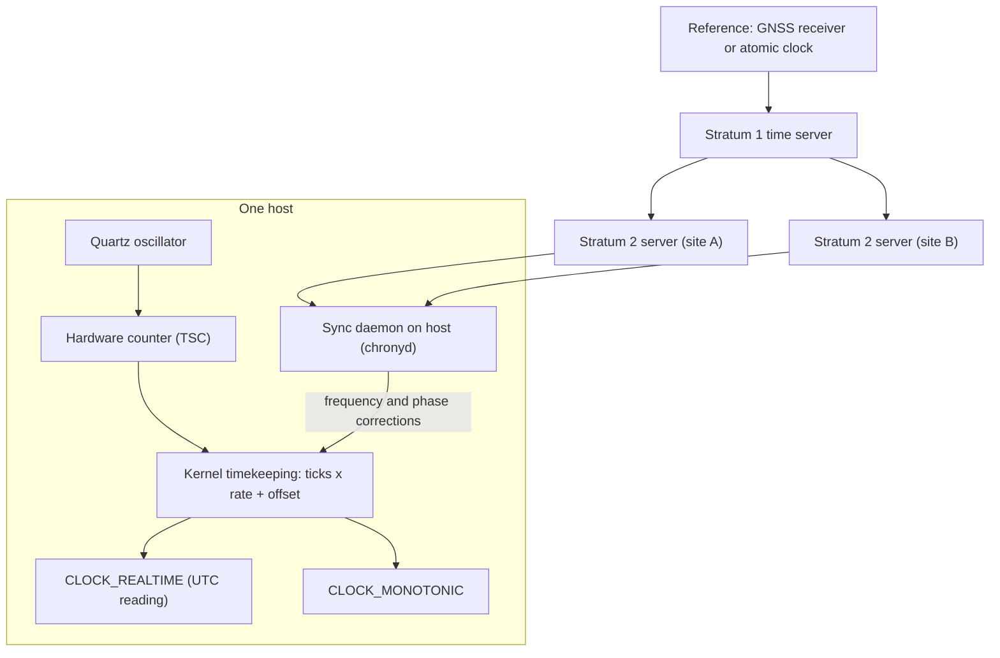
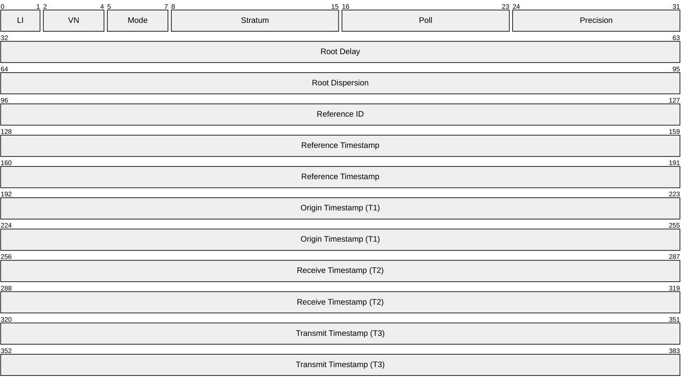
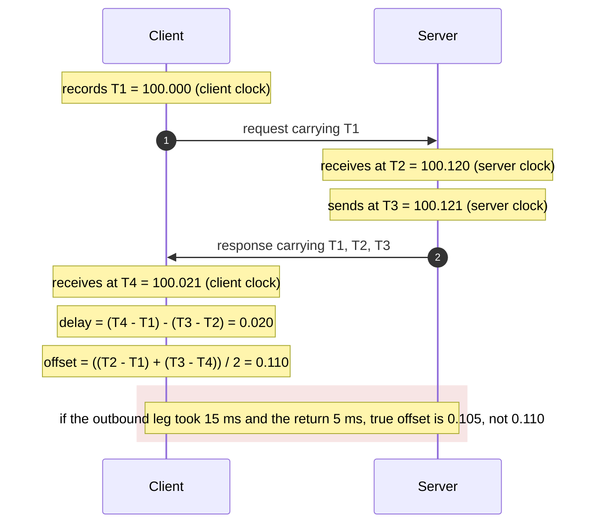
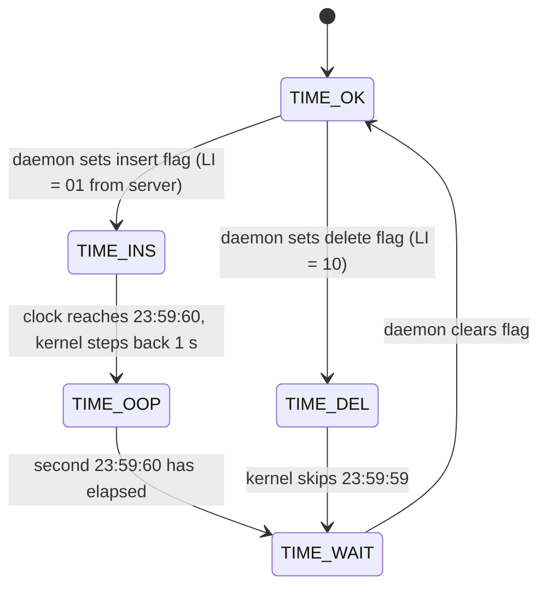
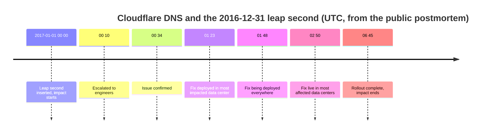
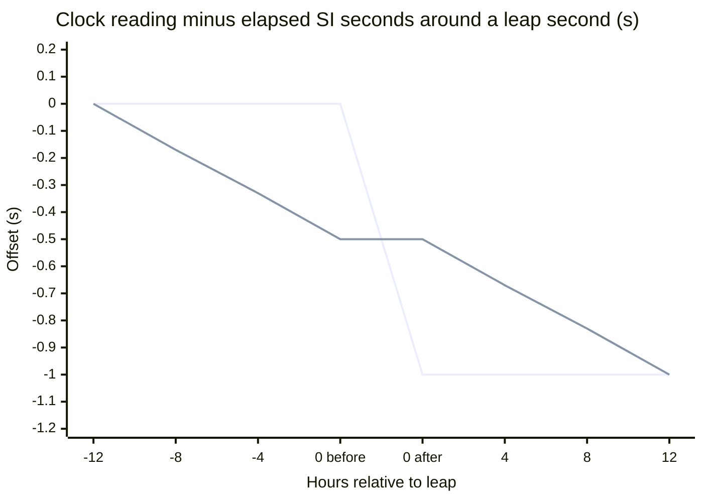

Fiziksel saat, bir osilatörün sürdüğü ve işletim sisteminin Eşgüdümlü Evrensel Zaman (Coordinated Universal Time, UTC) okumasına çevirdiği bir sayaçtır. Her sunucuda bir tane vardır ve hiçbiri diğeriyle aynı değeri göstermez. Osilatör biraz hızlı ya da yavaş çalışır, hızı sıcaklıkla ve yaşla değişir; onu düzelten yazılım ise gerçek zamanı yalnızca tek yönlü gecikmesini ölçemediği bir ağ üzerinden tahmin edebilir. Sonuç olarak bir makinenin zaman damgası ile diğerininki arasında bilinmeyen, genellikle küçük, bazen büyük ama asla sıfır olmayan bir fark bulunur.

Bu sayfanın ele aldığı problem, bir sistemin bu okumaları makineler arasında bir karar vermek için kullandığında ne olduğudur: iki yazmadan hangisi daha yeni, bir lease'in süresi doldu mu, bir sertifika geçerli mi, bir istek ne kadar sürdü. Senkronizasyon olmadan sıradan donanım saatleri günde saniyeler mertebesinde birbirinden uzaklaşır. Senkronizasyonla milisaniye ya da mikrosaniye içinde uyuşurlar; ancak bu yalnızca istatistiksel bir tahmindir ve hata sınırını senkronizasyon protokolünün kendisi hesaplayabildiği hâlde çoğu uygulama bu sınırı görmezden gelir.

Asıl denge, hassasiyet ile maliyet ve bağımlılık arasındadır. Daha sıkı uyum; donanım zaman damgalaması, daha sık sorgulama ve daha yakın referans saatler gerektirir ve her biri arızalanabilecek yeni altyapı ekler. Gevşek uyum ucuzdur, ancak makineler arasında zaman damgası karşılaştıran her mantık, skew kadar geniş bir hata penceresini miras alır. Mühendislik sorusu hiçbir zaman "saatler senkron mu?" değildir; soru "şu anda hatanın sınırı nedir ve mantık bu sınırın içindeki her noktada doğru kalıyor mu?" sorusudur. Bir uygulamanın hangi amaçla hangi saati okuması gerektiği [Monotonic Saatler ve Günlük Saat](/distributed-systems/tr/foundations/time-and-ordering/monotonic-vs-time-of-day/) sayfasında ele alınır; olayları fiziksel zamana hiç güvenmeden sıralamak ise [Happened-Before İlişkisi](/distributed-systems/tr/foundations/time-and-ordering/happened-before/) ile başlar.

## Kristalden Zaman Damgasına: Her Saat Neden Kayar

Bir sunucunun günlük saati bir bileşen zincirinden gelir. Nominal bir frekansta titreşecek şekilde kesilmiş bir quartz kristali, bir donanım sayacını sürer. x86 sunucularda işletim sistemi genellikle Time Stamp Counter'ı (TSC), yani sabit hızla artan core başına bir register'ı ya da bir guest içinde `kvm-clock` gibi sanallaştırılmış bir eşdeğerini okur. Kernel sayaç tick'lerini kalibre edilmiş bir dönüşüm katsayısıyla çarpıp nanosaniyeye çevirir, sonucu UTC'ye eşleyen bir offset ekler ve bunu `CLOCK_REALTIME` olarak sunar. Bir senkronizasyon daemon'ı (`chronyd`, `ntpd` ya da bir Precision Time Protocol daemon'ı) kernel'in yanında çalışır ve referans saatlerden öğrendiklerine göre bu dönüşüm katsayısını ve offset'i ayarlar.


*Referans saatten bir uygulamanın zaman damgasına zaman dağıtımı. Her stratum bir ağ adımı kadar belirsizlik ekler; düzeltmeler arasındaki boşluğu host'un kendi osilatörü doldurur.*

Diyagram, birbirinin üzerine eklenen iki hata kaynağını gösterir. Host'un üstünde her stratum seviyesi, gecikmesi bilinmeyip tahmin edilen bir ağ adımıdır; bu yüzden belirsizlik referanstan aşağı doğru birikir. Host'un içinde ise osilatör düzeltmeler arasında kendi başına çalışır ve daemon yalnızca kernel'in onun hızına dair tahminini yönlendirebilir. `CLOCK_REALTIME` ve `CLOCK_MONOTONIC` aynı sayaçtan beslenir; aralarındaki fark, daemon'ın onları sıçratıp sıçratamayacağıdır ve bu ayrım monotonic saat sayfasında ayrıntılı olarak işlenir.

### Kayma, Skew ve Offset

Hatayı üç terim tanımlar ve sıklıkla birbirine karıştırılır. **Offset**, bir saatin okuması ile gerçek UTC arasındaki tek bir andaki farktır. **Skew**, iki saat arasındaki offset'tir. **Kayma** (drift ya da frekans hatası), offset'in büyüme hızıdır ve milyonda bir (parts per million, ppm) cinsinden ifade edilir: 1 ppm frekans hatası olan bir saat saniyede bir mikrosaniye, günde 86,4 ms kazanır ya da kaybeder.

Quartz frekans hatasının birkaç bileşeni vardır. Sunucu anakartlarında kullanılan kristallerin üretim toleransı genellikle onlarca ppm olarak belirtilir. Frekans sıcaklıkla da değişir; yük artışı sırasında giriş havası ısınan bir sunucunun hızı değişir ve bu değişim doğrusal değildir. Kristaller yaşlanır ve aylar içinde yavaşça kayarlar. Bir senkronizasyon daemon'ı hatanın sabit kısmını tahmin edip iptal edebilir; disipline edilmiş bir saatin serbest çalışan bir saatten çok daha az kaymasının nedeni budur. Ancak iki ölçüm arasındaki sıcaklık kaynaklı kısmı öngöremez. Google'ın Spanner makalesi dayandığı varsayımı açıkça belirtir: zaman daemon'ları iki senkronizasyon arasında en kötü durum için saniyede 200 mikrosaniyelik (200 ppm) yerel kayma uygular. Bu değer tipik hızın çok üzerindedir, çünkü sınırın medyan makine için değil, filodaki her makine için geçerli olması gerekir.

Sanallaştırma bir katman daha ekler: guest'in saati hypervisor aracılığıyla host'taki bir sayaçtan türetilir ve canlı taşıma (live migration), duraklatılmış ya da snapshot'ı alınmış bir VM veya CPU steal, saatin önce donmasına, düzeltildiğinde de sıçramasına yol açabilir.

### Slew ve Step

Daemon saatin yanlış olduğunu öğrendiğinde onu düzeltmenin iki yolu vardır. **Slew** (kademeli düzeltme), saatin hızını hafifçe değiştirerek offset'i yavaş yavaş küçültür; zaman asla sıçramaz ve asla geriye gitmez, ancak büyük bir offset'i düzeltmek uzun sürer. **Step** (sıçratma), saati tek seferde yeni değere ayarlar; offset anında kaybolur, ancak zaman ileri ya da geri sıçrar ve sıçrama boyunca bir aralık ölçen her kod yanlış bir süre görür.

Referans NTP gerçeklemesi olan `ntpd`, varsayılan olarak 128 ms'nin altındaki offset'leri slew ile, bu eşiğin üzerindekileri step ile düzeltir; kernel disiplini slew hızını 500 ppm ile sınırladığı için 128 ms'lik bir düzeltme en az 256 saniye, tam bir saniye ise en az 2.000 saniye sürer. `chronyd` bu politikayı açık hâle getirir: `makestep` direktifi step'e yalnızca bir eşiğin üzerinde ve genellikle yalnızca başlangıçtan sonraki ilk birkaç güncellemede izin verir; varsayılan maksimum slew hızı ise çok daha yüksektir, dokümantasyonuna göre Linux'ta bir saniyeyi yaklaşık 12 saniyede düzeltecek kadar. Politika, uygulamanın hangi hatayı göreceğini belirler: geriye doğru bir step aralıkları ve sıralamayı bozar; yavaş bir slew ise saati dakikalarca yanlış bırakır.

## NTP Offset'i Nasıl Tahmin Eder ve Nerede Edemez

Network Time Protocol (NTP, güncel sürüm 4, RFC 5905), bir istemciyi zaman damgalı paketler değiş tokuş ederek ve offset'i bu damgalardan çıkararak bir sunucuya senkronize eder. Sabit 48 baytlık başlığı hem zaman damgalarını hem de istemcinin kendi hatasını tahmin etmek için ihtiyaç duyduğu meta veriyi taşır.


*Bit offset'leriyle NTPv4 başlık alanları. Zaman damgaları 64 bitlik sabit noktalı değerlerdir: 1900'den bu yana geçen saniyeler için 32 bit, kesir için 32 bit.*

Zaman damgalarının ötesinde üç alan önemlidir. 2 bitlik Leap Indicator (LI), günün sonunda bir artık saniyenin ekleneceğini ya da silineceğini bildirir veya sunucunun kendisinin senkronize olmadığını işaret eder; artık saniye yönetimi bu alana dayanır. Root Delay ve Root Dispersion, sunucunun referans saate kadar biriken round-trip gecikmesi ve hata tahminidir; istemci kendi ölçümlerini bunlara ekleyerek ne kadar yanılıyor olabileceğini hesaplar. Stratum ise sunucunun referansa olan uzaklığını verir.

### Dört Zaman Damgalı Değiş Tokuş


*Saniye cinsinden örnek zaman damgalarıyla tek bir NTP değiş tokuşu. Hesaplanan offset yalnızca round trip'in iki ayağı eşit süre aldığında kesindir.*

Dört zaman damgası, değiş tokuşu iki saatin üzerinde de iki yandan çevreler. İstemcide geçen toplam süreden sunucunun işleme süresi `T3 - T2` çıkarıldığında round-trip gecikmesi elde edilir; örnekte bu 20 ms'dir. Offset formülü isteğin ve yanıtın bu sürenin yarısını aldığını varsayar: değiş tokuşun orta noktasında sunucunun saati, istemcinin aynı orta noktadaki saatiyle karşılaştırılır. Örnekte istemci, sunucunun 110 ms gerisinde olduğu sonucuna varır.

Simetrik gecikme varsayımı NTP'nin doğruluğunun bittiği yerdir ve daha iyi bir yazılımla ortadan kaldırılamaz. Gidiş ayağı gerçekte 15 ms, dönüş ayağı 5 ms sürdüyse gerçek offset 105 ms'dir ve istemci, tespit etmesinin hiçbir yolu olmayan 5 ms'lik bir hata üretmiştir, çünkü dört zaman damgası iki durumda da aynıdır. Genel olarak asimetriden gelen hata en fazla round-trip gecikmesinin yarısı kadardır. Bu sınır saat senkronizasyonundaki en önemli sayıdır: 20 ms'lik bir round trip ölçen istemci, offset tahmininin 10 ms içinde doğru olduğunu bilir; buna sunucunun zaten taşıdığı hata (root dispersion'ı ve root delay'inin yarısı) ve ölçümden bu yana biriken kayma eklenir. Asimetri yaygındır: iki yönde farklı rotalar, tek yönde tıkanıklık ya da sanal bir switch'teki bir kuyruk.

### Filtreleme, Seçim ve Disiplin

Tek bir değiş tokuş gürültülüdür; bu yüzden NTP istemcileri her sunucu için kısa bir geçmiş tutar ve en düşük round-trip gecikmesine sahip örnekleri tercih eder. Gerekçe şudur: daha az kuyrukta bekleyen bir örnekte asimetriye daha az yer vardır. Sunucular arasında istemci, Marzullo'nun kesişim algoritmasından türetilmiş bir seçim algoritması çalıştırır: her sunucunun tahmini bir aralık tanımlar (offset artı eksi hata sınırı) ve istemci aralıkları örtüşen en büyük sunucu kümesini arar. Örtüşen çoğunluğun dışında kalan sunucular "falseticker" olarak sınıflandırılır ve yok sayılır. NTP rehberlerinin en az dört bağımsız kaynak önermesinin nedeni budur: birbiriyle çelişen yalnızca iki kaynakla istemci hangisinin yanlış olduğunu ayırt edemez, üç kaynakla ise tek bir arıza beraberlik bırakır.

Ayıklamadan geçen tahminler, kernel'in fazının yanı sıra frekans düzeltmesini de ayarlayan bir kontrol döngüsünü besler. Döngü zamanla osilatörün sistematik hatasını öğrenip iptal eder; böylece sabit sıcaklıkta sorgular arasındaki artık kayma onlarca ppm'den bir ppm'in küçük bir kesrine iner. Sorgulama aralığı uyarlanabilirdir; `ntpd` için tipik olarak 64 ile 1.024 saniye arasındadır. Daha uzun aralıklar yükü azaltır, ancak düzeltmeler arasında daha fazla kaymanın birikmesine izin verir.

:::tip[Yalnızca offset'e değil, hata sınırına alarm kurun]
Daemon'ın bildirdiği offset onun en iyi tahminidir ve gerçek hata büyükken kusursuz görünebilir: asimetrik bir yol, kararlı ama yanlış bir offset üretir. Daemon'ın hata tahminini de dışa aktarın. chrony'de bu, `chronyc tracking` çıktısındaki root dispersion artı root delay'in yarısıdır; Prometheus `node_exporter` ise kernel'in görüşünü `node_timex_offset_seconds` ve `node_timex_sync_status` ile birlikte `node_timex_maxerror_seconds` ve `node_timex_estimated_error_seconds` olarak sunar. Sınır uygulamanın tolere ettiği değere yaklaştığında ve sync status sıfıra düştüğünde alarm verin.
:::

### NTP'nin Ötesi: Donanım Zaman Damgalaması ve PTP

NTP'nin doğruluğunu yazılımda yaptığı iki şey sınırlar: ağ arayüzünde değil kernel'de alınan ve değişken zamanlama ile kesme gecikmesini içeren zaman damgaları ve kontrol etmediği yollar üzerindeki simetri varsayımı. Precision Time Protocol (PTP, IEEE 1588) ikisine birden saldırır. Ağ arayüzleri paketleri kablodan geçerken donanımda damgalar; PTP destekli switch'ler ise kendi kuyruk gecikmelerini ölçüp düzelten boundary ya da transparent clock olarak çalışır. Böylece geriye kalan asimetri kuyrukların değil, kablolama ve silikonun bir özelliği hâline gelir. Bunun için tasarlanmış bir veri merkezinde mikrosaniyenin altında uyum elde edilebilir. Huygens (Geng ve diğerleri, NSDI 2018) gibi araştırma sistemleri, çok sayıda prob çiftinden gelen istatistikleri birleştirerek PTP switch'leri olmadan benzer hassasiyete ulaşır.

Bulut sağlayıcılar artık benzer yetenekleri müşterinin işletmesi gereken bir altyapı olmadan sunuyor. Amazon Time Sync Service, EC2'de link-local `169.254.169.123` adresinden erişilebilir; AWS, NTP üzerinden tipik saat hata sınırının 100 mikrosaniyenin altında olduğunu, Nitro PTP donanım saati `/dev/ptp0` olarak bir chrony referans saatine bağlandığında ise tipik olarak 40 mikrosaniyenin altında olduğunu belirtir. AWS ayrıca chrony'nin durumunu bir uygulamanın sorgulayabileceği açık bir hata aralığına dönüştüren ClockBound adlı bir daemon yayımlar. Bunlar garanti değil, tipik değerlerdir; sınırı varsaymayın, okuyun.

## Sayısal Örnek: Makineler Arası Zaman Damgaları İçin Hata Bütçesi

Replikaları çakışan yazmaları daha büyük duvar saati zaman damgasına sahip olanı tutarak çözen bir servis düşünün; bu, birçok replike veri deposunun kullandığı last-writer-wins (LWW) kuralıdır (bkz. [Lidersiz Replikasyon](/distributed-systems/tr/data-management/replication/leaderless-replication/)). Soru şudur: farklı makinelerdeki iki yazma zamanda birbirine ne kadar yakın olursa LWW eskisini tutabilir? Aşağıdaki tüm parametreler örnek amaçlıdır.

Serbest çalışan saatlerle başlayın: frekans hataları +50 ve -50 ppm olan iki sunucu günde 8,64 saniye birbirinden uzaklaşır ve aralarında LWW daha ilk saat içinde anlamını yitirir.

Şimdi ikisini de aynı veri merkezindeki bir stratum 2 sunucusuna NTP ile senkronize edin. Ölçülen round-trip gecikmesinin 0,4 ms, sunucunun kendi root delay'inin 1 ms ve root dispersion'ının 0,1 ms, kontrol döngüsü yakınsadıktan sonra artık frekans hatasının 0,5 ppm ve sorgulama aralığının 64 saniye olduğunu varsayın. Bir host'un bir sorgudan hemen sonraki hata sınırı, asimetri sınırı artı sunucudan miras alınan hatadır: `0.4/2 + 1/2 + 0.1 = 0.8 ms`. Bir sonraki sorgudan hemen önce kayma nedeniyle `64 s x 0.5 us/s = 32 us` kadar büyüyerek yaklaşık 0,83 ms'ye çıkar. Birbirinden bağımsız senkronize edilen iki host, her birinin bildirdiği offset birkaç on mikrosaniye görünse bile, en kötü durumda yaklaşık 1,7 ms'ye kadar uyuşmayabilir. Aynı anahtara farklı replikalarda 1,7 ms'den daha kısa arayla gelen iki yazma yanlış sıralanabilir ve yenisi sessizce atılabilir.

Veri merkezi sunucusunu 40 ms round trip'li genel internet sunucularıyla değiştirin; asimetri terimi tek başına host başına 20 ms'ye, iki host arasında yaklaşık 40 ms'ye çıkar. NTP'yi tipik 40 µs sınırlı bir sağlayıcı PTP donanım saatiyle değiştirin; ikili pencere yaklaşık 80 µs'ye küçülür.

Son olarak senkronizasyon kaybını ele alın. Zaman sunucularının erişilemez olduğunu ve her host'un son frekans tahminiyle serbest çalıştığını varsayın; bu duruma holdover denir. Saat offset'i 500 ms'lik bir üst sınıra (CockroachDB'nin varsayılanı) yaklaştığında bir node'u servisten çıkaran bir veritabanı, burada varsayılan 0,5 ppm artık hatayla bu sınıra `0.5 / 0.5e-6 = 1,000,000 s` sonra, yani yaklaşık 11,6 günde ulaşır; ancak bir sıcaklık değişimi etkin hatayı 50 ppm'e çıkarırsa yalnızca 10.000 saniye, üç saatten kısa bir sürede ulaşır. Holdover planlamasında esas alınacak sayı kararlı koşullardaki artık hata değil, en kötü durumdaki çevresel kaymadır.

| Senkronizasyon yöntemi | Tipik hata sınırı (büyüklük mertebesi) | Baskın hata kaynağı | Operasyonel maliyet | Ne zaman tercih edilmeli |
|---|---|---|---|---|
| Serbest çalışan quartz | Günde saniyeler | Osilatör toleransı, sıcaklık | Yok | Makineler arasında karşılaştırılan hiçbir şey için asla |
| Genel internet üzerinden NTP | Milisaniyeler ile onlarca milisaniye | Uzun, değişken rotalarda yol asimetrisi | Düşük; üçüncü taraf sunuculara bağımlı | Daha yakın kaynağı olmayan host'lar; loglama, insanlara gösterilen zaman |
| Tesis içi sunuculara NTP (chrony) | Milisaniye altı ile yaklaşık bir milisaniye | Yazılım zaman damgalaması, kuyruk asimetrisi | Orta; yedekli stratum 1 ya da 2 sunucuları işletmek | Veri merkezi filoları için varsayılan |
| Bulut sağlayıcı zaman servisi, NTP ya da PHC | Onlarca ile yüz civarı mikrosaniye (sağlayıcı değerleri) | Sanallaştırma yolu, sağlayıcı altyapısı | Düşük; sağlayıcı işletir | Bilinen, sorgulanabilir bir sınıra ihtiyaç duyan bulut iş yükleri |
| Donanım zaman damgalamalı PTP | Mikrosaniye altı | Kablo ve silikon asimetrisi | Yüksek; PTP destekli NIC ve switch'ler, GNSS referansları | Finansal zaman damgalama, commit-wait tasarımları, sıkı tracing |

Bu merdivenin her basamağı daha fazla altyapıya mal olur. Yararlı alıştırma yukarıdakidir: seçilen basamağın verdiği sınırı hesaplayın, ikili karşılaştırmalar için ikiye katlayın ve sistemin zaman damgalarından verdiği her kararın bu pencere içinde doğru olup olmadığını kontrol edin. Doğru değilse çözüm çoğu zaman daha iyi bir saat değil, karşılaştırmaya bağlı olmayan bir mantıktır: [Lamport zaman damgaları](/distributed-systems/tr/foundations/time-and-ordering/lamport-timestamps/) ya da [Hibrit Mantıksal Saatler](/distributed-systems/tr/foundations/time-and-ordering/hybrid-logical-clocks/) gibi; ya da belirsizliği açıkça bekleyerek geçiren, [Google TrueTime ve Spanner](/distributed-systems/tr/foundations/time-and-ordering/truetime-spanner/) gibi bir tasarım.

## Artık Saniyeler: Bir Dakikanın 61 Saniye Sürdüğü An

UTC atom saatleriyle tanımlanır, ancak ortalama güneş zamanını (UT1) tanımlayan Dünya'nın dönüşü düzensizdir. İkisini birbirinden en fazla 0,9 saniye uzakta tutmak için Uluslararası Dünya Dönüşü ve Referans Sistemleri Servisi (IERS), artık saniyeleri yaklaşık altı ay önceden duyurur; bunlar Haziran ya da Aralık sonunda fazladan bir saniye, 23:59:60, olarak eklenir. 1972 ile 2016 sonu arasında yirmi yedi pozitif artık saniye eklendi; en sonuncusu 31 Aralık 2016'nın sonundaydı. 23:59:59'u atlayacak olan negatif bir artık saniye ise hiç yaşanmadı.

Bilgisayarlar 23:59:60'ı çoğunlukla temsil etmez. `time_t`'nin ve çoğu dil çalışma zamanının arkasındaki 1970'ten bu yana geçen saniyeler değeri olan POSIX zamanı, her günü tam 86.400 saniye olarak tanımlar. Bu yüzden artık saniyenin kendine ait bir numarası yoktur ve sistem onunla başka bir şey yapmak zorundadır: bir saniyeyi tekrarlamak, donmak ya da fazladan saniyeyi daha uzun bir döneme yaymak.


*adjtimex arayüzü üzerinden sürülen Linux kernel'inin artık saniye durum makinesi. TIME_OOP sırasında aynı POSIX saniyesi yeniden oynatılır.*

Durum makinesi, artık saniyelerin onlardan hiç bahsetmeyen yazılımları neden bozduğunu gösterir. Daemon artık saniyeyi sunucularının Leap Indicator alanından ya da bir leap-second dosyasından öğrenir ve olaydan önceki son gün içinde insert bayrağını ayarlayarak kernel'i hazırlar. Günün sonunda saati kernel'in kendisi `CLOCK_REALTIME`'ı bir saniye geri alır; böylece 23:59:60'ın POSIX zaman damgası 00:00:00'ınkine eşit olur ve o saniyedeki her zaman damgası iki kez üretilir. Duvar saati okumalarının asla azalmadığını ya da mutlak duvar saatiyle kurulmuş bir timeout'un tam bir kez tetikleneceğini varsayan kod, birkaç yılda bir tek bir gece, neredeyse hiç test edilmeyen yollarda bozulur. Silme dalı ise hiçbir yerde production'da hiç çalışmadı.

### 2012 ve 2016 Artık Saniyeleri Production'da

30 Haziran 2012 sonundaki artık saniye bir Linux kernel hatasını açığa çıkardı: kernel artık saniyeyi ekledikten sonra duvar saatine dayalı yüksek çözünürlüklü timer'lar erken dolmaya başladı; futex'lerde ve mutlak timeout'lu timer'larda bekleyen thread'ler hemen uyandı, tekrar uykuya daldı ve yeniden uyandı. Süreçler yeniden başlatıldıktan sonra bile CPU'yu %100 kullanarak döndü. Java uygulamaları, MySQL, Hadoop ve Cassandra yaygın biçimde etkilendi; Reddit, LinkedIn ve Qantas'ta kesintiler bildirildi. Sistem saatini elle ayarlamak bayat kernel durumunu sıfırladı ve yaygın geçici çözüm hâline geldi.


*Cloudflare'in RRDNS resolver'ındaki artık saniye arızasına ilişkin postmortem'inden zaman çizelgesi.*

İkinci olay, tekrarlanan saniyenin uygulama mantığına nasıl ulaştığını gösterir. Cloudflare'in Go ile yazılmış RRDNS servisi, upstream resolver'ların round-trip sürelerini iki duvar saati okumasını birbirinden çıkararak ölçüyordu. Artık saniyede `time.Now()` geriye gitti (Go'nun o dönemde monotonic saat okuması yoktu), bir ölçüm negatif çıktı ve ağırlıklı upstream seçim kodu bu değeri, negatif argümanda panic'leyen `rand.Int63n()` fonksiyonuna verdi. Zirvede Cloudflare'e gelen DNS sorgularının yaklaşık %0,2'si başarısız oldu ve CNAME kaydı kullanan müşteriler etkilendi. Düzeltme, zamanın geriye gittiği görüldüğünde upstream istatistiklerini atıp yeniden normalleştirmekti. Go 1.9 daha sonra `time.Time`'a monotonic bir okuma ekledi; böylece iki `time.Now()` değerinin farkı duvar saati sıçramalarından etkilenmez hâle geldi. Bu, monotonic saat sayfasında geliştirilen kuralın dil düzeyindeki karşılığıdır.

### Artık Saniyeyi Yaymak (Leap Smear)

Bir saniyeyi yeniden oynatmanın alternatifi onu hiç göstermemektir: her saati yavaşlatıp fazladan saniyeyi uzun bir pencereye yaymak. Google'ın genel NTP sunucuları, artık saniyeden önceki UTC öğle saatinden sonraki UTC öğle saatine kadar 24 saatlik doğrusal bir smear uygular ve saatleri yaklaşık 11,6 ppm yavaş çalıştırır; AWS de Time Sync Service NTP uç noktası ve genel havuzu için aynı smear'i kullanır. Pencere boyunca smear uygulanmış bir saat gerçek UTC'den yarım saniyeye kadar sapar, ancak hiçbir değeri tekrarlamaz ve asla geriye gitmez.


*Basamaklı çizgi: kernel'in eklediği artık saniye; saat gece yarısı bir saniye geri düşer. Eğimli çizgi: 24 saatlik doğrusal smear; aynı saniye kademeli olarak emilir. İkisi de artık saniye içermeyen bir sayımın bir saniye gerisinde biter.*

İki strateji de aynı yerde biter: artık saniyeleri yok sayan bir sayımın bir saniye gerisinde kalan bir saat; aralarındaki fark yalnızca yolun şeklindedir. Step, hatayı sıralama ve aralık mantığını bozan tek bir süreksizlikte yoğunlaştırır. Smear ise hatayı aralık ölçümünün göz ardı edebileceği kadar küçük bir frekans hatasına yayar, ama saati bir gün boyunca UTC'ye göre 0,5 saniyeye kadar yanlış bırakır. Smear'in asıl tehlikesi karıştırmaktır: bazı sunucuları smear uygulayan, bazıları uygulamayan bir istemci, artık saniye yakınında yarım saniyeye kadar ayrışan kaynaklar görür ve bir grubu falseticker olarak reddedebilir ya da iki grup arasında gidip gelebilir. AWS dokümantasyonu tek bir istemci yapılandırmasında smear uygulanmış ve uygulanmamış kaynakları karıştırmamayı önerir; PTP donanım saati de NTP uç noktasının aksine smear uygulamaz.

:::caution[Smear uygulanmış ve uygulanmamış zaman kaynaklarını asla karıştırmayın]
Bir filo tek bir artık saniye politikası seçmeli ve bunu her host'a ve her upstream'e uygulamalıdır. Google ya da AWS'nin smear uygulanmış NTP'sini artık saniyeyi ekleyen sunucularla, örneğin çoğu genel havuz sunucusuyla ya da bir PTP kaynağıyla karıştırmak, istemcilere smear penceresi boyunca 0,5 saniyeye kadar çelişen kaynaklar verir. Aynı durum bir sistemin sınırı ötesinde de geçerlidir: aynı olayları damgalayan, biri smear uygulayan biri uygulamayan iki servis bir gün boyunca yarım saniyeye kadar uyuşmaz.
:::

### Artık Saniyelerin Sonu ve Geriye Kalanlar

Kasım 2022'de Ağırlıklar ve Ölçüler Genel Konferansı (CGPM), UT1 ile UTC arasındaki izin verilen maksimum farkın en geç 2035'te artırılmasına, yani fiilen artık saniyelerin sona ermesine karar verdi. Bu, mevcut sistemler için problemi ortadan kaldırmaz. Değişiklik yürürlüğe girene kadar artık saniyeler mümkündür ve Dünya'nın dönüşü son dönemde bir sonrakinin, eğer olursa, negatif olabileceği kadar hızlanmıştır: Duncan Agnew'in *Nature*'da yayımlanan 2024 tarihli çalışması, kutup buzlarının erimesiyle gecikmiş olsa da 2029 civarında negatif bir artık saniyenin gerekebileceğini tahmin etti. Negatif bir artık saniye, durum makinesindeki TIME_DEL dalını çalıştırır; bu, hiçbir production filosunun hiç çalıştırmadığı bir kod yoludur. Savunmacı tutum, bunu olası saymak ve seçilen artık saniye politikasının eklemenin yanı sıra silmeyi de doğru yönettiğini doğrulamaktır.

| Artık saniye stratejisi | Saat bir değeri tekrarlar mı | UTC'ye göre maksimum hata | Aralık ölçümü | Ne zaman tercih edilmeli |
|---|---|---|---|---|
| Kernel ekleme (1 s geri step) | Evet, bir saniye boyunca | 0 (tam UTC) | Monotonic saat kullanılmadıkça step boyunca yanlış | Düzenlemeye tabi zaman damgaları gibi tam UTC raporlaması gereken sistemler |
| Daemon slew (örneğin chrony `leapsecmode slew`) | Hayır | Saniyeler ile dakikalar boyunca 1 s'ye kadar | Slew sırasında hafifçe bozulur | Smear uygulayan upstream'i olmayan tek bir filo |
| 24 saatlik doğrusal smear (Google, AWS NTP) | Hayır | Bir gün boyunca 0,5 s'ye kadar | Yaklaşık 11,6 ppm bozulur, çoğu kullanım için ihmal edilebilir | Tek bir politikayı her yere uygulayabilen büyük filolar |

## Zaman Senkronizasyonunu Production'da İşletmek

### Daemon'ı Yapılandırmak

Linux'ta `chronyd`, Red Hat ve SUSE dağıtım ailelerinde varsayılandır, başka yerlerde de yaygın olarak kullanılır ve hızlı yakınsadığı ve büyük frekans değişimlerini kaldırabildiği için sanal makineler ve aralıklı bağlanan host'lar için daha iyi bir seçimdir. Production yapılandırması kaynaklarını, step politikasını ve artık saniye politikasını varsayılanlara bırakmak yerine açıkça belirtir.

```text
# /etc/chrony.conf (illustrative fleet configuration)
server ntp-a.internal iburst          # at least four independent sources
server ntp-b.internal iburst
server ntp-c.internal iburst
server ntp-d.internal iburst
minsources 2                          # do not adjust the clock on a single source
makestep 1.0 3                        # step only if off by > 1 s, first 3 updates only
leapsecmode slew                      # never replay a second in CLOCK_REALTIME
maxslewrate 1000                      # ppm; bounds rate distortion while slewing
rtcsync                               # keep the hardware RTC near system time
driftfile /var/lib/chrony/drift       # persist learned frequency across restarts
```

Her satır bir kararı kodlar. Dört kaynak, seçim algoritmasının tek bir falseticker'ı oylamayla saf dışı bırakmasını sağlar. Küçük bir güncelleme sayısıyla `makestep`, saatin çok yanlış olabileceği ve henüz hiçbir şeyin ona bağlı olmadığı açılışta step'e izin verir, sonrasında ise yasaklar; böylece çalışan bir servis yalnızca slew görür. Sınırlandırılmış bir `maxslewrate` ile `leapsecmode slew`, artık saniyenin bir değeri yeniden oynatmasını engeller. Drift dosyası, yeniden başlatılan daemon'ın kristalin ham hatası yerine öğrenilmiş frekans düzeltmesiyle başlamasını sağlar; bu da saatin en az güvenilir olduğu yeniden başlatma sonrası pencereyi kısaltır. Gösterilen değerler örnek amaçlıdır; istemcilerine smear uygulanmış zaman sunması gereken bir sunucu için chrony'deki mekanizma, dokümante edilmiş `smoothtime` direktifidir.

```shell
chronyc tracking      # offset, frequency (ppm), root delay, root dispersion, leap status
chronyc sources -v    # per-source state: '*' selected, '+' combined, 'x' falseticker
timedatectl show -p NTPSynchronized   # whether the kernel considers the clock synchronized
```

### Hata Modları

**Çalışan bir serviste geriye doğru step.** Tetikleyici: her an step atacak şekilde yapılandırılmış bir daemon büyük bir offset'i düzeltir, bir VM snapshot'tan devam eder ve düzeltilir, bir operatör `date -s` çalıştırır ya da hypervisor'ın zaman ajanı ile NTP daemon'ı saat üzerinde çekişir. Belirtiler: metriklerde ve loglarda negatif süreler, hemen ya da hiç tetiklenmeyen timeout'lar, süresi dolmuş ya da uzamış sayılan lease'ler, daha yeni olan yazmaları atan LWW depoları, yinelenen ya da sırasız ID üreten [Snowflake tarzı ID üreteçleri](/distributed-systems/tr/foundations/time-and-ordering/distributed-id-generation/). Tespit: "System clock was stepped by ..." ya da "System clock wrong by ... seconds" gibi chrony log satırları, `node_timex_offset_seconds` değerindeki sıçrama, negatif geçen süreyi sayan uygulama sayaçları. Önlem: açılıştan sonra step'i yasaklayın, her aralığı monotonic saatle ölçün ve saati ayarlayabilen yalnızca tek bir ajan çalıştırın. Kurtarma: LWW'nin zaten attığı yazmalar için otomatik bir kurtarma yoktur; loglardan ya da upstream yeniden oynatmalarından bulunmaları gerekir.

:::danger[Duvar saati karşılaştırması sessizce veri kaybettirebilir]
Duvar saati zaman damgalarıyla last-writer-wins, yazanın saati iki yazma arasındaki farktan daha fazla gerideyse bir yazmayı hata vermeden atar. Kaybı hiçbir şey raporlamaz: iki yazma da onaylanmıştır. Bir depo çakışmaları bu şekilde çözüyorsa sayısal örnekte hesaplanan saat hata sınırı bir veri kaybı penceresidir; ya iş yükü için önemsiz kalacak kadar küçük olmalı ya da yerini [CRDT'ler](/distributed-systems/tr/data-management/consistency-models/crdts/) veya [vektör saatler](/distributed-systems/tr/foundations/time-and-ordering/vector-clocks/) gibi nedensellik takibine bırakmalıdır.
:::

**Sessiz senkronizasyon kaybı.** Tetikleyici: zaman sunucuları bir firewall değişikliği, DNS arızası ya da hizmetten çıkarma nedeniyle erişilemez hâle gelir ve daemon holdover'a düşer. Belirtiler: önce hiçbiri, sonra host'lar arasında yavaşça büyüyen skew; saati denetleyen sistemler sonunda hizmet vermeyi reddeder ve birkaç node aynı bozuk kaynağı paylaşıyorsa bu, quorum'un bir anda kaybedilmesine yol açabilir. Tespit: `node_timex_sync_status` değerinin sıfır olması, chrony leap status'unun "Not synchronised" göstermesi, hata sınırının saatler içinde doğrusal olarak büyümesi. Önlem: offset zaten büyüdüğünde değil, senkronizasyon kaybından dakikalar içinde alarm verin; birbirinden bağımsız hata alanlarındaki kaynakları kullanın. Bu arıza, [Ağ Modelleri](/distributed-systems/tr/foundations/system-models/network-models/) sayfasında anlatılan saat sınırı ihlalinin operasyonel biçimidir.

**Yanlış ama kendinden emin kaynak.** Tetikleyici: bir stratum 1 sunucusunun GNSS alıcısı kilidini kaybeder ya da spoof edilir, yanlış yapılandırılmış bir sunucu yerel saati sunar ya da her host tek bir upstream kullanır. Belirtiler: tüm filo kendi içinde sıkı biçimde uyuşur ve hep birlikte yanlıştır; iç karşılaştırmalar sorunsuz görünürken TLS sertifika doğrulaması, token süresi kontrolleri ve harici servislere yapılan çağrılar başarısız olur (bkz. [Sertifika Yaşam Döngüsü](/distributed-systems/tr/service-mesh/network-policies-mtls/certificate-lifecycle/)). Tespit: filonun zamanını harici, bağımsız bir referansla karşılaştırın; falseticker olarak işaretlenen kaynakları izleyin. Önlem: farklı upstream'lere sahip en az dört kaynak ve kurum içi stratum 1 için holdover osilatörlü GNSS alıcıları.

**Asimetrik yol sapması.** Tetikleyici: zaman sunucusuna giden trafik iki yönde farklı rotalar izler ya da yönlerden biri tıkanıktır. Belirtiler: round trip'in yarısına kadar yanlış olan kararlı ve makul görünen bir offset; bir rack ya da zone'daki host'lar diğeriyle sürekli sabit bir miktar kadar uyuşmaz. Tespit: farklı konumlardaki sunuculara karşı ölçülen offset'leri karşılaştırın; tutarlı bir zone çiftinde child span'in parent'ından önce başladığı trace zaman damgalarına bakın (bkz. [Dağıtık İzleme](/distributed-systems/tr/observability/logs-metrics-traces/distributed-tracing/)). Önlem: istemcilere topolojik olarak yakın zaman sunucuları, düşük gecikmeli örneklerin tercih edilmesi, hassasiyetin önemli olduğu yerde transparent clock'lu PTP.

**Artık saniye ya da smear uyumsuzluğu.** Tetikleyici ve belirtiler yukarıda anlatılanlardır. Tespit: olaydan önce `chronyc tracking` çıktısındaki leap status ve upstream artık saniye politikalarının envanteri. Önlem: filo genelinde tek bir politika ve bunun sahte bir artık saniye duyuran bir test sunucusuna karşı prova edilmesi.

| Arıza | İlk görünen belirti | Tespit sinyali | Önlem |
|---|---|---|---|
| Geriye doğru step | Negatif süreler, yinelenen ID'ler | Daemon logunda step mesajları, offset sıçraması | Açılıştan sonra step yok, monotonic aralıklar |
| Senkronizasyon kaybı (holdover) | Yavaşça artan skew, sonra kendini kapatma | Sync status 0, büyüyen hata sınırı | Senkronizasyon kaybına alarm, bağımsız kaynaklar |
| Yanlış ama emin kaynak | Harici doğrulama hataları | Falseticker'lar, harici referans karşılaştırması | Dört ya da daha fazla çeşitli kaynak |
| Asimetrik yol | Zone'lar arasında sabit offset | Tesisler arası offset karşılaştırması | Yakın sunucular, donanım zaman damgalaması |
| Artık saniye uyumsuzluğu | CPU'nun dönmesi, panic'ler, 0,5 s uyumsuzluk | Leap status, upstream envanteri | Tek politika, artık saniye provası |

## Fiziksel Zaman Ne Zaman Doğru Araçtır, Ne Zaman Değildir

Fiziksel zaman damgalarını makineler arasında, karar hata sınırını payla tolere ediyorsa ve sınır izleniyorsa kullanın. Log ve trace korelasyonu, insanlara gösterilen zamanlar, metrik kovalama, dakikalar ya da saatlerle ölçülen TTL'ler ve sertifika ile token geçerliliği milisaniyelerce skew'u tolere eder. Bunları sıralama ve çakışma çözümü için yalnızca sistem sınırı hesaplayıp ona uyuyorsa kullanın: Spanner'ın belirsizlik aralığını bekleyerek geçirmesi ya da CockroachDB'nin bir saat offset sınırını hibrit mantıksal saatlerle birleştirmesi gibi (bkz. [CockroachDB: Raft, HLC ve Parallel Commits](/distributed-systems/tr/case-studies/distributed-sql/cockroachdb-raft-hlc/)).

Aynı öğeye yapılan yazmalar saat hata sınırının iki katından daha kısa aralıklarla gelebiliyorsa, hangi yazmanın kazanacağına makineler arası duvar saati karşılaştırmasıyla karar vermeyin; bunun yerine nedenselliği takip edin. Başka bir sürecin lease'inin dolduğuna ve harekete geçmenin güvenli olduğuna da bu karşılaştırmayla karar vermeyin: duraklatılmış bir süreç ya da kaymış bir saat iki sahibin örtüşmesine izin verir; bunu [Kiralama Tabanlı Kilitleme](/distributed-systems/tr/coordination/distributed-locking/lease-based-locking/) ve [Fencing Tokens](/distributed-systems/tr/coordination/distributed-locking/fencing-tokens/) ele alır. Tek bir makinede bile süreleri günlük saatle ölçmeyin. Ve soru olayların kaynakta ne zaman gerçekleştiği olduğunda, stream processing'de olayları işleyen makinenin saatine göre sıralamayın; bu ayrımı [Olay Zamanı ve İşleme Zamanı](/distributed-systems/tr/data-processing/stream-processing/event-time-vs-processing-time/) yapar.

## İleri Okuma

- David L. Mills, Jim Martin, Jack Burbank, William Kasch, *Network Time Protocol Version 4: Protocol and Algorithms Specification* (RFC 5905), IETF, 2010. https://www.rfc-editor.org/rfc/rfc5905
- David L. Mills, *Internet Time Synchronization: The Network Time Protocol*, IEEE Transactions on Communications, 1991.
- James C. Corbett et al., *Spanner: Google's Globally-Distributed Database*, OSDI, 2012.
- Yilong Geng et al., *Exploiting a Natural Network Effect for Scalable, Fine-grained Clock Synchronization*, NSDI, 2018.
- John Graham-Cumming, *How and why the leap second affected Cloudflare DNS*, Cloudflare blog, 2017. https://blog.cloudflare.com/how-and-why-the-leap-second-affected-cloudflare-dns/
- Google, *Leap Smear*, Google Public NTP documentation. https://developers.google.com/time/smear
