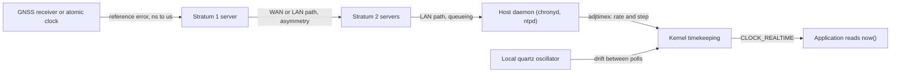
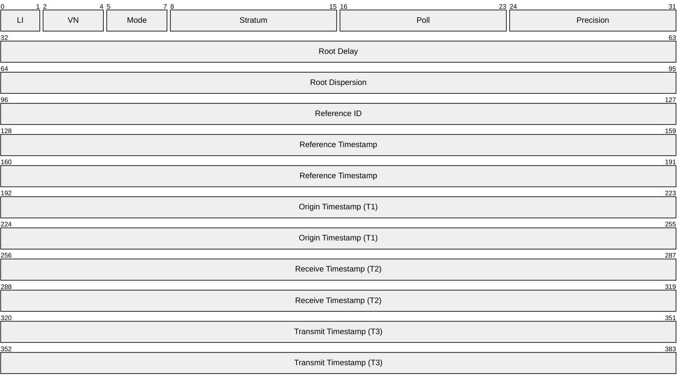
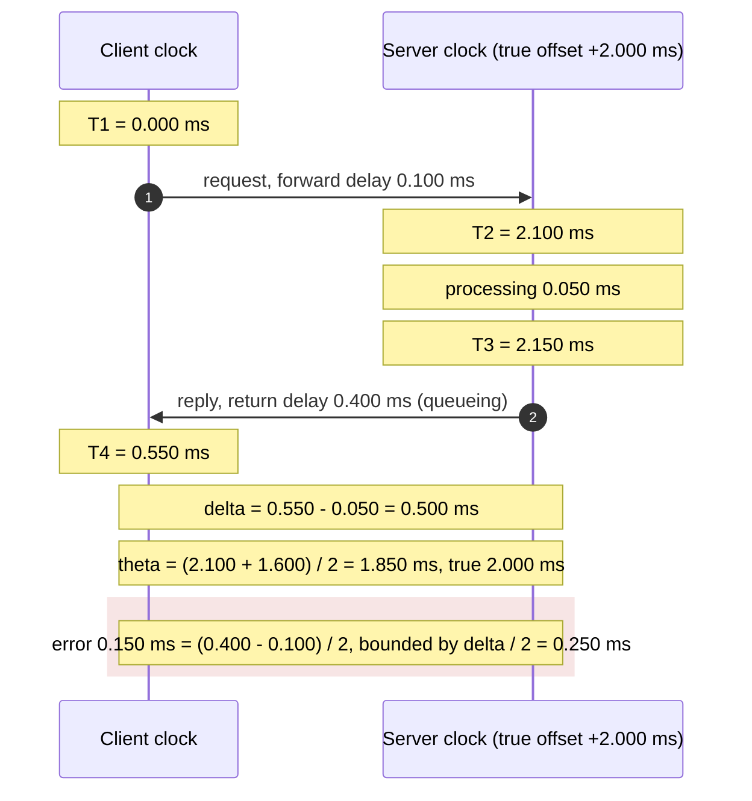
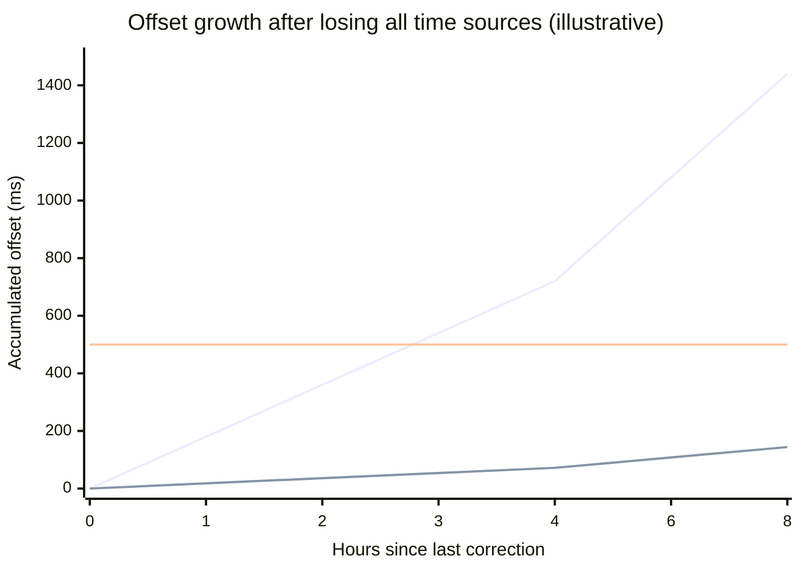
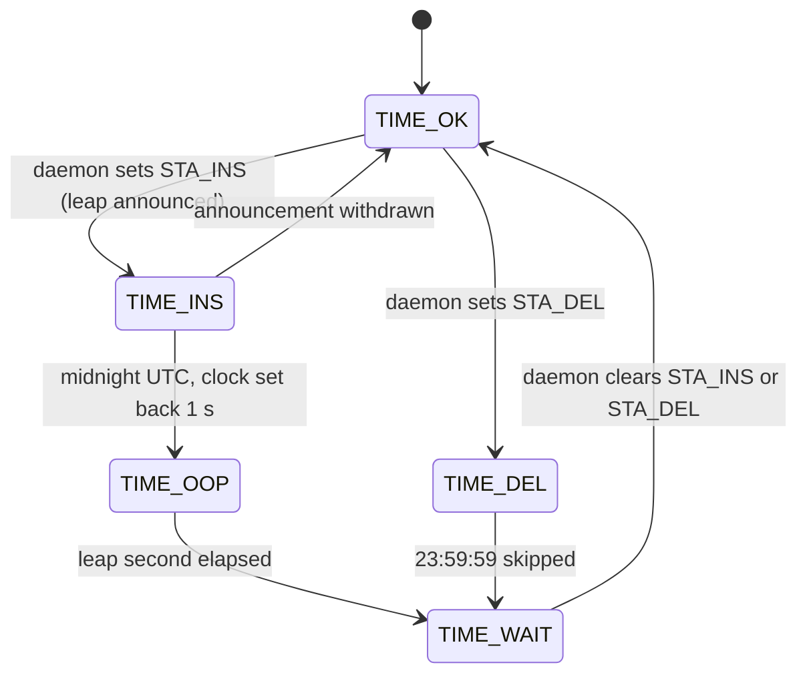
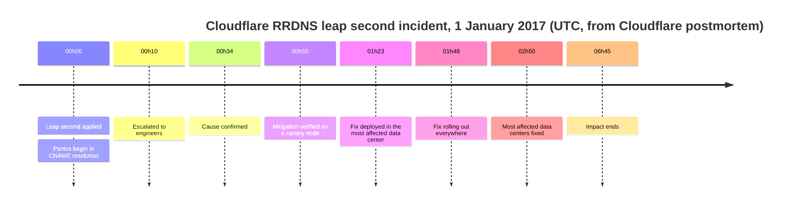

Fiziksel bir saat, bir osilatörün sürdüğü, varsayılan bir frekansla saniyeye çevrilen ve bir senkronizasyon protokolüyle Eşgüdümlü Evrensel Zaman'a (UTC) bağlanan bir sayaçtır. Bu cümledeki her terim hataya katkıda bulunur. Osilatör nominal frekansında çalışmaz ve hatası sıcaklıkla, yaşla değişir. Protokol, saatin offset'ini tek yönlü gecikmelerini göremediği bir ağ üzerinden tahmin eder. Düzeltme ya bir sıçrama olarak uygulanır, ki bu zamanın ileri aktığı varsayımını bozar, ya da bir hız değişikliği olarak uygulanır, ki bu da bir saniyenin bir saniye olduğu varsayımını bozar. Üstelik UTC'nin kendisi ara sıra 61 saniyelik bir dakika içerir ve yazılımların çoğu bunu temsil edemez.

Bu sayfanın ele aldığı problem, dağıtık sistemlerin bu saatleri okuyup sonuçları makineler arasında karşılaştırmasıdır: hangi yazmanın daha yeni olduğuna, bir lease'in ya da sertifikanın süresinin dolup dolmadığına, bir cache girdisinin ne zaman bayatladığına ya da bir olay sırasında farklı host'lardan gelen log satırlarının nasıl sıralanacağına karar vermek için. Bu karşılaştırmaların her biri ancak iki saat arasındaki fark, karşılaştırılan olaylar arasındaki farktan küçükse doğrudur. Tek bir veri merkezinde, Network Time Protocol (NTP) ile senkronize edilmiş iki sunucu genellikle bir milisaniyenin kesrinden birkaç milisaniyeye kadar uyuşmazken aralarındaki bir mesaj onlarca ila yüzlerce mikrosaniye sürer. Dolayısıyla duvar saati sırası mesaj sırası değildir ve aksini varsayan her tasarım sessizce bozulur.

Asıl denge, doğruluk ile maliyet ve etki alanı (blast radius) arasındadır. Daha sıkı senkronizasyon donanımsal zaman damgalama, uydu ya da atomik referanslı özel zaman sunucuları ve protokole katılan ağ switch'leri gerektirir; karşılığında mikrosaniye ya da altında hata sınırları kazandırır. Daha gevşek senkronizasyon hiçbir şeye mal olmaz ama kullanım anında bilinmeyen ve ara sıra büyük olan bir hata bırakır. Doğruluktan bağımsız olarak her senkronizasyon tasarımı saatin nasıl düzeltileceğini (step mi slew mü) ve artık saniyelerin nasıl ele alınacağını (step, slew, smear ya da yok sayma) seçmek zorundadır; her seçim hatayı farklı bir tüketiciye taşır. Bu sayfa hatanın büyüklüğünü ve biçimini ortaya koyar. Buna rağmen sürelerin nasıl ölçüleceği [Monotonic Saatler ve Günlük Saat](/distributed-systems/tr/foundations/time-and-ordering/monotonic-vs-time-of-day/) sayfasının, olayların ona güvenmeden nasıl sıralanacağı ise [Happened-Before İlişkisi](/distributed-systems/tr/foundations/time-and-ordering/happened-before/) sayfasının ve onu izleyen mantıksal saatlerin konusudur.


*Bir referanstan uygulamanın zaman damgasına uzanan zincir. Her ok ayrı bir hata terimidir; uygulamadaki toplam hata bunların toplamıdır ve yalnızca bir kısmı ölçülür.*

Diyagram bu sayfanın ana hatlarıdır. Soldaki referans çalışırken nanosaniye düzeyinde doğrudur, bozulduğunda ise yıllarca yanlış olabilir; aşağıdaki 2012 Naval Observatory olayı bunu gösterir. Her ağ atlaması, gerçek asimetrisiyle değil gidiş-dönüş süresinin yarısıyla sınırlanan bir hata ekler, çünkü asimetri gözlemlenemez. Osilatör terimi son düzeltmeden bu yana geçen süreyle doğrusal olarak büyür. Düzeltmenin uygulamaya step olarak mı yoksa hız değişikliği olarak mı ulaşacağına kernel karar verir. Kullanışlı bir hata bütçesi her oku adlandırır ve ona bir sayı atar.

## Osilatör: Her Saat Neden Kayar

Bir sunucunun günlük saati, bir quartz kristal osilatörün döngü sayısıdır; x86'da genellikle işlemcinin Time Stamp Counter'ı (TSC) üzerinden okunur ve kernel tarafından nanosaniyeye ölçeklenir. Bir quartz kristali, kesimi ve boyutlarıyla belirlenen bir frekansta rezonansa girer; üretici bir tolerans belirtir ve gerçek frekans nominalden milyonda birkaç kısım (ppm) kadar sapar. Bir ppm'lik frekans hatası saniyede bir mikrosaniye zaman hatası biriktirir; bu saatte 3,6 ms, günde 86,4 ms eder. Sunucu anakartlarındaki sıradan kristaller onlarca ppm ile tanımlanır, yani düzeltilmemiş bir sunucu saati günde saniyeler kazanıp kaybedebilir.

Sabit bir frekans hatasını gidermek kolay olurdu: bir kez ölçer ve ölçeklersiniz. Zorluk, hatanın sabit olmamasıdır. Kristal frekansı, kristalin kesimine bağlı bir eğri üzerinden sıcaklığa bağlıdır; dolayısıyla bir sunucunun osilatörü fanlar yavaşladığında, oda ısındığında ya da yanındaki CPU boştan tam yüke geçtiğinde hız değiştirir. Frekans ayrıca yaşlanır ve aylar içinde yavaşça kayar. Bu yavaş değişimlerin üzerinde kısa vadeli gürültü bulunur. Bu yüzden bir senkronizasyon daemon'ı saati bir kez kalibre edemez; hareket eden bir frekansı izlemek zorundadır ve iki düzeltme arasında saat, gerçek frekans ondan uzaklaşırken son frekans tahminiyle çalışır. Artık hata (residual error), yani daemon'ın en iyi tahmininden sonra kalan kısım, poll'lar arasında büyüyen terimdir.

Bir osilatörün iki niteliği kolayca karıştırılır. Doğruluk (accuracy), ortalama frekansın nominale ne kadar yakın olduğudur; kararlılık (stability), frekansın belirli bir aralıkta ne kadar değiştiğidir. Senkronizasyon doğruluk eksikliğini giderir, çünkü frekanstaki sabit bir sapma öğrenilir ve telafi edilir. Kararsızlığı ise poll hızından daha hızlı gideremez: frekans bir dakika içinde 1 ppm oynuyorsa, 17 dakikada bir poll eden bir daemon onu izleyemez. Sıcaklık kompanzasyonlu (TCXO) ya da fırın kontrollü (OCXO) kristaller veya rubidyum referanslar gibi daha iyi osilatörler kararlılığı ve dolayısıyla bir saatin referanssız doğru çalışabileceği süreyi iyileştirir. Bu süreye holdover denir ve aşağıdaki örnek onu hesaplar.

Sanallaştırma bir katman daha ekler. Bir guest kernel, host'un sayacından türetilen `kvm-clock` gibi paravirtualize bir saat kaynağını okur; böylece guest, host osilatörünün kaymasını ve hypervisor'ın guest'i duraklattığında, taşıdığında ya da geri yüklediğinde yarattığı her süreksizliği devralır; arıza modları bölümü bunlara geri döner.

## NTP: Ölçülemeyen Bir Ağ Üzerinden Offset Tahmini

Güncel sürümü olan 4 RFC 5905'te tanımlanan NTP, bir saati referansa daha yakın sunucularla zaman damgalı paketler değiş tokuş ederek düzeltir. Bir referansı doğrudan okuyan sunucu stratum 1'dir; stratum 1 sunucusuna senkronize olan sunucu stratum 2'dir ve bu böyle 15'e kadar gider; 16 senkronize olmamak anlamına gelir. Her paket, göndericinin referansa kendi uzaklığına dair görüşünü taşır; böylece istemci yalnızca bir offset tahmini değil, bu tahminin ne kadar yanlış olabileceğine dair bir üst sınır da hesaplayabilir.


*48 baytlık NTP başlığı. Üç zaman damgası değiş tokuşu taşır; root delay ve root dispersion, sunucunun referanstan birikmiş uzaklığını taşır.*

Başlık protokolün neyi bildiğini gösterir. Leap indicator (LI), geçerli günün sonunda bekleyen bir artık saniyeyi duyurur. Root delay, sunucudan stratum 1 referansına kadar olan toplam gidiş-dönüş gecikmesidir; root dispersion ise sunucunun bu yol boyunca biriken hata tahminidir ve sunucu taze güncellenmediği sürece sabit varsayılan bir hızla (RFC 5905 15 ppm kullanır) büyür. Her zaman damgası 64 bittir: 1 Ocak 1900'den bu yana geçen saniyeler için 32 bit ve kesir için 32 bit, yani yaklaşık 233 pikosaniyelik çözünürlük. 32 bitlik saniye alanı Şubat 2036'da başa sarar; NTPv4 bunu era numaralarıyla ele alır ve implementasyonlar era'yı güncel tarihe dair kaba bir bilgiden çözer. Saati on yıllarca yanlış başlayan bir istemcinin yanlış era'ya senkronize olabilmesinin bir nedeni budur.

### Dört Zaman Damgalı Değiş Tokuş

İstemci kendi saat okuması `T1`'i kaydeder ve bir istek gönderir. Sunucu isteğin geldiği anı `T2`, yanıtın çıktığı anı `T3` olarak, ikisini de kendi saatinde kaydeder. İstemci yanıtın geldiği anı `T4` olarak kaydeder. Her saatten ikişer olmak üzere bu dört okumadan istemci gidiş-dönüş gecikmesini `delta = (T4 - T1) - (T3 - T2)`, offset tahminini ise `theta = ((T2 - T1) + (T3 - T4)) / 2` olarak hesaplar.


*Asimetrik gecikmeli tek bir NTP değiş tokuşu. Sayılar örnek amaçlıdır: sunucu 2 ms ileridedir ve yanıt bir kuyrukta istekten 0,3 ms daha uzun bekler.*

1-5. adımlar dört okumayı üretir; 6. adım ve sonrasındaki notlar aritmetiktir. Her zaman damgası tam doğru olduğu hâlde tahmin 150 mikrosaniye yanlıştır ve hata tam olarak dönüş ve gidiş gecikmeleri arasındaki farkın yarısıdır. Formülü açmak nedenini gösterir: gerçek offset `theta_true`, tek yönlü gecikmeler `d_fwd` ve `d_back` ise `T2 - T1 = theta_true + d_fwd` ve `T3 - T4 = theta_true - d_back` olur; dolayısıyla tahmin `theta_true + (d_fwd - d_back) / 2`'ye eşittir. Formül simetrik yollar varsayar ve her asimetriyi offset'e yükler.

### Asimetri Neden Aşılamaz Bir Taban

Offset hatası formülün bir kusuru değildir; bu okumalardan hiçbir formül daha iyisini yapamaz. Sunucunun offset'inin `x` kadar daha büyük, gidiş gecikmesinin `x` kadar daha uzun, dönüş gecikmesinin `x` kadar daha kısa olduğu ikinci bir dünya düşünün. Dört zaman damgasının her biri iki dünyada da aynıdır; dolayısıyla onlar üzerinde yapılan hiçbir hesap iki dünyayı ayırt edemez. İstemci yalnızca hatayı sınırlayabilir: iki tek yönlü gecikme de negatif değildir ve toplamları `delta`'dır, yani asimetri terimi `-delta / 2` ile `+delta / 2` arasındadır. Tek yönlü gecikmenin bağımsız bir ölçümü olmadan elde edilebilecek en sıkı sınır gidiş-dönüş süresinin yarısıdır ve böyle bir ölçüm de senkronize saatler gerektirirdi.

Pratik sonuçlar doğrudan buradan çıkar. Hatalar gecikmeden değil asimetriden gelir: 50 ms'lik simetrik bir yol hiç hata eklemezken dönüş yönü her zaman toplu trafiğin arkasında kuyruğa giren 1 ms'lik bir yol, istemcinin göremeyeceği 0,5 ms'ye kadar hata ekler. Asimetri çoğunlukla rastgele değil sistematiktir: yöne göre farklı yönlendirme, tek yönde doymuş bir uplink ya da bir yönü geciktiren bir firewall. Sistematik bir hata çok sayıda örnek üzerinde ortalamayla kaybolmaz; istemci kendinden emin bir şekilde yanlış cevaba yakınsar. Bu yüzden bir daemon'ın raporladığı offset, hatanın bir ölçümü değil bir varsayım altındaki tahmindir; onu bir garantiye dönüştürmek, [Google TrueTime ve Spanner](/distributed-systems/tr/foundations/time-and-ordering/truetime-spanner/) sayfasının aralığına yerleştirdiği sınırlı terimleri gerektirir.

### Filtreleme, Seçim ve Yalan Söyleyen Bir Sunucudan Kurtulmak

İstemci tek bir değiş tokuşa güvenmez. Her sunucu için son örneklerin kısa bir geçmişini tutar (referans implementasyonun clock filter'ında sekiz örnek) ve en düşük gidiş-dönüş gecikmesine sahip örneği tercih eder; gerekçe, en hızlı değiş tokuşun en az kuyruklanmaya ve dolayısıyla en az olası asimetriye maruz kaldığıdır. Bu örneğin offset'i, gecikmesinden ve sunucunun root delay ile dispersion değerlerinden türetilen bir hata sınırıyla birlikte bir doğruluk aralığı oluşturur: sunucu dürüstse gerçek zamanın içinde bulunması gereken aralık.

Birden fazla sunucuyla istemcinin elinde birden fazla aralık olur ve Marzullo algoritmasından türetilen bir seçim algoritması çalıştırır: aralıkların çoğunluğunun örtüştüğü en küçük aralığı bul. Aralıkları bu bölgeye düşen sunucular truechimer, düşmeyenler falseticker'dır ve daha düşük bir stratum bildirseler bile elenirler. Ardından bir kümeleme adımı hayatta kalanlar arasındaki aykırı değerleri budar ve birleştirme adımı kalan offset'lerin kaliteye göre ağırlıklı ortalamasını alır. Doğruluk, çoğunluğun dürüst olmasına bağlıdır ve algoritmanın tek bir kötü sunucuyu oyla alt edebilmesi için en az üç sunucuya ihtiyacı vardır: uyuşmayan iki sunucuyla istemci hangisinin yanlış olduğunu bilemez, tek sunucuyla ise bir şeylerin yanlış olduğunu bile bilemez. Yaygın öneri dört sunucudur; böylece biri erişilemezken bir diğeri yalan söyleyebilir.

### Disiplin: Slew, Step ve Frekans

Daemon bir offset tahminine sahip olduğunda, saati kullanılamaz hâle getirmeden düzeltmek zorundadır. Bunun için iki aracı vardır ve aralarındaki seçim, saatle ilgili üretim olaylarının çoğunun kaynağıdır. Slew, saatin hızını hafifçe değiştirir; böylece saat yavaş yavaş yetişir ya da geri kalır. Saat hiç sıçramaz, ama düzeltme boyunca makinedeki bir saniye gerçek zamanın bir saniyesi değildir. Step ise saati bir anda düzeltilmiş değere ayarlar; hata yok olur ama saat sıçrar, belki geriye doğru, ve sıçramayı kapsayan her hesaplama imkânsız bir aralık görür.

Daemon ayrıca osilatörün frekans hatasını da öğrenir, çünkü nedeni gidermeden offset'leri gidermek saati ileri geri testere dişi gibi salındırırdı. NTP referans implementasyonu (ntpd), phase-locked ve frequency-locked davranışı birleştiren bir kontrol döngüsü kullanır; frekans düzeltmesini ardışık offset'lerin eğiliminden ayarlar ve her iki düzeltmeyi `adjtimex()` sistem çağrısıyla kernel'a iletir. Kernel frekans düzeltmesini sürekli uygular; asla step atmayan bir saat olan `CLOCK_MONOTONIC`'in bile daemon'ın yönlendirdiği bir hızda çalışmasının nedeni budur.

Eşikler kontrol teorisinden daha önemlidir. RFC 5905'ten devralınan ntpd varsayılanları, offset 128 ms'yi aştığında saati step'ler, aksi hâlde slew eder; slew hızı en fazla 500 ppm'dir, bu da kernel'ın frekans ayarı sınırıdır. 500 ppm'de 128 ms'lik bir offset'i slew ile gidermek 256 saniye sürer; 10 saniyeyi gidermek beş saatten fazla sürerdi, büyük offset'lerin step'lenmesinin nedeni budur. 1.000 saniyenin üzerindeki bir offset, yani panic eşiği, ntpd'nin harekete geçmek yerine çıkmasına yol açar; gerekçe, böyle bir offset'in kayan bir saati değil bozuk bir referansı gösterdiğidir. Birçok güncel Linux dağıtımında varsayılan olan chrony bu seçimleri açık hâle getirir: `makestep` eşiği ve step'e izin verilen ilk güncelleme sayısını, `maxslewrate` ise slew sınırını belirler. Bu sınırın 83.333,333 ppm'lik varsayılanı chrony'nin bir saniyelik offset'i yaklaşık on iki saniyede gidermesini sağlar; bedeli ise %8'lik bir hız bozulmasıdır ve [monotonic saat sayfası](/distributed-systems/tr/foundations/time-and-ordering/monotonic-vs-time-of-day/) bunun lease marjlarını bozmaya yettiğini gösterir.

Poll sıklığı tabloyu tamamlar. ntpd'nin varsayılan poll aralığı 64 ile 1.024 saniye arasında uyarlanır; chrony'nin varsayılan aralığı da aynıdır. Daha uzun bir aralık sunucular üzerindeki yükü azaltır ve daha fazla gürültünün ortalamasını alır, ama osilatörün sapmasının düzeltmeler arasında daha uzun süre birikmesine izin verir. Sunucuların yakın ve yükün ucuz olduğu bir veri merkezinde 16 ila 64 saniyelik aralıklar yaygındır ve kayma terimini orantılı olarak küçültür.

## NTP'nin Ötesi: Donanımsal Zaman Damgaları, PTP ve Bulut Zaman Servisleri

NTP hatasının, dört zaman damgası fikrine özgü olmayan iki kaynağı vardır: paket ağ arayüzünü, kesme işlemeyi ve kernel'ın ağ yığınını geçtikten sonra yazılımda alınan zaman damgaları ve istemci ile sunucu arasındaki switch'lerde oluşan asimetrik kuyruklanma. IEEE 1588 olarak standartlaştırılan Precision Time Protocol (PTP) ikisine birden saldırır (yaygın kullanılan sürüm 1588-2008'dir, 2019'da revize edilmiştir).

İlk çözüm donanımsal zaman damgalamadır. Ağ arayüz kartı (NIC), bir paketin ilk bitinin çıktığı ya da ulaştığı tam anı, NIC üzerindeki PTP Hardware Clock (PHC) adlı bir saatle kaydeder. Onlarca mikrosaniyelik yazılım jitter'ı ölçümden kaybolur ve host'un sistem saati daha sonra PHC'ye ağ yerine yerel veri yolu üzerinden senkronize edilir. İkinci çözüm switch'leri protokole katmaktır. Transparent clock, her PTP paketinin kendi içinde ne kadar beklediğini (residence time) ölçen ve bu süreyi paketteki bir düzeltme alanına ekleyen bir switch'tir; alıcı bu süreyi çıkarır ve böylece switch içindeki kuyruklanma artık asimetriye katkıda bulunmaz. Boundary clock ise PTP'yi her port'ta sonlandırır: yukarı yönde istemci olarak kendini senkronize eder, aşağı yönde sunucu gibi davranır ve uzun bir yolu kısa yollara böler. Değiş tokuşun kendisi farklı mesaj adlarıyla yine dört zaman damgalıdır (sunucudan istemciye Sync ve Follow_Up, ters yönde Delay_Req ve Delay_Resp) ve aynı simetrik yol varsayımını taşır: PTP asimetriyi azaltır, yukarıdaki ayırt edilemezlik argümanından kaçmaz. Bir Best Master Clock Algorithm, diğer tüm saatlerin izlediği grandmaster'ı seçer.

Meta'nın 2022'de PTP kurulumunu anlattığı yazı, iyileşmenin ölçeğini ve maliyetini gösterir. Zaman cihazları, özel bir zaman kartında bir uydu alıcısını atomik bir osilatörle birleştirir; sunucuları unicast PTP üzerinden senkronize olur ve Meta switch'lerde transparent clock'lara dayanır, çünkü kendi anlatımına göre bunlar olmadan yol gecikmesi hataları yüzlerce mikrosaniyeye ulaşabilir. İzlemede 24 saat boyunca yaklaşık 100 ns'nin altında sapma raporlamış, NTP için ise milisaniye düzeyinde hassasiyet tanımlamış; saat belirsizliğinin geçmesini bekleyen okumalarla yaptığı bir deneyde de kabaca yüz kat performans farkı bildirmiştir. İstemci API'si tek bir zaman damgası yerine bir aralık döndürür; TrueTime'ın kullandığı tasarımın aynısı.

Bulut sağlayıcıları artık bu düzeyde senkronizasyonu, kurmayı gerektirmeden sunuyor. Amazon Time Sync Service her EC2 instance'ından `169.254.169.123` link-local adresinde NTP üzerinden erişilebilir; AWS'nin belgelediği tipik saat hata sınırı 100 mikrosaniyenin altındadır. Desteklenen instance tiplerinde ise instance'ın ağ adaptöründe bir PHC sunar ve doğru yapılandırıldığında tipik sınır 40 mikrosaniyenin altındadır. İki yol, aşağıda ele alınan artık saniye davranışında ayrışır: NTP servisi smear yapar, PHC yapmaz. Diğer büyük sağlayıcılar da benzer iç servisler işletir; belgelenmiş özellikleri farklıdır ve varsayılmak yerine ilgili platform için okunmalıdır.

| Senkronizasyon yöntemi | UTC'ye göre tipik hata | Onu sınırlayan | Altyapı maliyeti | Ne zaman tercih edilir |
|---|---|---|---|---|
| Serbest çalışan osilatör | Onlarca ppm hızla büyür, günde saniyeler | Osilatör doğruluk ve kararlılık eksikliği | Yok | Makineler arası karşılaştırılan hiçbir şey için asla; yalnızca holdover olarak |
| Genel internet havuzlarına NTP | Milisaniyeler ila onlarca ms | WAN üzerinden yol asimetrisi, bilinmeyen sunucu kalitesi | Yok | Sağlayıcı ya da iç servisi olmayan host'lar; iç stratum 1 veya 2'yi yalnızca çok sayıda çeşitli kaynakla beslemek |
| Aynı bölgedeki iç ya da bulut sunucularına NTP | Milisaniye altı ila birkaç ms; AWS tipik 100 us altı belgeler | Yazılımsal zaman damgalama, LAN kuyruklanması, poll aralığı | Düşük: birkaç iç sunucu ya da bir sağlayıcı uç noktası | Çoğu servis için varsayılan; milisaniye kaymasını tolere eden her şey |
| NIC donanımsal zaman damgalarıyla NTP ya da chrony | Onlarca mikrosaniye | Switch kuyruklanma asimetrisi | Düşük: NIC desteği ve yapılandırma | Yeni switch almadan NTP'den daha iyisine ihtiyaç duyan, desteklenen NIC'lere sahip filolar |
| Donanımsal zaman damgalı, transparent ya da boundary clock'lu PTP | Mikrosaniye altı ila birkaç mikrosaniye | Grandmaster kalitesi, kablolama ve PHY'deki artık asimetri | Yüksek: PTP destekli switch'ler, zaman cihazları, operasyon becerisi | Commit ya da okuma yolunda saat belirsizliğini bekleyen sistemler, finansal zaman damgalama |
| Bulut PHC (ör. desteklenen instance'larda AWS) | AWS tipik 40 us altı belgeler | Sağlayıcı altyapısı; instance tipi desteği | Kullanıcı için düşük | PTP donanımına sahip olmadan bulutta sınırlı belirsizlikli saatler |

Tablonun son sütunu karardır. Çoğu servisin yakındaki bir sunucuya NTP'den daha iyisine ihtiyacı yoktur, çünkü yaptıkları hiçbir şey birkaç milisaniyenin altındaki kaymaya bağlı değildir. Hassasiyet ancak bir protokol belirsizliğin geçmesini beklediğinde, commit wait'in yaptığı gibi, ödemeye değer hâle gelir; o durumda hatanın her mikrosaniyesi her transaction'da bir mikrosaniyelik gecikmedir.

## Örnek Hesap: Bir Hata Bütçesi ve Bir Holdover Sınırı

Tek bir veri merkezinde A ve B adlı iki uygulama sunucusu olduğunu varsayın; her biri, kendileri de bir WAN üzerinden stratum 1 sunucularına senkronize olan iki iç stratum 2 sunucusuna karşı chrony çalıştırıyor. Bu bölümdeki tüm sayılar, belgelere atfedilenler dışında örnek amaçlı varsayımlardır; önemli olan sayılar değil yöntemdir.

Host başına bütçe, ilk diyagramdaki okları toplar. Stratum 2 sunucusunun WAN yolundan devraldığı, UTC'ye göre kendi hatasının en fazla 0,25 ms olduğu varsayılıyor. Host'un stratum 2 sunucusuna giden yolunda yük altında gözlenen en düşük gidiş-dönüş süresi 0,5 ms'dir, dolayısıyla asimetri hatası en fazla bunun yarısı, 0,25 ms'dir. Poll aralığı 64 saniyedir ve disiplin sonrası artık frekans hatasının sıcaklık geçişlerinde 5 ppm'e ulaştığı varsayılıyor; böylece saat bir sonraki düzeltmeden önce `64 s x 5e-6 = 0.32 ms` kayabilir. Yazılımsal zaman damgalama ve kesme gecikmesi varsayılan 0,03 ms ekler. En kötü durumda toplam, host başına `0.25 + 0.25 + 0.32 + 0.03 = 0.85 ms`'dir.

A ile B arasındaki her karşılaştırma için önemli olan ikili sınırdır ve topolojiye bağlıdır. A ve B farklı stratum 2 sunucularına senkronize oluyorsa hataları bağımsızdır ve zıt yönleri gösterebilir; sınır host başına değerin iki katı, 1,7 ms'dir. İkisi de aynı stratum 2 sunucusunu kullanıyorsa o sunucunun hatası ikisinde ortaktır ve farkta birbirini götürür; sonuç `2 x 0.6 = 1.2 ms` olur. Zaman damgalarını karşılaştıran bir sunucu kümesini aynı upstream'e senkronize etmek, UTC'ye göre doğruluklarını iyileştirmeden aralarındaki kaymayı azaltır; bu, bir veritabanı kümesi için yapılmaya değer, şirketler arası log korelasyonu için ise önemsiz bir takastır.

Sınırı mesaj gecikmesiyle karşılaştırın. Veri merkezi içinde A'dan B'ye bir istek tek yönde belki 0,1 ms sürer. A'nın isteği damgalamasından 0,1 ms sonra B'nin damgaladığı bir yanıt, A'nınkinden 1,6 ms daha erken bir zaman damgası taşıyabilir. Duvar saati sırası, kaymadan daha yakın olan her olay çifti için neden ile sonucu ters çevirir; tek bir veri merkezinde bu, her istek ve yanıt demektir. Nedensel olarak bağımlı yazmaları bu zaman damgalarıyla sıralayan bir last-writer-wins deposu yazmaları sessizce kaybeder; bu arıza [Happened-Before İlişkisi](/distributed-systems/tr/foundations/time-and-ordering/happened-before/) sayfasında incelenir.

Aynı host'ları her biri 40 mikrosaniyelik sınıra sahip bir PHC'ye taşımak 80 mikrosaniyelik bir ikili sınır verir; yirmi katlık bir iyileşmedir ve 50 mikrosaniyelik bir istek-yanıt çiftini sıralamaya yine yetmez. Daha iyi senkronizasyon pencereyi daraltır; asla ortadan kaldırmaz.

### Holdover: Bir Saat Tek Başına Ne Kadar Süre Sınırlar İçinde Kalır

Şimdi A host'unun bir firewall değişikliği, bir DNS arızası ya da bozuk bir iç servis yüzünden tüm zaman sunucularıyla bağlantısını kaybettiğini varsayın. Daemon son frekans tahminini uygulamaya devam eder, dolayısıyla saatin hatası artık frekans hatası hızında büyür. [Hibrit Mantıksal Saatler](/distributed-systems/tr/foundations/time-and-ordering/hybrid-logical-clocks/) üzerine kurulu veritabanlarında olduğu gibi tüm node'ların yapılandırılmış bir maksimum offset içinde kalmasını gerektiren bir sistemin, bu sınır ihlal edilmeden önce bir son tarihi vardır.


*Üst çizgi: öğrenilmiş bir frekans olmadan soğuk başlangıçtan sonraki gibi 50 ppm'lik artık frekans hatası. Alt çizgi: frekans tahmini hâlâ iyi olan disiplinli bir saat, 5 ppm. Düz çizgi: 500 ms'lik bir maksimum offset sınırı.*

Dik çizgi 500 ms'lik sınırı `0.5 s / 50e-6 = 10,000 s` sonra, yani yaklaşık 2,8 saatte; yatık çizgi ise `0.5 s / 5e-6 = 100,000 s` sonra, yaklaşık 28 saatte geçer. Daha sıkı bir 50 ms sınırına karşı aynı saatler yaklaşık 17 dakika ve 2,8 saat dayanır. Commit wait tabanlı bir tasarımın bütçeleyebileceği belirsizlik olan 1 ms'lik bir sınıra karşı ise 5 ppm'lik bir saat 200 saniye dayanır. Buradan üç sonuç çıkar. Kaybedilen bir zaman kaynağını tespit edip harekete geçme bütçesini en gevşek değil en sıkı tüketici belirler. Holdover'ı satın alan varlık frekans tahminidir; kesinti sırasında yeniden başlayan bir host onu kaybeder ve dik hızla kayar. Ve holdover sırasındaki hata host'un kendisi tarafından gözlemlenemez; bu yüzden alarm kurulacak sinyal, son değerinde kalan raporlanmış offset değil, son güncellemeden bu yana geçen süreyle büyüyen daemon'ın maksimum hata tahminidir.

## Artık Saniyeler: 61 Saniyelik Bir Dakika

UTC iki zaman ölçeği arasındaki bir uzlaşmadır. Uluslararası Atom Zamanı (TAI), atomik saatlerden tekdüze SI saniyeleri sayar. Evrensel Zaman (UT1) ise düzensiz olan Dünya'nın dönüşünü izler. UTC, TAI hızında tıklar ama 1972'den beri Haziran ya da Aralık sonunda bir artık saniye eklenerek, ya da prensipte çıkarılarak, UT1'in 0,9 saniye yakınında tutulmuştur. Hepsi pozitif olmak üzere yirmi yedi artık saniye eklenmiştir, sonuncusu 31 Aralık 2016 sonunda; dolayısıyla TAI, UTC'nin 37 saniye önündedir. Uluslararası Dünya Dönüşü ve Referans Sistemleri Servisi (IERS) her birini yaklaşık altı ay önceden Bulletin C ile duyurur ve NTP sunucuları duyuruyu leap indicator bitleri üzerinden yayar.

:::note[UTC, TAI, UT1 ve Unix zamanı]
TAI tekdüze atomik zamandır. UT1, Dünya'nın dönüş açısının zaman olarak ifadesidir. UTC, UT1'e yakın kalacak şekilde seçilen tam sayıda saniye çıkarılmış TAI'dir. `CLOCK_REALTIME`'ın döndürdüğü Unix zamanı, 1970'ten bu yana her gün tam 86.400 saniyeymiş gibi saniye sayar; dolayısıyla bir artık dakikanın 61. saniyesini temsil edemez: pozitif bir artık saniye sırasında bir değeri tekrarlar ya da durur. GPS zamanı da TAI'den sabit 19 saniye farklı olan bir başka tekdüze ölçektir.
:::

Pozitif bir artık saniye, günün son dakikasını 00:00:00'a ulaşmadan önce 23:59:00'dan 23:59:60'a kadar çalıştırır. Unix zamanı 23:59:60'ı ifade edemediği için her sistem o saniye boyunca saatinin ne göstereceğine karar vermek zorundadır ve seçenekler süreksizliği nereye koyduklarına göre ayrışır.


*adjtimex() ile raporlandığı biçimiyle Linux kernel'ının artık saniye durumu. Kernel artık saniyeyi ancak daemon onu kurarsa uygular.*

Kernel'ın ele aldığı modda senkronizasyon daemon'ı, artık saniyeden önceki son gün içinde bir durum bayrağı ayarlayarak kernel'ı kurar; kernel `TIME_INS` durumuna girer. UTC gece yarısında kernel `CLOCK_REALTIME`'ı bir saniye geri step'ler, böylece 23:59:59 saniyesi yeniden oynatılır; bu saniye boyunca `TIME_OOP` (operation in progress) raporlar ve dikkatli bir okuyucu iki geçişi ayırt edebilir. Ardından daemon'ın bayrağı temizlemesini bekler. İlginç özellik, step'in kernel'ın timekeeping kodu içinde, saat değişikliğini normalde diğer alt sistemlere bildiren yolların dışında gerçekleşmesidir; aşağıda anlatılan 2012 arızası tam olarak buradan çıktı. Hiç gerçekleşmemiş olan negatif bir artık saniye 23:59:59'u tamamen atlardı; kod yolu mevcuttur ama hiçbir üretim filosunda çalışmamıştır.

### Step, Slew, Smear ya da Yok Sayma

Kernel step'ine alternatiflerin hepsi bir süreksizliği, yanlış hızda ya da yanlış zamanda geçen bir süreyle takas eder. Daemon saati kernel yerine kendisi step'leyebilir; bu, farklı bir yoldan aynı sıçramadır. Slew edebilir: gece yarısı saate dokunmaz, kendini UTC'nin bir saniye önünde bulur ve saniyeyi yavaş yavaş giderir; chrony'nin belgelerine göre Linux'ta varsayılan `maxslewrate` ile bu yaklaşık 12 saniye sürer. Ya da zaman sunucuları smear yapabilir: fazladan saniyeyi saatlerini hafifçe yavaş çalıştırarak uzun bir pencereye yayarlar; böylece onları izleyen istemciler hiçbir zaman bir sıçrama görmez ve UTC'den hiçbir zaman yarım saniyeden fazla uzaklaşmaz.

Google'ın genel NTP servisi her artık saniyeyi UTC öğleden öğleye 24 saat boyunca doğrusal olarak smear eder; bu yaklaşık 11,6 ppm'lik bir hız değişikliğidir ve Google bunu bir standart olarak önerir. AWS de NTP servisi için aynı smear'ı kullanır. Meta, 2022'deki kendi uygulamasını anlatırken stratum 2 sunucularında uygulanan ikinci dereceden (quadratic) bir eğriyle 17 saat boyunca smear yaptığını belirtmiştir; küçük adımları seçmesinin nedeni yüzlerce sunucunun aynı anda smear yapması ve poll başına daha büyük değişikliklerin istemcilerin smear yapan sunucuları seçimlerinden oyla dışlaması riskidir. chrony'nin `smoothtime` direktifi sunucu tarafı smear'ı uygular; belgelerindeki örnek 17 saat 34 dakika sürer ve `leaponly` seçeneği normal düzeltmeleri yumuşatmanın dışında tutar, böylece aynı şekilde yapılandırılmış birden fazla sunucu birebir aynı zamanı üretir.

| Strateji | Artık saniye sırasında saat | UTC'den en fazla uzaklık | Hız bozulması | Ne zaman tercih edilir |
|---|---|---|---|---|
| Kernel step (`leapsecmode system`, ntpd varsayılanı) | 23:59:59 yeniden oynatılır, `TIME_OOP` ayarlanır | Artık saniye dışında 0 | Yok, ama geriye bir step | UTC'yle birebir eşleşmesi gereken ve yazılımı geriye step'lere karşı denetlenmiş sistemler |
| Daemon step (`leapsecmode step`) | Saat 00:00:00'da geri step'lenir | Step'ten sonra 0 | Yok, geriye step | Kernel yoluna güvenilmeyen yerlerde yukarıdakiyle aynı |
| İstemci slew (`leapsecmode slew`) | Gece yarısı saat 1 s öndedir, sonra yetişir | Slew süresince 1 s | `maxslewrate`'e kadar; chrony varsayılanında yaklaşık %8 | Asla step atmaması gereken ve kısa hız bozulmasını tolere eden tekil host'lar |
| Sunucu tarafı smear (Google, AWS NTP: 24 saat doğrusal) | Hiç sıçramaz | Artık saniye anında 0,5 s | 24 saat boyunca yaklaşık 11,6 ppm | Hepsi aynı smear kaynağını izleyebilen filolar |
| Yok say, sonra yeniden senkronize ol | Daemon fark edene kadar 1 s kayık | Düzeltilene kadar 1 s | Sonraki düzeltmeye bağlı | Sonradan bir step'in zararsız olduğu izole sistemler |
| İçeride tekdüze ölçek (TAI, GPS, smear'sız PHC) | Artık saniye yok; kenarlarda dönüştür | UTC'den sabit tam sayı offset | Yok | Kendi zaman damgası formatına sahip olan ve sunumda dönüştürebilen sistemler |

:::danger[Smear'lı ve smear'sız saatler yarım saniyeye kadar uyuşmaz]
Bir smear penceresi sırasında, smear yapan bir sunucuyu izleyen bir host ile artık saniyeyi uygulayan bir host 0,5 saniyeye kadar farklılaşır; bu, normal bütçeden yüzlerce kat büyük bir kaymadır. Replica'ları her iki tür host üzerinde bulunan bir last-writer-wins deposu yazmaları bu kadar ters sıralayıp sessizce düşürebilir ve iki tür arasındaki lease ya da token kontrolleri uyuşmayabilir. AWS, bir artık saniye olayı sırasında tek bir istemcide smear'lı ve smear'sız kaynakların birlikte yapılandırılmamasını açıkça önerir; aynı kural, üyeleri zaman damgalarını karşılaştıran bir filo için de geçerlidir. Her karşılaştırma alanı için tek bir strateji seçin ve bir bulut sağlayıcısının NTP servisi ile PHC'sinin bu çizginin zıt taraflarında olabileceğini unutmayın.
:::

### Artık Saniyelerin Sonu ve Belki Hiç Gelmeyecek Olan

Artık saniye emekliye ayrılıyor. Ağırlıklar ve Ölçüler Genel Konferansı (CGPM) 2022'de Resolution 4 ile UT1 ve UTC arasında izin verilen farkın 2035'te ya da öncesinde artırılmasına karar verdi. Ekim 2026'daki 28. toplantısı için hazırlanan karar taslağı, sürekli UTC'nin 20 Mayıs 2027'de bir saatlik maksimum farkla yürürlüğe girmesini öneriyor ve o toplantıya dair haberler taslağın kabul edildiğini bildiriyor. Mühendisler için iki sonuç kalıyor. Artık saniye kodu kernel'larda, daemon'larda ve kütüphanelerde yıllarca kalacak ve tarihî 27 artık saniyeyi kapsayan damgalı veriler işlendiği sürece çalışmaya devam etmek zorunda. Ve değişiklik yürürlüğe girene kadar, Dünya'nın son dönemdeki hızlanması negatif bir artık saniyeyi ilk kez akla yatkın hâle getirdi: Duncan Agnew'ün 2024'te *Nature*'da yayımlanan analizi, kural değişmezse 2029 civarında bir tane gerekeceğini öngördü; karar taslağı da 2035'e kadar bir tane olma olasılığını yaklaşık %30 olarak aktarıyor. Meta'nın 2022 analizi, negatif bir artık saniyenin hiçbir zaman ölçekli olarak test edilmediği uyarısında bulunmuştu. Kural değişikliği bunun olmasını olasılık dışı kılıyor; onu ele alacak kod yolu ise hâlâ hiç çalışmadı.

## Zaman Senkronizasyonunu İşletmek: Yapılandırma, Sinyaller ve Arızalar

Bir zaman senkronizasyonu yapılandırması, host üzerindeki her saat düzeltmesinin nasıl davranacağına karar veren küçük bir dosyadır ve bir veritabanı failover politikasıyla aynı incelemeyi hak eder. Aşağıdaki chrony yapılandırması bir filoda önemli olan parametreleri gösterir; host adları yer tutucudur ve değerler örnek amaçlıdır.

```text
# Several internal sources, so one bad server is outvoted
server ntp-a.internal iburst minpoll 4 maxpoll 6
server ntp-b.internal iburst minpoll 4 maxpoll 6
server ntp-c.internal iburst minpoll 4 maxpoll 6
server ntp-d.internal iburst minpoll 4 maxpoll 6
minsources 2              # do not adjust the clock from a single source
# Step only during the first 3 updates after start; afterwards only slew
makestep 0.1 3
# Bound the rate distortion every clock sees while slewing (ppm)
maxslewrate 1000
# Leap seconds: take the table from tzdata and slew locally
leapsectz right/UTC
leapsecmode slew
# Use NIC hardware timestamps where the driver supports them
hwtimestamp *
```

Bu satırlardan üçü ayar değil politikadır. `makestep 0.1 3` step'e yalnızca açılışta, saate henüz hiçbir şey bağlı değilken izin verir ve sonrasında yasaklar; böylece sonraki bir offset büyük olsa bile slew edilir. Bedeli, açılıştan sonra ciddi biçimde yanlış olan bir host'un uzun süre yanlış kalmasıdır ve bunu izlemenin yakalaması gerekir. `maxslewrate 1000` her hız bozulmasını %0,1 ile sınırlar: bir saniyeyi düzeltmek 12 yerine 1.000 saniye sürer ve monotonic saat sayfasında ele alınan lease marjları yaklaşık 80 kat küçülür. Artık saniye satırları da onunla birleşir: slew 1.000 ppm ile sınırlandığında host'un artık saniye düzeltmesi yerel bir 1.000 saniyelik smear'a dönüşür; bu da ancak onunla zaman damgası karşılaştıran her host aynı şekilde davranıyorsa güvenlidir.

İzleme iki kaynağı okur. Daemon kendi görüşünü raporlar: tahmini offset, frekans, root delay ve dispersion ile her kaynağın durumu. Kernel ise daemon'ın `adjtimex()` ile ona bildirdiklerini dışa aktarır; Prometheus'un node exporter'ı bunları `node_timex_offset_seconds`, `node_timex_sync_status`, `node_timex_maxerror_seconds`, `node_timex_estimated_error_seconds` ve `node_timex_frequency_adjustment_ratio` olarak yayımlar.

```shell
chronyc tracking       # offset, frequency (ppm), root delay, root dispersion, leap status
chronyc sources -v     # per source: * selected, + combined, - excluded, x falseticker, ? unreachable
chronyc sourcestats    # per source: frequency skew and offset standard deviation
journalctl -u chronyd | grep -E 'stepped|wrong by|Selected source|Can.t synchronise'
```

Kullanışlı alarmlar yalnızca offset üzerine kurulmaz. Erişilebilir ve seçilebilir kaynak sayısı tek bir kötü kaynağı oyla alt etmeye gereken sayının altına düştüğünde; herhangi bir kaynak falseticker olarak işaretlendiğinde; maksimum hata tahmini en sıkı tüketicinin bütçesini aştığında; frekans düzeltmesi keskin biçimde değiştiğinde (bu, offset'te görünmeden önce termal ya da donanımsal sorunu gösterir); ve açılıştan sonraki her step'te alarm üretin. Raporlanan offset'i bir hata sınırı gibi kullanmaya dair uyarı ve root delay ile dispersion'dan bir sınırın nasıl kurulacağı [TrueTime sayfasındadır](/distributed-systems/tr/foundations/time-and-ordering/truetime-spanner/).

:::tip[Yalnızca sunucuya olan offset'i değil, host'lar arası kaymayı ölçün]
Her host sunucusuna küçük bir offset raporlarken iki host milisaniyelerce uyuşmayabilir, çünkü her offset kendi yol asimetrisini gizler. İkili kaymanın önemli olduğu yerlerde onu doğrudan ölçün: host'ları ortak bir PTP ya da PHC referansına karşı karşılaştırın veya eşler arasında zaman damgası değiş tokuş eden ve en düşük gecikmeli offset'i zaman içinde izleyen problar çalıştırın. NTP'nin raporlamadığı kalıcı, sıfırdan farklı bir ikili offset, görünür hâle gelmiş asimetridir.
:::

### Artık Saniye Livelock'u: 30 Haziran 2012

Tetikleyici: 30 Haziran 2012 sonundaki artık saniye, daemon'ı kernel'ı kurmuş host'larda Linux kernel'ı tarafından uygulandı. Kernel, duvar saatini yüksek çözünürlüklü timer'ların mutlak duvar saati deadline'larını dönüştürmek için kullandığı kayıtları güncellemeden bir saniye geri step'ledi. Java ve MySQL'in thread koordinasyonu için kullandığı futex beklemelerinin timeout'ları dahil `CLOCK_REALTIME` üzerindeki timer'lar bir saniye erken tetiklendi ve hemen tetiklenmeye devam etti. Belirtiler: başka türlü boşta olan host'larda CPU kullanımı %100'e fırladı, Java uygulamaları yanıt vermez oldu ve tüm filolarda yük aynı anda sıçradı. Reddit bir süre erişilemez oldu; LinkedIn, Yelp ve Mozilla'nın Hadoop ve ElasticSearch kurulumları etkilendi; Qantas ve Virgin Australia'nın kullandığı Amadeus Altea rezervasyon sistemi yaklaşık bir saat çöktü ve manuel check-in'e geçilmek zorunda kalındı. Tespit: trafik değişikliği olmadan tam UTC gece yarısında filo çapında bir CPU sıçraması, futex çağrılarında dönen thread'ler ve artık saniye eklemesini gösteren kernel log'ları. O zamanki önlem: saati kendisine ayarlamak, örneğin `date -s "$(date)"` ile; bu normal saat ayarlama yolundan geçiyor ve timer kayıtlarını onarıyordu. Kernel düzeltmesi birkaç gün içinde geldi. Kalıcı ders şudur: bir artık saniye, birkaç yılda bir, her makinede aynı anda bir kod yolunu çalıştırır ve bu mümkün olan en kötü test rejimidir. Büyük operatörlerin smear'a geçmesinin nedeni bu gözlemdir.

### Negatif Süreler: Cloudflare, 1 Ocak 2017

Tetikleyici: 2016 sonundaki artık saniye. Cloudflare'in Go ile yazılmış DNS servisi RRDNS, upstream resolver'lara gidiş-dönüş süresini iki `time.Now()` okumasını birbirinden çıkararak ölçüyordu; o tarihte Go'nun `time.Now()` fonksiyonunun monotonic bir bileşeni yoktu, dolayısıyla saat bir saniyeyi tekrarladığında ölçülen bir süre negatif çıktı. RRDNS bu ölçümleri yumuşatarak bir ağırlığa dönüştürüyordu ve negatif bir ağırlık, negatif argümanla panic'leyen `rand.Int63n()`'e ulaştı.


*Cloudflare'in kamuya açık postmortem'inden zaman çizelgesi. Zirvede Cloudflare'e gelen DNS sorgularının yaklaşık %0,2'si etkilendi; bunlar çoğunlukla CNAME kaydı kullanan müşterilerin sorgularıydı.*

Zaman çizelgesi çoğu saat olayının yapısını gösterir: tüm filonun aynı anda paylaştığı bir tetikleyici, zamanı açıkça ele alan herhangi bir koddan uzakta beliren bir belirti ve olay sürerken her yere dağıtılması gereken küçük bir düzeltme. Cloudflare'in düzeltmesi, zaman geriye gittiğinde upstream performans verisini atıyordu. Genel önlem olan süreleri monotonic bir saatle ölçmek, [monotonic saat sayfasının](/distributed-systems/tr/foundations/time-and-ordering/monotonic-vs-time-of-day/) konusudur; Go, 2017'nin ilerleyen aylarında 1.9 sürümüyle `time.Time`'a monotonic okumalar ekledi.

### Yalan Söyleyen Bir Referans: 2000 Yılına Sıçrama, Kasım 2012

Tetikleyici: 19 Kasım 2012'de, yaygın kullanılan genel bir stratum 1 kaynağı olan Birleşik Devletler Deniz Gözlemevi'nin (United States Naval Observatory) bir NTP sunucusunun, yeniden başlatıldıktan sonra sınırlı bir süre 2000 yılına ait bir zaman sunduğu bildirildi. Belirtiler: onu tek ya da baskın kaynak olarak kullanan istemciler saatlerini on iki yıl geri step'ledi; ntpd instance'ları panic eşiğinde çıktı; ondan senkronize olan Windows Active Directory domain controller'ları replikasyon hataları raporladı ve Microsoft "zamanda geriye giden" domain'ler için rehber yayımladı. Tespit: çok kaynaklı istemcilerde kaynak üzerinde bir falseticker işareti, daemon log'larında step ve panic mesajları ve henüz geçerli olmayan sertifikalar ya da aşılmış tombstone ömürleriyle ilgili uygulama hataları. Önlem: seçim algoritmasının kötü olanı oyla alt edebilmesi için birden fazla bağımsız kaynak; saçma düzeltmeleri reddeden bir panic eşiği ya da step sınırı; dizin servisleri için ise saatin tek bir ayarda ne kadar düzeltilebileceğine dair sınırlar, ki Microsoft'un rehberi bunlara işaret ediyordu. Sistemler yanlış zamana göre hareket ettiğinde kurtarma yavaştır: yanlış bir tarih altında silinen ya da süresi dolan nesneler silinmiş kalır.

### Kaynaksız Kayma ve Yeniden Senkronizasyon Sonrası Step'ler

Tetikleyici: bir host bir firewall kuralı, yapılandırmada hâlâ adı geçen kaldırılmış bir sunucu ya da bozuk bir metadata uç noktası yüzünden zaman kaynaklarını kaybeder ve holdover örneğindeki gibi kayar. Belirtiler: başta hiçbiri; sonra bir veritabanı node'u maksimum offset'i aştığı için kendini kapatır, Kerberos ya da TLS kontrolleri henüz geçerli olmayan veya süresi dolmuş görünen token'larda başarısız olur ve host'un log satırları sırası bozulur. Bağlantı geri geldiğinde step atmasına izin verilen bir daemon tek bir büyük düzeltme yapar ve host üzerinde duvar saatini okuyan her deadline, rate limiter ve ID üreteci zamanın sıçradığını görür. Tespit: `chronyc sources` içinde erişilemeyen kaynaklar, senkronize olmadığını raporlayan `node_timex_sync_status`, düzenli olarak büyüyen bir maksimum hata tahmini ve toparlanmada bir step mesajı. Önlem: holdover sınırından çok önce kaynak erişilebilirliğine alarm kurun; toparlanmanın bir slew olması için açılıştan sonra step'leri yasaklayın; ve saate bağımlı sistemlerin yalnızca offset'i değil senkronizasyon durumunu da kontrol etmesini sağlayın.

### Sanal Makine Duraklatmaları ve Snapshot'lar

Tetikleyici: bir hypervisor, live migration ya da host bakımı için bir guest'i duraklatır veya bir guest bir snapshot'tan geri yüklenir. Belirtiler: duvar saatinin duraklatma süresi kadar ileri ya da snapshot zamanına geri sıçraması ve ardından büyük bir düzeltme; guest donmuşken diğer host'lardaki lease'ler ve heartbeat'ler sona erer ve guest uyandıktan sonra bayat duruma göre hareket eder. Tespit: hypervisor'dan steal time ve duraklatma olayları, daemon log'unda step mesajları ve uygulama heartbeat'lerindeki boşluklar. Önlem: uyanma sonrası büyük offset'leri ele alacak şekilde yapılandırılmış daemon'lar, guest'e host saatinin doğrudan okumasını veren `ptp_kvm` ya da sağlayıcı PHC cihazları ve [Fencing Token'lar](/distributed-systems/tr/coordination/distributed-locking/fencing-tokens/) sayfasındaki duraklatmaya dayanıklı tasarımlar; çünkü hiçbir saat yapılandırması, kritik bir bölümün ortasında dondurulmuş bir süreci korumaz.

:::caution[Her an step'e izin vermek]
chrony'de `makestep 1 -1` ya da bir cron job'ından `ntpdate` veya `date -s` çalıştırmak, normal çalışma sırasında geriye doğru olanlar dahil her an step'e izin verir. Bu yapılandırma çoğu zaman uyku moduna geçen dizüstü bilgisayarlar için yazılmış bir rehberden gelir. Sunucularda ise her geçici senkronizasyon sorununu duvar saati tüketicilerinin gördüğü bir süreksizliğe dönüştürür. Step'e açılışta izin verin, sonrasında slew edin ve açılış sonrası her step'i incelenecek bir olay olarak ele alın.
:::

| Arıza | İlk görünen belirti | Tespit sinyali | Önlem |
|---|---|---|---|
| Artık saniye kernel yolu hatası | UTC gece yarısında filo çapında CPU sıçraması | `adjtimex` içindeki leap durumu, futex ağırlıklı profiller | Kernel step yerine smear ya da slew; yamalı kernel'lar |
| Geriye step'ten negatif süre | Gecikmeden türetilen mantıkta panic'ler ya da saçma değerler | Negatif süre sayaçları, step log satırları | Monotonic süreler; negatif değerlere karşı koruma |
| Falseticker referans | Saatler saçma miktarda sıçrar | Kaynak durumunda `x`, panic ya da step mesajları | Dört veya daha fazla çeşitli kaynak; step sınırları |
| Kaybedilen kaynaklar, holdover kayması | Offset sınırı kapanmaları, kimlik doğrulama hataları | Erişilemeyen kaynaklar, yükselen maksimum hata | Erişilebilirlik alarmları; yalnızca slew ile toparlanma |
| Karışık smear'lı ve smear'sız kaynaklar | Smear penceresinde yarım saniyelik kayma | Artık saniye pencerelerinde ikili kayma probları | Karşılaştırma alanı başına tek artık saniye stratejisi |
| Asimetrik yol | Küçük raporlanan offset'lerle kalıcı ikili kayma | Eşler arası kayma probları | Daha yakın sunucular, donanımsal zaman damgaları, PTP transparent clock'lar |
| VM duraklatması ya da snapshot geri yüklemesi | Uyanma sonrası sıçramalar, başka yerlerde süresi dolmuş lease'ler | Hypervisor olayları, step mesajları, heartbeat boşlukları | PHC ya da `ptp_kvm`, fencing |

## Fiziksel Zamana Ne Zaman ve Ne İçin Güvenilir

Tüketici bir insan ya da hata bütçesini tolere eden bir sistem olduğunda duvar saati zaman damgalarını rahatça kullanın: bir olay sırasında okunan log satırları, `created_at` sütunları, denetim kayıtları, metrikler, dakikalarca tolerans tanıyan sertifika geçerliliği, saniyeler ya da daha uzun TTL'ler ve takvim tarihlerine bağlı iş kuralları. Bunlar için, hata bütçesi yazılı ve izleniyor olduğu ve zaman senkronizasyonu daemon'ı açılıştan sonra step atmayacak şekilde yapılandırıldığı sürece yakındaki bir sunucuya NTP yeterlidir.

Fiziksel zamanı makineler arası sıralama için ancak protokol açık bir sınır taşıyor ve bu sınırı ya bekliyor ya da ihlallerini tespit ediyorsa kullanın. TrueTime'ın commit wait'i ölçülmüş bir aralıkla bunu yapar; hibrit mantıksal saat kullanan veritabanları da yapılandırılmış bir maksimum offset ve aşıldığında kendini kapatma ile bunu yapar. Bu tür sistemler, gecikmeleri ya da abort oranları sınırla ölçeklendiği için, platformun sunduğu en iyi senkronizasyon üzerinde çalışmalıdır: mümkünse bir PHC ya da PTP.

Nedensel olarak ilişkili iki yazmadan hangisinin daha yeni olduğuna, başka bir node'un tuttuğu bir lease'in sona erip ermediğine karar vermek ya da benzersiz olması gereken tanımlayıcılar üretmek için, tasarım kaymayı ve geriye step'leri hesaba katmadıkça fiziksel zaman damgalarını kullanmayın. Alternatifler bu bölümün geri kalanının konusudur: zaman olmadan sıralama için [Lamport zaman damgaları](/distributed-systems/tr/foundations/time-and-ordering/lamport-timestamps/) ve [vektör saatler](/distributed-systems/tr/foundations/time-and-ordering/vector-clocks/), yerel deadline'lar için [monotonic saatlerde](/distributed-systems/tr/foundations/time-and-ordering/monotonic-vs-time-of-day/) ölçülen süreler ve açık geriye gitme yönetimiyle zaman önekli tanımlayıcılar için [Dağıtık ID Üretimi](/distributed-systems/tr/foundations/time-and-ordering/distributed-id-generation/).

Doğruluğu ve gecikmesi milisaniye altındaki kaymaya bağlı olmayan bir sistem için PTP'ye yatırım yapmayın; fayda ancak bir protokol belirsizlik için gecikme ödediğinde ortaya çıkar. Ve hangi senkronizasyon yöntemi seçilirse seçilsin, zaman damgalarını karşılaştıran tek bir makine kümesi içinde artık saniye stratejilerini karıştırmayın.

## İleri Okuma

- David L. Mills, Jim Martin, Jack Burbank, and William Kasch, *Network Time Protocol Version 4: Protocol and Algorithms Specification*, RFC 5905, IETF, 2010.
- Keith Marzullo and Susan Owicki, *Maintaining the Time in a Distributed System*, ACM Symposium on Principles of Distributed Computing, 1983.
- IEEE, *IEEE Standard for a Precision Clock Synchronization Protocol for Networked Measurement and Control Systems*, IEEE Std 1588-2019.
- Google, *Leap Smear*, Google Public NTP documentation. https://developers.google.com/time/smear
- Cloudflare, *How and why the leap second affected Cloudflare DNS*, Cloudflare blog, 2017. https://blog.cloudflare.com/how-and-why-the-leap-second-affected-cloudflare-dns/
- Oleg Obleukhov and Ahmad Byagowi, *How Precision Time Protocol is being deployed at Meta*, Engineering at Meta, 2022. https://engineering.fb.com/2022/11/21/production-engineering/precision-time-protocol-at-meta/
