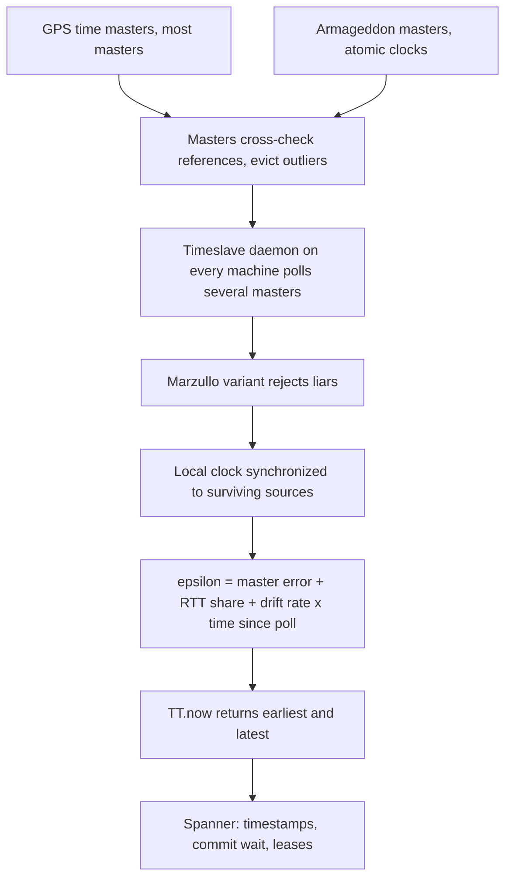
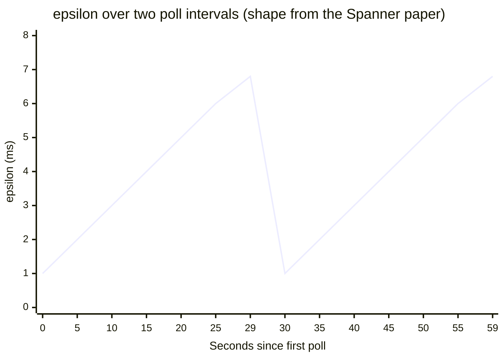
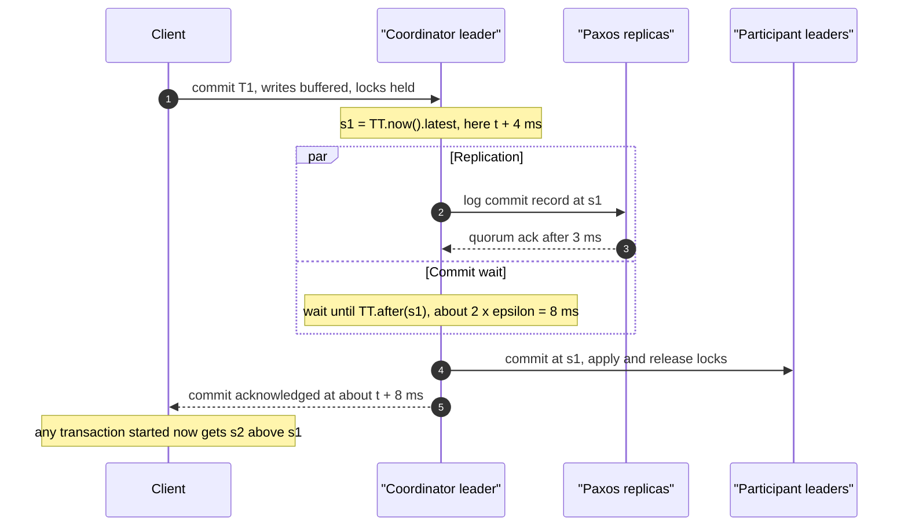
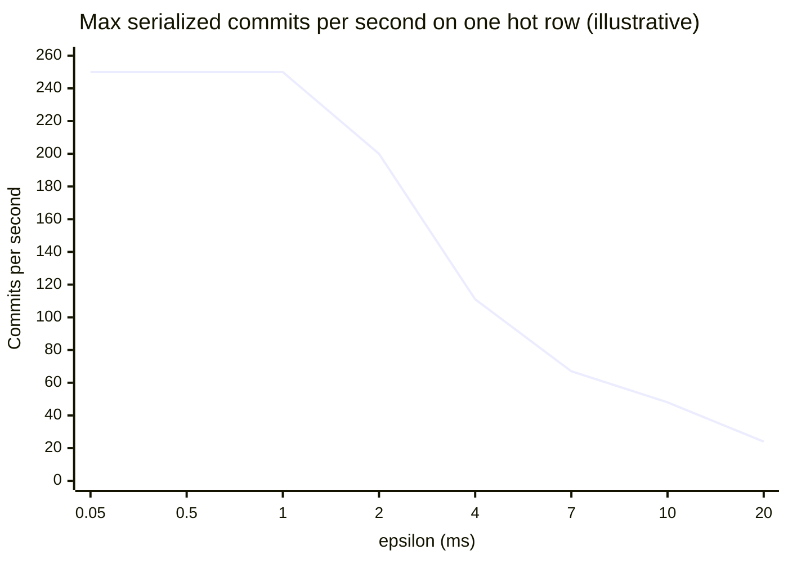
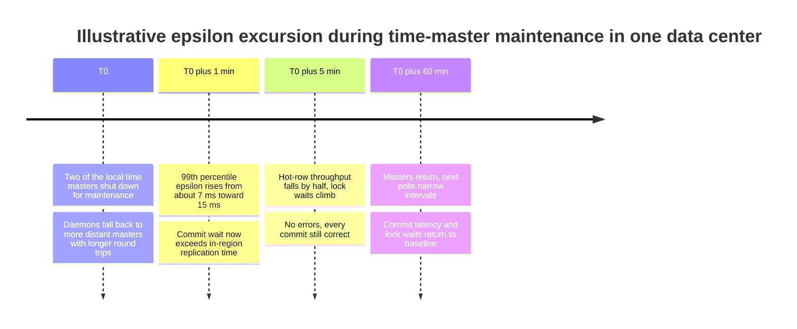

TrueTime, Google'ın hiçbir zaman tek bir zaman değeri döndürmeyen saat API'sidir. `TT.now()` çağrısı bir `[earliest, latest]` aralığı döndürür ve yanında bir garanti verir: çağrı anındaki gerçek mutlak zaman bu aralığın içinde bir yerdedir. Aralık genişliğinin yarısı anlık hata sınırıdır ve `epsilon` olarak yazılır. Türetilmiş iki çağrı bu garantiyi kullanılabilir kılar: `TT.after(t)` yalnızca `t` her yerde kesinlikle geçmişte kaldığında, `TT.before(t)` ise yalnızca `t` kesinlikle henüz gelmediğinde doğru döner. Google'ın küresel ölçekte dağıtık veritabanı Spanner, bu aralığı sıralaması işlemlerin gerçek zaman sırasıyla örtüşen commit zaman damgaları atamak için kullanır; bu, birbiriyle hiç iletişim kurmayan istemciler arasında bile geçerlidir.

TrueTime'ın çözdüğü problem, bu bölümün geri kalanının açık bıraktığı problemdir. [Fiziksel saatler](/distributed-systems/tr/foundations/time-and-ordering/physical-clocks/), kullanım anında kimsenin ölçmediği bir miktar kadar birbirinden farklıdır; bu yüzden bir makinede alınmış bir zaman damgası, başka bir makinede alınmış biriyle ters sıralama riski olmadan karşılaştırılamaz. [Hibrit mantıksal saatler](/distributed-systems/tr/foundations/time-and-ordering/hybrid-logical-clocks/) mesajlarla bağlı olaylar için bu ters çevrilmeyi onarır; ancak bir node'da onaylanmış bir yazma ile, bunu veritabanının hiç görmediği bir kanaldan duyduktan sonra başka bir node'da başlatılmış bir okuma yine yanlış sıralanabilir. Her işlemin, kendisi başlamadan önce commit edilmiş her işlemi gördüğünü vaat eden bir veritabanı, yani Spanner'ın external consistency (dış tutarlılık) dediği garantiyi veren bir veritabanı, hiçbir mesajı paylaşmayan işlemleri sıralamak zorundadır ve bu işlemlerin paylaştığı tek bilgi zamandır.

Asıl denge şudur: TrueTime saat belirsizliğini bir doğruluk riskinden bir gecikme maliyetine dönüştürür. Spanner, saatlerin yapılandırılmış bir sapma (offset) içinde anlaştığını varsayıp varsayımın tutmasını ummak yerine belirsizliğini sürekli ölçer ve onu bekleyerek geçirir: bir işlemin commit'i, zaman damgası her makinede kesinlikle geçmişte kalana kadar görünür kılınmaz; bu yaklaşık `2 * epsilon` kadar bir gecikmedir. Birkaç milisaniyelik bir `epsilon` ile bekleme katlanılabilirdir ve büyük ölçüde replikasyonun arkasında gizlenir; HLC veritabanlarında yaygın olarak yapılandırılan yüzlerce milisaniyelik bir sınırla ise kullanılamaz olurdu. Bu sayfadaki her şey bu takastan çıkar: `epsilon`'u küçük tutmak için gereken altyapı, bekleme boyunca kilitleri tutmanın throughput maliyeti ve aralık gerçek zamanı dışarıda bırakırsa ortaya çıkan sessiz hata.

## TrueTime Aralığı ve Genişliğinin Kaynağı

Bir aralık, ancak genişliği referans saat ile çağrı anı arasındaki her hata kaynağını hesaba katıyorsa dürüsttür. TrueTime bu genişliği, her biri yerel olarak ölçülebilen ya da sınırlanabilen üç terimden kurar. Birincisi referansın kendi hatasıdır; çalışan bir alıcıya sahip bir time master için bu sıfıra yakındır. İkincisi master ile yapılan ağ alışverişinin eklediği belirsizliktir; bu, round trip'in yarısıyla sınırlıdır ve NTP'yi sınırlayan, fiziksel saatler sayfasında türetilen asimetri sınırıyla aynıdır. Üçüncüsü son senkronizasyondan bu yana biriken kaymadır (drift): yerel osilatör o andan beri serbest çalışmaktadır ve daemon bunu varsayılan en kötü durum hızının geçen süreyle çarpımı kadar hesaba yazar. İlk ikisi her yoklamada (poll) sabitlenir; üçüncüsü bir sonraki yoklamaya kadar doğrusal olarak büyür.


*2012 tarihli Spanner makalesinde anlatıldığı biçimiyle TrueTime'ın gerçekleştirimi. Farklı hata biçimlerine sahip iki tür referans her daemon'ı besler ve daemon kendi hata sınırını yayımlar.*

Diyagramın önemli özelliği, iki uçta da çeşitlilik olmasıdır. GPS alıcıları anten arızaları, parazit ve sahte sinyal (spoofing) yüzünden bozulur; atom saatleri ise dış bir referans olmadan kayarak bozulur. Bunları eşleştirmek ve master'ların referanslarını düzenli olarak birbiriyle karşılaştırıp yerel saatleri referanstan saptığında kendilerini devreden çıkarmasını sağlamak, iki türün aynı anda ilişkili biçimde bozulmasını olası dışı kılar. İstemci tarafında her daemon, bir kısmı kendi veri merkezinde, bir kısmı daha uzakta olan birkaç master'ı yoklar ve Marzullo algoritmasının bir varyantını uygular: her master'ın raporunu bir aralık olarak ele alır, en fazla sayıda raporla tutarlı zamanı bulur ve aralıkları bununla örtüşmeyen master'ları yalancı olarak reddeder. Alıcısı bozuk tek bir master'a güvenilmez, oylamada azınlıkta kalır. Yerel osilatörü varsayılan en kötü durum sınırından büyük frekans sapmaları gösteren makineler devreden çıkarılır, çünkü kayma terimi yalnızca donanım ona uyduğu sürece geçerlidir.

Makale 2012 kurulumu için somut rakamlar verir. Daemon'lar her 30 saniyede bir yoklama yapar ve saniyede 200 mikrosaniyelik bir uygulanan kayma hızı hesaba yazar; böylece kayma terimi her yoklama aralığında sıfırdan 6 ms'ye çıkar, master'lara olan iletişim gecikmesi de yaklaşık 1 ms ekler. Sonuç, yaklaşık 1 ile 7 ms arasında değişen ve ortalaması yaklaşık 4 ms olan bir testere dişidir. Makale ayrıca Google'ın filosunda bozuk CPU'ların bozuk saatlerden altı kat daha olası olduğunu bildirir; bir saati etrafında tasarım yapılması gereken güvenilmez bir bileşen olarak değil, izlenmesi gereken güvenilir bir donanım olarak ele almanın arkasındaki gözlem budur.


*30 saniyelik yoklama aralığında 200 us/s'den gelen 0-6 ms'lik kayma terimi ile yaklaşık 1 ms'lik iletişim gecikmesi. Gerçek ölçümler daha gürültülüdür ve arızalar testere dişinin üzerine taşan sapmalara yol açar.*

Testere dişi, kolayca yanlış okunan iki şeyi açıklar. Birincisi, `epsilon` bir cluster sabiti değil, her makinenin her andaki bir özelliğidir: iki saniye önce yoklama yapmış bir makinenin aralığı, yoklamak üzere olan bir makinenin aralığından dardır ve onun üzerinden yapılan commit'ler daha az bekler. İkincisi, senkronizasyon durduğunda `epsilon` kendiliğinden büyür. Hiçbir master'a ulaşamayan bir daemon `TT.now()` çağrılarına yanıt vermeye devam eder, ancak aralık her saniye 0,2 ms genişler; bu yüzden yoklamasız bir dakikanın ardından `epsilon` yaklaşık 13 ms, on dakikanın ardından yaklaşık 121 ms olur. Makine yanlış değil, yavaş hâle gelir. TrueTime'ı yapılandırılmış bir maksimum sapmadan ayıran özellik bu kendi durumunu bildirme yeteneğidir: sınır, okumayı yapan makinenin gerçek senkronizasyon durumunu izler.

Garanti ayrıca ikili değil yereldir. TrueTime iki makinenin saatlerinin anlaştığını vaat etmez, yalnızca her makinenin aralığının gerçek zamanı içerdiğini vaat eder; merkezleri birbirinden milisaniyelerce uzak iki aralık aynı anda doğru olabilir. Karşılaştırmalar hiçbir zaman merkezler arasında değil, aralık uçları arasında yapılır; geniş aralıklı bir makineyi kullanmanın güvenli olmasının nedeni budur: verdiği her karar yalnızca daha muhafazakârdır.

## Aralıklardan External Consistency'ye: Atama ve Commit Wait

External consistency, [linearizability](/distributed-systems/tr/data-management/consistency-models/linearizability/)'nin işlem düzeyindeki biçimidir: `T1` işlemi mutlak zamanda `T2` işlemi başlamadan önce commit edildiyse, `T1`'in commit zaman damgası `s1`, `T2`'ninki olan `s2`'den küçüktür ve dolayısıyla `T2`'deki her okuma `T1`'in yazmalarını görür. [Serializability](/distributed-systems/tr/data-management/consistency-models/serializability/) ile birleştiğinde, veritabanı literatürünün strict serializability dediği garantiyi oluşturur. Zamanda örtüşen işlemler hakkında hiçbir şey söylemez; sıra serializable olduğu sürece bu işlemler iki yönde de sıralanabilir.

Spanner bu garantiyi, bir okuma-yazma işlemini koordine eden leader'ın uyguladığı iki kuraldan elde eder. Başlangıç kuralı (start rule), bir zaman damgasının ne kadar büyük olması gerektiğini belirler: koordinatör commit isteğini aldığında, `s` değerini o andaki `TT.now().latest`'ten küçük olmayacak biçimde seçer; ayrıca `s`, katılımcıların hazırlık (prepare) sırasında önerdiği hiçbir zaman damgasından küçük olamaz ve leader'ın daha önce atadığı her zaman damgasından büyük olmalıdır. Commit-wait kuralı ise zaman damgasının ne zaman açığa çıkabileceğini belirler: `TT.after(s)` doğru olana kadar hiçbir istemci ve hiçbir katılımcı `s` anında yazılmış veriyi göremez. İşlemin aldığı kilitler o ana kadar tutulmaya devam eder.


*Ortalama `epsilon` değeri 4 ms ve bölge içi replikasyon süresi temsili olarak 3 ms olan bir okuma-yazma işleminin commit'i. Adım numaraları mesajlara karşılık gelir.*

Adım 2, zaman damgasını mevcut aralığın en üstünden, yani gerçek zaman olabilecek en büyük değerden seçer. `par` bloğu beklemenin göründüğünden neden ucuz olduğunu gösterir: commit kaydının replikasyonu (adım 3 ve 4) ile commit wait eşzamanlı çalışır, dolayısıyla istemcinin gördüğü gecikme ikisinin toplamı değil, büyük olanıdır. Burada replikasyon 3 ms sonra biter ve kalan 5 ms saf beklemedir; quorum round trip'inin onlarca milisaniye sürdüğü çok kıtalı bir yapılandırmada ise bekleme tamamen gizlenir. Katılımcılar yazmaları ancak adım 5'te uygular ve kilitlerini bırakır; istemci sonucu ancak adım 6'da öğrenir. Makalenin, örtüşecek bir replikasyonun bulunmadığı tek replikalı ölçümlerinde commit wait yaklaşık 5 ms'dir.

Beklemenin `epsilon` değil de yaklaşık `2 * epsilon` olmasının nedeni, zaman damgasının bir aralığın tepesinden alınması ve daha sonraki bir aralığın tabanının altında kalması gerekmesidir. Atama anında gerçek zaman `t`, `latest - 2 * epsilon` kadar düşük olabilir. `TT.after(s)`, `TT.now().earliest > s` olduğunda doğru olur; sabit bir `epsilon` ile bu, gerçek zaman `s + epsilon`'u geçtiğinde, yani atamadan kabaca `2 * epsilon` sonra gerçekleşir. Daha kısa beklemek, aralığı doğru olan bir makinenin `s`'yi hâlâ gelecekte sayabileceği bir pencere bırakırdı.

### İki Kural Gerçek Zaman Sırasını Neden Garanti Eder

İspat, mutlak zamanlar üzerinde dört eşitsizlikten oluşan bir zincirdir. `e1_commit`, `T1`'in commit'inin görünür hâle geldiği olay; `e2_start`, `T2`'nin başladığı olay; `e2_server` ise `T2`'nin koordinatörünün commit isteğini aldığı olay olsun. Commit wait gereği `T1`, `TT.after(s1)` doğru olduktan sonra görünür olmuştur; dolayısıyla `s1 < t(e1_commit)`. Varsayım gereği `T1`, `T2` başlamadan önce commit edilmiştir; dolayısıyla `t(e1_commit) < t(e2_start)`. Nedensellik gereği `T2`'nin commit isteği, `T2` başladıktan sonra koordinatörüne ulaşmıştır; dolayısıyla `t(e2_start) <= t(e2_server)`. Başlangıç kuralı ve TrueTime garantisi gereği `s2`, `e2_server` anındaki `TT.now().latest`'ten küçük değildir ve bu değer de o olayın gerçek zamanından küçük değildir; dolayısıyla `t(e2_server) <= s2`. Geçişlilik `s1 < s2` sonucunu verir.

Her adım farklı bir bileşeni kullanır. İlki aralığın alt ucunu, sonuncusu üst ucunu kullanır ve ikisi de yalnızca aralık gerçek zamanı içeriyorsa geçerlidir. İki makineden hiçbirinin diğerinin saat okumasını bilmesi gerekmedi; her biri kendi aralığını mutlak zamanla karşılaştırdı ve mutlak zaman ikisinin de paylaştığı tek şeydir. TrueTime'ın hiç mesaj alışverişi yapmamış işlemleri sıralaması tam olarak bu anlamdadır; bu, her [mantıksal saati](/distributed-systems/tr/foundations/time-and-ordering/happened-before/) çaresiz bırakan durumdur.

### Okumalar, Safe Time ve Lease'ler

Salt okunur işlemler kilit almaz. Birden fazla Paxos grubuna dokunabilecek bir okumaya `s_read = TT.now().latest` atanır; aynı argümanla, okuma başlamadan önce commit edilmiş her işlemin zaman damgası daha küçüktür, dolayısıyla `s_read` anındaki bir snapshot onu içerir. Bir replika bu snapshot'ı ancak `s_read` veya altında henüz gelmemiş bir yazma olmadığını bildiğinde sunabilir; bunu safe time, yani `t_safe` olarak izler: Paxos log'undan uygulanmış en yüksek zaman damgası ile, two-phase commit'te hazırlanmış ama commit edilmemiş herhangi bir işlem varken, bu tür en erken prepare zaman damgasının hemen altındaki bir sınırın minimumu. Zaman damgası `t_safe`'in üzerinde olan bir okuma bekler. Hazırlanmış işlem bulunmayan tek bir Paxos grubu için Spanner, `TT.now().latest` yerine son commit edilmiş yazmanın zaman damgasını kullanabilir; bu, bu beklemenin büyük kısmını ortadan kaldırır. Açıkça belirtilmiş geçmiş bir zaman damgasındaki okumalar hem başlangıç kuralını hem de beklemeyi atlar; bunların yakındaki replikalardan sunulması [Follower Reads ve Bounded Staleness](/distributed-systems/tr/case-studies/distributed-sql/follower-reads-bounded-staleness/) sayfasında, bunları mümkün kılan çok sürümlü depolama ise [Zayıf İzolasyon ve MVCC](/distributed-systems/tr/data-management/consistency-models/weak-isolation-mvcc/) sayfasında ele alınır.

Leader değişimleri boyunca zaman damgası monotonluğu, TrueTime'ı üçüncü kez kullanır. Her Paxos grubunun leader'ı, makaledeki varsayılan değeriyle 10 saniyelik, bir quorum'un oylarıyla verilen ve başarılı yazmalarla örtük olarak uzatılan süreli bir lease (kiralama) tutar. Spanner, leader lease aralıklarının ayrık olmasını şart koşar ve bir leader yalnızca kendi lease'i içinde zaman damgası atar. Görevi bırakmadan önce bir leader, kullandığı en büyük zaman damgası olan `s_max` için `TT.after(s_max)` doğru olana kadar bekler; böylece halefinin zaman damgaları selefininkilerin altına düşemez. Lease'in sona ermesi iki tarafta da aralık uçlarıyla değerlendirilir; bu da garantiyi iki makinenin saatlerinin anlaşmasından bağımsız tutar. Lease'lerin genel mekaniği ve neden sınırlı saat hızlarına ihtiyaç duydukları [Kiralama Tabanlı Kilitleme](/distributed-systems/tr/coordination/distributed-locking/lease-based-locking/) sayfasına aittir.

Kurallar birkaç satırlık pseudocode'a sığar; bu, her beklemenin nerede gerçekleştiğini de görünür kılar.

```text
commit(T):                                    # coordinator leader
    s <- max(TT.now().latest, max(prepare_ts), last_assigned + 1)
    replicate commit record at s via Paxos    # runs concurrently with the wait
    wait until TT.after(s)                    # commit wait: s is past everywhere
    apply at s, release locks, ack client

read_only(keys):                              # multi-group, strong read
    s_read <- TT.now().latest
    for each replica serving keys:
        wait until t_safe(replica) >= s_read  # no write at or below s_read pending
    return snapshot at s_read

abdicate():                                   # Paxos leader
    wait until TT.after(s_max)                # lease intervals stay disjoint
```

Kod parçasındaki her `wait`, sistemin belirsizlik için ödediği bedeldir. Commit yolu yaklaşık `2 * epsilon` öder, güçlü okuma (strong read) en fazla yaklaşık `epsilon` artı replikasyon gecikmesi öder, görevi bırakan leader ise kendi son zaman damgalarının bedelini öder. Bunların hiçbiri, işlem anında bir saat otoritesine gönderilen bir mesaj içermez.

### Hesaplı Örnek: Commit Wait'in Maliyeti

Gecikme maliyeti görünen maliyettir; ekipleri şaşırtan ise çekişmeli satırlardaki throughput maliyetidir. Bu bölümdeki, makalenin `epsilon` rakamları dışındaki tüm sayılar temsilidir.

Commit kaydı quorum'unun 3 ms sürdüğü, `epsilon`'un ortalama 4 ms olduğu ve istemcinin leader'ın yanında durduğu bölgesel bir yapılandırma varsayalım. Commit gecikmesi, istek işleme süresine ek olarak yaklaşık `max(3, 8) = 8` ms'dir. Quorum'un 40 ms sürdüğü çok bölgeli bir yapılandırmada ise `max(40, 8) = 40` ms'dir: commit wait ölçülebilir hiçbir maliyet getirmez. Dolayısıyla gecikme cezası replikasyonun en hızlı olduğu yerde yoğunlaşır; burası aynı zamanda kullanıcıların milisaniyeleri en az fark ettiği yerdir, çünkü commit yolu zaten kısadır.

Kilit tutma süresi farklıdır, çünkü kilitler alındıkları andan commit wait'in sonuna kadar tutulur. Her işlemin güncellediği bir satır varsayalım, örneğin bir hesap bakiyesi ya da bir stok sayacı; kilit alındıktan sonra 1 ms'lik yürütme olsun. Her işlem kilidi yaklaşık `1 + max(3, 8) = 9` ms tutar; dolayısıyla satır, veritabanında kaç makine olursa olsun saniyede en fazla yaklaşık `1000 / 9`, kabaca 110 seri commit taşır. Commit wait olmadan, aynı replikasyona sahip bir HLC tasarımında tutma süresi `1 + 3 = 4` ms'dir ve satır saniyede yaklaşık 250 commit taşır. Bir time master kesintisi sırasında `epsilon` 10 ms'ye sıçrarsa tutma süresi `1 + 20 = 21` ms olur ve aynı satır, diğer tüm metrikler sağlıklı görünürken saniyede yaklaşık 48 commit'e düşer.

Örneğin ikinci yarısı belirsizlik bütçesidir. TrueTime'ın 2012 parametreleriyle `epsilon = 1 ms + 200 us/s * time since poll` (son yoklamadan beri geçen süre). 30 saniyelik yoklamayı 1 saniyelik bir yoklamayla değiştirdiğinizde kayma terimi en fazla 0,2 ms olur; ağ terimini, bulut sağlayıcılarının artık kendi zaman servisleri için belgelediği gibi hata sınırı onlarca mikrosaniye düzeyinde olan donanım zaman damgalı bir PTP kaynağıyla değiştirdiğinizde `epsilon` bir milisaniyenin çok altına iner. Bu durumda commit wait, istemciye olan ağ round trip'inden daha az tutar ve sıcak satır tavanını yeniden replikasyon belirler. Tasarımı sınırlayan algoritması değil, altyapısının garanti edebildiği aralık genişliğiydi ve bu genişlik 2012'den bu yana daraldı.


*Kilit tutma süresi = 1 ms yürütme + max(3 ms replikasyon, 2 x epsilon). 1,5 ms'nin altında replikasyon baskındır ve eğri 250'de düzdür; bunun üzerinde `epsilon`'un her milisaniyesi iki milisaniyelik kilit tutma süresine mal olur.*

Kırılma noktası, `2 * epsilon`'un replikasyon süresine eşit olduğu yerdedir. Bunun altında daha iyi zaman senkronizasyonuna yatırım yapmak bu iş yükü için hiçbir şey kazandırmaz; üzerinde ise elde edilebilecek en ucuz throughput iyileştirmesidir. TrueTime tarzı bir tasarımı değerlendiren bir ekip, başka herhangi bir karar vermeden önce kendi replikasyon süresini ve ulaşabileceği `epsilon` değerini bu eğri üzerinde konumlandırmalıdır.

## İşlemleri Sıralamanın Diğer Yollarıyla Karşılaştırıldığında TrueTime

Commit wait, dağıtık bir veritabanında gerçek zaman sırası üreten birkaç mekanizmadan biridir; bu mekanizmalar maliyeti nereye koydukları bakımından ayrışır.

| Mekanizma | Gerçek zaman sırası nasıl elde edilir | Ödenen bedel | Varsayım bozulursa oluşan hata | Ne zaman tercih edilmeli |
|---|---|---|---|---|
| Commit wait ile TrueTime (Spanner) | Her commit, zaman damgası doğru her saatte geçmişte kalana kadar bekler | Commit başına yaklaşık `2 * epsilon`, daha uzun kilit tutma | Bir aralık gerçek zamanı dışarıda bırakırsa sessiz bayat okumalar | GNSS ya da PTP sınıfı saatlerle ve birkaç ms veya daha az `epsilon` ile küresel strict serializability |
| Belirsizlik aralıklı HLC (CockroachDB, YugabyteDB) | Okumalar, yapılandırılmış maksimum sapma içindeki sürümlerde yeniden başlar | Özellikle uzun işlemlerde okuma yeniden başlatmaları | Gerçek sapma yapılandırılmış sınırı aşarsa sessiz bayat okumalar | Sıradan NTP saatleri, retry'a toleranslı okuma iş yükleri |
| Commit wait ile gelecek zamanlı yazmalar (CockroachDB GLOBAL tabloları) | Yazmalar replikasyon süresi artı maksimum sapma kadar ileri damgalanır, ardından commit wait uygulanır | Yavaş yazmalar, 250 ms sapmada yüzlerce ms | HLC ile aynı | Her bölgede yerel olarak okunması gereken, ağırlıklı okunan küresel veri |
| Merkezî zaman damgası oracle'ı (Percolator, TiDB) | Tek bir servis kesin olarak artan zaman damgaları dağıtır | İşlem başına oracle'a bir round trip, tek bir serileştirme noktası | Oracle failover'ı hiçbir zaman bir zaman damgasını yeniden vermemelidir | Tek bölge, yüksek throughput, özel saat yok |
| Tek leader ya da sıralayıcı (sequencer) | Tek bir log her şeyi sıralar | Kapsamdaki tüm yazmalar tek bir node'dan geçer | Leader failover'ı ve split brain | Kapsam tek bir replikasyon grubuna sığıyorsa |

Tablo, genellikle birbirine karıştırılan iki soruyu ayırır. Birincisi gerçek zaman bilgisinin nereden geldiğidir: bir saat sınırından (TrueTime, HLC), tek bir otoriteden (oracle, leader) ya da hiçbir yerden; son durumda yalnızca nedensel sıra elde edilebilir. İkincisi bedeli kimin ödediğidir: her yazan (commit wait), şanssız her okuyan (belirsizlik yeniden başlatmaları) ya da bir round trip üzerinden her işlem (oracle). TrueTime'ın bedeli yazanlara yüklemesi bilinçli bir seçimdir: çoğu iş yükünde okumalar baskındır; yazmaları birkaç milisaniye bekleten, güçlü okumaları ise kilitsiz ve yeniden başlatmasız kılan bir tasarım, maliyetini en az acıttığı yerde harcar.

Oracle doğal bir karşılaştırma noktasıdır, çünkü aynı garantiyi saat olmadan verir. Sınırlaması coğrafyadır: başka bir kıtadaki bir istemci, herhangi bir veriye dokunmadan önce bir zaman damgası almak için kıtalar arası bir round trip öder ve oracle'ın bölgesi her yazma ve her güçlü okuma için bir bağımlılık hâline gelir. TrueTime bu round trip'i yerel bir hesaplama ve uzunluğu mesafeden bağımsız bir beklemeyle değiştirir; listedeki yaklaşımlar arasında merkezî bir uğrak noktası olmadan küresel güçlü okumalara ölçeklenen tek yaklaşımın bu olmasının nedeni budur.

TrueTime [CAP teoreminin](/distributed-systems/tr/data-management/consistency-models/cap-theorem/) sonuçlarını da değiştirmez. Eric Brewer'ın Spanner üzerine 2017 tarihli notu, Spanner'ın teknik olarak bir CP sistemi olduğunu, yani bir partition oluştuğunda erişilebilirlik yerine tutarlılığı seçtiğini açıklar; yüksek erişilebilirliği saatten değil, partition'ları nadir kılan yedekli ağlardan ve operasyonlardan gelir. TrueTime'ın değiştirdiği şey, [PACELC](/distributed-systems/tr/data-management/consistency-models/pacelc-theorem/) tarafından tarif edilen dengenin gecikme tarafıdır: güçlü okumalar yerel ve ucuz hâle gelir, bedel ise sınırlı bir yazma gecikmesine taşınır.

## TrueTime Tarzı Bir Saati Kurmak ve İşletmek

Google dışında aynı desen parçalardan bir araya getirilebilir. AWS, chrony'nin ya da bir PTP donanım saatinin senkronizasyon durumunu okuyan ve saat hata sınırını mutlak yerel sapma artı root dispersion artı root delay'in yarısı olarak hesaplayan ClockBound adlı bir daemon yayımlar; daemon bu sınırı paylaşılan bellek üzerinden sunar, böylece okumalar sistem çağrısı gerektirmez. İstemcisinin `now()` çağrısı, bir saat durumuyla birlikte `earliest` ve `latest` döndürür; belgelenmiş durum değerleri `Unknown`, `Synchronized`, `FreeRunning` ve `Disrupted`'dır ve belgeler zaman damgalarına ikinci ve üçüncü durumda güvenilebileceğini, birinci ve dördüncüde güvenilmemesi gerektiğini belirtir. Yapı doğrudan TrueTime'a karşılık gelir: root delay ve dispersion ağ ve referans terimleridir; sınır da güncellemeler arasında TrueTime'ın kayma terimi gibi büyür.

| Parametre | Etkisi | Ayar rehberi |
|---|---|---|
| Yoklama aralığı | Kayma teriminin tepe değerini belirler | Daha kısa yoklamalar testere dişini doğrusal olarak küçültür; 1 s'de kayma terimi ağ hatasının yanında ihmal edilebilir |
| Varsayılan kayma hızı | Testere dişinin eğimi; doğruluk, donanımın bunu hiç aşmamasına bağlıdır | Gözlenen en kötü osilatör sapmasının üzerinde ayarlayın ve aşan makineleri devreden çıkarın; gecikmeyi azaltmak için asla düşürmeyin |
| Referansların sayısı ve çeşitliliği | Yalan söyleyen ya da bozulan bir kaynağa karşı direnç | Birkaç kaynak, iki hata biçimi (GNSS ve atom saati ya da sağlayıcı PTP'si), Marzullo tarzı kesişim |
| Zaman kaynağına erişilebilirlik alarmları | Bir makinenin yalnızca kaymaya dayanarak ne kadar çalıştığı | `epsilon`, lease ya da timeout ölçeğine ulaşmadan çok önce, commit-wait bütçesini aştığında alarm verin |
| Lease süresi | Bir leader'ın yenilemeden ne kadar hizmet verdiği; bir failover'ın ne kadar beklediği | Yenilemeleri amorti edecek kadar uzun, failover gecikmesini kabul edilebilir tutacak kadar kısa; Spanner makalesindeki varsayılan 10 s |

Gerçekleştirimlerin çoğunun yanlış yaptığı parametre kayma hızıdır, çünkü bir performans ayarı gibi görünür. Onu düşürmek aralığı daraltır ve her commit wait'i kısaltır; belki bir sıcaklık sapmasının ardından ya da yaşlanan donanımla bir makinenin osilatörü varsayımdan hızlı kayana kadar hiçbir şey bozulmaz. O anda aralık gerçek zamanı içermeyi bırakır ve sistemdeki hiçbir şey bunu fark edemez. TrueTime'ın saniyede 200 mikrosaniyesi, sunucu kristallerinde tipik olan milyonda onlarca parçanın (ppm) çok üzerindedir ve bu payın amacı da budur.

:::caution[Bir NTP sapması bir hata sınırı değildir]
`chronyc tracking` ve `ntpq`, yerel saatin tahmini sapmasını bildirir; bu tahmin simetrik ağ yollarını ve doğru bir kaynağı varsaydığı için gerçek hata milisaniyeler düzeyindeyken bile sıfıra yakın olabilir. TrueTime tarzı bir aralık, ClockBound'un yaptığı gibi sınırlı terimlerden kurulmalıdır: root delay, root dispersion ve son güncellemeden beri biriken kayma. Bildirilen sapmayı ya da sabit bir değeri `epsilon` olarak kullanmak, commit wait'e garantisi olmadan doğruluk görüntüsü verir.
:::

:::tip[Commit wait'i ayrı bir gecikme bileşeni olarak ölçün]
Her commit'in replikasyon bittikten sonra beklemede geçirdiği süreyi dışa aktarın ve makine başına `epsilon` ile yan yana grafiğe dökün. Replikasyon baskın olduğunda metrik sıfırda kalır ve zaman senkronizasyonu kritik yolda değildir; yükseldiğinde ise neden depolama ya da ağ değil, saatlerdir; bu, genel bir commit gecikmesi alarmının nöbetçi mühendise düşündürdüğünün tam tersidir.
:::

## Hata Biçimleri ve Dışarıdan Görünüşleri

TrueTime'ın hataları, görünürlükleri çok farklı olan iki sınıfa ayrılır. Aralık genişlediğinde sistem yavaşlar ve her sinyal nedenini söyler. Aralık yanlış olduğunda ise sistem hızlı kalır ve yanlış yanıtlar döndürür.

### Epsilon Sapmaları: Yavaş ama Doğru

Tetikleyici: time master'ların kaybı, onlara giden yoldaki ağ tıkanıklığı ya da master'larından kopmuş bir makine. Spanner makalesi böyle bir olay bildirir: ölçüm döneminin 13 Nisan gününde, bir veri merkezindeki iki time master'ın rutin bakım için kapatılması `epsilon`'u yaklaşık bir saat boyunca yükseltmiştir; makale, kuyruktaki (tail) daha önceki iyileşmeleri de master'lara olan gecikmeyi azaltan ağ değişikliklerine bağlar. Belirtiler: etkilenen makinelerde commit gecikmesi `epsilon` ile orantılı olarak artar, sıcak satırlar hesaplı örnekteki gibi throughput kaybeder ve her kilit daha uzun tutulduğu için kilit bekleme süreleri tırmanır. Güçlü okumalar `t_safe` için daha uzun bekler. Tespit: makine ve veri merkezi başına `epsilon`, gecikmenin commit-wait bileşeni ve daemon'dan master'lara erişilebilirlik. Önlem: yoğun Paxos gruplarının leader'lığını geniş aralıklı makinelerden uzaklaştırmak, master'ları geri getirmek ve veri merkezi başına, ikisinin bakımı kuyruğu oynatmayacak kadar master bulundurmak. Kurtarma, yoklamalar başarılı olduğunda kendiliğinden gerçekleşir: bir sonraki yoklama aralığı daraltır.


*Spanner makalesinde anlatılan bakım olayının biçimine göre kurgulanmış varsayımsal bir zaman çizelgesi; bir saatlik süre dışındaki yüzdelik değerler ve süreler temsilidir.*

Zaman çizelgesi bu hatanın neden zararsız ama pahalı olduğunu gösterir. Hiçbir noktada hiçbir doğruluk özelliği risk altında değildir: daemon'lar gerçekten daha az bildikleri için daha geniş aralıklar bildirir ve commit yolu buna göre bekler. Bedel önce çekişmeli iş yüklerine düşer, çünkü onların kapasitesi kilit tutma süresiyle ters orantılıdır. Operasyonel ders şudur: time master'lar veritabanı için kapasite altyapısıdır; ikisini hizmet dışı bırakmak, veritabanı node'larını çıkarmakla aynı biçimde etki eder ve aynı biçimde planlanmalıdır.

### Aralığın Gerçek Zamanı Dışarıda Bırakması: Hızlı ama Yanlış

Tetikleyici: iki yoklama arasında varsayılan hızdan daha hızlı kayan bir osilatör; referansı, çapraz kontrollerin yakalayamayacağı biçimde yanlış olan bir master, örneğin aynı bozuk sinyalle yanıltılmış birkaç GNSS alıcısı; daemon'ı hâlâ son senkronizasyona güvenirken duraklatılmış ya da taşınmış bir sanal makine; ya da sınırını olduğundan küçük bildiren bir daemon hatası. Belirtiler: başka bir işlem commit edildikten sonra başlamış bir işlem daha küçük bir zaman damgası alıp o işlemi içermeyen bir snapshot okuyabilir; güçlü bir okuma onaylanmış bir yazmayı kaçırabilir; en kötü durumda iki Paxos leader'ı örtüşen lease'ler tutar ve ikisi de zaman damgası atar.

```mermaid
sequenceDiagram
    autonumber
    participant A as Client A
    participant L1 as "Leader 1 (interval correct)"
    participant L2 as "Leader 2 (clock 12 ms slow, epsilon 4 ms)"
    participant B as Client B
    A->>L1: commit write x
    Note over L1: true time 1000, s1 = 1004, waits until 1008
    L1-->>A: committed at true time 1008
    A-)B: x is saved, via a channel outside the database
    B->>L2: start transaction, read x
    rect rgb(90, 40, 40)
    Note over L2: true time 1010, local clock 998, interval 994 to 1002
    Note over L2: s_read = 1002, below s1 = 1004
    end
    L2-->>B: snapshot at 1002, x missing
    Note over B: external consistency violated, no error raised
```


*Gerçek zamanı dışarıda bırakan bir aralığın neden olduğu bayat okuma. Değerler temsilidir ve milisaniye cinsindendir.*

Adım 2 doğrudur: Leader 1'in aralığı gerçek zamanı içerir ve tam `2 * epsilon` kadar bekler. İhlal gölgeli bloktadır. Leader 2'nin saati 12 ms geridedir, bu da 4 ms'lik `epsilon`'undan fazladır; bu yüzden gerçek zaman 1010 iken aralığı 1002'de biter. Başlangıç kuralı `s_read = 1002` atar, ispatın son eşitsizliği olan `t(e_server) <= s` yanlış olur ve okuma, kendisi başlamadan önce bitmiş bir commit'in altında sunulur. Protokoldeki hiçbir şey bunu tespit etmez: her kural, kendisine verilen girdilerle izlenmiştir. Bu yüzden tespit okuma yolunun dışından gelmelidir: her makinenin daemon düzeyinde birkaç master'a karşı çapraz kontrolü, frekansı kayma sınırını aşan makinelerin devreden çıkarılması, farklı leader'ların nedensel olarak ilişkili işlemlere verdiği zaman damgalarının sıralı olup olmadığının kontrolü ve kaçırılmış bir yazmayı açığa çıkaracak uygulama invariant'ları. Önlem, senkronizasyon durumu şüpheli hâle geldiği anda makinenin zaman damgası üretmesini durdurmaktır; örneğin ClockBound tabanlı bir tasarımda `Unknown` ya da `Disrupted` durumunda işlem yapmayı reddetmek ve lease'lerin muhafazakâr biçimde sona ermesini sağlamak. Kurtarma, bozuk aralığın kullanıldığı pencereyi belirlemeyi ve o pencerede sunulanları denetlemeyi gerektirir, çünkü veritabanının kendisi bir şeylerin ters gittiğine dair hiçbir kayıt tutmaz.

:::danger[Commit wait ancak aralık kadar doğrudur]
Bu sayfadaki her garanti, yani external consistency, `TT.now().latest` anındaki snapshot okumaları ve ayrık leader lease'leri, tek bir varsayıma dayanır: her aralık gerçek zamanı içerir. İhlal edilmiş bir aralık, hiçbir hata ve hiçbir retry olmadan bayat okumalar ve örtüşen lease'ler üzerinden zaman damgası atayan iki leader üretir. Zaman altyapısını veritabanının doğruluk sınırının bir parçası olarak ele alın: çeşitli referanslar, yalancı tespiti, donanımın devreden çıkarılması ve senkronizasyon durumu bilinmediğinde hizmet vermeyi reddetmek.
:::

### Hazırlanmış İşlemlerin Arkasında Bloke Olan Okumalar

Tetikleyici: bir two-phase commit katılımcısı bir işlemi hazırlamıştır (prepare) ve koordinatörü yavaştır ya da erişilemezdir. Hazırlanmış işlem hâlâ prepare zaman damgasına eşit ya da daha büyük bir zaman damgasında commit edilebileceği için katılımcının `t_safe` değeri onun ötesine ilerleyemez ve o gruptaki daha büyük zaman damgalı güçlü okumalar bekler. Belirtiler: tek bir gruptaki okuma gecikmesinde, yükle değil, belirsiz durumdaki (in-doubt) bir dağıtık işlemle ilişkili sıçramalar. Tespit: grup başına en eski hazırlanmış işlemin yaşı ve `TT.now()` ile `t_safe` arasındaki fark. Önlem: gruplar arası işlemleri kısa tutmak ve uygulamanın izin verdiği yerde biraz bayat bir zaman damgasında okumak. Bu, [two-phase commit](/distributed-systems/tr/coordination/distributed-transactions/two-phase-commit/)'in bloke edici özelliğinin okuma yolunda ortaya çıkmasıdır; Spanner'ın bunu Paxos grupları üzerine nasıl katmanladığı [Pratikte Dağıtık İşlemler: Consensus Üzerinde 2PC](/distributed-systems/tr/case-studies/distributed-sql/transactions-2pc-over-consensus/) sayfasında ele alınır.

### Hata Özeti

| Hata | Dışarıdan görünen belirti | Tespit sinyali | Önlem |
|---|---|---|---|
| Epsilon sapması | Daha yüksek commit gecikmesi, daha düşük sıcak satır throughput'u | Makine başına `epsilon`, gecikmenin commit-wait bileşeni | Master'ları geri getirmek, leader'ları taşımak, master kapasitesini planlamak |
| Yalıtılmış makine | Tek bir makinenin commit'leri sürekli daha yavaş | Son başarılı yoklamadan beri geçen süre, `epsilon` büyümesi | Erişilebilirliği düzeltmek ya da makineyi boşaltmak |
| Aralığın gerçek zamanı dışarıda bırakması | Sessiz bayat okumalar, örtüşen lease'ler | Birkaç master'a karşı çapraz kontroller, frekans sapmaları | Makineyi devreden çıkarmak, bilinmeyen durumda hizmeti reddetmek |
| Kendi kurulan bir saatte olduğundan küçük bildirilen sınır | Sessiz bayat okumalar | Bağımsız bir referansla karşılaştırma | `epsilon`'u sapmadan değil, sınırlı terimlerden kurmak |
| Hazırlanmış işlemlerin arkasındaki okumalar | Tek bir grupta okuma gecikmesi sıçraması | En eski hazırlanmış işlemin yaşı, `t_safe` gecikmesi | Kısa gruplar arası işlemler, bayat okumalar |

## Sınırlı Saat Belirsizliği Üzerine Ne Zaman İnşa Etmeli

Gereksinim, veritabanı üzerinden iletişim kurmayan istemciler arasında küresel ölçekte gerçek zaman sırasıysa ve altyapı replikasyon süresinin yanında küçük kalan bir `epsilon` sağlayabiliyorsa, commit wait ile TrueTime tarzı bir aralık kullanın: atom saati yedekli GNSS disiplinli master'lar ya da donanım zaman damgalaması ve yayımlanmış bir hata sınırı olan bir sağlayıcı zaman servisi. Kilitsiz snapshot okumalarına dönüşen güçlü okumaların ve replikasyonu zaten bekleme kadar süren yazmaların baskın olduğu iş yüklerine uyar. Ayrık lease'lere ya da ikili saat uyumuna güvenmeden leader değişimleri boyunca monoton kalan zaman damgalarına ihtiyaç duyan her tasarıma da uyar.

Hata sınırı onlarca ya da yüzlerce milisaniye olan yollar üzerinde sıradan NTP ile kullanmayın: bekleme o zaman her yazmaya hâkim olur ve aynı garanti için belirsizlik yeniden başlatmalı bir HLC tasarımı ya da bir zaman damgası oracle'ı daha hızlı olur. `epsilon` replikasyon süresinin çok altında değilse, birkaç çok sıcak satır etrafında kurulmuş iş yükleri için kullanmayın, çünkü onların throughput tavanını commit wait belirler. Sistem tek bölgeliyse ve tek bir replikasyon grubu her şeyi sıralayabiliyorsa kullanmayın; bir leader'ın log'u ya da [leader tabanlı replikasyonun](/distributed-systems/tr/data-management/replication/leader-based-replication/) sıra numaraları, sırayı hiçbir saat bağımlılığı olmadan zaten sağlar. Bunu sınırlı bir hata yerine bildirilen bir saat sapmasından kurmayın; ya da saatleri, sınır bunu yansıtmadan duraklatılabilen sanal makineler üzerinde kurmayın. Ve bir partition sırasında erişilebilirlik sağlamasını beklemeyin: güçlü okumalardan bir koordinasyon round trip'ini kaldırır, bir quorum ihtiyacını kaldırmaz.

TrueTime ayrıca benzersiz tanımlayıcıların kaynağı ya da olaylar için genel amaçlı bir zaman damgası değildir: iki aralık örtüşebilir ve iki makine aynı `latest` değerini üretebilir; bu yüzden kimlik için yine bir eşitlik bozucuya (tie-break) ihtiyaç vardır, bu da [Dağıtık ID Üretimi](/distributed-systems/tr/foundations/time-and-ordering/distributed-id-generation/) sayfasının konusudur. Spanner'ın saat dışındaki mimarisi, yani dizinler (directory), Paxos grupları ve SQL katmanı, [Spanner: TrueTime, Paxos Grupları ve External Consistency](/distributed-systems/tr/case-studies/distributed-sql/spanner-architecture/) sayfasında; HLC tabanlı alternatif ise [CockroachDB: Raft, HLC ve Parallel Commits](/distributed-systems/tr/case-studies/distributed-sql/cockroachdb-raft-hlc/) sayfasında ele alınır.

## İleri Okuma

- James C. Corbett et al., *Spanner: Google's Globally-Distributed Database*, USENIX OSDI, 2012.
- Eric Brewer, *Spanner, TrueTime and the CAP Theorem*, Google, 2017.
- Keith Marzullo and Susan Owicki, *Maintaining the Time in a Distributed System*, ACM PODC, 1983.
- Nathan VanBenschoten et al., *Enabling the Next Generation of Multi-Region Applications with CockroachDB*, ACM SIGMOD, 2022.
- Daniel Peng and Frank Dabek, *Large-scale Incremental Processing Using Distributed Transactions and Notifications*, USENIX OSDI, 2010.
- Maurice P. Herlihy and Jeannette M. Wing, *Linearizability: A Correctness Condition for Concurrent Objects*, ACM TOPLAS, 1990.
