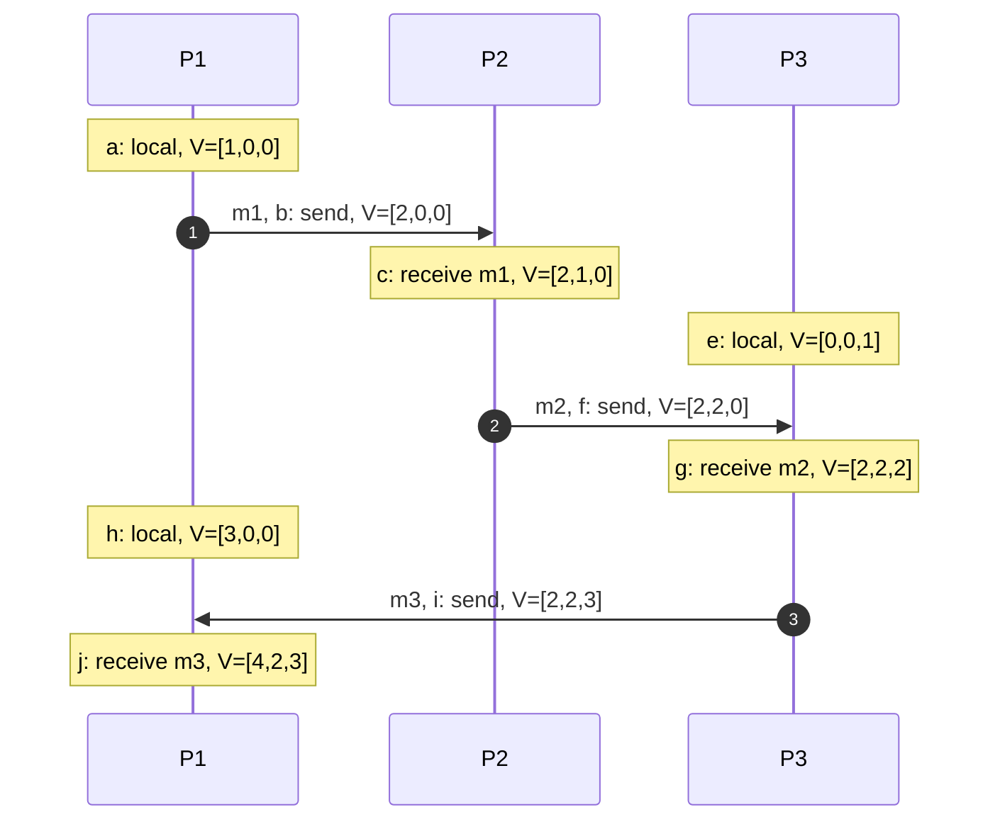
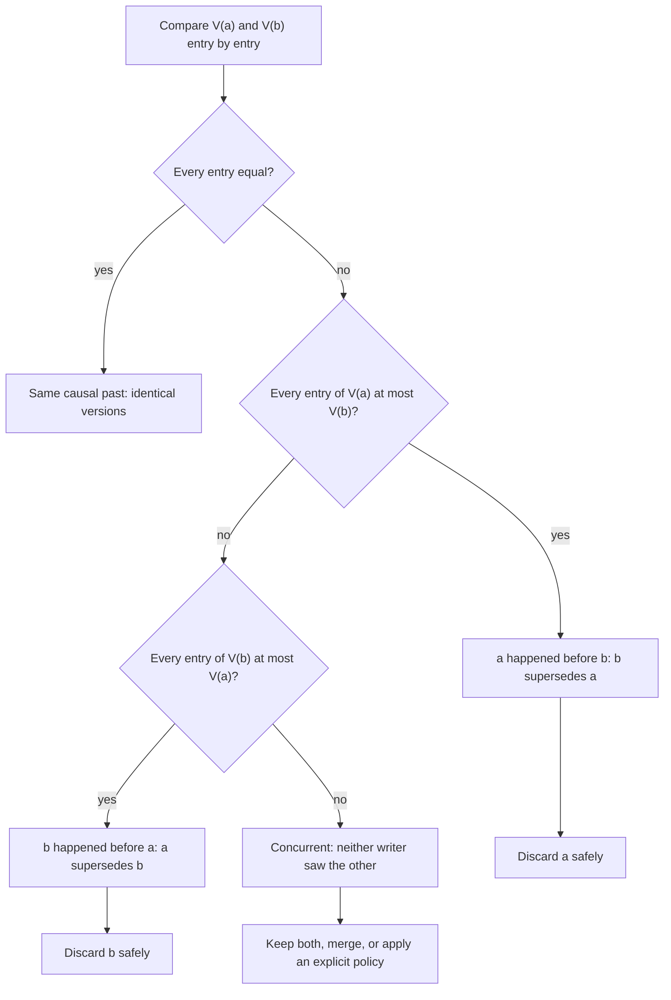
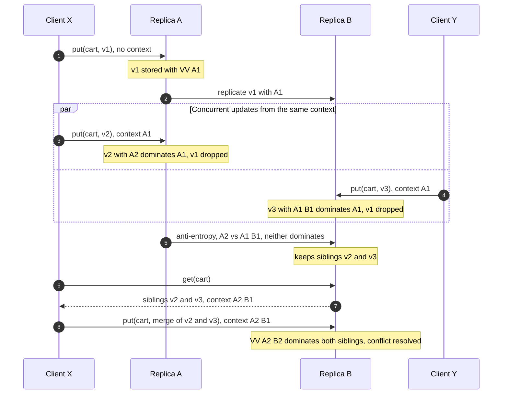
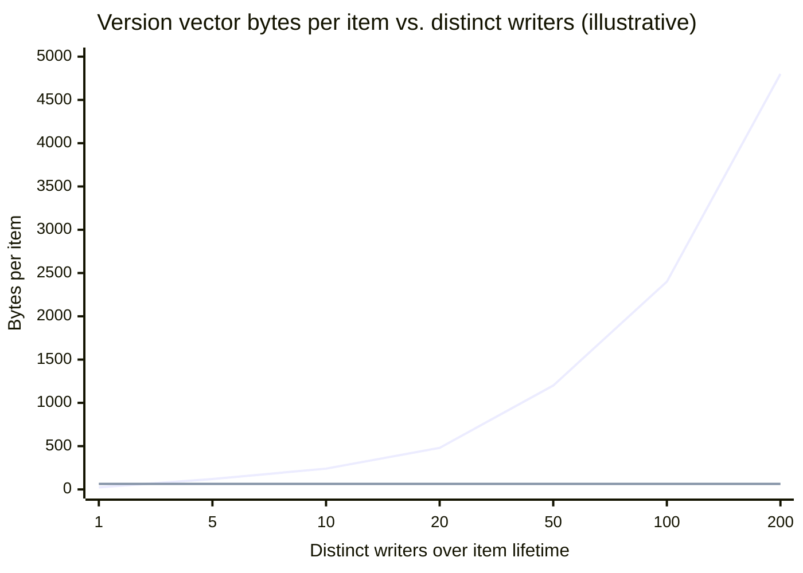

Vektör saat, her olaya eklenen ve process başına bir girdi içeren bir sayaç dizisidir. Her process, damgaladığı her olayda kendi girdisini artırır; her alımda ise artırmadan önce kendi vektörüyle mesajın taşıdığı vektörün eleman eleman maksimumunu alır. Sonuç, tek bir tamsayının sahip olamayacağı bir özelliktir: herhangi iki olay için vektörlerini eleman eleman karşılaştırmak, birincinin ikinciden önce mi olduğunu, ikincinin birinciden önce mi olduğunu, yoksa hiçbirinin mi geçerli olduğunu söyler; son durumda olaylar eşzamanlıdır (concurrent). Vektör, [happened-before ilişkisine](/distributed-systems/tr/foundations/time-and-ordering/happened-before/) yaklaşmaz; onu birebir temsil eder.

Çözdüğü problem çakışma tespitidir. Bir [Lamport zaman damgası](/distributed-systems/tr/foundations/time-and-ordering/lamport-timestamps/) hiçbir nedensel çifti tersine çevirmez, ama eşzamanlı olayları da sıralar. Bu yüzden yazmaları Lamport ya da duvar saati zaman damgasıyla çözen replike bir veri deposu, "bu yazma ötekini geçersiz kıldı" ile "bu iki yazar birbirini hiç görmedi" durumlarını ayırt edemez. İlk durum güvenle tek sürüme indirgenebilir; ikincisi saklanması, birleştirilmesi ya da bilinçli olarak atılması gereken bir çakışmadır. Bu ikisini ayıramayan bir depo ya eşzamanlı yazmaları sessizce kaybeder ya da her sürümü sonsuza kadar tutar. Vektör saatler ve onların veriye yönelik biçimi olan version vector'lar, çok liderli ve lidersiz depoların, nedensel broadcast protokollerinin ve dinamik race dedektörlerinin bu ayrımı yapma yoludur.

Asıl denge, kesinlik ile metadata boyutu arasındadır. Eşzamanlılığı tam olarak tespit etmek, bağımsız olarak olay üretebilen her actor için bir girdiye mal olur. Charron-Bost'un happened-before sayfasında ele alınan 1991 tarihli alt sınırı, eleman eleman karşılaştırılabilen hiçbir zaman damgasının bunu `n` process için `n`'den az girdiyle yapamayacağını gösterir. Bu nedenle sistemler tasarım emeklerini kimin actor sayılacağını seçmeye (process'ler, sunucular, istemciler), bu kümeyi sınırlı tutmaya ve yine de büyüdüğünde ne yapılacağına harcar. Aşağıda anlatılan, vektör saatlerin production'daki her hatası bu seçimlerden birinin sonucudur.

## Vektör, Kuralları ve Karşılaştırma

`n` process'ten oluşan bir sistemde her `Pi` process'i, başlangıçta tamamı sıfır olan `n` tamsayılık bir `Vi` vektörü tutar. Fidge ve Mattern mekanizmayı 1988'de birbirinden bağımsız olarak yayımladı; kurallar Lamport'unkilerin doğrudan bir genellemesidir. Bir yerel olaydan ya da gönderimden önce `Pi`, `Vi[i]`'yi artırır ve olayı `Vi`'nin bir kopyasıyla damgalar. Mesaj, gönderenin `Vm` vektörünü taşır. Alımda `Pi`, her `Vi[k]` girdisini `max(Vi[k], Vm[k])` yapar, ardından `Vi[i]`'yi artırır ve alım olayı ortaya çıkan değeri alır.

Vektörü kesin kılan, her girdinin anlamıdır. Bu kurallar işledikten sonra `V(e)[j]`, `e`'nin nedensel geçmişinde yer alan `Pj` olaylarının sayısıdır; `e` zaten `Pj` üzerindeyse `e`'nin kendisi de sayılır. Kendi girdisini artırmak yerel olayları sayar; alımdaki eleman eleman maksimum ise gönderenin diğer tüm process'ler hakkında bildiği her şeyi içeri aktarır. Dolayısıyla bir vektör saat, bir olayın tüm nedensel geçmişinin sıkıştırılmış bir tarifidir: her process'in geçmişi bir dizi olduğundan, "`Pj`'nin ilk `k` olayı" tek bir `k` sayısıyla eksiksiz tarif edilir.


*Vektör saat kurallarını işleten üç process. Her gönderim gönderenin kendi girdisini artırır; her alım taşınan vektörle eleman eleman maksimumu alır, ardından alıcının kendi girdisini artırır.*

`m2`'nin alımı, P3'ün P1 ile hiç mesajlaşmadan P1'i öğrendiği yerdir: `m2`, `[2,2,0]` taşır ve P3'ün vektörü `[0,0,1]`'den `[2,2,2]`'ye sıçrar; bu, P1'in iki olayının ve P2'nin iki olayının artık P3'ün nedensel geçmişinde olduğunu kaydeder. P1 üzerindeki `h` olayının vektörü `[3,0,0]`'dır: kendi üç olayını bilir, başka hiçbir şeyi bilmez, çünkü P1 `m1`'den beri hiçbir yanıt almamıştır. Bunu `g = [2,2,2]` ile karşılaştırın. `h`'nin ilk girdisi daha büyük, ikinci ve üçüncü girdileri daha küçüktür; dolayısıyla iki vektörden hiçbiri diğerinin altında değildir ve olaylar eşzamanlıdır. Aynı yürütmede bir Lamport saati `h` ile `g`'ye iki farklı tamsayı ve bir sıra verirdi; vektör bunu reddeder.

### Bir Karşılaştırmanın Dört Olası Sonucu

İki vektör eleman eleman karşılaştırılır. `V(a) <= V(b)`, `V(a)`'nın her girdisinin `V(b)`'deki karşılığından büyük olmadığı anlamına gelir; `V(a) < V(b)` ise `V(a) <= V(b)` olması ve en az bir girdinin kesin olarak küçük olması demektir. Herhangi bir çift için dört sonuçtan tam olarak biri geçerlidir: vektörler eşittir, ki olay damgaları için bu aynı olay demektir; `V(a) < V(b)`, yani `a -> b`; `V(b) < V(a)`, yani `b -> a`; ya da hiçbiri diğerini domine etmez, yani `a || b`. Hiçbir skaler kodlamanın üretemeyeceği sonuç bu sonuncusudur.


*Tek bir veri öğesinin iki sürümü için bir karar prosedürü olarak karşılaştırma. Yalnızca eşzamanlı dal bir politika kararı gerektirir; diğer üçü mekaniktir.*

Replike veri için bu diyagram, çakışma yönetimi sözleşmesinin tamamıdır. İki domine etme dalı, vektör tabanlı replikasyonu otomatikleştirmeyi güvenli kılan şeydir: eski bir sürüm hiçbir şey kaybetmeden atılabilir, çünkü yenisini onu görmüş biri yazmıştır. Eşzamanlı dal ise uygulamanın, bir [CRDT](/distributed-systems/tr/data-management/consistency-models/crdts/) birleştirme fonksiyonunun ya da bilinçli bir last-writer-wins kuralının devreye girdiği yerdir. Vektör saatler çakışmaları çözmez; çözülecek tek çakışmaların gerçek çakışmalar olmasını garanti eder.

Olayların kimlikleri biliniyorsa daha ucuz bir test vardır. `a`, `Pi` üzerinde gerçekleştiyse, `a -> b` ancak ve ancak `V(a)[i] <= V(b)[i]` ve `a`, `b`'den farklıysa geçerlidir: `b`'nin nedensel geçmişi `Pi`'nin ilk `V(b)[i]` olayını içerir ve `a` bunların `V(a)[i]`'inci olayıdır. Nedensel broadcast ve race dedektörleri, önemli olan tek girdiyle sabit zamanda karşılaştırma yapmak için bundan yararlanır.

### Karşılaştırma Neden Kesindir

Garanti, güçlü saat koşuludur (strong clock condition): `a -> b` ancak ve ancak `V(a) < V(b)`. İki yön de girdilerin anlamından çıkar.

İleri yön: happened-before'un her doğrudan bağlantısı domine etmeyi korur. Program sırası boyunca process'in kendi girdisi artar ve hiçbir girdi azalmaz. Bir mesaj boyunca alıcı eleman eleman maksimumu alır; böylece vektörü her girdide en az gönderenin vektörü kadardır. Ardından kendi girdisini artırır ve gönderen henüz bu alımı görmemiş olduğundan gönderenin vektöründe bu girdi kesin olarak daha küçüktür. Her bağlantı her yerde `<=`, bir yerde `<` verir; nedensel bir zincir de bağlantılardan oluşan bir dizi olduğuna göre `V(a) < V(b)` elde edilir.

Ters yön: `a`, `Pi` üzerinde ve `b`'den farklıyken `V(a) <= V(b)` olduğunu varsayalım. O zaman `V(b)[i] >= V(a)[i]`'dir; yani `b`'nin nedensel geçmişi `Pi`'nin en az ilk `V(a)[i]` olayını içerir ve `a` bunlardan biridir. Ya `a`, `b`'nin nedensel geçmişindedir, ki bu `a -> b` demektir, ya da `a` zaten `b`'dir. Bir Lamport saatinde başarısız olan adım tam olarak bu ters yöndür: tek bir tamsayı hangi process'in olaylarını saydığını söylemez, dolayısıyla daha büyük bir değer `b`'nin geçmişi hakkında hiçbir şey kanıtlamaz.

Lamport ispatında olduğu gibi bu ispat da gerçek zamana ya da mesaj gecikmesine dair hiçbir şey kullanmaz; bu yüzden tamamen [asenkron model](/distributed-systems/tr/foundations/system-models/network-models/) altında da geçerlidir. Ancak implementasyonların bozabileceği iki şeye dayanır: girdiler çökmeler dahil hiçbir zaman azalmaz ve her actor'ün kimliği benzersizdir. Bu sayfanın ilerisindeki her hata biçimi bunlardan birini ihlal eder.

## Version Vector'lar: Olaylardan Replike Veriye

Bir vektör saat, her mesaj alımı dahil her olayı damgalar. Replike bir depo olayların çoğuyla ilgilenmez; veri öğelerinin sürümleriyle ve bir sürümün diğerini geçersiz kılıp kılmadığıyla ilgilenir. Parker ve arkadaşları version vector'ları 1983'te, Fidge-Mattern saatlerinden beş yıl önce, tam olarak bunun için tanıttı: bölünmüş (partitioned) bir sistemde bir dosyanın kopyaları arasındaki karşılıklı tutarsızlığı tespit etmek. Mekanizma, farklı artırma kurallarıyla aynı kafestir (lattice). Bir version vector bir process'e değil, bir veri öğesine eklenir. Öğeye yönelik bir güncellemeyi koordine etmiş her replika için bir girdi içerir. Bir yazmayı kabul eden replika kendi girdisini artırır; senkronize olan replikalar eleman eleman maksimumu alır; okumalar ve mesaj alışverişleri hiçbir şeyi değiştirmez.

Version vector olayları değil güncellemeleri saydığından, iki sürüm yukarıdaki karar prosedürünün anlattığı gibi karşılaştırılır ve replikalar arası anti-entropy mekanik hâle gelir: domine edilen sürümler atılır, eşzamanlı olanlar sibling (kardeş sürüm) olarak tutulur. Protokolün diğer yarısını okuma yolu taşır. Okuma yapan istemci tüm güncel sibling'leri ve bunların version vector'larının birleşimi olan bir nedensel bağlamı (causal context) alır, sonraki yazmasında da bu bağlamı geri gönderir. Bağlam, deponun istemcinin hangi sürümleri gördüğünü, dolayısıyla yazmanın hangilerini geçersiz kıldığını öğrenme yoludur.


*Lidersiz bir depoda version vector'lar. İki istemci aynı bağlamdan farklı replikalar üzerinden yazar; depo eşzamanlılığı tespit eder, iki sürümü de tutar ve ancak bağlamı ikisini de kapsayan bir yazma geldiğinde onları tek sürüme indirger.*

3. ve 4. adımlar eşzamanlıdır: iki yazma da aynı `A1` bağlamına dayanır ve hiçbir replika diğerinin yazmasından haberdar değildir. 5. adımdaki anti-entropy alışverişi `A2` ile `A1 B1`'i karşılaştırır ve her birinin diğerinde olmayan bir girdiye sahip olduğunu görür; bu yüzden hiçbir sürüm atılmaz. Önemli kısım 8. adımdaki çözümdür: Client X'in birleştirilmiş yazması iki sibling'i de kapsayan `A2 B1` bağlamını taşır; bu nedenle yeni `A2 B2` sürümü ikisini de domine eder ve replikasyon onu yaydıkça sibling'ler her yerden kaldırılır. Client X bağlam olmadan, yani kör bir yazma (blind write) ile yazsaydı, depo bu yazmayı her şeyle eşzamanlı saymak ve üçüncü bir sibling eklemek zorunda kalırdı. Her okuma ve yazmayı hangi replikaların alacağını belirleyen quorum mekaniği [Lidersiz Replikasyon](/distributed-systems/tr/data-management/replication/leaderless-replication/) sayfasında, Dynamo'nun bu şemayı alışveriş sepeti için nasıl kullandığı ve production'da neler olduğu ise [Dynamo Makalesinde Vektör Saatler](/distributed-systems/tr/case-studies/dynamodb-cassandra/vector-clocks-conflict-resolution/) sayfasında ele alınır.

### Actor'leri Seçmek

Bir version vector'ün girdileri actor'lere aittir ve actor seçimi hem metadata boyutunu hem de kesinliği belirler. İstemciler actor ise her istemci kendi girdisini artırır; böylece vektör her istemcinin hangi yazmaları gördüğünü kesin olarak kaydeder, ama boyutu öğeye şimdiye kadar yazmış farklı istemci sayısıyla büyür ve web'e açık bir depoda bu sayı sınırsızdır. Replika sunucuları actor ise vektörde replika başına en fazla bir girdi, tipik olarak üç girdi bulunur; ancak bu kez bir sunucu birçok istemci adına yazma koordine eder ve gelen her yazma için yazmanın mevcut sibling'lerden hangilerini geçersiz kıldığına karar vermek zorundadır. Öğe başına tek bir vektör varken, birden fazla sibling sunucunun girdisini paylaştığı anda sunucu, istemcinin bağlamının hangi sibling'e işaret ettiğini ayırt edemez.

Riak'ın mühendislik yazısı, actor'lerin vnode'lar olduğu durumdaki sonucu anlatır. Client Y "Bob", Client X eşzamanlı olarak "Sue" yazar; ikisi de tek bir vektör altında sibling olur. Ardından Client Y eski bağlamıyla "Rita" yazar ve bu yazmanın "Bob"un yerini alması gerekir. Vnode, Y'nin bağlamını öğenin tek vektörüyle karşılaştırır, "Bob"u eski girdiyle ilişkilendiremez ve "Rita"yı yeni bir sibling olarak tutar. Eski bir bağlamdan yapılan her sonraki yazma bir sibling daha ekler ve küme sınırsız büyür: aşağıda bir hata biçimi olarak incelenen sibling patlaması (sibling explosion).

### Dotted Version Vector'lar

Preguiça, Baquero, Almeida, Fonte ve Gonçalves'in 2010 civarında tanıttığı dotted version vector'lar, sunucu actor'lerini koruyarak kesinlik problemini çözer. Her sibling, öğenin nedensel bağlamıyla birlikte bir dot ile, yani onu yaratan tek `(replica, counter)` olayıyla saklanır. Bir yazma bir bağlamla geldiğinde sunucu yalnızca dot'ları bağlam tarafından kapsanan sibling'leri atar (bağlamın dot'un replikasına ait girdisi en az dot'un sayacı kadarsa) ve geri kalanları tutar. Riak örneğinde "Bob" `(a, 1)` dot'unu taşır, Y'nin bağlamı bunu kapsar ve "Rita" "Bob"a eklenmek yerine onun yerini alır. Metadata bedeli sibling başına bir dot'tur, yani küçük bir sabittir. Riak, dotted version vector'ları 2.0 ile benimsedi; bu sürümden itibaren bucket type'lar için varsayılan mantıksal saat bunlardır, bucket type dışındaki bucket'lar ise `dvv_enabled` ayarlanmadıkça klasik vektör saatleri kullanmaya devam eder.

Version vector'lar yalnızca öğe sürümlerini değil, replika durumunu da özetler. Diğer her replikanın güncellemelerinin kesintisiz bir önekini uygulamış bir replika, tuttuğu her şeyi tek bir vektörle tarif edebilir; iki replika vektörlerini değiş tokuş ederek her birinin tam olarak hangi güncellemeleri kaçırdığını hesaplar. Birçok operation-based CRDT sistemi ve bazı [anti-entropy](/distributed-systems/tr/data-management/replication/anti-entropy-merkle/) protokolleri, tüm veri kümelerini karşılaştırmadan gönderilecek farkı (delta) bu yolla bulur.

:::tip[Yazmadan önce okuyun ve bağlamı geri gönderin]
Vektör tabanlı bir depo, sibling'leri yalnızca nedensel bağlam taşıyan yazmalar için tek sürüme indirebilir. Önceki bir okumadan gelen bağlamı göndermeden yazan ya da bağlamı ilgisiz operasyonlar arasında cache'leyen istemci kütüphaneleri, her yazmayı yeni bir eşzamanlı sürüme dönüştürür. Bağlamı bir optimistic concurrency token'ı gibi ele alın: okumayla birlikte alın, yazmayla birlikte gönderin, asla uydurmayın ve yeniden kullanmayın.
:::

## Vektör Zaman Damgalarıyla Nedensel Teslim

Vektörlerin ikinci büyük kullanımı, grup iletişiminde nedensel teslimi (causal delivery) zorunlu kılmaktır; bu, happened-before sayfasındaki, bir mesajın ancak nedensel geçmişindeki her mesajdan sonra teslim edilmesi kuralıdır. Standart vektör tabanlı protokolü 1991'de Birman, Schiper ve Stephenson verdi. Sabit bir grup içindeki broadcast için her process, kendisi dahil her gönderenden teslim ettiği broadcast'leri sayan bir `Vi` vektörü tutar; gönderen kendi girdisini artırır ve vektörü mesaja ekler. Alıcı, iki koşul sağlanana kadar mesajı bekletir.

```text
on broadcast by Pi:
    Vi[i] <- Vi[i] + 1
    send (m, Vi) to every other process

on receive (m, Vm) from Pj at Pi:
    wait until Vm[j] = Vi[j] + 1          # next message from Pj, none skipped
           and Vm[k] <= Vi[k] for k != j  # sender's dependencies already delivered
    deliver m
    Vi[j] <- Vm[j]
    re-check the hold-back queue
```

Birinci koşul gönderen başına ilk giren ilk çıkar (FIFO) sırasını, ikincisi ise gönderenin göndermeden önce diğer process'lerden teslim ettiği her şeyin burada da teslim edilmiş olmasını zorunlu kılar. İkisi birlikte, teslim anında uygulanan sabit zamanlı dot testidir. Protokol ne onay (acknowledgment) ne de ek mesaj gerektirir; yalnızca her mesajdaki vektörü ister. Bu yüzden küçük gruplar için caziptir: replike bellek içi durum, ortak çalışma oturumları ya da bir cluster üyelik kanalı. Sınırları şunlardır: grubun bilinmesi ve sabit olması gerekir (üyelik değişiklikleri bir view-change protokolü ister), kaybolan bir mesaj yeniden iletilene kadar onu nedensel olarak izleyen her mesajı bloklar ve bu blokaj süresince hold-back kuyruğu büyür. İstemciler için bir tutarlılık garantisi olarak nedensel teslim ve mesaj başına vektörden kaçınan oturum düzeyindeki alternatifler [Nedensel Tutarlılık ve Oturum Garantileri](/distributed-systems/tr/data-management/consistency-models/causal-consistency-session-guarantees/) sayfasında ele alınır.

### Sayısal Örnek: Metadata'nın Bedeli

Bu örnekteki tüm sayılar örnek amaçlıdır.

Önce nedensel broadcast. 8 baytlık girdilerle 40 process'lik bir grup, ortalama 200 baytlık payload ve grup genelinde saniyede 50.000 mesaj varsayalım. Vektör her mesaja `40 * 8 = 320` bayt ekler; bu, payload'un %160'ı ve `320 * 50,000 = 16 MB/s` metadata demektir. Singhal ve Kshemkalyani'nin 1992 tarihli diferansiyel tekniği, her hedefe yalnızca o hedefe gönderilen son mesajdan bu yana değişen girdileri `(index, value)` çiftleri olarak gönderir. Bir process gönderimler arasında tipik olarak üç başka process'ten değişiklik öğreniyorsa, her mesaj `3 * (4 + 8) = 36` bayt taşır ve ek yük yaklaşık 1.8 MB/s'ye iner. Teknik FIFO kanallar ve hedef başına durum gerektirir; kesinlikten ise hiçbir şey kaybettirmez.

Sonra depolama. Üç replika üzerinde 200 milyon öğe varsayalım. İstemciler actor ise bir girdi, 16 baytlık bir istemci kimliği artı 8 baytlık bir sayaçtır, yani 24 bayt. Bir öğeye ömrü boyunca ortalama 30 farklı istemci yazıyorsa version vector'ü 720 bayt tutar ve depo kopya başına `200,000,000 * 720 = 144 GB`, üç replikada toplam 432 GB vektör taşır; bunun büyük kısmı bir daha asla yazmayacak istemcilere aittir. Replika actor'leri ve dotted version vector'larla, üç adet 16 baytlık girdi artı sibling başına 16 baytlık bir dot, tek sibling'li bir öğe için 64 bayt eder: kopya başına 12.8 GB. Oran sabit değildir; önemli olan nokta değil, eğridir.


*Üst çizgi: actor olarak istemciler, yazar başına 24 bayt. Düz çizgi: üç replika actor'ü artı bir dot, istemci sayısından bağımsız olarak 64 bayt. Girdi boyutları örnek amaçlıdır.*

İstemci actor'lü çizgi düz çizgiyi yaklaşık üç yazarda keser ve doğrusal olarak tırmanmaya devam eder; dolayısıyla paylaşılan bir doküman, bir sayaç ya da bir konfigürasyon anahtarı gibi popüler bir öğe en çok bedeli öder. Düz çizgi de kendi içinde daha yavaş bir büyümeyi gizler: replikalar değiştirildikçe yeni replika kimlikleri actor kümesine katılır ve eskiler kendiliğinden ayrılmaz; bu yüzden on node değişimi yaşamış bir öğe, emekli actor'ler sıkıştırılmadıkça (compaction) on üç sunucu girdisi taşır. Her karşılaştırma da girdi sayısıyla doğrusaldır ve bir okuma koordinatörü her okumada replika yanıtlarını karşılaştırır.

## Production Dengeleri ve Konfigürasyon

Nedensellik takipçileri ailesi vektör saatlerden daha geniştir ve her üyesi yerden tasarruf etmek için ilişkinin farklı bir kısmını gözden çıkarır.

| Takipçi | Eşzamanlılığı tespit eder mi | Boyut | Actor değişimi | Ne zaman tercih edilmeli |
|---|---|---|---|---|
| Lamport zaman damgası | Hayır | Tek tamsayı | Önemsiz | Deterministik bir tam sıralama yeterli; çakışmaların tespit edilmesi gerekmiyor |
| Vektör saat, process başına bir girdi | Evet, olaylar için | Process başına bir girdi | Sabit ya da yönetilen üyelik gerekir | Küçük, sabit gruplarda nedensel broadcast; debugging ve race tespiti |
| Version vector, istemci actor'leri | Evet, sürümler için | Farklı yazar sayısıyla büyür | Sınırsız büyüme | Öğe başına az sayıda, uzun ömürlü yazar; örneğin cihaz senkronizasyonu |
| Version vector, sunucu actor'leri | Kısmen: eşzamanlılık altında sahte sibling'ler | Replika başına bir girdi | Node değişimleriyle büyür | İstemcilerin nadiren eşzamanlı yazdığı, yazmadan önce okuma disiplini olan depolar |
| Dotted version vector | Evet, sürümler için | Replika başına bir girdi artı sibling başına bir dot | Node değişimleriyle büyür | Sibling tutan lidersiz ya da çok liderli depolar |
| Interval tree clock | Evet | Canlı actor'lere uyum sağlar | Global kimlik olmadan fork ve join | Kimlik servisi olmayan, çok dinamik actor kümeleri |
| Hibrit mantıksal saat | Hayır | Bir tamsayı artı bir sayaç | Önemsiz | Duvar saatine de yaklaşması gereken nedensel zaman damgaları |

Interval tree clock'lar (Almeida, Baquero ve Fonte, 2008) actor kimliği problemine doğrudan saldırır: actor'ler paylaşılan bir kimlik uzayını böler ("fork") ve yeniden birleştirir ("join"); böylece yeni bir replikanın bir kayıt servisine ihtiyacı olmaz, emekli olan da payını geri verir. Çoğunlukla araştırma sistemlerinde ve bağımsız kütüphanelerde yaşarlar. [Hibrit mantıksal saatler](/distributed-systems/tr/foundations/time-and-ordering/hybrid-logical-clocks/) tabloda karşıtlık olarak yer alır: sistemlerin eşzamanlılığı tespit etmeye ihtiyaç duymadıklarına karar verdiklerinde seçtikleri şey odur.

### Doğruluğu Belirleyen Parametreler

Actor kimliği. Kimlikler, onları taşıyan herhangi bir verinin ömrü boyunca benzersiz olmalıdır ve bir kimlik, o kimliğin tüm geçmişini tutmayan bir process tarafından asla yeniden kullanılmamalıdır. Diskini kaybedip sayacı sıfırlanmış olarak eski kimliğiyle yeniden katılan bir replika, aşağıdaki danger notunun açıkladığı gibi, vektör tabanlı bir sistemin ulaşabileceği en tehlikeli konfigürasyondur. Her enkarnasyon için rastgele üretilen kimlikler, veri kaybıyla sonuçlanan her yeniden başlatmada yeni bir actor pahasına bu problemi önler.

Sayacın kalıcılığı. Bir actor'ün kendi girdisi asla azalmamalıdır. Bir replika için bu girdi, her öğenin öğeyle birlikte kalıcı olan version vector'ü içinde yaşar; risk, eski bir sayacı canlı bir kimlik altında geri getirebilen snapshot'larda, yedekten geri yüklemelerde ve kopyalamaya dayalı provisioning'dedir.

Pruning (budama). Girdileri atarak vektör boyutunu sınırlamak, kesinliği yerle takas etmektir. Dynamo makalesi bir kırpma tarif eder: `(node, counter)` çiftlerinin sayısı, makalenin yaklaşık on olarak verdiği bir eşiğe ulaştığında, saklanan zaman damgasına göre en eski çift kaldırılır. Riak aynı amaçla dört bucket özelliği sunar: `small_vclock`, `big_vclock`, `young_vclock` ve `old_vclock`; bunlar budamayı girdi sayısı ve girdi yaşına göre sınırlar. Dokümantasyonu iki sayı eşiği için varsayılanı 50, `old_vclock` için bir gün olarak verir. Budama ancak atılan bir girdiye bir karşılaştırmayı karara bağlamak için hiçbir zaman ihtiyaç duyulmayacaksa güvenlidir ve hiçbir depo bunu bilemez.

Emekli actor'lerin sıkıştırılması. Bir girdi, her replikadaki her sürümde eşit hâle gelip artık hiçbir şeyi ayırt etmediğinde kayıpsız olarak kaldırılabilir; bunu tespit etmek global bir uzlaşma adımı gerektirir, bu yüzden çoğu sistem bunun yerine sezgisel (heuristic) budama yapar.

:::caution[Budama bir çakışmayı sessiz bir üzerine yazmaya çevirebilir]
Bir vektörden girdi atmak yalnızca sahte çakışmalar yaratmaz. `a = [A:1, B:1]` ve `b = [A:1, C:1]` gibi iki eşzamanlı sürüm alın. Budama `a`'dan `B:1`'i kaldırırsa `a`, `b`'nin domine ettiği `[A:1]` hâline gelir ve depo `a`'yı daha eski bir sürüm olarak atar. `a`'da kayıtlı yazma onaylanmıştı ve artık yok; hiçbir çakışma raporlanmaz. Yalnızca olası her eşzamanlı yazmadan daha eski girdileri budayın ve actor kümesini budamak yerine sınırlamayı tercih edin.
:::

## Hata Biçimleri ve Dışarıdan Görünüşleri

Aşağıdaki her hata ya ispatın iki varsayımından birini, yani monoton girdileri ve benzersiz actor'leri bozar ya da mekanizmanın ihtiyaç duyduğu alan bütçesini tüketir.

### Sibling Patlaması

Tetikleyici: dot'suz, sunucu actor'lü version vector'lar ile eski bağlamlardan ya da hiç bağlam olmadan yazan istemcilerin bir araya gelmesi. Belirtiler: tekil öğeler tek sürümden düzinelerce, hatta yüzlerce sibling'e büyür; sıcak anahtarlarda okuma gecikmesi ve nesne boyutu tırmanır; uç durumlarda node'lar tek bir nesneyi okurken belleği tüketir.

```mermaid
sequenceDiagram
    autonumber
    participant CX as Client X
    participant V as "Replica a (server actor)"
    participant CY as Client Y
    CY->>V: put Bob, no context
    Note over V: Bob, VV a1
    CX->>V: put Sue, no context
    Note over V: siblings Bob, Sue, VV a2
    CY->>V: put Rita, context a1 from first write
    rect rgb(70, 40, 40)
    Note over V: a1 does not cover a2, Rita kept as new sibling
    Note over V: Bob not removed, siblings Bob, Sue, Rita, VV a3
    end
    CX->>V: get
    V-->>CX: Bob, Sue, Rita, context a3
    CX->>V: put Ann, context a3
    Note over V: a3 covers the whole vector, all replaced by Ann
```


*Öğe başına tek version vector ve actor olarak sunucu ile sibling patlaması. 3. adımın Bob'un yerini alması gerekir, ancak sunucu Bob ile a1 sürümü arasındaki ilişkiyi kaybetmiştir.*

Kesinliğin kaybolduğu yer 3. adımdır. Client Y'nin `a1` bağlamı tam olarak gördüğü sürümü, yani Bob'u tarif eder; ancak öğenin tek vektörü artık `a2`'dir ve sunucunun hangi sibling'in `a1`'e karşılık geldiğine dair bir kaydı yoktur. Temkinli davranıp her şeyi tutmak zorundadır; böylece Rita üçüncü sibling olur ve Bob hayatta kalır. Bu şekilde iç içe yazan iki yazar neredeyse her yazmada bir sibling ekler. 4-6. adımlar durumun neden aralıklı ortaya çıktığını gösterir: önce okuyup tüm vektörü kapsayan bir bağlamla geri yazan bir istemci her şeyi tek seferde temizler; bu yüzden sibling sayısı trafik desenleriyle birlikte iner çıkar ve hatayı yeniden üretmek zorlaşır. Tespit: okuma başına sibling sayısı ve okuma başına nesne boyutu histogramları, ortalamaya değil yüksek persentillere kurulan alarmlar; anahtar bazında, az sayıdan fazla sibling döndüren okumaların logları. Hafifletme: dotted version vector'lar; her zaman yazmadan önce okuyan ve bağlamı geri gönderen istemci kütüphaneleri; sıcak anahtarlarda anahtar başına rate limit. Kurtarma: etkilenen nesneleri okuyun, sibling'leri uygulamada çözün ve tam bağlamla geri yazın; bu, hepsini tek adımda tek sürüme indirir.

### Veri Kaybı Sonrası Actor Yeniden Kullanımı

Tetikleyici: bir replika durumunu kaybeder (disk arızası, eski bir snapshot'tan yeniden kurulum, bir şablondan yeniden provisioning) ve sayacı sıfırda ya da eski bir değerde olacak şekilde önceki actor kimliğiyle yeniden katılır. Ardından yazma kabul eder ve bunları diğer replikaların zaten görmüş olduğu girdilerle damgalar. Belirtiler: o replika üzerinden yeni onaylanmış yazmalar, anti-entropy ya da read repair sonrasında hiçbir çakışma raporlanmadan kaybolur, çünkü eşler bunların zaten tuttukları sürümler tarafından domine edildiğine hükmeder.

:::danger[Yeniden kullanılan bir actor kimliği yeni yazmaları eski gösterir]
Eşlerin bir öğeyi `[A:3, C:5]` olarak tuttuğunu ve C replikasının boş olarak C kimliğiyle yeniden katıldığını varsayalım. Kabul ettiği bir yazma `[C:1]` ile damgalanır. Her eş `[C:1] <= [A:3, C:5]` olduğunu görür, yazmanın zaten geçersiz kılınmış eski bir sürüm olduğu sonucuna varır ve senkronizasyon sırasında onu atar. Yazma, istemcisine onaylanmıştı. Bir replikanın, o kimlikle damgalanmış tüm veriyi kurtarmadıkça eski kimliğiyle yeniden katılmasına asla izin vermeyin; yeniden kurulan bir replikaya bunun yerine yeni bir kimlik verin.
:::

Tespit: yeni yazılmış bir sürümdeki kendi girdisi, eşlerin tuttuğu sürümlerdeki girdisinden düşük olan bir replika, yeniden kullanımın kanıtıdır; anti-entropy sırasında bunu kontrol edin ve alarm üretin. Hafifletme: enkarnasyon tabanlı kimlikler (her veri dizini için yeni bir rastgele kimlik), replika eşleriyle senkronize olana kadar yazmaları reddeden bir açılış kontrolü ve "node'u değiştir" ile "node'u yeniden kat" işlemlerini farklı prosedürler olarak ele alan operasyon runbook'ları. Kurtarma zordur: atılan yazmalar yalnızca istemci loglarında ya da hinted-handoff buffer'larında hayatta kalmış olabilir.

### Budamanın Yol Açtığı Kayıp ve Sahte Çakışmalar

Tetikleyici: vektör boyutu budama eşiğini aşar; tipik olarak çok sayıda koordinatör üzerinden yazılan öğelerde, örneğin koordinasyonu alışılmadık node'lara taşıyan bir arıza sırasında ya da istemci actor'leriyle. Belirtiler iki türlüdür. Yeni sürümden bir girdi atmak onun domine etmesini bozar; geçersiz kılması gereken bir sürüm eşzamanlı hâle gelir ve nedensel olarak sıralı yazmalar için sibling'ler belirir. İki eşzamanlı sürümden birinden girdi atmak ise, caution notundaki gibi, diğerini onu domine ediyormuş gibi gösterebilir ve onaylanmış bir yazma sessizce atılır. Tespit: bucket ya da tablo başına budama olaylarını sayın; vektör uzunluklarının dağılımını izleyin ve eşikten çok önce alarm üretin. Hafifletme: budamanın normal işleyişte hiç tetiklenmemesi için actor kümesini sınırlayın (sunucu actor'leri, emekli actor'lerin sıkıştırılması) ve budama eşiklerini ortalamaya göre değil, bir failover sonrasında beklenen en büyük vektörün üzerinde ayarlayın.

### Actor Değişiminden Kaynaklanan Metadata Büyümesi

Tetikleyici: yüksek istemci değişimiyle birlikte istemci actor'leri ya da yıllar süren node değişimleri boyunca sıkıştırma yapılmayan sunucu actor'leri. Belirtiler: payload boyutunda hiçbir değişiklik olmadan nesne boyutu ve okuma gecikmesi aylar içinde yavaşça büyür; öğe başına depolama maliyeti artar; okuma yolundaki CPU profillerine serileştirme hâkim olur. Tespit: zaman içinde öğe başına ortalama ve kuyruk vektör uzunluğu ile metadata'ya harcanan bayt payı. Hafifletme: istemci actor'lerinden dot'lu sunucu actor'lerine geçmek, emekli actor'leri bakım pencerelerinde sıkıştırmak ya da eşzamanlılık tespitine gerçekten ihtiyaç yoksa takibi bırakıp anahtar başına tek bir sıralayıcı (sequencer) kullanmak.

### Tespit Edilip Sonra Atılan Eşzamanlılık

Tetikleyici: bir sistem eşzamanlılığı doğru tespit eder, ardından her çakışmayı duvar saati zaman damgasıyla last-writer-wins kuralına göre çözer; çoğu zaman uygulama sibling çözümünü hiç implemente etmediği için. Belirtiler [Nihai Tutarlılık ve LWW](/distributed-systems/tr/data-management/consistency-models/eventual-consistency/) sayfasındakilerle aynıdır: onaylanmış eşzamanlı yazmalar kaybolur. Sistem vektörlerin bedelini öder ve zaman damgalarının garantilerini alır. Tespit: yedek kuralla (fallback) çözülen çakışmaları sayın. Hafifletme: bir birleştirme fonksiyonu yazın, bir CRDT benimseyin ya da politikayı açıkça kabul edip vektörleri bırakın.

| Hata | Dışarıdan belirti | Tespit sinyali | Hafifletme |
|---|---|---|---|
| Sibling patlaması | Sıcak anahtarlar devleşir, okuma gecikmesi ve bellek sıçrar | Okuma başına sibling, nesne boyutu persentilleri | Dotted version vector'lar, yazmadan önce okuma, anahtar başına rate limit |
| Veri kaybı sonrası actor yeniden kullanımı | Bir replika üzerinden onaylanan yazmalar kaybolur | Yeni sürümlerdeki kendi girdisi eşlerin tuttuğundan düşük | Enkarnasyon başına yeni kimlik, yazma kabul etmeden önce senkronizasyon |
| Budama | Sahte sibling'ler ya da sessizce kaybolan eşzamanlı yazmalar | Budama olayı sayısı, vektör uzunluğu dağılımı | Sınırlı actor kümeleri, failover tepelerinin üzerinde eşikler |
| Actor değişimi | Nesne boyutunda ve okuma CPU'sunda yavaş büyüme | Zaman içinde vektör uzunluğu ve metadata payı | Sunucu actor'leri, emekli actor'lerin sıkıştırılması |
| Tespit edilip atılan | Vektörlere rağmen eşzamanlı yazmalar kaybolur | Yedek kuralla çözülen çakışmalar | Birleştirme fonksiyonları, CRDT'ler ya da daha basit tasarım |

## Vektör Saatler Ne Zaman Doğru Araçtır

Sistem aynı veriye koordinasyon olmadan birden fazla yerden yazma kabul ediyorsa, örneğin [çok liderli](/distributed-systems/tr/data-management/replication/multi-leader-replication/) ve lidersiz replikasyonda ya da sonradan senkronize olan, çevrimdışı çalışabilen istemcilerde, ve eşzamanlı bir yazmanın kaybı kabul edilemiyorsa, yani çakışmaların tespit edilip saklanması ya da birleştirilmesi gerekiyorsa vektör saatleri ya da version vector'ları kullanın. Actor kümesi sınırlı olmalı ya da sınırlı hâle getirilmelidir: istemciler yerine replika sunucuları ve kesinliği korumak için dot'lar. Process başına vektör saatleri küçük, sabit gruplarda nedensel broadcast için ve araçlarda kullanın: FastTrack (Flanagan ve Freund, 2009) gibi dinamik data-race dedektörleri, thread'ler arasındaki happens-before ilişkisini, yaygın durum için skaler epoch'lara indirgenmiş vektör saatlerle izler; log görselleştirme araçları da sıradan loglardaki vektör damgalarından space-time diyagramlarını yeniden kurar.

Kapsamı zaten tek bir sıralayıcı sıralıyorsa kullanmayın: tek liderli bir veritabanı, bir Raft log'u ya da tek bir Kafka partition'ı her yazmaya bir konum verir ve o kapsam içinde eşzamanlılık yoktur. Öğe başına çok sayıda yazarı olan bir depoda istemci actor'lü vektörler kullanmayın; metadata istemci nüfusuyla büyür. Uygulama her çakışmayı zaten last-writer-wins ile çözecekse kullanmayın; bir [Lamport zaman damgası](/distributed-systems/tr/foundations/time-and-ordering/lamport-timestamps/) ya da hibrit mantıksal saat aynı sonucu sekiz baytla verir. Gereksinim birbirleriyle iletişim kurmayan istemciler arasında gerçek zaman sıralamasıysa kullanmayın; bu [linearizability](/distributed-systems/tr/data-management/consistency-models/linearizability/) demektir ve hiçbir nedensel kodlama bunu sağlamaz. Ve eşzamanlılık tespit edilebilir ama çözülemez durumdaysa kullanmayın: hiçbir birleştirme fonksiyonu yoksa ve hiçbir kullanıcıya sorulamıyorsa, çakışmayı tespit etmek veri kaybını yalnızca daha geç ve daha az görünür bir noktaya taşır.

Üç komşu kavram vektör saatlerle sık sık karıştırılır. Version vector'lar farklı bir fikir değil, aynı kafesin veri öğelerine uygulanmış hâlidir ve Dynamo makalesi dahil pek çok yazı onlara vektör saat der. [CRDT'ler](/distributed-systems/tr/data-management/consistency-models/crdts/), birleştirme işlemi eşzamanlılığı zararsız kılan veri türleridir; birçoğu neyin görüldüğünü izlemek için içeride version vector kullanır, ama vektörler eşzamanlılığı tespit eder, veri türü ise çözer. [Nedensel tutarlılık](/distributed-systems/tr/data-management/consistency-models/causal-consistency-session-guarantees/) ise istemcilerin neleri gözlemleyebileceğine dair bir garantidir; vektörler onu implemente etmenin bir yoludur, happened-before sayfasında ele alınan açık bağımlılık takibi (explicit dependency tracking) ise farklı ölçeklenen bir başka yoldur.

## İleri Okuma

- Colin J. Fidge, *Timestamps in Message-Passing Systems That Preserve the Partial Ordering*, Australian Computer Science Conference, 1988.
- Friedemann Mattern, *Virtual Time and Global States of Distributed Systems*, Parallel and Distributed Algorithms (çalıştay bildirileri), North-Holland, 1989.
- D. Stott Parker Jr. ve diğerleri, *Detection of Mutual Inconsistency in Distributed Systems*, IEEE Transactions on Software Engineering, 1983.
- Kenneth Birman, André Schiper ve Pat Stephenson, *Lightweight Causal and Atomic Group Multicast*, ACM Transactions on Computer Systems, 1991.
- Nuno Preguiça, Carlos Baquero, Paulo Sérgio Almeida, Victor Fonte ve Ricardo Gonçalves, *Dotted Version Vectors: Logical Clocks for Optimistic Replication*, arXiv, 2010.
- Paulo Sérgio Almeida, Carlos Baquero ve Victor Fonte, *Interval Tree Clocks: A Logical Clock for Dynamic Systems*, OPODIS, 2008.
